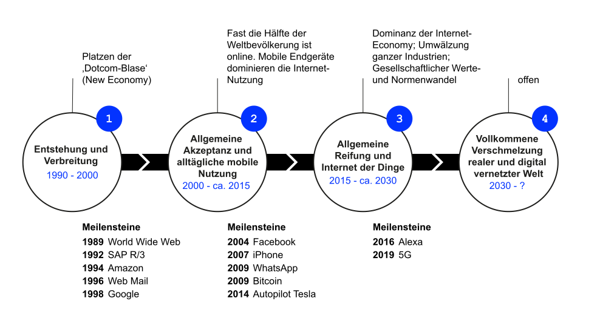
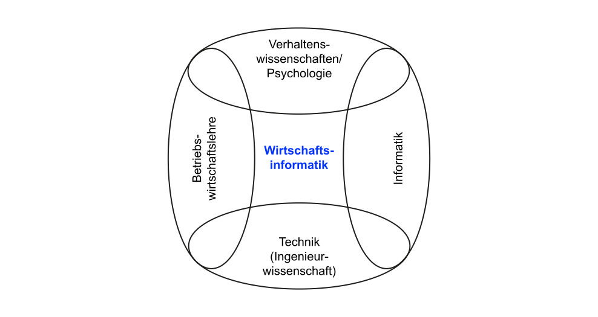

# Motivation {.vertical-center .bg-highlight}

::: {.fragment .fade-up}
> Every business is a software business now.   
*Dean Leffingwell, Creator of SAFe (2019)*
:::

::: {.fragment .fade-up}
> Wer sich nicht digitalisiert, wird ausgeknockt.   
*Wladimir Klitschko, ehemaliger Box-Weltmeister (2017)*
:::

::: {.fragment .fade-up}
> Erfolg der Software entscheidet über unsere Zukunft.   
*Herbert Diess (2017), ehemaliger CEO der VW AG*
:::

:::notes
Es ist einfach, weitere Zitate zu finden, die die Bedeutung von __digitalen Technologien__ für Wirtschaft und Gesellschaft deutlich machen — noch nie waren Informationen und Dienste so allgegenwärtig und die Geschwindigkeit, mit der neue Technologien unseren Alltag sowie Unternehmen, Kunden und Mitarbeiter gleichermaßen verändern, so hoch.

In dieser Vorlesung beschäftigen wir uns mit den Grundlagen des __Informationsmanagement__ im sogenannten __digitalen Zeitalter__. In diesem Kapitel starten wir mit der Klärung einiger wichtiger Grundbegriffe.
:::

# Lernergebnisse 🎯

Nach dieser Einheit können Sie 

::: {.incremental}
- den Begriff __Digitalisierung__ definieren und anhand von Beispielen erläutern,
- zeigen, wie Digitalisierung Arbeit und Wirtschaft bislang verändert hat und in Zukunft verändern wird,
- anhand von Beispielen erläutern, was __Informationen__ sind, wie diese entstehen und welche Rolle diese für die betriebliche Leistungserstellung spielen, 
- erklären, was __Informationsmanagement__ ist und welche Ziele es im Unternehmen verfolgt ist und
- die Disziplin __Wirtschaftsinformatik__ und ihre Aufgaben einordnen.
:::

# Digitalisierung {.vertical-center .bg-highlight}

Die Digitalisierung der Arbeits- und Lebenswelt ist der __Megatrend__ im frühen 21. Jahrhundert.

:::notes
- Die Digitalisierung verändert die Art und Weise, wie wir konsumieren, arbeiten, leben und miteinander kommunizieren. 
- Es gibt bereits heute weder im privaten noch im geschäftlichen Umfeld Aufgaben, die nicht durch eine App unterstützt oder geprägt werden (können). 
- Digitalisierung hat also tiefgreifende Auswirkungen auf die Gesellschaft und Unternehmen, die untersucht, verstanden und gesteuert werden müssen.
- Die Veränderungsprozesse werden als [Digitale Tranformation](../2/index.qmd) bezeichnet.
:::

## Definition

Im technischen Sinn bedeutet Digitalisierung die __Elektronifizierung von Informationen__ (elektronische Erzeugung, Speicherung, Verarbeitung, Anzeige und Nutzung) [@lemke2015einfuhrung].

. . .

allen Teilen der menschlichen Gesellschaft bezeichnet, die __durch die verstärkte Anwendung von digitalen Technologien__ entstehen [@leimeister2021einfuhrung]. In dieser Vorlesung nutzen wir hierfür den Begriff [Digitale Transformation](../2/).

## Digitales Zeitalter

> Ich habe früher dazu einmal „Neuland“ gesagt. Das hat mir einen großen Shitstorm eingebracht. Deshalb will ich das jetzt nicht einfach wiederholen. Jedenfalls ist es aber in gewisser Weise noch nicht durchschrittenes Terrain. […] Das Ganze ist im Grunde eine revolutionäre Phase.   
*Angela Merkel, ehemalige Bundeskanzlerin (2018)*

. . .

Als das __Digitale Zeitalter__ wird der Zeitabschnitt verstanden, in dem Informationen wesentlich sind und der maßgeblich durch Informations- und Kommunikationstechnologien geprägt ist. 

. . .

Das Adjektiv __digital__ beschreibt, wie Informationen repräsentiert, gespeichert, verarbeitet und übertragen werden (mithilfe von diskreten elektronischen Signalen).

---

### Evolutionsstufen

{#fig-evolution}

::: {.notes}

### Stufe 1
In der __ersten Evolutionsstufe__ (Entstehung und Verbreitung) von ca. 1990 bis 2000 stand vor allem die Vernetzung von Computern im Vordergrund der Entwicklung. Eine wesentliche Rolle spielte hierbei die Erfindung des World Wide Webs (WWW) als zentraler Dienst des Internets zur Übertragung von Daten ([zur ersten Website des Internets](http://info.cern.ch/hypertext/WWW/TheProject.html)). 

Das WWW ermöglichte erstmals den gleichzeitigen Austausch von Text-, Bild-, Audio- und Video-Daten, deren Verlinkung sowie deren einfache Erstellung und Verbreitung im Internet durch die Benutzung einer grafischen Oberfläche, dem sogenannten Internet-Browser. 

In den späten 90er Jahren entstand die ‚New Economy‘ als Erscheinungsform eines Marktes, der auf (informationsbasierte) Dienstleistungen, die über das Internet erbracht werden, ausgerichtet ist (bspw. digitaler Handel). Das Platzen dieser Marktblase wurde aufgrund zu hoch gesetzter Erwartungen verursacht und beendet diese erste Stufe des digitalen Zeitalters.

### Stufe 2
In der __zweiten Evolutionsstufe__ (Akzeptanz und alltägliche Nutzung) von 2000 bis ca. 2015 setzten sich digitale Dienste und (informationsbasierte) Dienstleistungen. Das Internet wurde durch die Verfügbarkeit unterschiedlicher mobiler Endgeräte (bspw. iPod, iPhone, iPad) sowie breitbandiger Internet-Zugang für die Masse zunehmend verfügbar und zunehmend mobil. Zudem begannen die sozialen Angebote im Internet die Kommunikation und Interaktion von Menschen tiefgreifend zu verändern (bspw. Facebook).

### Stufe 3
In der __dritten Evolutionsstufe__ (zunehmende Vernetzung) um 2015 bis ca. 2030 setzt sich das "Internet der Dinge" durch. Die Vernetzung von physischer und digitaler Welt ist das zentrale Merkmal dieser Stufe. Viele Produkte und Alltagsgegenstände werden durch Vernetzung und dem (automatisierten) Austausch digitaler Daten und Informationen ‚intelligent‘ bzw. ‚smart‘ (bspw. die Zahnbürste). Physische Produkte erweitern zunehmend ihren Nutzen durch digitale Lösungen (bspw. Zahnputztipps).

### Stufe 4
In der __vierten Evolutionsstufe__ (vollkommene Verschmelzung) sollen reale und digitale Welten vollständig verschmelzen (Stichwort "Metaverse"). Digitalisierung und Vernetzung sind dann weltweit integraler Bestandteil des alltäglichen Lebens.

Nach @lemke2015einfuhrung [p. 19ff]

:::

## Übung ✏️ {background-color=lightgray}

Suchen Sie sich ein Beispiel für die Digitalisierung aus Ihrer Lebenswelt (Arbeit und/oder Freizeit).

Beschreiben Sie anhand dieses Beispiels, wie die Digitalisierung Ihren Alltag verändert hat.

# Information {.vertical-center .bg-highlight}

Die Digitalisierung bezeichnet also die __Elektronifizierung von Informationen__ sowie die sich daraus ergebenden Möglichkeiten. 

Doch was sind __Informationen__?

## Definition

::: {.notes}
Es gibt eine Vielzahl unterschiedlicher Definitionen. Zudem werden die Begriffe __Daten__, __Information__ und __Wissen__ oft synonym verwendet.   

Zur Abgrenzung dieser Begriffe verwenden wir in dieser Veranstaltung folgende Definitionen:
:::

__Daten__ sind Zeichen aus einem Zeichenvorrat, die in einen definierten, strukturierten Zusammenhang stehen. Daten sind noch nicht in eine für den Menschen verständliche und verwendbare Form gebracht.

. . .

__Informationen__ sind Daten in einem gegebenen Kontext, der den Daten Bedeutung verleiht. Informationen sind für Menschen bedeutungsvoll und nützlich.

. . .

__Wissen__ entsteht, wenn unterschiedliche Informationen miteinander vernetzt werden. Wissen ist die Basis für Handlungen und Entscheidungen.

## Visualisierung

![Abgrenzung von Zeichen, Daten, Information und Wissen nach @krcmar2015informationsmanagement [p. 4]](images/informationen.svg){#fig-informationen}

::: {.notes .small}
Auf der untersten Ebene befindet sich der Vorrat verschiedener Zeichen (bspw. Dezimalzahlen und Dezimaltrennzeichen). Werden die Zeichen in einen definierten, strukturierten Zusammenhang gebracht, kann man von Daten sprechen (bei Dezimalzahlen hat jede Ziffer einen Ziffernwert und je nach Position einen Stellenwert). Daten folgen also einer Syntax. Die Ergänzung der Daten um einen Kontext verschafft den Daten Bedeutung. Dadurch entsteht Information. Im Beispiel wird durch Hinzufügen von weiteren Zeichen und Daten (`€` `=` und `1 US $`), dass mit 0,87 der Wert des Dollars in Euro gemeint ist. Wird diese Information mit weiteren Informationen, Erfahrungen und Handlungsbezügen vernetzt, entsteht Wissen. Der Wert steigt in mit jeder Ebene der Hierarchie.
:::

## Eigenschaften

Nach @krcmar2015informationsmanagement [p. 5] haben Informationen folgende Eigenschaften

::: {.incremental}
- Sie sind __immatrielle Ressourcen__, aber nicht kostenlos
- Sie __stiften Nutzen__, wenn sie in Handeln umgesetzt werden
- Ihr Wert hängt von der __kontextspezifischen und der zeitlichen Verwendung__ ab und kann durch Hinzufügen, Selektieren, Konkretisieren und Weglassen verändert werden
- Treten in unterschiedliche __Qualitäten__ auf (bspw. Verlässlichkeit)
- Sie sind leicht kopierbar, dadurch ist die Durchsetzung von exklusiven Rechten schwierig
- Sie werden kodiert übertragen, deshalb sind Standards notwendig
:::

:::notes

|Materielles Wirtschaftsgut                            |Information                                           |
|:-----------------------------------------------------|:-----------------------------------------------------|
|Hohe Vervielfältigungskosten                          |Niedrige Vervielfältigungskosten
|Wertverlust durch Gebrauch                            |Kein Wertverlust durch Gebrauch
|Individueller Besitz                                  |Vielfacher Besitz möglich
|Identifikations- und Schutzmöglichkeit                |Probleme des Datenschutzes und der Datensicherheit
|Logistik oft aufwendig                                |Logistik einfach
|Preis/Wert im Markt ermittelbar                       |Preis/Wert nur schwer bestimmbar

: Materielle Wirtschaftsgüter und Informationen [@krcmar2015informationsmanagement, p. 5] {#tbl-vergleich-wirtschaftsgueter}

:::

## Produktionsfaktor

Information kann als __Produktionsfaktor im betrieblichen Leistungserstellungsprozess__ verstanden werden [@krcmar2015informationsmanagement, p. 5].

. . .

Informationen müssen deshalb analog zu den anderen Produktionsfaktoren betrachtet werden:

::: {.incremental}
- Information muss gesteuert werden
- Information unterstützt die Steuerung der anderen Produktsionfaktoren
:::

::: {.notes}

::: {.callout-note}
### Produktionsfaktor
Als Produktionsfaktor bezeichnet man in der Betriebswirtschaftslehre und Volkswirtschaftslehre jene in der Produktion verwendeten materiellen und immateriellen Güter, deren Einsatz zur Herstellung anderer Güter oder Dienstleistungen aus technischen oder wirtschaftlichen Gründen erforderlich ist, also __Boden__, __Arbeit__, __Kapital__ und __Information__.
:::

:::

## Übung ✏️ {background-color=lightgray}

Grenzen Sie die Begriffe *Wissen*, *Information*, *Daten* und *Zeichen* anhand eines selbst gewählten Beispiels voneinander ab.

Erläutern Sie anhand von dem Beispiel, wie sich Information von matriellen Ressourcen abgrenzt. 

Diskutieren Sie anhand des Beispiels welche konkrete Möglichkeiten sich ergeben, wenn die Information digital vorliegt. 

# Informationsmanagement {.vertical-center .bg-highlight}

## Definition

Unter __Management__ wird in der Betriebswirtschaft das Setzen von Zielen und Visionen, das Organisieren, das Entscheiden und das Kontrollieren sowie die Entwicklung und Förderung von Menschen im betrieblichen Kontext verstanden [@leimeister2021einfuhrung, p.28].

. . .

Das __Informationsmanagement__ befasst sich  mit diesen Aktivitäten in Bezug auf Informationen. Zum Beispiel der Organisation und Kontrolle von Informationsflüssen innerhalb eines Unternehmens.

. . .

Das Informationsmanagement hat insbesondere zum Ziel, sicherzustellen, dass die benötigten Informationen zur richtigen Zeit in der richtigen Qualität und in der richtigen Menge am richtigen Ort sind.

::: {.notes}
Die zielgerichtete Bereitstellung von Informationen wird auch als __Informationslogistik__ bezeichnet.

:::{.small}
Die zentrale Bedeutung der Informationslogistik kann am Beispiel des Investors verdeutlicht werden. Wenn der Investor entweder a) einen falschen Verlauf des Aktienkurses (falsche Qualität) oder b) den richtigen Verlauf erst am Tag  darauf (falsche Zeit) oder c) den richtigen Verlauf zur richtigen Zeit an eine falsche Adresse  zugesandt bekommt, dann ist die Information für ihn im schlechtesten Fall ohne Wert [@leimeister2021einfuhrung, p. 28].
:::

Das digitale Unternehmen muss im Rahmen des Informationsmanagements
- Angebot, Nachfrage und Verwendung von Information gestalten,
- Systeme, die Daten produzieren, beschaffen, verteilen und verarbeiten ([Informationssysteme](../4/index.qmd)) sowie
- die zugehörige Technik ([Informationstechnologie](../3/index.qmd)) steuern.
:::

# Wirtschaftsinformatik {.vertical-center .bg-highlight}

## Definition

Die Wirtschaftsinformatik befasst sich mit allen Aktivitäten rund um __Entwicklung__, __Einführung__, __Betrieb__, __Nutzung__ und __Ablösung__ von Systemen zur Bereitstellung von Information und zur Kommunikation (__Informationssysteme__).

. . .

Ziel ist insbesondere auch die Gestaltung von sozial akzeptablen, technisch stabilen und ökonomisch nachhaltigen __Informationssystemen__ und __Geschäftsmodellen__ [@leimeister2021einfuhrung, p.11].

. . .

Die Wirtschaftsinformatik erforscht und gestaltet das (betriebliche) __Informationsmanagement__, insbesondere hinsichtlich der Gestaltung der Informationslogistik und der Informationssysteme sowie der zugrundeliegenden Informationstechnologie.

## Einordnung

{#fig-wi}

:::notes
Die Wirtschaftsinformatik (WI) ist ein interdisziplinäres Fach, entstanden zunächst zwischen den Feldern Betriebswirtschaftslehre und Informatik. Im Laufe der Entwicklung der Disziplin rückten auch die Schnittstellen zu den Ingenieurwissenschaften und den Verhaltenswissenschaften stärker in den Fokus, insbesondere hinsichtlich der reproduzierbaren Gestaltung technologischer Lösungen und der Erforschung der Nutzungsabsichten und des Nutzungsverhaltens.
:::

# Abschließende Übung ✏️ {background-color=lightgray}

Tauschen Sie sich darüber aus, welche Fähigkeiten Sie im Studium erwerben möchten, damit Sie in Zukunft Digitalisierung in Wirtschaft und Gesellschaft positiv gestalten können. Dokumentieren Sie diese Fähigkeiten inkl. einer kurzen Beschreibung.

Nutzen Sie gerne Job-Portale, um notwengie Fähigkeiten zu identifizieren.

- Beispiele für Job-Portale: [stepstone](www.stepstone.com) und [indeed](www.indeed.com)
- Mögliche Suchbegriffe: „Digital Information Management“, „IT-Projektleiter“, „IT-Consultant“, „Enterprise Architekt“, „Software Engineer“, „UI/UX Engineer“

# Lernkontrolle 🧐 {visibility="hidden"}

Weitere Aufgaben zur Prüfungsvorbereitung

- Welche Rolle spielt Information in der betrieblichen Leistungserstellung. Erläutern Sie dies anhand eines Beispiels.
- Beschreiben Sie anhand des Beispiels einer Bestellnummer (B2022-0815) den Unterschied zwischen *Zeichen*, *Daten*, *Information* und *Wissen*
- Erläutern Sie, was *Syntax* und *Kontext* im Bezug auf Informationen bedeuten.
- Informationen können in analoger (bspw. handschriftlich auf einem Blatt Papier) oder digitaler Form ("elektronifiziert") vorliegen. Erklären Sie anhand der Evolutionsstufen des digitalen Zeitalters, was durch die Digitalisierung von Informationen möglich wurde und wird.
- Erklären Sie anhand eines Beispiels, welches Ziel das Informationsmanagement im Unternehmen verfolgt.

# Literatur 📚
::: {#refs}
:::