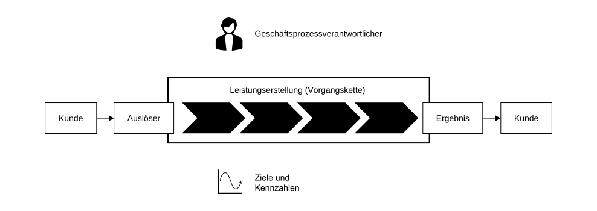
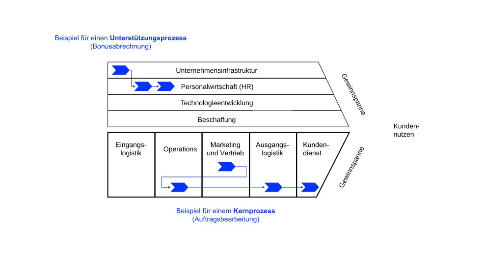
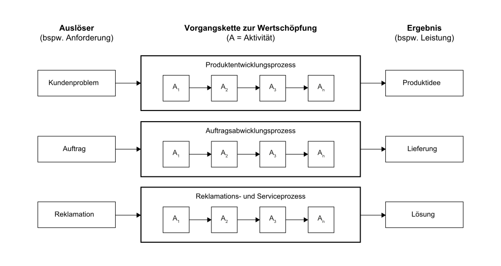
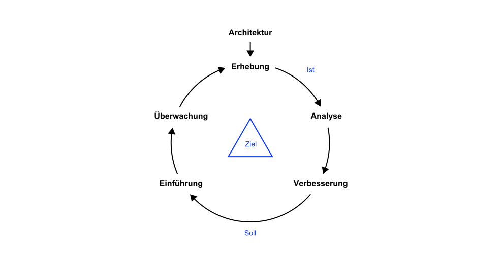
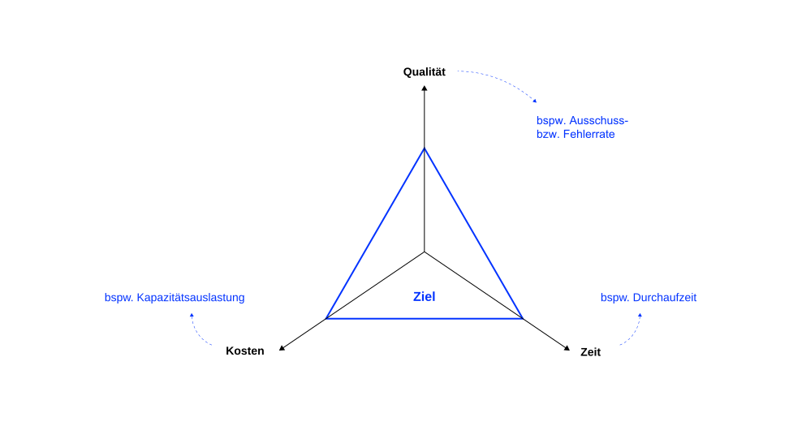
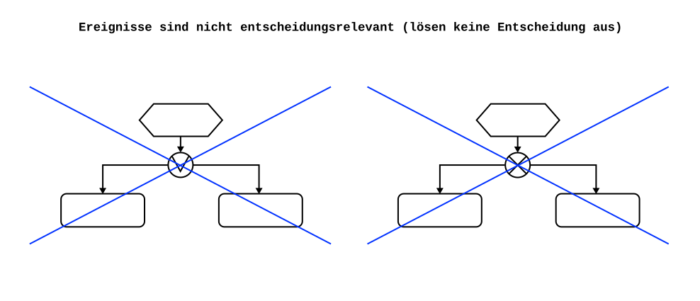
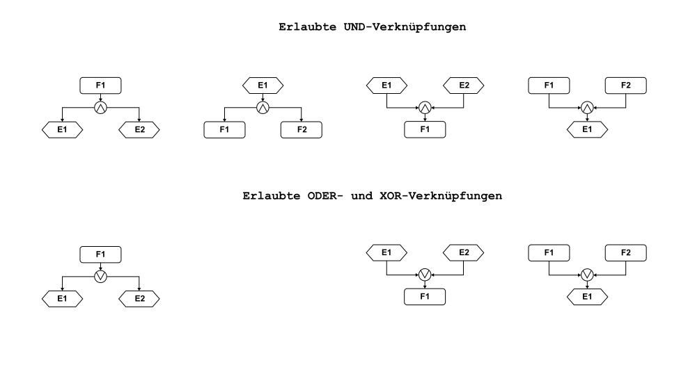
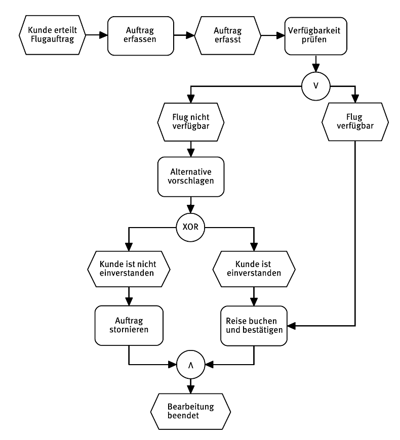

# Motivation {.vertical-center .bg-highlight}

> If you can't describe what you are doing as a process, you don't know what you're doing.
*William Edwards Demin, Physiker, Statistiker und Pionier im Qualitätsmanagement* 

:::notes
Im vorherigen Kapitel haben wir uns mit Informationssystemen beschäftigt, also Systemen, die die Daten produzieren, beschaffen, verteilen und verarbeiten. Zudem haben wir gelernt, dass diese Systeme Geschäftsprozesse, die Daten nuten und erzeugen, unterstützen. In diesem Kapitel schauen wir uns an, was Geschäftsprozesse sind und wie diese gesteuert und optimiert werden können.
:::notes

# Lernergebnisse 🎯

Nach dieser Einheit können Sie 

::: {.incremental}
- erklären, was Geschäftsprozesse sind und welche Bedeutung sie haben,
- Kern- und Unterstützungsprozesse unterscheiden und Beispiele geben,
- Aufgaben, Ziele und die Vorgehensweise des Geschäftsprozessmanagement (GPM) nennen und
- die Basisnotation der EPK beschreiben und die Modellierungsregeln anwenden,
- EPK-Prozessdiagrame lesen, fehler erknennen und korrigieren sowie
- textliche Beschreibungen von Prozessen als EPK und eEPK darstellen.
:::

# Geschäftsprozesse {.vertical-center .bg-highlight}

## Definition

Ein Geschäftsprozess ist eine eine zielgerichtete zeitlich-logische Folge oder Vorgangskette von Aktivitäten (bzw. Tätigkeiten, Geschäftsvorgänge), die für das Unternehmen einen Beitrag zur Wertschöpfung leistet [@leimeister2021einfuhrung].

. . .

In der Regel sind diese Prozesse aus der Geschäftsstrategie abgeleitet (siehe [Business Engineering](../4/#einbettung) und am Kunden orientiert. Kundenorientierung bedeutet, dass Geschäftsprozesse entweder direkt oder indirekt einen Wert für Kunden erzeugen. 

## Merkmale

:::incremental
- Geschäftsprozesse bilden __die Basis für die Wertschöpfung__ des Unternehmens. Sie dienen dem Kunden (Problemlösung) und dem Unternehmen (Gewinnerzielung).
- Geschäftsprozesse sind __Routineaufgaben__ des Unternehmens, die weitestgehend Standards folgen und keine einmaligen Einzelprojekte.
- Jeder Geschäftsprozess hat einen __Auslöser__ (bpsw. einen Auftrag) und ein __Ergebnis__ (bspw. ausgeführter Auftrag und Rechnung für den Kunden).
- Die Aktivitäten des Geschäftsprozesses können (teilweise) __parallel__, __wiederholt__ oder __alternativ__ ausgeführt werden.
- Geschäftsprozesse queren Abteilungen und enden nicht an der Unternehmensgrenze. Deshalb sind an Geschäftsprozessen  in der Regel __mehrere organisatorische Einheiten__ des Unternehmens und gegebenenfalls externe Partner (bspw. Kunden beteiligt.
:::

:::notes
:::{.callout-note}
#### Aktivitäten vs. Teilprozesse

Der Auslöser des Geschäftsprozess für dazu, dass mehrere __Aktivitäten__ bzw. __Teilprozesse__ ausgeführt werden. Während eine Aktivität nicht weiter sinnvoll unterteilt werden kann, enthalten Teilprozesse wiederum mehrere Aktivitäten. Bei komplexen Zusammenhängen wird zunächst auf einer hohen Abstraktionsstufe eine Unterteilung in Teilprozesse vorgenommen und danach werden Teilprozesse in einzelne Aktivitäten unterteilt. 
:::
:::

## Komponenten

{#fig-komponenten}

:::notes
- __Kunde:__ Der Kunde löst Geschäftsprozesse entweder direkt (bspw. durch Erteilung eines Auftrages) oder indirekt (bspw. durch die Notwendigkeit der Anstellung von Mitarbeitern) aus
- __Auslöser:__ Jeder Geschäftsprozess startet mit einem auslösenden Ereignis.
- __Leistungserstellung:__ Die Leistung wird durch die Verkettung unterschiedlicher Aktivitäten erbracht. Diese können parallel, wiederholt oder alternativ ausgeführt werden.
- __Ergebniss:__ Ergebnisse von Geschäftsprozessen sind entweder Produkte oder Dienstleistungen, die für den Kunden von Wert sind und für die der Kunde einen entsprechenden Preis bezahlt (Kernprozesse) oder Leistungen, die indirekt dazu beitragen oder den Bestand und die Zukunft eines Unternehmens sichern (Unterstützungsprozesse). 
- __Geschäftsprozessverantwortlicher:__ Derjenige Mitarbeiter, der die Verantwortung für die Effektivität und Effizienz eines Geschäftsprozesses trägt. Zur Steuerung dienen Ziele und Kennzahlen.
- __Ziele und Kennzahlen:__ Das Geschäftsprozessmanagement stellt mit Hilfe von Zielen und Kennzahlen sicher, dass die Effektivität und die Effizienz der Unternehmensabläufe erhöht werden.
::::

## Kern- und Unterstützungsprozesse

{#fig-wertschoepfungskette}

:::notes

<iframe src="https://www.loom.com/embed/f1089780b3084d15a2fcf91f3b23a51e" frameborder="0" webkitallowfullscreen mozallowfullscreen allowfullscreen style="position: absolute; top: 0; left: 0; width: 100%; height: 100%;"></iframe>

In den **Kernprozessen** findet die originäre Wertschöpfung durch Verkettung von Aktivitäten für externe Kunden statt, sie enthalten nicht-imitierbares Wissen (Kernkompetenzen) eines Unternehmens. Beispiel: Produktentwicklung.

**Unterstützungsprozesse** erzeugen Leistungen für interne Kunden und ermöglichen den reibungslosen Ablauf der Kernprozesse. Sie haben keine strategische Bedeutung. Beispiel: Lohn- und Gehaltsabrechnung.

In Unternehmen, die entlang der Wertschöpfungskette organisiert sind, durchlaufen sowohl Kernprozesse als auch Unterstützungsprozesse in der Regel meist mehrere organisatorischen Einheiten (oft Abteilungen). Die Prozesse sind also „abteilungsübergreifend“. Die Optimierung solcher Prozesse erfordert prozessorientierte Denken. Im Kontrast zum funktionalen Denken, das sich mit den Aufgaben des eigenen Funktionsbereichs beschäftigt, umfasst prozessorientiertes Denken die gesamte Prozesskette, ggf. auch über mehrere Abteilungen oder Bereiche hinweg.

:::{.small}
Ein typisches Beispiel für die unterschiedliche Sichtweise von Prozess- und Funktionsdenken ist die Beschaffung von Waren und Dienstleistungen. Im Rahmen der Gestaltung der Beschaffungsabläufe tritt regelmäßig die Frage auf, welchem Bereich die Teilaufgabe der „Rechnungsprüfung“ zugeordnet werden soll: der Logistik oder dem Rechnungswesen. 
Für den Bereich Logistik spricht, dass die Rechnungsprüfung die qualitative und mengenmäßige Kontrolle durchführt. Die Logistik verfolgt unter anderem das Ziel, die richtige Ware in der richtigen Menge und Qualität zur richtigen Zeit zum Empfänger zu transportieren. Das Rechnungswesen beansprucht oft die Verantwortung für die Überprüfung
von Kontierungen und Zahlungsbedingungen. Das Rechnungswesen hat unter anderem das Ziel, eine ordnungsgemäße Bilanz und Gewinn- und Verlustrechnung aufzustellen. Wird der Prozess gesplittet, beispielsweise in der Art, dass zunächst die qualitative und Mengenkontrolle in der Logistik durchgeführt wird und später nach Weitergabe der Dokumente
die kaufmännische bzw. finanztechnische Prüfung im Rechnungswesen erfolgt, sind fast zwangsläufig durch den Bearbeiterwechsel Verzögerungen zu erwarten.
:::
:::

## Beispiele

{#fig-beispiele}

# Geschäftsprozessmanagement {.vertical-center .bg-highlight}

## Definition

Das Geschäftsprozessmanagement ist dafür verantwortlich, Geschäftsprozesse so zu __gestalten__, __umzusetzen__, zu __kontrollieren__ und zu __verbessern__, dass das Unternehmen die gesteckten Ziele möglichst effizient erreicht [@mertens2016grundzuge].

. . .

Das Geschäftprozessmanagement implementiert einen kontinuierlichen Verbesserungsprozess, der Geschäftsprozessse kontinuierlich überwacht, analysisert und verbessert.

## Ablauf

{#fig-ablauf}

:::notes
- __Erhebung__
  - Modellierung des Ist-Prozesses und der verwendeten Informationssysteme
  - Erhebung der Zielerreichung über Prozesskennzahlen (z. B. Durchlaufzeiten, Kosten)
- __Analyse__
  - Identifikation organisatorischer und IT-technischer Schwachstellen
- __Verbesserung__
  - Auswahl und Umsetzung von Verbesserungskonzepten (Harmonisierung, Automatisierung, Auslagerung, etc.)
  - Konzeption der geeigneten IT-Unterstützung  
  - Modellieren des Soll-Prozesse (Aktivitäten, Ereignisse, Dateninput/Datenoutput, Anwendungssysteme, Prozessbeteiligte und -verantwortliche, etc.)  
  - Definition bzw. Aktualisierung der Ziele und Prozesskennzahlen
- __Einführung__
  - Einführen der Soll-Prozesse im Unternehmen (Schulung, Training, etc.)
  - Aktualisierung bzw. Einführung der Anwendungssysteme
- __Überwachung__
  - (Automatisierte) Erhebung der Prozesskennzahlen und Berichterstattung an die Prozessverantwortliche
  - Analyse der Prozesskennzahlen bzw. der Prozessleistung
:::

## Ziele

Das Geschäftsprozessmanagement möchte Effektivität und Effizienz des Unternehmens steigern.

. . .

In der Regel sind Unternehmen in einer Marktwirtschaft __gewinnorientiert__. Das Geschäftsprozessmanagement zielt in solchen Unternehmen deshalb darauf ab, die Kosten durch höhere Effizienz zu senken und Umsätze durch eine bessere Kundenbindung zu erhöhen [@schmelzer2020geschaftsprozessmanagement].

. . .

Konkrete Ziele sollten aus den Unternehmenszielen abgeleitet (siehe [Business Engineering](../4/#einbettung)) und in spezifische und messbare Ziele und Kenngrößen für einzelne Geschäftsprozesse überführt werden. 

## Zieldimensionen

{#fig-dreieck}

:::notes
:::{.callout-note}
#### Das "magische Dreieck"

Das magische Dreieck beschreibt die drei Zieldimensionen der Geschäftsprozessoptmierung bestehend aus Zeit, Qualität und Kosten. Diese Drei Dimensionen stehen immer in Beziehung miteinander und können nicht unabhängig voneinander optimiert werden.

Wenn beispielsweise unter Zeitdruck produziert werden muss, steigt die Wahrscheinlichkeit für Fehler. Die Nachbesserung und Korrektur dieser ist dann mit weiterer Zeit und weiteren Kosten verbunden. Oder umgekehrt: wenn  die Qualität erhöht werden soll, ist in der Regel mehr Zeit und/oder Geld notwendig.
 
Im Geschäftsprozessmanagement müssen deshalb die drei Zieldimensionen abgewogen werden und Prioritäten gesetzt werden. 
:::
:::

## Verbesserung

:::notes
Grundformen für die Verbesserung von Geschäftsprozessen:
:::

Weglassen
: Überprüfung der Notwendigkeit von Prozessen oder Teilprozessen zur Funktionserfüllung, Abschaffung von Medienbrüchen, Abschaffung von nicht sinnvollen Genehmigungsschritten

. . .

Auslagern
: Vergabe von (Teil-)prozessen an externe spezialisierte Dienstleister (bspw. Buchführung und Bilanzierung durch einen Steuerberater)

. . .

Zusammenfassen
: Arbeitsteilige Aufgaben werden so zusammengefasst, dass ein Bearbeiter zusammengehörige Teilprozesse vollständig ohne Bearbeiterwechsel durchführt (z. B. Kundenberatung und Auftragserfassung bis zur Erstellung der Auftragsbestätigung)

----

Parallelisieren
: Erhöhung der Arbeitsteilung bei parallelisierbaren Teilschritten (z. B. Klausurkorrektur durch mehrere Prüfer je Teilgebiet)

. . .

Verlagern
: Verlagerung von Prozessschritten, so dass Aufgaben frühzeitig durchgeführt werden, ohne später zu einem Flaschenhals zu werden (z. B. vollständige Erfassung der Kundeninformationen bei Auftragserfassung)

. . .

Beschleunigen
: Einsatz von zeitsparenden Arbeitsmitteln (Dokumentenmanagementsystem ersetzt Papierdokumentation, Reduzierung von Warte- und Liegezeiten durch Erhöhung von Kapazitäten

----

Schleifen vermeiden
: Schleifenfreie Gestaltung von Prozessen, d. h. Verzicht auf Wiederholung
von Teilschritten eines Prozesses (z. B. Onlineerfassung aller Kunden und Bestelldaten im Rahmen der Auftragserfassung und Freigabe des Auftrages erst nach vollständiger Plausibilisierung der Daten)

. . .

Ergänzen
: Vermeidung von nachgelagerten Prozessen zur „Schadensbeseitigung“ (z. B. Ergänzung einer Qualitätskontrolle nach der Teilemontage um einen möglichen „Nachbearbeitungsprozess“ oder eine „Rückholaktion
fehlerhafter Ware“ zu vermeiden).

# Prozessmodellierung {.vertical-center .bg-highlight}

## Zielsetzung

Die Prozessmodellierung dient der Dokumentation von Sachverhalten und erleichtert deren Kommunikation im Unternehmen (bspw. zwischen Hierarchie-Ebenen oder Teams). 

. . .

Prozessmodelle ermöglichen zudem die Analyse von Problemen und Fehlern und dienen der Gestaltung von Aktivitätsketten und deren automatisierter Abarbeitung mit Hilfe von Anwendungssystemen [@leimeister2021einfuhrung].

## Übersichtsdiagramme

:::notes
Zur Übersicht über die Prozesse eines Unternehmens werden oftmals __Prozesslandkarten__ und __Wertschöpfungskettendiagramme__ eingesetzt. Prozesslandkarten stellen die wesentlichen Geschäftsprozesse eines Unternehmens dar, während Wertschöpfungskettendiagramme zusätzlich die Zusammenhänge zwischen den wesentlichen Prozessen und deren Teilprozessen darstellen.
:::

![Beispiele für Prozesslandkarten und Wertschöpfungskettendiagramme, aufbauend auf @gadatsch2020grundkurs [S. 87ff]](images/prozesslandkarten.svg){#fig-landkarten}

::: {.hidden}

<iframe src="https://www.loom.com/embed/4cccededabb64c0786939b4d058d752d" frameborder="0" webkitallowfullscreen mozallowfullscreen allowfullscreen style="position: absolute; top: 0; left: 0; width: 100%; height: 100%;"></iframe>
 
:::

## Modellierungssprachen

Zur Modellierung von  Geschäftsprozessen und zur Gestaltung von Informationssystemen finden sich in der Praxis eine Vielzahl von Methoden. Zwei Methoden werden besonders häufig eingesetzt: __Ereignisgesteuerte Prozesskette__ (EPK) und __Business Process Model and Notation__ (BPMN) [@gadatsch2020grundkurs].

. . .

Diese Vorlesung führt die Basisnotation der EPK ein.

:::notes

Der Schwerpunkt der EPK-Methode liegt auf der Abbildung des Kontrollflusses von Prozessen, der beschreibt, in welcher logischen Reihenfolge Vorgänge ausgeführt werden sollen. 

- Die EPK wurde zum ersten Mal 1992 in einer Veröffentlichung der Universität des Saarlandes spezifiziert.
- Die EPK wurde von der SAP zur Dokumentation Ihres ERP-Systems R/3 genutzt, unter anderem deshalb ist die EPK in Unternehmen immer noch stark verbreitet
- Die EPK beschreibt den Ablauf eines Geschäftsprozesses mit nur wenigen Grundsymbolen
:::

# EPK {.vertical-center .bg-highlight}

## Basisnotation

![EPK Basisnotation, aufbauend auf @gadatsch2020grundkurs [S. 87ff]](images/syntax.svg){#fig-syntax}

:::notes
__Funktionen__ ändern den Zustand von Objekten im Geschäftsprozess und beschreiben den zugrundeliegenden Transformationsprozess. Funktionen sind also aktive Objekttypen Dies drückt sich auch in der Namensgebung einer Funktion durch Substantiv & Verb aus (z. B. „Auftrag anlegen“)

__Ereignisse__ stellen Zustände dar, lösen Funktionen aus und sind wiederum Ergebnis bereits ausgeführter Funktionen. Ereignisse sind passive Objekttypen. Dies drückt sich auch in der Bezeichnung durch ein Substantiv (das Informationsobjekt) und Verb im Perfekt aus („Auftrag angelegt“).

__Konnektoren__ Funktionen können in der Praxis von mehr als einem Ereignis angestoßen werden. Um derartige Konstrukte darstellen zu können, werden drei logische Konnektoren verwendet: die Konjunktion („und“), die Disjunktion („exklusives oder“) und die Adjunktion („inklusives oder“). 
:::

## Modellierungsregeln

Die Modellierung (also die zeitliche Abfolge des Prozesses) erfolgt von oben links nach unten rechts.

:::incremental
- __Kanten__ verknüpfen Funktionen und Ereignisse und stellen den Kontrollfluss dar. Jede Funktion/Ereignis hat jeweils nur eine ein- bzw. ausgehende Kante.
- Ereignisse und Funktionen wechseln einander ab.
- Eine EPK beginnt und endet mit (mindestens) einem Ereignis. Das prozessauslösende Ereignis wird als Start-Ereignis, das prozessabschließendes Ereignis als __Endereignis__ bezeichnet.
- Folgeprozesse können durch Ende-Ereignisse eines vorangegangenen Prozesses ausgelöst werden, d. h. ein Ende-Ereignis kann in einem anderen Prozess ein __Startereignis__ darstellen.
:::

## Verkettungen

:::notes

{#fig-unerlaubt}

- Ereignisse und Funktionen haben grundsätzlich nur einen Eingang und einen Ausgang.
- Konnektoren dürfen entweder nur einen Eingang und mehrere Ausgänge (min. 2) oder mehrere Eingänge (min. 2) und nur einen Ausgang haben
- Verzweigungen müssen mit dem gleichen Konnektor geschlossen werden, mit dem sie geöffnet wurden.
Im Gegensatz zur Funktion hat ein Ereignis keine Entscheidungskraft, d.h. nach einem Ereignis darf keine ODER- bzw. - XOR-Verknüpfung zu mehreren Funktionen stattfinden.
- Konnektoren können direkt verkettet, d.h. hintereinander modelliert werden, um komplexe Regeln ausdrücken zu können.
:::

{#fig-entscheidung}

## Erweiterte EPK (eEPK)

:::notes
EPKs lassen sich um weitere Elemente ergänzen, um Prozesse zu detaillieren. In der Praxis werden vor allem Organisationseinheiten, Anwendungssysteme sowie verarbeitete Informationsobjekte dieser Systeme ergänzt.

- Die __Organisationseinheit__ zeigt die einer Funktion zugeordnete organisatorische Einheit, die diese ausführt.
- Das __Informationsobjekt__ bildt die vom Prozess verarbeiteten Informationen (Input und Output) ab. Ein Informationsobjekt zeigt also welche Informationen benötigt und/oder erzeugt werden.
- Das __Anwendungssystem__ zeigt das den Prozess unterstützende betriebliche Anwendungssystem.
:::

![eEPK Notation, aufbauend auf @gadatsch2020grundkurs [S. 87ff]](images/eEPK.svg){#fig-eEPK}

# Übungen ✏️ {.headline-only}

## Erhebung {.scrollable}

Suchen Sie sich jeweils einen der folgenden Geschäftsprozesse aus und beschreiben Sie diesen den anderen Mitgliedern der Gruppe (verbale Beschreibung).

- Angebotsbearbeitung in einem Produktionsbetrieb
- Bearbeitung von Reklamationen in einem Online-Shop
-	Durchführung eines Bewerbungsgesprächs in einem Unternehmen
-	Optimierung eines Geschäftsprozesses in einem Unternehmen
-	Verkauf eines Autos in einem Autohaus

Dokumentieren Sie Ihre Erkenntnisse in folgender Vorlage. 

|                      |                                    |
|----------------------|------------------------------------|
| __Typ__              | _Kern- oder Unterstützungsprozess_ |
| __Auslöser__         |                                    |
| __Aktivitäten__      |                                    |
| __Ergebnis__         |                                    |
| __Kennzahlen__       |                                    |
| __Verantwortlicher__ |                                    |

Weshalb handelt es sich um einen Geschäftsprozess?

## Analyse und Verbesserung {.smaller .scrollable}

Ein fiktiver Maschinenhersteller organisiert seine Auftragsbearbeitung wie folgt:

1.	Der Prozess beginnt beim Vertriebsleiter, der sich persönlich um eingehende Anfragen der Kunden kümmert.
2.	Danach wird das Angebot vom Sachbearbeiter A an den Kunden versandt. Bevor das Angebot verschickt wird, wird es vom Vertriebsleiter kontrolliert. Da der Vertriebsleiter nicht immer anwesend ist, kann es vorkommen, dass ein vom Sachbearbeiter A fertig erstelltes Angebot einige Tage liegen bleibt.
3.	Wenn der Kunde eine Bestellung vornimmt, wird diese vom Sachbearbeiter C manuell geprüft und danach vom Sachbearbeiter D im Auftragsbearbeitungssystem erfasst.
4.	Der Kunde erhält eine Auftragsbestätigung, nachdem der Vertriebsleiter den Auftrag gesehen und freigegeben hat.
5.	Nach der Erfassung des Auftrages geht der Auftrag an den Leiter der Logistikabteilung. Dieser entscheidet persönlich, ob ein Teil vom Lager entnommen werden kann, beschafft werden muss oder gar noch zu produzieren ist.
6.	Falls er sich unsicher ist, fragt er beim Vorstand nach.
7.	Der Lagerleiter erhält daraufhin den Auftrag, das Material auszuliefern. Wenn er an diesem Tag nicht im Betrieb anwesend ist, übergibt er den Auftrag erst am folgenden Werktag an einen seiner Sachbearbeiter (z. B. H.)
8.	Der Sachbearbeiter (hier H) entnimmt das Teil, versendet es an den Kunden und löst eine Nachbestellung des Ersatzteiles beim zuständigen Lieferanten aus.
9.	Nach dem Versand übermittelt Sachbearbeiter H im Lager seinem Vorgesetzten die Abgangsbuchung. Dieser prüft den Beleg und verschickt ihn an den Leiter des Rechnungswesens. 
10.	Der Leiter Rechnungswesen gibt den Beleg an den Leiter der Abteilung Buchhaltung und dieser wiederum an einen seiner Sachbearbeiter. Da der Leiter Rechnungswesen häufig vom Vorstand für Planungsaufgaben eingesetzt wird, bleiben die Belege häufig einige Tage liegen.
11.	Der Sachbearbeiter M erstellt in diesem Fall die Rechnung und verschickt sie an den Kunden.

Analysieren Sie den Prozess, identifizieren Sie Optimierungspotenziale und Schlagen Sie Verbesserungsmöglichkeiten im Sinne der Prozessoptimierung vor.

## Modellierung (Angebotsbearbeitung)

Modellieren Sie den von Ihnen optimierten Angebotsbearbeitungsprozess des fiktiven Maschinenherstellers aus der vorherigen Aufgabe.

:::notes
:::{.callout-note}
### Modellierungstool
Zur Modellierung können Sie das [yEd Live](https://www.yworks.com/yed-live) verwenden. Die EPK-Symbole finden Sie rechts unter „Flussdiagramm“.
:::
:::

## Modellierung (Reisebuchung)

Modellieren Sie gemeinsam folgenden Geschäftsprozess als eEPK. Starten Sie damit im Text Ereignisse, Funktionen und Verknüpfungsoperatoren zu markieren. 

- Die Buchhaltung hat die Aufgabe, zu Arbeitsbeginn eines jeden Werktags die am Vortag neu eingegangenen Reisebuchungen zu ermitteln (die Buchungen sind im Reservierungssystem erfasst). Sind keine unbearbeiteten Reisebuchungen im System endet der Prozess.
- Für jede neue Reisebuchung muss eine Rechnung erstellt werden. Rechnungen müssen anschließend im Finanzbuchhaltungssystem SAP FI verbucht werden. 
- Danach werden parallel (A) die Kreditkarte des Kunden entweder mit dem Rechnungsbetrag belastet oder der Rechnungsbetrag wird per Lastschrift eingezogen (je nach Zahlungsart) und (B) die Rechnung versendet.

## Modellierung (Einkaufsprozess)

Erstellen Sie für folgende Prozess eine ereignisgesteuerte Prozesskette. 

:::incremental
- In einem Unternehmen bestellt der zentrale Einkauf regelmäßig Büromaterial bei vier verschiedenen Lieferanten. 
- Wenn Bedarf vorhanden ist, ruft die Einkaufsabteilung vier Lieferanten an, um ein Angebot über die Lieferungen einzuholen. 
- Sobald die Angebote eingetroffen sind, werden sie verglichen, es wird ein Lieferant ausgewählt und die Bestellung an diesen Lieferanten geschickt. 
- Wenn die bestellten Büromaterialien eingetroffen sind, prüft die Abteilung Wareneingangskontrolle zunächst, ob die Lieferung korrekt erfolgte.
- Die Ware wird entweder angenommen oder reklamiert (bei Beschädigung oder Fehllieferungen, der Prozess endet hier). 
- Nach erfolgter Lieferung erhält das Unternehmen die Rechnung. 
- Die Einkaufsabteilung prüft die Rechnung und weist die Bezahlung an. 
:::

# Lernkontrolle 🧐 {visibility="hidden"}

- Erläutern Sie anhand von zwei wesentlichen Merkmalen, weshalb es sich bei der Angebotserstellung in einem Unternehmen, das Möbel vertreibt, um einen Geschäftsprozess handelt.
- In der Vorlesung haben wir drei wesentliche Kriterien/Dimensionen zur Beurteilung von Prozessen diskutiert. Vertriebsleiterin definiert die Anzahl der Rückfragen pro versendetes Angebot als Kennzahl für den Angebotsprozess. Welches wesentliche Kriterium zur Bewertung von Prozessen versucht sie abzubilden?
- Geben Sie ein Beispiel für eine Kennzahl, die ein anderes wesentliches Kriterium abbildet und nennen Sie dieses.
- Die Anzahl der Rückfragen ist sehr hoch. Durch welche Maßnahme könnte der Angebotsprozess optimiert werden?
- Analysieren Sie das folgende EPK und beschreiben Sie mögliche Fehler:   
{#fig-fehlersuche}

# Literatur 📚
::: {#refs}
:::