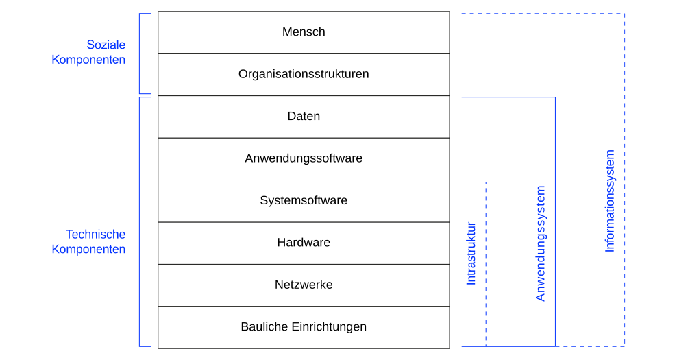
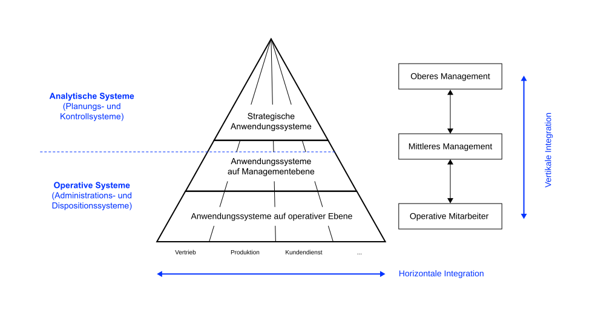
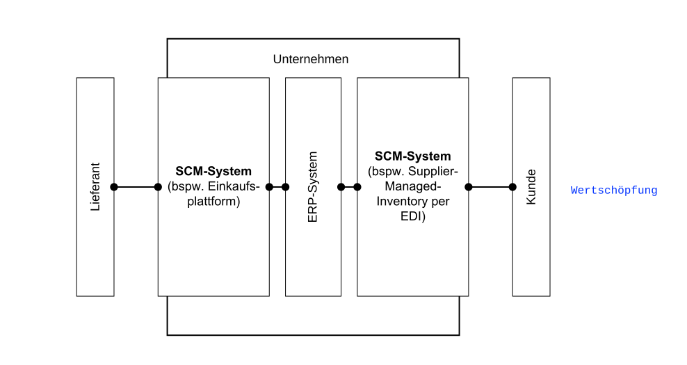
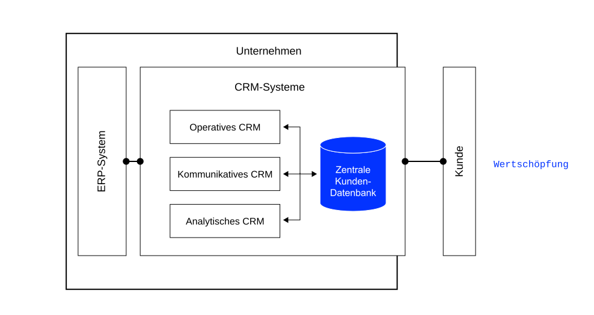

[Präsentation](slides.html)[^print]  / [Big Picture](assets/big-picture.pdf)



# Motivation {.vertical-center background-color="blue"}

> Zu den gewaltigen Kosten für die Softwareumstellung als solche kommen jeden Tag neue für Fehlersuche und Problembeseitigung. *Ernst Prost (2019), Geschäftsführer der Liqui Moly GmbH in Ulm*

:::notes
Damit das nicht passiert, müssen die passenden Anwendungssysteme ausgewählt und an die Geschäftsprozesse angepasst werden (und/oder vice versa). Bevor wir uns mit der Implementierung von Anwendungssoftware beschäftigen, schauen wir uns in diesem Kapitel an, was die wichtigsten Arten von Anwendungssysteme sind, die im Unternehmen eingesetzt werden.
::::

# Lernergebnisse 🎯

Nach dieser Einheit

::: incremental
-   können Sie den Begriff **Anwendungssystem** erläutern und vom Begriff Informationssystem abgrenzen,
-   sind Sie in der Lage, betriebliche Anwendungssysteme nach unterschiedlichen Kriterien zu **klassifizieren**,
-   können Sie beschreiben, wie die Anwendungssystem-Kategorien **ERP, CRM, SCM und BI** aufgebaut sind und welchem Zweck diese jeweils dienen und
-   sind Sie in der Lage, den Begriff **Business Intelligence (BI)** zu erläutern und die Komponenten eines BI-Systems zu beschreiben.
:::

# Anwendungssysteme

**Anwendungssysteme** bilden den technischen Teil von **Informationssystemen.**

Anwendungssysteme bauen auf einer gegebenen Infrastruktur auf und umfassen alle Programme (Anwendungssoftware), die für ein bestimmtes Aufgabengebiet entwickelt und eingesetzt werden sowie der Daten, die erzeugt und genutzt werden [nach @laudon2016wirtschaftsinformatik, p.15].

. . .

Anwendungssysteme enthalten entweder **Standardsoftware**, die "von der Stange" gekauft oder aus der Cloud als Software as a Service verwendet werden oder **Individualsoftware**, die spezifisch für eine Organisation entwickelt wird. Beide Typen müssen in Abstimmung mit den anderen Komponenten eingeführt und zum Informationssystem ausgebaut werden.

. . .

Anwendungssysteme werden verkürzt als Anwendung bezeichnet.

::: notes
Oft spricht man auch von „Applikation" (Englisch „business application" oder nur „application"). **„App"** ist die Kurzform von Applications und wird oft im Zusammenhang mit mobilen Plattformen verwendet (bspw. Apps für das Smartphone, die über „App Stores" geladen werden) [@abts2017grundkurs].
:::

## Visualisierung

{#fig-is}

# Betriebliche Anwendungssysteme

**Betriebliche Anwendungssysteme** unterstützen die Anwender innerhalb eines Unternehmens bei der Durchführung ihrer Aufgaben.

. . .

Anwendungen bilden dabei die **Geschäftslogik** bzw. die fachlichen Funktionszusammenhänge ab, die durch die Geschäftsprozesse definiert und repräsentiert werden [@alpar2000anwendungsorientierte].

. . .

In modernen Unternehmen unterstützen und integrieren Anwendungssysteme fast alle **Funktionsbereiche und deren Prozesse** (horizontale Integration) und stellen auf unterschiedlichen Hierarchieebenen notwendige Daten zur **Entscheidungsfindung, Planung und Kontrolle** bereit (vertikale Integration).

## Funktionsbereich

![Beispiele für betriebliche Anwendungssysteme entlang der Wertschöpfungskette (Value Chain)[^Abkürzungen]](images/valueChain.svg){#fig-valueChain}

::: notes
Betriebliche Anwendungssysteme können nach dem Funktionsbereich, in dem diese eingesetzt werden, klassifiziert werden. In @fig-valueChain sind einige beispielhafte Anwendungssysteme und die zugehörige betriebliche Funktion dargestellt.
:::

[^Abkürzungen]: **Abkürzungen:** BI = Business Intelligence; CAD = Computer Aided Design; ERP = Enterprise Resource Planning; PPS = Production Planning System; MES =  Manufacturing Execution System; TM = Transportation Management System; EWM = Extended Warehouse Management System; CRM = Customer Relationship Management System

## Organisatorische Ebene

Betriebliche Anwendungssysteme können nach der organisatorischen Ebene, die sie unterstützen, unterteilt werden: Systeme auf der operativen Ebene, Systeme auf der Managementebene und Systeme auf der strategischen Ebene [@laudon2016wirtschaftsinformatik, S. 406].

. . .

Anwendungssysteme auf operativer Ebene
: Führen die grundlegenden, für den Geschäftsbetrieb notwendigen Routinetransaktionen aus, zeichnen diese auf und überwachen diese (bspw. Verkauf, Wareneingang, Geldeingang, Materialverbrauch, etc.).

. . .

Anwendungssysteme auf Managementebene
: Unterstützen das mittlere Management in den Bereichen Kontrolle, Entscheidungsfindung und Administration.

. . .

Strategische Anwendungssysteme
: Unterstützen die langfristige Planung des oberen Managements.

. . .

Vereinfacht kann zwischen **operativen Anwendungssystemen** und **analytischen Anwendungssystemen** unterschieden werden.

. . .

Analytische Anwendungssysteme nutzen die von den operativen Systemen erzeugten Daten (evtl. ergänzt um Daten aus anderen Quellen), verdichten und bereiten diese auf (insbesondere in Form von Kennzahlen) und unterstützen damit das Management in der Unternehmensführung und Entscheidungsfindung [@abts2017grundkurs, S. 267 ff].

# Wichtige Typen {.vertical-center background-color="blue"}

## ERP-Systeme

Als Enterprise Resource Planning Systeme (ERP-Systeme) bezeichnet man **integrierte betriebswirtschaftliche Standardanwendungssoftware**.

. . .

Integriert bedeutet, dass sämtliche oder **wesentliche Teile der Geschäftsprozesse** innerhalb des Unternehmens unterstützt werden (u.a. Beschaffung, Produktion, Vertrieb und Rechnungswesen) und Daten in einer zentralen Datenbank gehalten werden [@abts2017grundkurs].

. . .

ERP-Systeme ermöglichen insbesondere die **horizontale Integration**. 

. . .

Die zu den Geschäftsvorfällen erzeugten Daten werden von analytischen Systemen im Sinne der **vertikalen Integration** genutzt. Teilweise wird diese Funktion auch von den ERP-Systemen selbst übernommen.

------------------------------------------------------------------------

### Visualisierung

![Schematischer Aufbau eines ERP-Systems, eigene Darstellung basierend auf @abts2017grundkurs [S. 194]](images/erp.svg){#fig-erp}

## SCM-Systeme

**Supply-Chain-Management (SCM)** beschreibt die aktive Gestaltung aller Prozesse, um Kunden oder Märkte in Wertschöpfungsketten wirtschaftlich mit Produkten und Dienstleistungen zu versorgen.

. . .

SCM-Systeme unterstützen die **Geschäftsprozessintegration innerhalb der Wertschöpfungskette** zwischen den einzelnen Unternehmen auf den unterschiedlichen Wertschöpfungsstufen und dem Endkunden @bachle2021einfuhrung.

. . .

SCM-Systeme steuern und optimieren unternehmensübergreifende Informations-, Geld- und Güter- und Dienstleistungsströme und unterstützen damit bei der Gestaltung, Planung und Steuerung von Lieferketten.

------------------------------------------------------------------------

### Visualisierung

{#fig-scm}

::: notes
**Zielsetzungen (Auswahl)**:

-   Verringerung des [Bullwhip-Effekts](https://de.wikipedia.org/wiki/Peitscheneffekt_(Supply-Chain-Management))
-   Erhöhung der Liefertreue Kosteneinsparungen bspw. durch höhere Kapazitätsauslastung und
-   Senkung von Lagerbeständen, Verringerung der Lead-Time, etc.
:::

## CRM-Systeme

**Customer-Relationship-Management (CRM)** umfasst den Aufbau und die Festigung langfristig profitabler Kundenbeziehungen durch abgestimmte und kundenindividuelle Marketing-, Sales- und Servicekonzepte mithilfe moderner IT.

. . .

**CRM-Systeme** sind Anwendungssysteme, die sämtliche Interaktionen der Unternehmung mit Kunden verfolgen und analysieren, um Umsatz, Rentabilität, Kunden-zufriedenheit und Kundenbindung zu optimieren. Diese Systeme

-   vereinen eine Vielzahl von Einzellösungen aus verschiedenen Unternehmensbereichen
-   lassen in die beiden Teilbereiche operatives CRM und analytisches CRM aufteilen.

. . .

In der Regel unterscheidet man zwischen **operativen**, **analytischen** und **kommunikativen CRM-Systemen**

------------------------------------------------------------------------

### Visualisierung

{#fig-crm}

::: notes
### Operatives CRM

Systeme, die Unterstützung für das Tagesgeschäft in der direkten Interaktion mit den Kunden bieten, insbesondere - Unterstützung des Kundenkontakts durch Integration aller Daten zum Kunden - Bereitstellung von Anwendungen für das Front- und Backoffice (bspw. Angebotsmanagement) - Verbesserung der Reaktionsfähigkeit auf Kundenbedürfnisse, Effizienz und Integration der Lieferketten

Hauptziel ist es, die Kunden zufriedenzustellen und so viele Daten wie möglich zu sammeln.

### Analytisches CRM

Systeme, die helfen 360°-Sichten auf den Kunden durch Zusammenführung aller verfügbaren Daten zu erstellen, z.B.,

-   Beziehungskarten und Kontaktverlauf
-   Demografische und psychografische Daten
-   Rentabilitätskennzahlen (z. B. Share of Wallet)
-   Marketing- und Vertriebsinformationen
-   Daten zur Produktnutzung

Hauptziel ist die Gewinnung von Wissen über den Kunden, um Ableitungen für die Interaktion mit dem Kunden zu gewinnen und Strategien zur Marktbearbeitung zu entwickeln (bspw. mittels Kundensegmentierung)

### Kommunikatives CRM

Kommunikative CRM Systeme sind oftmals Teil operativer CRM Systeme. Sie umfassen das Management aller Kommunikationskanäle zwischen Kunde und Unternehmen (Telefonie, Internet, E-Mail, Direct Mailing, etc.). Die verschiedenen Kommunikationskanäle werden synchronisiert, gesteuert und eingesetzt, um eine zielgerichtete Kommunikation zwischen Kunden und Unternehmen zu ermöglichen. Dieser Ansatz wird auch als Multi-Channel Management bezeichnet.

Grundsätzlich kann zwischen dem direkten und indirekten Kommunikationskanal unterschieden werden.

- Direkte Kommunikation: Das Unternehmen tritt unmittelbar mit den Kunden in Kontakt (bspw. Besuche von Außendienstmitarbeitern, Telefonate, direkter Kontakt mit dem Verkaufspersonal in Verkaufsräumen, Kontakt via Chat oder Instant Messaging, etc.)
- Indirekte Kommunikation: Es findet kein direkter persönlicher Kontakt zwischen Unternehmen und Kunden statt (bspw. Briefe, Faxe, E-Mail-Kampagnen etc.)
:::

## BI-Systeme

Business Intelligence (BI) bezeichnet ein integrierter, IT-basierter Gesamtansatz zur Unterstützung betrieblicher Entscheidungen.

. . .

BI-Systeme kombinieren Komponenten für die Beschaffung, Aufbereitung und Bereitstellung von Daten. Zielsetzung ist, neue Erkenntnisse aus bestehenden Daten für bessere Entscheidungen zu gewinnen [@abts2017grundkurs].

::: incremental
-   BI-Systeme bauen auf einem **Data Warehouse**[^1], einer zentralen Datenbank, die aktuelle und historische Daten in aggregierter und mehrdimensionaler Form speichert, auf
-   Die Daten aus dem DW werden in der Regel mittels **OLAP** analysiert
-   Mittels **Data Mining** werden die Daten analysiert, um sinnvolle Muster oder Regelmäßigkeiten zu entdecken (bspw. Kaufverhalten der Kunden)
:::

[^1]: Teilbereiche des DW werden als **Data Mart** bezeichnet. Sie werden insbesondere zur Steigerung der Performance eingerichtet (z. B. Data Mart für den Vertrieb)

------------------------------------------------------------------------

### Visualisierung

{#fig-bi}

## Kollaborationssysteme

Als **Kollaborationssysteme** (Collaboration Tools) werden Anwendungssysteme bezeichnet, die die **Zusammenarbeit** von Personen innerhalb eines Unternehmens (funktionsübergreifend) sowie auch unternehmensübergreifend ermöglichen und verbessern [@abts2017grundkurs].

. . .

Die Zusammenarbeit kann sowohl synchron als auch asynchron erfolgen.

. . .

Mittels Kollaborationssysteme sollen Mitarbeiter funktionsübergreifend besser miteinander kommunizieren und das Wissen untereinander teilen.

. . .

**Beispiele:** Office 365, Google Docs, Slack, etc.

# Übungen ✏️ {.headline-only}

## Rolle von Anwendungssystemen

Besprechen Sie in der Gruppe die Rolle von operativen und analytischen Anwendungssystemen, deren Aufgaben und in welcher Beziehung diese zueinander stehen. Erläutern Sie die Punkte anhand von möglichst konkreten Beispielen.

## Beispiele

Recherchieren Sie im Internet nach konkreten Beispielen für folgende Kategorien an Anwendungssysten. Erläutern Sie die Funktion des Systems und begründen Sie die Zuordnung.

-   Analytisches Anwendungssystem
-   Standardsoftware
-   Individualsoftware
-   Anwendungssystem für HR
-   Anwendungssystem für Marketing und Sales

## SCM {.scrollable .smaller}

Sie führen ein Unternehmen, das Flugzeugteile herstellt. Sie haben viele Wettbewerber, die versuchen, günstigere Preise und besseren Kundenservice zu bieten. Sie möchten herausfinden, ob Sie von einem SCM-System profitieren können. 

[Hier](assets/bestellungen.xlsx) finden Sie eine Tabellenkalkulationsdatei mit einer Liste sämtlicher Artikel, die Ihr Unternehmen während der letzten drei Monate bei ihren Lieferanten bestellt hat. Analysieren Sie die Datei und bereiten Sie eine Empfehlung dazu vor, wie die in dieser Tabelle enthaltenen Daten zur Verbesserung des Supply Chain Managements eingesetzt werden können. Sie sollten überlegen, wie Sie bevorzugte Lieferanten oder andere Möglichkeiten zur Verbesserung der Lieferung und Produktion der Produkte identifizieren können. 

Erstellen Sie in Excel Berichte, die Ihre Empfehlung unterstützen.

## BI

OLAP steht für „Online Analytical Processing“ und erlaubt die mehrdimensionale Abfrage von Daten, die in einem Data Warehouse gespeichert sind. Die Mehrdimensionalität wird üblicherweise anhand eines Datenwürfels (Data Cube; OLAP Cube) veranschaulicht. 

Recherchieren Sie zu OLAP, skizzieren Sie einen beispielhaften Datenwürfel und beschreiben Sie die Slice-Funktion sowie deren Nutzen.

## CRM

Salesforce ist einer der erfolgreichsten Anbieter von betrieblichen Anwendungssystemen als SaaS und aktuell weltweit führend in cloud-basierten CRM-Systemen.

Recherchieren Sie [hier](https://www.salesforce.com/de/customer-success-stories/) nach einer für Sie interessanten Fallstudie zum Einsatz von Salesforce. Lesen Sie diese durch und beschreiben Sie anschließend in eigenen Worten, welche Funktionen des CRM-Systems dem Unternehmen helfen, erfolgreicher zu sein.

Ordnen Sie die Funktionen, die Sie identifiziert haben den drei Ebenen von CRM-Systemen zu (operativ, kommunikativ, analytisch).

# Lernkontrolle 🧐 {visibility="hidden"}

- Nennen Sie uner erläutern Sie zwei Ziele, die Unternehmen mit Hilfe eines CRM-Systems erreichen möchten.
- Erläutern Sie, wie ein SCM System Unternehmen dabei unterstützt diese Ziele zu erreichen.
- Beschreiben Sie ein Ziel des operativen CRM und erläutern Sie anhand eines möglichst konkreten Beispiels, wie ein Anwendungssystem helfen kann, dieses Ziel zu erreichen.
- Ein CRM-System kann sowohl zur Klasse der operativen Anwendungssysteme als auch zur Klasse der analytischen Anwendungssysteme gehören. Erläutern Sie, was ein analytisches System von einem operativen System unterscheidet. 
- Nennen Sie konkrete Funktionen von CRM-Systemen und zeigen Sie (a) wie diese zum Unternehmenserfolg beitragen können und (b) ob es sich um operative oder analytische Funktionen handelt.
- In einem Data Warehouse eines Unternehmens werden historische Daten vorgehalten, die zur besseren Entscheidungsfindung ausgewertet werden. Beschreiben Sie anhand eines Beispiels, wie die Daten im Data Warehouse strukturiert sind.

# Literatur 📚

::: {#refs}
:::
