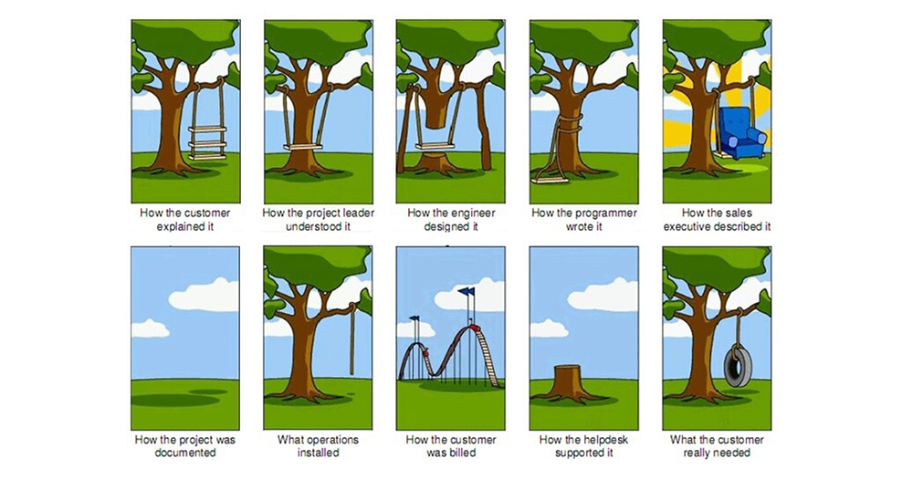
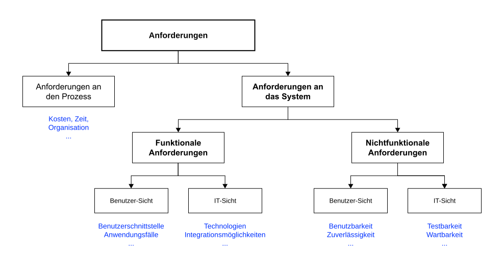
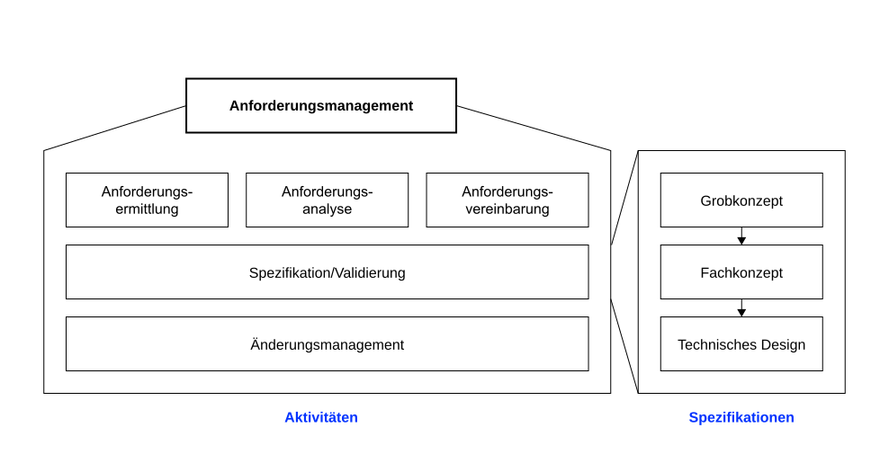
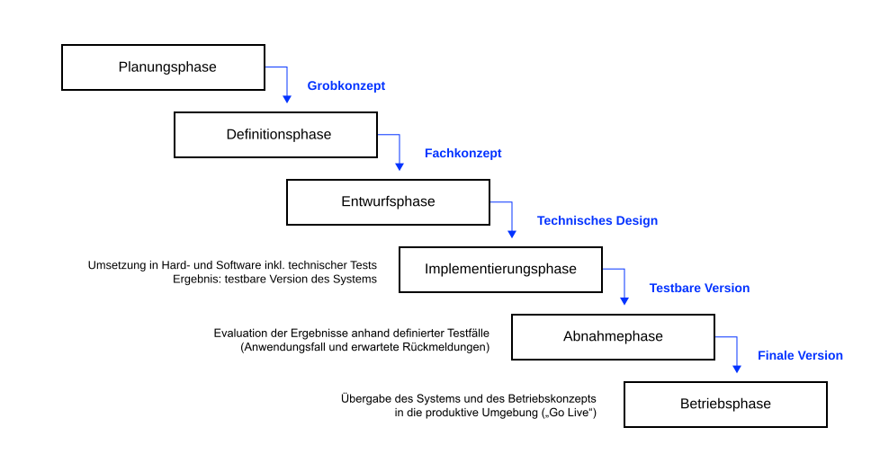
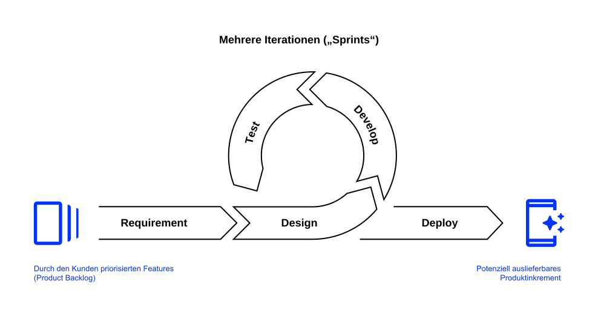
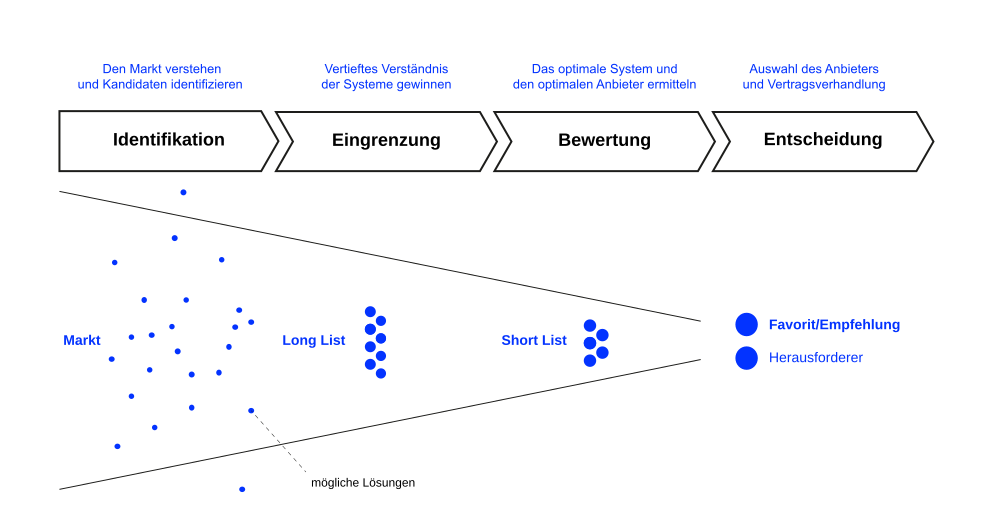
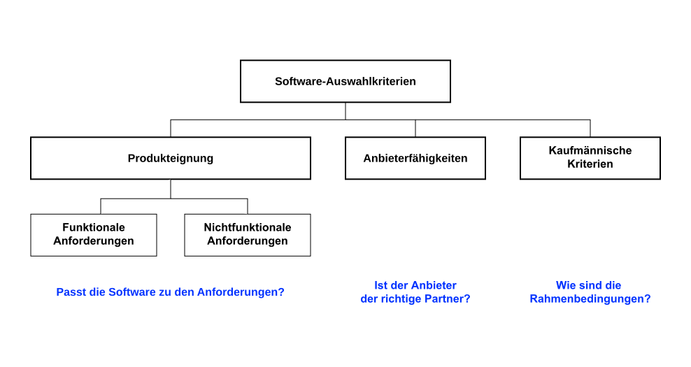

# Motivation {.vertical-center .bg-highlight}

> We‘ve minimized the economic impact of the defects of the system via an advanced business process called ‘hoping nobody notices’. *Dilbert, merican comic strip written and illustrated by Scott Adams*

. . .

> As a rule, software systems do not work well until they have been used, and have failed repeatedly, in real applications. *David Parnas, early pioneer of software engineering and professor of computer science*

:::notes
Der Nutzen von Anwendungssystemen zeigt sich nicht auf dem Papier, sondern erst in der Praxis, nämlich dann wenn Sie Teil eines betrieblichen Informationssystem werden. Um den Nutzen zu maximieren, müssen die richtigen Anwenundungssysteme ausgewählt oder entwickelt, an die Geschäftsprozesse angepasst (oder vice versa) und von den Mitarbeitenen genutzt werden. Welche Möglichkeiten zur Implementierung zur Verfügung stehen und was es zu beachten gilt ist Thema dieses Kapitels.
:::

# Lernergebnisse 🎯

Nach dieser Einheit

::: incremental
- verstehen Sie, weshalb **Modelle** für die Entwicklung und Anpassung von Anwendungssystemen notwendig sind,
- können Sie den **Anwendungslebenszyklus** beschreiben,
- kennen Sie erste **Herausforderungen in der fachlichen Konzeption** von Anwendungssystemen sowie Ansätze zum Umgang mit diesen,
- verstehen Sie **Grundsätze der linearen Phasen-basierten sowie der agilen Methoden** zur Entwicklung von Individualsoftware erläutern und
- können Sie **den Auswahl- und Einführungsprozess von Standardsoftware** beschreiben
:::

# Einleitung

Für viele Bereiche sind Anwendungen am Markt erhältlich, mit der die fachlichen Anforderungen vieler Unternehmen  abgedeckt werden können — sogenannte __Standardsoftware__ [@mertens2016grundzuge]. 

. . .

Sind die Anforderungen des Unternehmens sehr spezifisch, so muss die Standardsoftware __modifiziert__ bzw. erweitert werden.

. . .

Ist das nicht möglich, ist die Entwicklung eines unternehmensspezifischen Anwendungssystems erforderlich — sogenannte __Individualsoftware__ [@mertens2016grundzuge].

:::notes
:::{.callout-note}
### Vor- und Nachteile von Standard- und Individualsoftware
Einführung und Betrieb von Standardsoftware sind in der Regel mit __weniger Risiken__ verbunden: 

- Niedrigere und besser kalkulierbare Kosten und höhere Investitionssicherheit
- Möglichkeiten zur Evaluierung vor Einführung
- Höhere Qualität (Reife, Stabilität und Skalierbarkeit, Standardkonformität)
- Abbildung von Best-Practice Prozessen

Auf der anderen Seite kann Individualsoftware besser auf die Unternehmensbelange zugeschnitten werden. So können bspw. spezifische Prozesse, die eine Basis für Wettbewerbsvorteile darstellen, unterstützt werden.
:::
:::

## Anwendungslebenszyklus

Der Lebenszyklus von betrieblichen Anwendungssystemen überspannt den Zeitraum zwischen der ursprünglichen Idee über die Entwicklung und Einführung, sowie die Wartung und evtl. Weiterentwicklung bis hin zur Ablösung [@krcmar2015informationsmanagement].

Angesichts der relativ langen Lebensdauer von betrieblichen Anwendungen muss der Lebenszyklus systematisch gesteuert werden.

Der Anwendungslebenszyklus wird im Allgemeinen in sechs Phasen unterteilt: *Entwicklung*,
*Einführung*, *Wachstum*,*Sättigung/Reife*, *Rückgang* und *Abschaffung* [@heinrich2005informationsmanagement].

## Visualisierung

![Modell des Anwendungslebenszyklus in Anlehnung an @heinrich2005informationsmanagement [S. 237]](images/lifecycle.svg){#fig-lifecycle}

:::notes

@krcmar2015informationsmanagement [S. 65-66] beschreibt die Phasen des Lebenszyklus wie folgt: 

- **Entwicklung**: In der Phase der Entwicklung werden die Schritte der Ideenfindung und verwirklichung, beispielsweise im Rahmen eines Software-Entwicklungsprojekts oder -Auswahl und Beschaffungsprojekts, durchlaufen. Hier fallen während des Lebenszyklus die höchsten Systemkosten an.
- **Einführung**: Wird eine freiwillige Nutzung unterstellt, ist diese im Idealfall zunehmend. Die Nutzungsintensität wird auch vom Auftreten und Beseitigen von Fehlern während der Installationstests und zu Beginn des produktiven Betriebs bestimmt. 
- **Wachstum**: In dieser Phase sind alle Tests abgeschlossen und alle während der Einführung aufgetretenen Fehler beseitigt. Alle Funktionen der Anwendung können produktiv genutzt werden. Es kommt idealerweise zu einem weiteren Anstieg der Nutzung, sofern es sich nicht um eine Anwendung mit beschränktem Benutzerkreis handelt.
- **Sättigung/Reife**: In dieser Phase erreicht die Nutzung ihren Höhepunkt. Bisherige Nutzer können keine weiteren Nutzungsmöglichkeiten entdecken und weitere Nutzer kommen nicht mehr hinzu. Ein Nutzungsrückgang kann dadurch verursacht werden, dass das System nicht mehr dem Stand der Technik entspricht, mit anderen, zeitlich nachgelagert eingeführten, Systemen konkurriert oder die Menge und Bedeutung der unterstützten Aufgaben zurückgeht.
- **Rückgang**: Der in der Phase Sättigung/Reife einsetzende Nutzungsrückgang setzt sich fort.
- **Abschaffung**: In dieser Phase wird die Entscheidung getroffen, zu welchem Zeitpunkt ein System abgeschafft oder durch ein neues System abgelöst wird. Über den Zeitpunkt der Nutzung hinaus kann das auslaufende System noch Umstellungskosten oder auch remanente Lizenzkosten verursachen.
:::

# Anforderungsmanagement

Vor der Auswahl einer Standardsoftware bzw. der Entwicklung einer Individualsoftware sowie deren Einführung eines Systems müssen die **Anforderungen unternehmensspezifisch erhoben werden** [@krcmar2015informationsmanagement].

. . .

Informationssysteme sind **soziotechnische Systeme**. Deshalb müssen neben den technischen Anforderungen auch Anforderungen an die nicht-technischen Komponenten formuliert werden (insbesondere die zu gestaltenden Prozesse).

. . .

Das **Anforderungsmanagement** ist eine systematische Vorgehensweise, um alle relevanten Anforderungen zu ermitteln, zu analysieren, zu vereinbaren, zu spezifizieren, zu validieren, im Projekt zu verfolgen und gegebenenfalls zu ändern [@ebert2019systematisches].

## Notwendigkeit

{#fig-re}

## Anforderungsarten

Die Anforderungen an ein zu entwickelndes System können in **funktionale und nichtfunktionale Anforderungen** unterschieden werden.

. . .

Funktionale Anforderungen
: Diese beschreiben das Verhalten und die Funktionen des Systems und geben an, was das System leisten soll (bspw. Funktionsumfang, UI/UX, Datenstrukturen, Integrationsmöglichkeiten). 

. . .

Nichtfunktionale Anforderungen
: Diese beschreiben, wie gut funktionale Anforderungen durch das System
realisiert werden sollen (bspw. die Reaktionszeit, Verfügbarkeit, Sicherheit).

## Visualisierung

{#fig-anforderungen}

## Aktivitäten

{#fig-am}

:::notes
Nach @ebert2019systematisches sind die Aktivitäten des Anforderungsmanagements: 

- **Anforderungsermittlung**: Im Rahmen der Anforderungsermittlung werden die Anforderungsquellen, z. B. Stakeholder, identifiziert und die Anforderungen an das zu entwickelnde System erhoben. 
- **Anforderungsanalyse**: Die ermittelten Anforderungen werden hinsichtlich ihrer Machbarkeit, Vollständigkeit oder Eindeutigkeit überprüft sowie konkretisiert und priorisiert. Das Ziel der Anforderungsanalyse ist die Beschreibung einer angestrebten Lösung, die die Anforderungen erfüllt.
- **Anforderungsvereinbarung**: Im Rahmen der Anforderungsvereinbarung werden Konflikte zwischen Stakeholdern in Bezug auf die Anforderungen identifiziert und gelöst. 
- **Spezifikation**: Die abgestimmten Anforderungen werden in einem Anforderungsdokument, auch Anforderungsspezifikation genannt, festgehalten. Die Beschreibung des Systems kann zusätzlich, beispielsweise in Form von Use Cases, erfolgen.
- **Validierung**: Während der Validierung wird überprüft, ob die analysierten und spezifizierten Anforderungen den Stakeholderwünschen oder Marktbedürfnissen entsprechen.
- **Änderungsmanagement**: Das Änderungsmanagement hat die Aufgabe, mit Änderungen an Anforderungen so zu erheben, zu
verwalten und zu priorisieren, dass die Projektlaufzeit sowie das Budget nicht überschritten werden und dass das Projekt insgesamt erfolgreich abgeschlossen werden kann.

Nach Abschluss der **Validierung** müssen alle Anforderungen an das System formuliert sein:

- Was das System können muss
- Was das System nicht können muss
- Wie das System sich verhalten soll
- Wie das System „aussehen“ soll (UI)
:::

## Spezifikation

Die Form der Beschreibung wird mit zunehmendem Detaillierungsgrad immer formaler bis hin zu einer detaillierten technischen Spezifikation (Modelle). 

. . .

Grobkonzept
: Semi-formale Beschreibung der fachlichen Anforderungen und Grenzen auf hohem Niveau

. . .

Fachkonzept
: Detaillierte Ausformulierung der fachlichen Anforderungen inkl. formaler Modelle („Lastenheft“)

. . .

Technisches Design
: Formaler Systementwurf mit allen systemseitig notwendigen Festlegungen und Eingrenzungen

:::notes
Die Freiheitsgrade nehmen zunehmend ab. Im Idealfall kann ein am Prozess unbeteiligter Software-Entwickler auf Basis des technischen Designs das System ohne weitere Rückfragen erstellen.
:::

# Software-Entwicklung

Der Erfolg einer Anwendungsentwicklung hängt wesentlich davon ab, wie gut die einzelnen Schritte des Projektes geplant, wie gut Probleme vorhergesehen und mögliche Lösungen vorbereitet werden [@krcmar2015informationsmanagement].

. . .

In der Praxis werden in der Software-Entwicklung zwei verschiedene Typen von Vorgehensmodellen verwendet:

:::incremental
- **Lineare Phasenmodelle**: Grundprinzip ist die Abgrenzung einzelner Phasen durch Meilensteine. Die Phasen werden sequenziell durchlaufen, Rücksprünge in vorangegangene Phasen sind nur dann vorgesehen, wenn festgestellt wird, dass gesteckte Ziele sonst nicht erreicht werden.
- **Agile, iterative Vorgehensmodelle**: Die Wiederholung von vorangegangenen Arbeitsschritten ist ausdrücklich vorgesehen.
:::

## Lineare Phasenmodelle

Die linearen Phasenmodelle zerlegen den Entwicklungsprozess in aufeinanderfolgende Spezifikationsschritte.

. . .

Die einzelnen Teilschritte schließen jeweils mit einem nachzuweisenden Ergebnis ab, das den Input für die nächste Phase bildet. Deshalb wird dieses Modelle auch oft als *Wasserfall-Modell* bezeichnet.

. . .

Falls Probleme auftauchen, für die Entscheidungen in vorigen Phasen ursächlich sind, muss in die Phase zurückgesprungen werden, in der diese getroffen wurden. Die Fehlerbeseitigung kann dann aufwändig sein.

:::notes
Das Wasserfall-Modell stellt hohe, teilweise praxisferne Anforderungen, die in einer Vielzahl von Problemen resultieren [@mertens2016grundzuge]:

- Die Anforderungen an das neue System müssen vollständig vor Beginn der Implementierung vorliegen, Fehler werden oft erst spät erkannt
- Üblicherweise ist es kaum möglich, Anforderungen ex ante vollständig und korrekt zu formulieren
- Manche Anforderungen ergeben sich erst während der Nutzung des neuen Systems
- Zwischen der Spezifikation der Anforderung und der Produktivsetzung des Systems können mehrere Monate bis Jahre vergehen, in einem VUCA Umfeld ändern sich in dieser Zeit die Anforderungen fast zwangsläufig

Das Wasserfall-Modell kommt in seiner  Reinform in der Praxis üblicherweise nicht vor. Statt dessen werden oft *zyklische Phasenmodelle* verwendet, die aus mehreren sich  überlappenden Wasserfall-Modellen bestehen und Rücksprünge in Vorphasen vorsehen [@krcmar2015informationsmanagement].
:::

## Visualisierung

{#fig-wasserfall}

## Agile, iterative Ansätze

Agile Ansätze umfassen wiederholt ablaufende Aktivitäten, an deren Ende jeweils ein messbares Teilergebnis, d. h. eine teilfertige und nutzbare Version des zu erstellenden Systems, als Grundlage für nachfolgende Iterationen steht [@mertens2016grundzuge]. 

:::incremental
- Als Basis der Umsetzung dient in der Regel eine fachliche Anforderungsdefinition („User Story“), die in einzelne logisch zusammengehörende Arbeitspakete unterteilt wird.
- Die Kommunikation zwischen den Entwicklern und mit den späteren Nutzern der Software ist ein wichtiges Element. Wenn möglich, sollen die teilfertigen Versionen schnell eingeführt und schrittweise ergänzt werden.
- Ein Beispiel für ein solchen Ansatz ist *SCRUM.*
:::

:::notes
Bei dem SCRUM-Vorgehensmodell werden Arbeitspakete in sog. „Sprints“, d. h. vierwöchigen Implementierungsphasen, entwickelt. Im Anschluss werden die Ergebnisse direkt vom Nutzer getestet.

Selbstorganisation, Transparenz, Kunden-Fokus, Flexibilität und kontinuierliche Verbesserung sind wesentliche Werte dieser Vorgehensmodelle.
:::

## Visualisierung

{#fig-SCRUM}

# Software-Einführung

Projekte zum Einführen von Standardsoftware dauern zumeist mehrere Monate. Die Einführungskosten, insbesondere Personalkosten, übersteigen dabei meistens deutlich die Kosten für die Software (insbesondere Lizenzkosten) [@mertens2016grundzuge].

. . .

Auch bei der Einführung von Standardsoftware ist ein erhebliches fachliches Verständnis für die zu unterstützenden betrieblichen Funktionen und Prozesse notwendig.

. . .

Projekte zum Einführen von Standardsoftware laufen vergleichbar der Individualentwicklung in Phasen ab. 

. . . 

Analog zur Entwicklung von Individualsoftware existieren verschiedene phasenorientierte Vorgehensmodelle. Allen gemein sind drei Grundphasen: die Auswahl, die Einführung sowie der Betrieb der Software.

## Phasenmodell

![Phasenmodell zur Software-Einführung nach @mertens2016grundzuge [S. 142]](images/einführung.svg){#fig-einführung}

Bei der Anpassung unterscheidet man zwischen **Customizing** und **Parametrisierung.** Im Rahmen des Customizing werden Eigenschaften der Software in der Regel per Programmierung angepasst, im Rahmen der Parametrisierung werden vorhandene Einstellungsmöglichkeiten des Systems zur Anpassung verwendet.

## Produktauswahl

{#fig-auswahl}

:::notes
Die Auswahl einer Standardsoftware lässt sich in vier Phasen gliedern.

- **Identifikation**
    - Zielsetzung: Den Markt verstehen und mögliche Lösungen identifizieren 
    - Wichtige Aktivitäten:
        - Anforderungen in einem Kriterienkatalog erfassen
        - Liste potenzieller Anbieter erstellen (Long List)
        - Informationen anfordern (Request for Information, RfI)
- **Eingrenzung**
    - Zielsetzung: Detailliertes Verständnis der Fähigkeiten der Lösungen und Anbieter gewinnen
    - Wichtige Aktivitäten:
        - Bewertung der Antworten der Anbieter auf die RfI
        - Erweiterung des Kriterienkatalogs und Entwicklung von Use Cases
        - Erstellung der Short List
- **Bewertung**
    - Zielsetzung: Das optimale System und den optimalen Anbieter ermitteln
    - Wichtige Aktivitäten:
        - Anforderung kommerzieller Angebote der Short-List (Request for Proposal, RfP)
        - Durchführung von Workshops zur Bewertung der Lösungen anhand der Use Cases
- **Entscheidung**
    - Zielsetzung: Auswahl des Anbieters und Vertragsverhandlung
    - Wichtige Aktivitäten:
        - Analyse der kommerziellen Angebote (Favorit und Herausforderer)
        - Abschluss der Verhandlungen (finales Angebot)
        - Entscheidung treffen und abstimmen
:::

## Auswahlkriterien

{#fig-auswahlkriterien}

:::notes
Im Rahmen der Softwareauswahl sollten sowohl das Anwendungssystem als auch der Anbieter und die kommerziellen Rahmenbedingungen evaluiert werden.

Wichtige **Eigenschaften des Anbieters** sind unter anderem:

- Branchen-Kenntnis
- Release-Strategie
- Verfügbarkeit und Support-Strukturen
- Ausfallrisiko
- Implementierungsansatz
- Partner-Ökosystem
- Erfolgsbilanz/Referenzen

Wichtige **kommerzielle Rahmenbedingungen** sind:

- Implementierungskosten
- Investitionskosten
- Betriebskosten (inkl. Langzeitprojektion)

:::

## Lizenzmodelle

Die in der Praxis vorkommenden Lizenzmodelle für kommerzielle Anwendungssysteme unterscheiden sich hauptsächlich in den Bezugsgrößen, die für die Ermittlung der Lizenzkosten herangezogen werden [@krcmar2015informationsmanagement]:

:::incremental
- **Nutzerbezogene Modelle**—Bezugsgröße ist in der Regel die Anzahl der Nutzer (Lizenzkosten pro Nutzer)
- **Wertbezogene Modelle**—Bezugsgröße können Personalbestand, Herstellkosten oder verkaufte Produkte sein (z.B. Umsatzbeteiligung in einem Webshop)
- **Zeitbezogene Modelle**—Bezugsgröße ist die Dauer der Nutzung (Subskription)
- **Infrastrukturbezogene Modelle**—Bezugsgröße ist das Ausmaß der Nutzung der Infrastruktur (bspw. IaaS nach Prozessor- oder Speichernutzung, Lizenzkosten pro Gerät)
:::

# Übungen ✏️ {.vertical-center .bg-highlight}

## Anforderungserhebung

Stellen Sie sich vor, Sie sind an der HNU angestellt und leiten das Projekt zur Einführung einer neuen E-Learning-Plattform. Ihre erste Aufgabe ist die Erstellung eines Grobkonzeptes.

Starten Sie mit der Erhebung der Anforderungen und erstellen Sie eine Liste der wichtigsten Anforderungen an eine E-Learning-Plattform:

Wie würden Sie vorgehen und wen würden Sie einbinden?

Anforderungserhebung: 

- Wer könnte welche Anforderungen an das System haben? Listen Sie Anforderungen inkl. Anforderer.
- Markieren Sie funktionale und nicht-funktionale Anforderungen in der Liste.
- Bewerten Sie die Anforderungen auf Ihrer Liste nach Wichtigkeit. 
- Analysieren Sie die Liste hinsichtlich möglicher Probleme/Zielkonflikte.

Wägen Sie dann zwischen den Optionen Make or Buy ab:

- Würden Sie sich für die Einführung einer Standard- oder einer Individualsoftware entscheiden? Warum?
- Welche speziellen Anforderungen gäbe es bei der Entwicklung einer Individualsoftware zu berücksichtigen?
- Welche Lizenzmodelle würden Sie bei einer Standardsoftware bevorzugen?

## Agile Vorgehensmodelle

Um die Nachteile des Wasserfallmodells zu vermeiden, werden in vielen Unternehmen mittlerweile verstärkt **agile Vorgehensmodelle** eingesetzt. Diese sind als Gegenentwurf zu den traditionellen Vorgehensmodellen entstanden und zielen unter anderem darauf ab, auf Anforderungsänderungen schnell reagieren zu können. Die verschiedenen agilen Vorgehensmodelle basieren auf denselben Prinzipien und weisen Gemeinsamkeiten im Vorgehen auf.

- Recherchieren Sie zu einem dieser Vorgehensmodelle (bspw. SCRUM). 
- Fassen Sie die **wesentlichen Prinzipien** in eigenen Worten zusammen. 
- Leiten Sie aus den Prinzipien Vorteile gegenüber linearer Phasenmodelle (bspw. Wasserfallmodell) ab. Berücksichtigen Sie inbesondere die Charakteristika des digitalen Zeitalters.

:::notes
Folgende Quellen könnten nützlich sein:
- @bächle2018einführung [S. 53ff]
- @abts2017grundkurs [S. 439ff]
- [Agile Essentials der Agile Alliance](https://www.agilealliance.org/agile-essentials)
:::

## Kosten von Anwendungssystemen

Recherchieren Sie die Kosten für die Entwicklung der deutschen "Corona Warn App".

- Listen Sie die Kosten (jährlich oder für einen definierten Zeitraum)
- Wie ist das Verhältnis von Entwicklungskosten zu Betriebs-und Wartungskosten?
- Welche Konsequenzen können Sie daraus für die Entwicklung von Individualsoftware ableiten?

# Lernkontrolle 🧐 {visibility="hidden"}

- Was sind Herausforderungen in der Anforderungserhebung?
- Worin unterscheiden sich funktionale und nicht-funktionale Anforderungen?
- Was sind Vor- und Nachteile linearer Phasenmodelle?
- Worin unterscheiden sich agile Vorgehensmodelle?
- Welche Ähnlichkeiten erkennen Sie zwischen agilen Vorgehensmodellen in der Software-Entwicklung und Design Thinking?
- Welche Kriterien sollten bei der Auswahl eines Standard-Anwendungssystems berücksichtigt werden?
- Welche Kosten müssen bei der Entscheidung zur Implementierung von Anwendungssystemen berücksichtigt werden?

# Literatur 📚
::: {#refs}
:::
