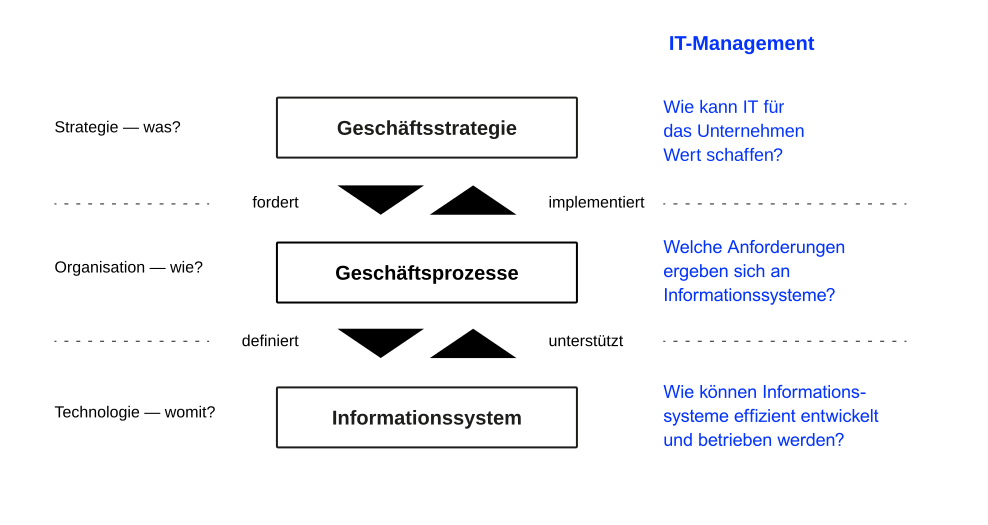
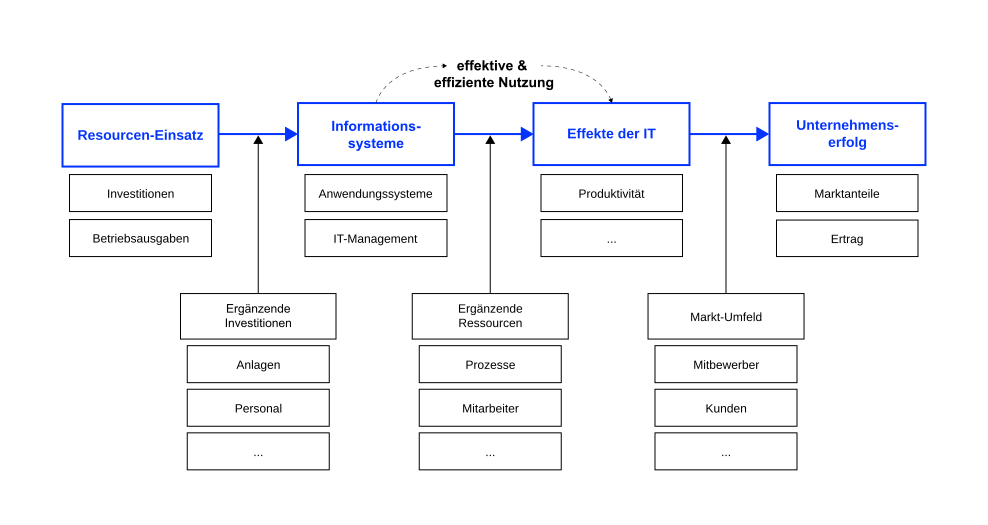
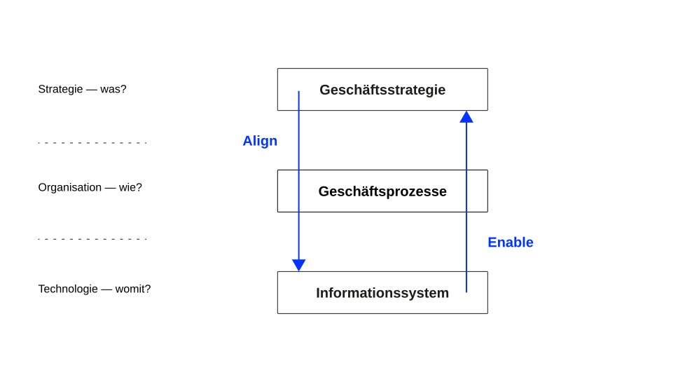
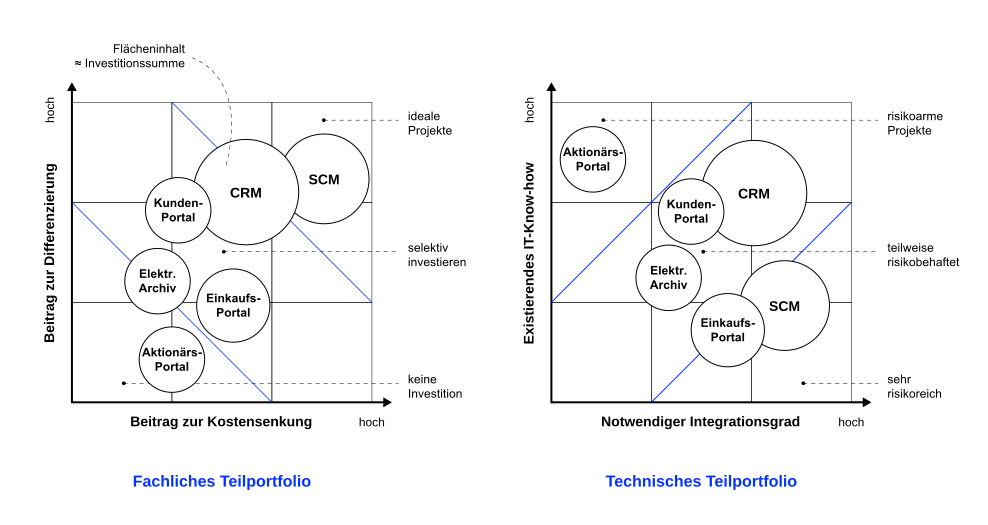
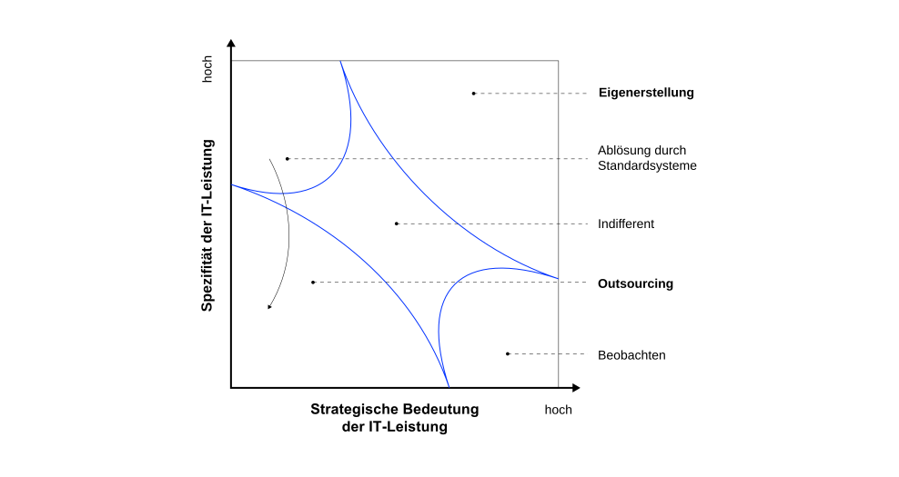
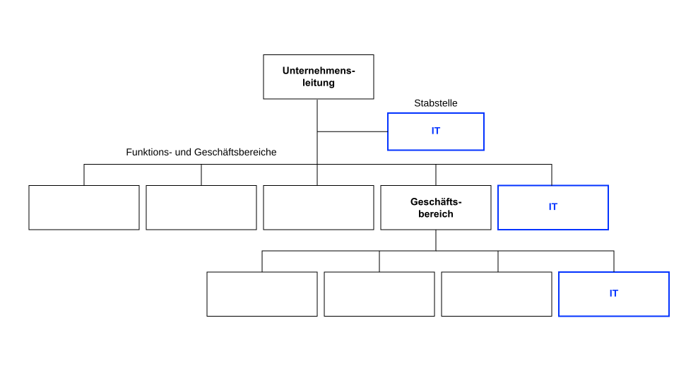
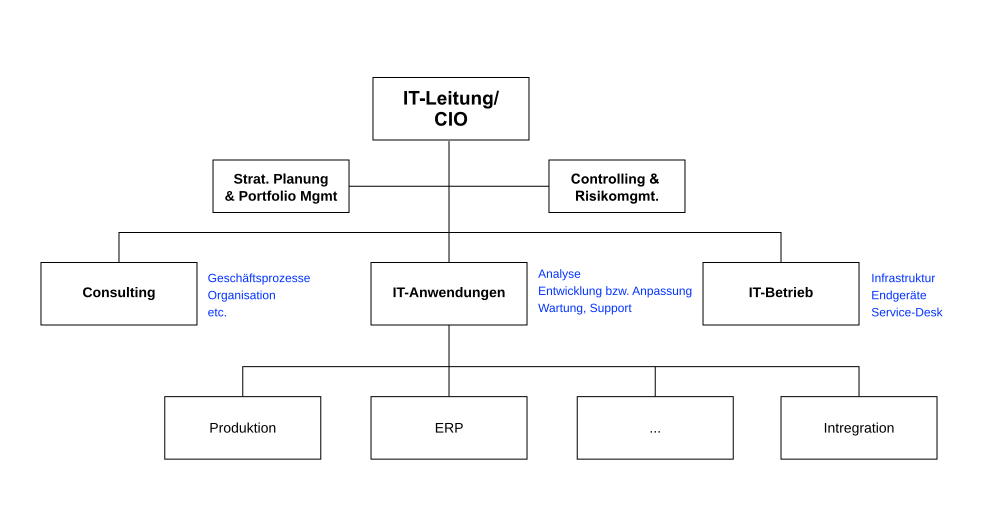

# Motivation {.vertical-center .bg-highlight}

> Ohne IT-basierte Anwendungssysteme sind viele Unternehmen überhaupt nicht mehr funktionsfähig. Das Management der Ressource IT ist damit zu einem wichtigen Thema des Managements geworden
*@mertens2016grundzuge [S. 160]*

:::notes
Informationstechnologie ermöglicht Unternehmen im digitalen Zeitalter die Entwicklung von entscheidenden Fähigkeiten. Analog zu anderen Produktionsfaktoren schafft jedoch auch IT nicht per se __Wettbewerbsvorteile__ für Unternehmen. Denn es ist nicht die Technologie, die den Unterschied macht. Entscheidend ist die Art und Weise, wie die Technologie implementiert, gesteuert und genutzt  wird. In diesem Kapitel erhalten Sie einen ersten Einblick in die Notwendigkeit und Ansätze für das Management der Ressource IT.
:::

# Lernergebnisse 🎯

Nach dieser Einheit 

::: {.incremental}
- können Sie erläutern, unter welchen Bedingungen IT zum Unternehmenserfolg beiträgt,
- sind Sie in der Lage, die wesentlichen Management-Aufgaben der IT im Unternehmen zu beschreiben,
- kennen Sie die Notwendigkeit und Möglichkeiten zum Managements des IT-Projektportfolios und der IT-Landschaft,
- können den Nutzen und Kriterien für das Outsourcing von IT-Leistungen beschreiben und
- können Sie erläutern, wie IT in die Unternehmensorganisation eingebunden werden kann.

:::

# Begriffsklärung {.vertical-center .bg-highlight}

## IT-Management

Unter dem Begriff des __IT-Managements__ lassen sich diejenigen Aufgaben fassen, die sich für die Leitung eines Unternehmens aus der Nutzung von IT ergeben.

. . .

Das IT-Management umfasst die __Planung, Überwachung und Steuerung__ der Informationsarchitektur des Unternehmens (strategische Ebene) und der einzelnen Komponenten dieser Infrastruktur (taktische Ebene) sowie deren Nutzung (operative Ebene).

. . .

Wesentliche Aufgaben sind:

. . . 

::: {.incremental}
- Entwicklung und Umsetzung der __IT-Strategie__ (IT als strategischer Wettbewerbsfaktor),
- __Gestaltung__ des Aufbaus der Informationssysteme sowie
- Realisierung und __Betrieb__ der IT-Landschaft
:::

## Einbettung

{#fig-be}

## Wertbeitrag der IT

Der Wertbeitrag der IT beschreibt die __subjektive Zusammenfassung der Kosten und der Nutzeffekte__ einer Investition in IT-Lösungen [@krcmar2015informationsmanagement].

. . .

Die Kosten einer IT-Lösung sollten über die gesamte Lebensdauer hinweg bestimmt werden, wobei die Abschätzung des Nutzens üblicherweise schwieriger ist als die Kostenbestimmung [@mertens2016grundzuge].

. . .

Erst wenn die Informationssysteme auf die Unternehmensstrategie und die Geschäftsprozesse abgestimmt sind, kann IT einen Wertbeitrag zum Unternehmenserfolg leisten.

. . .

Durch die erfolgreiche Abstimmung kann IT die __Produktivität__ erhöhen und bessere __Entscheidungen__ ermöglichen sowie __neue Produkte und Services__ möglich machen und sich somit zu einem strategischen Wettbewerbsfaktor entwickeln.

# Handlungsfelder {.vertical-center .bg-highlight}

## IT-Strategie

Analog zur Unternehmensstrategie definiert die IT-Strategie

:::incremental
- die grundlegenden __langfristigen Ziele__ eines Unternehmens hinsichtlich der Gestaltung und Nutzung der Informationstechnologie
- die __Handlungsoptionen__, die zur Erreichung dieser Ziele erforderlich sind sowie
- die __Ressourcen-Allokation__, insbesondere die Zuweisung von Investitionsmitteln und Betriebsausgaben festgelegt.
:::

. . .

Auch die IT-Strategie richtet den Blick nach Außen und versucht, die Chancen und Risiken verfügbarer Technologien mit den Fähigkeiten und Ressourcen des Unternehmens in Einklang zu bringen.

. . .

Die IT-Strategie definiert, in welche Technologie investiert wird, um gemeinsam mit ergänzenden Ressourcen effektive Informationssysteme zu schaffen, die durch ihre Effekte im gegebenen Marktumfeld Wettbewerbsvorteile erzielen.

----

#### Visualisierung

{#fig-mechanismen}

## Effekte der IT-Nutzung

Richtig eingesetzt führt IT zu höherer Produktivität und größerem Nutzen [@sambamurthy1994management], zum Beispiel:

:::incremental
- IT wird in __neue Produkte/Dienstleistungen__ integriert, die z. B. zu einer erhöhten Kundenzufriedenheit führen.
- IT ermöglicht die Implementierung von __effizienteren Geschäftsprozessen__, die z. B. zu höherer Produktivität oder Mitarbeiterzufriedenheit führen.
- IT verbessert die __Entscheidungsfindung__, indem bspw. ein besseres Verständnis von Märkten und Kunden ermöglicht wird.
- IT ermöglicht __flexible und anpassungsfähige Organisationsformen__, die bspw. zu kürzeren Vorlaufzeiten bei der Produktentwicklung führen.
:::

. . .

Die IT-Strategie legt fest, wie IT Wertbeiträge generieren möchte und definiert Handlungsoptionen, um diese zu erreichen.

## Align-Enable

:::notes
Um die Wertbeiträge zu generieren, müssen die Informationssysteme so gestaltet und gemanagt sein, dass diese die Prozesse und indirekt die Strategie des Unternehmens möglichst optimal unterstützen („align“).

Gleichzeitig können Informationssysteme so gestaltet werden, dass diese komplett neue Prozesse und neue Geschäftsstrategien ermöglichen. Auch solche Potenziale müssen in der Strategie-Entwicklung identifiziert und festgeschrieben werden („enable“).
:::

{#fig-align-enable}

## IT-Projektportfolio

Vor der effizienten Umsetzung eines oder mehrerer IT-Projekte mittels dem passenden [Vorgehensmodell](../10/#software-entwicklung) muss in der Regel zwischen mehreren Projektideen entschieden werden.

. . .

Neben **ökonomischen Aspekten** (Wertbeitrag) sollten bei der Auswahl auch **technische Kriterien** (bspw. notwendiger Integrationsgrad und vorhandenes Know-how) bewertet werden [@mertens2016grundzuge]. 

. . .

:::incremental
- In der Bewertung werden unterschiedliche **Teilportfolio** gebildet (bspw. fachliches und technisches Teilportfolio). 
- Projekte werden typischerweise auf Basis **subjektiver Bewertungen** fachkundiger Mitarbeiter in den Portfolios positioniert.
- Durch die Bewertung können dann **Projekte ausgewählt** werden, die bspw. einen hohen Nutzen stiften und gut machbar sind.
:::

----

#### Visualisierung

{#fig-portfolio}

## Informationsarchitektur 

Die Informationsarchitektur (oder IT-Landschaft) beschreibt alle im Unternehmen eingesetzten IT-Komponenten in folgenden Bereichen [@mertens2016grundzuge]:

:::incremental
- **Anwendungsarchitektur**: beschreibt welche Anwendungssysteme welche Geschäftsprozesse und Funktionen unterstützen. Hierbei werden unter anderem Prozesslandkarten und Wertschöpfungsdiagramme ergänzt um die eingesetzten Informationssysteme eingesetzt.
- **Datenarchitektur**: bildet die Datenbestände (*Wo sind welche Daten gespeichert?*) und deren Struktur (*Welche Datenmodelle liegen zugrunde?*) ab. Hierzu sind unternehmensweite Datenmodelle hilfreich.
- **Kommunikationsarchitektur** bildet den Datenfluss zwischen Funktionen und Datenbeständen ab.
- **IT-Architektur**: beschreibt, die technische Infrastruktur (typischerweise Server, Endgeräte, Netzwerke).
:::

. . .

Ziel des IT-Managements ist es, diese Bereiche kontinuierliche auf die Geschäftsprozesse und Aufbauorganisation abzustimmen.

## IT-Sourcing

Das IT-Management ist auch mit der Entscheidung betraut, ob Leistungen selbst erbracht (*„make“*) oder von extern bezogen (*„buy“*) werden. Letzteres wird oft als **Outsourcing** bezeichnet.

. . .

Bei diesem Entscheidungsproblem sollten vier Aspekte berücksichtigt werde [@mertens2016grundzuge]:

:::incremental
- Welche Aufgaben der IT werden betrachtet (was)?
- Wo könnten Vorteile des Fremdbezugs liegen (warum)?
- Wie genau wird der Fremdbezug ausgestaltet (wie) und
- Wohin wird die Leistungserstellung verlagert (wohin)?
:::

. . .

Wesentliche Gründe für das Outsourcing sind neben **Kostensenkungen** die **Konzentration auf Kernkompetenzen** und der **Zugang zu fehlendem Know-how**.

----

#### Entscheidungsmatrix

{#fig-outsourcing}

# Organisation {.vertical-center .bg-highlight}

:::notes
Die IT sollte so organisiert und geleitet sein, dass diese an den Geschäftszielen ausgerichtet ist, verantwortungsvoll die verfügbaren Ressourcen einsetzt sowie das Risikomanagement angemessen betreibt [@meyer2003governance].
:::

## Einordnung der IT

Die Unternehmens-IT kann grundsätzlich auf drei verschiedene Arten in die Organisation eines Unternehmens eingeordnet werden: als Stabsstelle, als Linienfunktion oder in einer Mischform.

:::incremental
- **IT als Stabsstelle** der Geschäftsleitung: IT agiert als verlängerter Arm der Unternehmensleitung
- **IT als Linienfunktion**: IT agiert mit anderen Funktions- und Geschäftsbereichen auf Augenhöhe
- **Mischformen**: Zentrale Funktionen der IT sind als Stabsstelle organisiert, geschäftsspezifische Funktionen den Geschäftsbereichen untergeordnet
:::

. . .

Einige Unternehmen gliedern die IT oder Teile davon in selbstständige Unternehmen aus, um die Effizienz der Leistungserstellung durch tatsächliche Marktkräfte zu optimieren [@mertens2016grundzuge].

----

#### Visualisierung

{#fig-organisation}

## Interne Organisation 

Hauptaufgaben einer IT-Abteilung sind die Entwicklung sowie der Betrieb von Anwendungssystemen. Dazu sind ganz unterschiedliche Kompetenzen erforderlich.

. . .

Aus diesen Gründen finden sich in der IT typischerweise separate Einheiten für die **Entwicklung** und für den **Betrieb der Systeme**. Diese stellen den Kern einer IT-Abteilung dar.

. . .

Je nach Positionierung der IT umfasst diese auch folgende Einheiten:

- Strategische Planung und Architektur-Management
- IT-Controlling und IT-Sourcing
- IT-Risiko-Management und Datensicherheit
- Beratung (Entwicklung neuer Prozesse oder IT-basierter Produkte)

----

#### Visualisierung

{#fig-organigramm}

## Risikomanagement

Aufgrund der zentralen und noch wachsenden Bedeutung der IT ist sowohl das mit dem Betrieb verbundene Risiko zu berücksichtigen als der geltende Rechtsrahmen zur Speicherung und Verarbeitung von Daten [@mertens2016grundzuge].

:::incremental
- **Identifikation**, **Analyse** und **Bewertung** der mit IT verbundenen Gefahren (bspw. Hackerangriff, Stromausfall, etc.).
- **Planung** und **Umsetzung** geeigneter Maßnahmen zur Vermeidung oder Beherrschung dieser Unsicherheiten (technische oder organisatorische Maßnahmen).
- Laufende **Überwachung** und bedarfsgerechte Anpassung der getroffenen Maßnahmen.
:::

. . .

Besonderes Augenmerk gilt zudem dem **Datenschutz**, insbesondere dem Schutz personenbezogener Daten.

# Übungen ✏️ {.vertical-center .bg-highlight}

## IT-Management

Ein strategisches Ziel der HNU ist die Digitalisierung von Studium und Lehre ([siehe Hochschulentwicklungsplan](https://www.hnu.de/hochschule/profil/leitbild-strategie)).

Welche Konsequenzen ergeben sich daraus für das IT-Management der Hochschule? Nutzen Sie hierzu das Business-Engineering Modell und finden Sie Antworten auf die in @fig-be dargestellten Fragen. 

## Effekte der IT-Nutzung

Finden Sie anhand eines Unternehmens Ihrer Wahl möglichst konkrete Beispiele für die von @sambamurthy1994management identifizierten Kategorien der Nutzeneffekte von IT.

## Wertbeitrag Kundenportal

Stellen Sie sich vor, Sie sind für die Einführung eines Kundenportals verantwortlich. Über das Portal sollen die Kunden Produkte und Leistungen bestellen, Service-Aufträge platzieren, den Status Ihrer Aufträge abrufen, auf wichtige Dokumente und Informationen zugreifen, sowie Ihre Stammdaten ändern können.

- Welche Aspekte sind für die Bewertung des Wertbeitrags notwendig? Geben Sie möglichst konkrete Beispiele für Kosten und Nutzen eines Kundenportals. Wie könnte der Nutzen quantifiziert werden?
- Was ist notwendig, damit die beschriebenen Wertbeiträge realisiert werden können? Unter welchen Voraussetzungen entstehen Wettbewerbsvorteile? Beziehen Sie Ihre Antwort auf @fig-mechanismen.
- Inwieweit müsste das Kundenportal mit anderen Systemen integriert werden? Geben Sie Beispiele für Prozess- und Datenintegration und erläutern Sie jeweils die Integrationsrichtung.
- Würden Sie die Entwicklung des Kundenportals auslagern? Bitte begründen Sie Ihre Entscheidung. Falls notwendig, treffen Sie Annahmen.

## Alignment

Stellen Sie sich vor, Sie sind der CEO eines mittelständischen Dienstleistungsunternehmens, in dem die IT bislang im Wesentlichen für „die Technik“ zuständig ist und als Kostenfaktor (Cost Center) gesehen und entsprechend geführt wird. Leider müssen Sie feststellen, dass die IT nicht ausreichend zum Unternehmenserfolg beiträgt. Insbesondere folgende Schwachstellen fallen Ihnen auf:

-	Die verfügbaren Anwendungssysteme werden nicht intensiv genug genutzt. 
-	Die eingesetzten Informationssysteme sind nicht in der Lage, die Geschäftsprozesse effektiv zu unterstützen.
-	Die Unternehmensziele, die Sie mithilfe der IT erreichen möchten, spiegeln sich nicht in den Projektaufträgen und den Anforderungen an die Informationssysteme.
-	In der Unternehmensstrategie sind die Möglichkeiten technischer Innovationen kaum berücksichtigt.

Diskutieren Sie in der Gruppe, welche Maßnahmen Sie treffen könnten, um den Wertbeitrag der IT zu erhöhen.

## Handlungsfelder

Das IT-Management gestaltet die IT-Landschaft im Rahmen von IT-Projekten. Erläutern Sie anhand des Business-Engineering-Modells wie die IT dadurch zur Gestaltung erfolgreicher Unternehmen beitragen kann.

## Exkurs: Visualisierung {.scrollable}

Die Verbesserung der organisatorischen Entscheidungsfindung, die bspw. zu einem besseren Verständnis von Märkten und Kunden führen, ist ein Feld, auf dem die IT wesentliche Beiträge zum Unternehmenserfolg leisten kann. IT kann hier unter anderem dazu eingesetzt werden, die Analyse von großen Datenmengen zu unterstützen.

1. Lesen Sie in den Vorlesungsunterlagen den Exkurs zur Datenvisualisierung und recherchieren Sie zu diesem Konzept.
2. Schauen Sie sich folgende Datenvisualisierung an: [World’s Biggest Data Breaches & Hacks](https://www.informationisbeautiful.net/visualizations/worlds-biggest-data-breaches-hacks/) und beschreiben Sie, wie die IT-gestützte Visualisierung das Information Seeking Mantra unterstützt.
3. Überlegen Sie vor dem Hintergrund der in Kapitel 2 vorgestellten und diskutierten Eigenschaften des digitalen Zeitalters (Stichwort VUCA), weshalb Datenvisualisierung und Exploration ein wichtiger Baustein des Unternehmenserfolgs sein kann.
4. Welche Verantwortung und Aufgabe trägt hierfür das IT-Management?
4. Stellen Sie sich vor, Sie hätten Daten zu Ihrem LinkedIn Netzwerk (oder von einem anderen sozialen Netzwerk), also Daten über Ihre Kontakte und wie diese in Verbindung miteinander stehen. Sie möchten diese visualisieren, um sie dann analysieren zu können. Insbesondere interessiert Sie, welche Gruppen sich in Ihrem Netzwerk identifizieren lassen, was diese Gruppen eint (bspw. frühere Kollegen, gruppiert nach Arbeitgebern) und wie diese Gruppen in Beziehung zueinanderstehen.   
Welche Visualisierungsform würden Sie wählen (für eine Auswahl der Möglichkeiten siehe [hier](https://datavizproject.com/)) und welche Daten würden Sie in welcher Art visualisieren, um Ihre Fragen beantworten zu können?

:::notes
:::{.callout-note}
### Exkurs: Datenvisualisierung

Die Daten- und Informationsexploration dient der Erkundung innerer Strukturen von Daten und Informationen aus einer Datenmenge. Viele Phänomene können als mehrdimensionale Datensätze erfasst werden. Die darin enthaltenden und oft verborgenen Informationen können mittels explorativer Analysen erkundet werden. Das ermöglicht es, neues Wissen über die inneren Zusammenhänge und mögliche Muster zu erlangen. Die Datenvisualisierung hilft in diesem Erkundungsprozess durch eine grafische und interaktive Darstellung der Datensätze.

Die visuelle Datenexploration von Datenmengen kann nach einer dreistufigen Systematik vorgenommen werden, die Ben Shneiderman auch als „Information Seeking Mantra“ bezeichnet hat:

- __Overview first__ bedeutet, dass der Datenanalyst sich als erstes einen grundlegenden Überblick über die Datenmenge verschafft (erster Überblick). Erkennt er in dieser Betrachtung mögliche Muster oder Ausnahmen in den Konstellationen, betrachtet er diese Ausschnitte im nächsten Schritt näher.
- __Zoom and filter__ bedeutet, dass der Betrachter jetzt fokussiert und die möglichen Datenkonstrukte betrachtet, die ihm als Muster oder Ausnahmen aufgefallen sind (Vergrößern und Filtern). Zur genauen Analyse steigt er in die Details der Daten ein und betrachtet diese tiefgehend.
- __Details-on-demand__ bedeutet die detaillierte und ausführliche Betrachtung und Analyse der ausgewählten Datenkonstrukte zur Validierung der entdeckten Muster oder Ausnahmen (Detaillierung entsprechend dem gewählten Fokus).

:::
:::

# Lernkontrolle 🧐 {visibility="hidden"}

- Beschreiben Sie die wesentlichen Aufgaben des IT-Managements.
- Das IT-Management hat unter anderem zur Aufgabe, den Einsatz von IT so zu planen und zu steuern, dass die Geschäftsziele erreicht werden. In der Vorlesung haben wir hier zwischen zwei verschiedenen Pfaden entschieden: *align* und *enable*. Erläutern Sie anhand des Business-Engineering-Modells, was das IT-Management jeweils sicherzustellen hat.
- Nennen und erläutern Sie zwei der generischen Effekte, die IT auf den Unternehmenserfolg haben kann. Welche Voraussetzungen sind notwendig, damit diese Effekte eintreten können?
- Anhand welcher Kriterien sollten IT-Projekte bzw. Investitionen evaluiert werden?
- Geben Sie jeweils ein Beispiel für eine ausgelagerte und eine nicht-ausgelagerte Aufgabe der IT und erläutern Sie, weshalb eine Auslagerung (nicht) sinnvoll ist. 
- Erläutern Sie, weshalb das Management der IT-Landschaft zur Erhöhung der vertikalen und horizontalen Integration notwendig ist.

# Literatur 📚
::: {#refs}
:::
