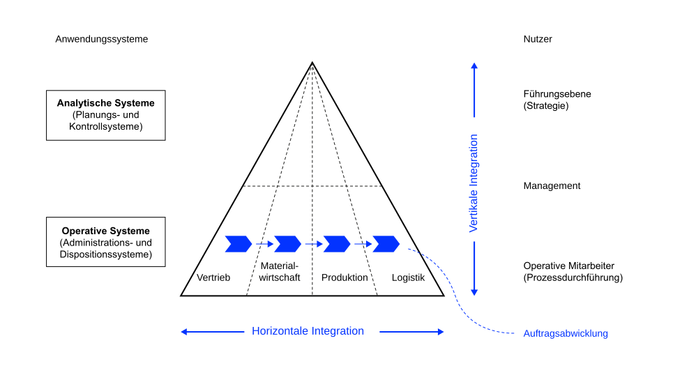
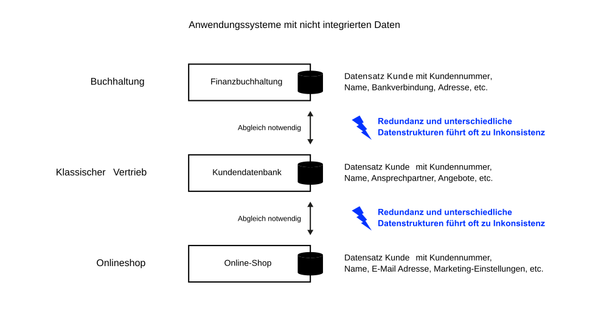
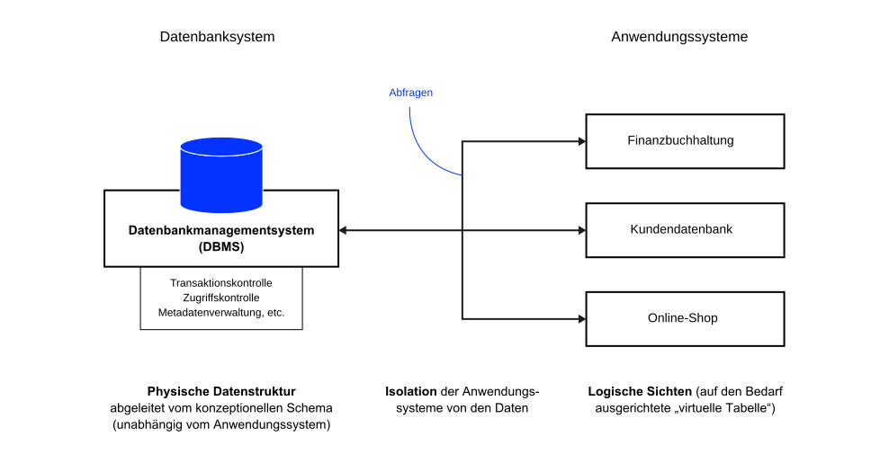

# Motivation {.vertical-center background-color="blue"}

> Das Ganze ist mehr als die Summe seiner Teile *Aristoteles, Philosoph (384 -- 322 v. Chr.)*

::: notes
Informationen sind ein wichtiger Produktionsfaktor und entstehen durch die Kontextualisierung, also Vernetzung von Daten. Mithilfe von Geschäftsprozessen erzeugt das Unternehmen Wert für den Kunden. In der Praxis sind, vor allem durch die zunehmende Arbeitsteilung und Spezialisierung, Prozesse und Daten jedoch oftmals unzureichend verknüpft. Das führt unter anderem zu Problemen wie Datenredundanzen und Inkonsistenzen, ineffiziente Prozesse und Qualitätsprobleme. In diesem Kapitel schauen wir uns an, wie durch die Integration von Daten, Funktionen und Prozessen diese Probleme reduziert werden können.
:::

# Lernergebnisse 🎯

Nach diesem Kapitel können Sie

::: incremental
-   das Konzept der Integration im Sinne einer **integrierten Informationsverarbeitung** erläutern,
-   zeigen, welche **Dimensionen der Integration** sich unterscheiden lassen,
-   die Konzepte **horizontale und vertikale Integration** anhand von Beispielen erklären,
-   erläutern, weshalb **Stammdatenmanagement** notwendig ist und wie es umgesetzt werden kann sowie
-   die Funktionsweise und Komponenten eines **Datenbanksystems** erläutern.
:::

# Integration {.vertical-center background-color="blue"}

## Notwendigkeit

Anwendungssysteme wurden und werden häufig für einzelne Unternehmen bzw. deren Abteilungen oder sogar einzelne Arbeitsplätze entwickelt.

. . .

Diese Fragmentierung steht einem arbeitsplatz-, abteilungs- oder unternehmensübergreifenden **Informationsfluss** im Weg.

. . .

**Integration** bedeutet, dass diese künstlich geschaffenen Grenzen durch die Verknüpfung von Mensch, Aufgaben und Technik wieder aufgehoben werden [@mertens2016grundzuge, p. 65].

::: notes
::: smaller
*Beispiel: Eine Kundendatenbank, ein Online-Shop und ein Finanzbuchhaltungssystem unterstützen zusammen die Auftragsabwicklung in einem Industrieunternehmen. Ohne eine Integration dieser Anwendungssysteme ist eine effiziente Abwicklung des durchgehenden Ablaufs eine Kundenbestellung nicht möglich. Wären etwa die Kundendatenbank und der Online-Shop nicht integriert, so würden Änderungen der Kundendaten, die über den Shop hereinkommen, nicht automatisch in das Kundenverwaltungssystem gelangen. Bei manuellem Abgleich der Daten durch Menschen entstehen durch Medienbrüche typischerweise Fehler und damit hohe Kosten für die Nachbearbeitung.*
:::
:::

. . .

Für die Integration bieten sich drei Ansatzpunkte bzw. **Gegenstände** an:

::: incremental
-   Datenintegration,
-   Funktionsintegration und
-   Prozessintegration [siehe @mertens2016grundzuge, p. 65].
:::

## Integrationsgegenstände

Datenintegration
:   Die Daten von mehreren Anwendungssystemen werden so verwaltet, dass jedes Datum (bspw. die Kundenadresse) nur einmal gespeichert ist. Tritt ein Datum mehrfach auf, werden die Kopien konsistent gehalten. Das wird in der Regel mittels [Datenbanksystemen](#datenbanksysteme) oder automatisierten Abgleichen realisiert.

. . .

Funktionsintegration
: Die Funktionsintegration hat zum Ziel, verschiedene Abteilungen oder Funktionen eines Unternehmens zu verbinden, sodass sie auf eine gemeinsame Datenbasis zugreifen und effizient zusammenarbeiten können. Ein Enterprise Resource Planning (ERP) System integriert beispielsweise die Funktionen von Finanzwesen, Personalwesen, Produktion und Logistik in einem Anwendungssystem.

. . .

Prozessintegration
:   Die Prozessintegration hat zum Ziel, Abläufe oder Prozesse, die oft abteilungs- und oder unternehmensübergreifend sind, zu verzahnen. Es geht darum, diese Prozesse zu automatisieren und zu optimieren, um die Effizienz zu steigern. Ein ERP-System integriert Prozesse wie Bestellabwicklung, Rechnungsstellung und Lieferkettenmanagement. Der Fokus liegt auf der Integration der Prozesse, um einen nahtlosen Ablauf zu gewährleisten.

## Voraussetzungen

Voraussetzung für eine gelingende Integration ist ein gutes Verständnis von und eine gute Übersicht über die zu integrierenden Gegenstände (Daten, Funktionen, Prozesse) sowie die eingesetzten Anwendungssysteme [@mertens2016grundzuge, p. 173].

. . .

**[Unternehmensdatenmodelle](../6/#datenmodellierung)** beschreiben die Datenbestände eines Unternehmens und deren Struktur (**Datenarchitektur**). In diesem Modell werden unter anderem Mindestanforderungen an Datensätze definiert, die von jedem Anwendungssystem implementiert werden müssen (bspw. Struktur der Kundennummer). Diese erleichtern unter anderem den automatischen Abgleich von Daten.

. . .

**[Prozessmodelle](../5/#Prozessmodellierung)** und **Organigrammen** beschreiben die Funktionen und Abläufe eines Unternehmens (**Organisationsarchitektur**) und welche Informationssysteme für welche Aufgaben eingesetzt werden.

## Integrationsrichtung

Die Integrationsrichtung beschreibt die Orientierung der Integration innerhalb und zwischen den verschiedenen Hierarchieebenen eines Unternehmens [@laudon2016wirtschaftsinformatik, p. 437]:

. . .

Vertikale Integration
:   Versorgung von Informationssystemen zur Entscheidungsunterstützung ([analytische Systeme](../8/#betriebliche-anwendungssysteme)) mit Daten aus den Systemen, die das Tagesgeschäft ermöglichen bzw. abbilden ([operative Systeme](../8/#betriebliche-anwendungssysteme)). Diese Daten werden verdichtet und verknüpft, um daraus Informationen zu gewinnen. 

. . .

Horizontale Integration
:   Die Verbindung der operativen Anwendungssysteme entlang der betrieblichen Wertschöpfungskette auf gleicher Hierarchieebene mit dem Ziel der durchgängigen Unterstützung von Geschäftsprozessen über mehrere Unternehmensbereiche hinweg.

## Visualisierung

{#fig-hierarchie}

## Integrationsreichweite

Hinsichtlich der Reichweite der Integration unterscheidet man zwischen der innerbetrieblichen und der zwischenbetrieblichen Integration [@laudon2016wirtschaftsinformatik, p. 437]:

. . .

Innerbetriebliche Integration
:   Integrierte Anwendungssysteme verbinden unterschiedliche Unternehmensbereiche entlang der Wertschöpfungskette. [Customer Relationship Management (CRM) Systeme](../8/#crm-systeme) verbinden bspw. Marketing, Vertrieb und Kundendienst.

. . .

Zwischenbetriebliche Integration
:   Anwendungssysteme von zwei oder mehr Unternehmen sind so aufeinander abgestimmt, dass Daten (bspw. Angebote, Aufträge, Lieferscheine, Rechnungen) zwischen Unternehmen und/oder Endkunden über unternehmensübergreifende Systeme digital ausgetauscht werden und so Prozesse weitestgehend automatisiert werden können (bspw. Auftragsabwicklung).

. . .

Unternehmensübergreifende Informationssysteme gewinnen mit der zunehmenden Digitalisierung immer mehr Bedeutung.

## Integrationszeitpunkt

Stapelverarbeitung und Ereignisorientierung sind zwei Ansätze, die über den Zeitpunkt der Integration entscheiden [@laudon2016wirtschaftsinformatik, p. 437]:

Stapelverarbeitung
: Bei der Stapelverarbeitung werden zu bearbeitende Daten zunächst gesammelt und dann zu einem definierten Zeitpunkt zwischen unterschiedlichen Anwendungssystemen abgeglichen (bspw. in der Nacht).

Ereignisorientierung
: Bei der Ereignisorientierung ist ein Ereignis der Auslöser von weiteren Verarbeitungsschritten. Verlässt bspw. eine Lieferung den Hof (Ereignis) werden automatisch alle relevanten Logistik-Informationen an den Kunden übertragen (Verarbeitungsschritte).

# Stammdatenmanagement {.vertical-center background-color="blue"}

## Definition

**Stammdatenmanagement** (engl. Master Data Management, MDM) befasst sich mit dem Management der Stammdaten im Unternehmen [@krcmar2015informationsmanagement, p.43]. 

. . .

**Stammdaten** sind Grunddaten eines Unternehmens, die sich auf betriebswirtschaftlich relevante Objekte beziehen. Stammdaten existieren unabhängig von anderen Daten und werden im Zeitablauf selten verändert (bspw. Kunden- oder Materialstammdaten) [@alpar2000anwendungsorientierte, p. 206].

. . .

Stammdatenmanagement umfasst in der Regel **Identifikation**, **Konsolidierung**, **Harmonisierung**
und **Integration** der Stammdaten sowie die anschließende **Synchronisation** der Daten [@krcmar2015informationsmanagement, p.43].

## Notwendigkeit

Stammdaten werden oft in **verschiedenen Anwendungssystemen** benötigt, verwaltet und gespeichert. Bspw. werden Kundendaten oftmals sowohl in Finanzsystemen und in Systemen der Logistik und/oder Marketing vorgehalten [@alpar2000anwendungsorientierte, p. 206].

. . .

Diese **Redundanz** beeinträchtigt sowohl die Konsistenz als auch die Qualität der Stammdaten. 

. . .

Der Abgleich von redundanten Daten, die auf unterschiedlichen Systemen abgelegt sind, erfordern einen hohen **organisatorischen Aufwand**.

. . .

Sind Stammdaten identifiziert und harmonisiert, können mithilfe eines **Stammdatenmanagementsystems** die Stammdaten in einer zentralen Datenbank vorgehalten und über die Systeme automatisiert synchronisiert werden.

# Datenbanksysteme {.vertical-center background-color="blue"}

## Notwendigkeit

Sind in einem Unternehmen Daten nicht ausreichend integriert, entstehen **Redundanzen** und es erhöht sich das Risiko für **Dateninkonsistenzen**. Zudem erhöht sich der **Aufwand** für die Datenerfassung [@mertens2016grundzuge, p. 36] und es fehlen die Grundlagen für die Integration von Funktionen und Prozessen.

. . .

Ein **Datenbankmanagementsystem** ermöglicht es, die Daten eines Unternehmens, deren Nutzung und entsprechende Sicherheitsrichtlinien zu integrieren und zentral zu verwalten.

. . .

Ein Datenbankmanagementsystem ermöglicht die Trennung von Programmcode und Datenhaltung. Anwendungssysteme und Benutzer arbeiten lediglich mit einer **logischen Sicht**[^1] auf die Daten.

[^1]: **Eine Sicht ist eine virtuelle Tabelle, die durch eine Abfrage definiert wird.**

. . .

Durch die **Entkopplung von Daten und Programm** wird zudem Flexibilität der Anwendungssysteme erhöht. Programme können aktualisiert werden, ohne Veränderungen an den Daten vornehmen zu müssen und vice versa.

:::notes
::: callout-note
#### Physische und logische Datenstruktur

Ein **logisches Datenmodell** (bspw. ein Relationenmodell) legt die Struktur von Datenobjekten und ihre Beziehungen untereinander fest. Das **physische Datenmodell** bezieht sich auf die Art und Weise, wie das System implementiert wird, und berücksichtigt das spezifische Datenbankmanagementsystem. Ein logisches Datenmodell dient als Grundlage für ein physisches Datenmodell.

Mittels **Sichten** kann flexibel auf die gespeicherten Daten zugegriffen werden. Man kann eine Sicht auch als virtuelle Tabelle bezeichnen, die durch eine Datenbankabfrage definiert werden. Die Abfrage kann Daten aus einer oder mehreren Tabellen des physischen Datenmodells oder aus anderen Sichten in der aktuellen Datenbank oder anderen Datenbanken verwenden.
:::
:::

## Visualisierung

{#fig-redundanzen}

## Definition

Datenbanksysteme werden zur Datenorganisation und Datenintegration verwendet und bestehen aus folgenden Komponenten [@laudon2016wirtschaftsinformatik]:

::: incremental
-   **Datenbank (DB):** eine möglichst redundanzfreie Sammlung von Daten, die so strukturiert sind, dass sie von mehreren Benutzern und Anwendungen gleichzeitig und effizient genutzt und flexibel ausgewertet und verknüpft werden können.
-   **Datenbankmanagementsystem (DBMS):** System zur Erstellung und Verwaltung von Datenbanken, die von mehreren Anwendungen genutzt werden können. Ein DBMS trennt physische und logische Datenstruktur.
:::

::: notes
#### Wichtige Anforderungen an DBMS

Nach @mertens2016grundzuge [S. 42] müssen DBMS folgende Anforderungen erfüllen:

-   **Datenunabhängigkeit**: Unabhängigkeit zwischen dem konzeptionellen Schema und Anwendungsprogrammen (logische Datenunabhängigkeit) sowie zwischen dem konzeptionellen Schema und der physischen Datenorganisation (physische Datenunabhängigkeit)
-   Geplante und **kontrollierte Datenredundanz**: Begrenzung der Redundanz auf ein kleinstmögliches bzw. zweckmäßiges Maß durch eine entsprechende Datenstruktur
-   Sicherung der **Datenkonsistenz**: Erhaltung des gleichen Änderungsstands bei mehrfach gespeicherten Datenbeständen
-   **Datenbankintegrität**: Maßnahmen zur Erhaltung der Korrektheit und Vollständigkeit der Daten. Betrifft zum einen die semantische Integrität (Vermeiden von Fehleingaben und unzulässigen Operationen durch Festlegung und Kontrolle von erlaubten Werten und Beziehungen zwischen Datenelementen) sowie die operative Integrität (Verhindern von Fehlern, wenn mehrere Anwender auf gleiche Datenbestände zugreifen)
-   **Datensicherheit**: Bewahrung der Daten vor Verfälschung, Vernichtung und unberechtigtem Zugriff
-   **Datenschutz**: Verhinderung der unberechtigten Verwendung von Daten
-   **Ausfallsicherheit**: Routinen zur Wiederherstellung der Konsistenz der Daten bspw. bei einem Absturz
:::

## Beispiel

{#fig-DBMS}

# Übungen ✏️ {.vertical-center background-color="blue"}

## Integration

Finden Sie **jeweils ein konkretes Beispiel für Daten-, Funktions- und Prozessintegration** in einem Unternehmen und beantworten Sie jeweils folgende Fragen:

- Weshalb ist die Integration wichtig/notwendig?
- Wie wird die Integration erreicht?
- Was ist die Integrationsrichtung?
- Was ist der Integrationszeitpunkt?

## Stammdaten

Identifizieren und beschreiben Sie drei unterschiedliche Stammdatenobjekte eines produzierenden Unternehmens, also Daten, die Grundinformationen über betrieblich relevante Objekte enthalten (bspw. Kunde). 

Beantworten Sie zu jedem Stammdatenobjekt (bspw. Kunde) folgende Fragen:

- Wie kann ein Stammdatensatz eindeutig identifiziert werden (bspw. ein spezifischer Kunde)? 
- Welche Attribute beschreiben das Stammdatenobjekt?
- In welchen Prozessen werden diese Stammdaten wozu benötigt?
- Benötigen die Prozesse unterschiedliche Daten des Objekts? Falls ja, wie unterscheiden dich die Sichten?

## Datenintegration

Stammdaten und andere Daten werden in Unternehmen oft in zentralen Datenbanksystemen gehalten.

- Beschreiben Sie, was ein Datenbanksystem ist und aus welchen Komponenten es besteht.
- Welche Voraussetzungen müssen gegeben sein, damit verschiedene Anwendungssysteme dieselbe Datenbank nutzen können?
- Was sind Vor- und Nachteile eines zentralen Datenbanksystems.
- (Wozu) nutzen Sie persönlich ein zentrales Datenbanksystem?

## Prozessintegration

Über Cloud-Systeme wie [IFTTT](https://ifttt.com/) (*If* *T*his *T*hen *T*hat) können Sie Anwendungssysteme (Apps) die Sie verwenden integrieren und so wiederkehrende Aufgaben/Tätigkeiten nahtlos automatisieren.

Schauen Sie sich die Plattform an und beantworten Sie folgende Fragen.

**Wiederholung:**

- Welches Service- und Bereitstellungsmodell nutzt IFTTT?
- Erläutern Sie anhand dieses Angebots die Eigenschaften von Cloud-Computing.
- Stellen Sie sich vor, Sie würden IFTTT intensiv nutzen. Welche Vor- und  Nachteile ergeben sich aus dem Cloud-Betriebsmodell für Sie?

**Integration:**

- Welcher Ihrer privaten Prozesse (Tätigkeitsketten) kann IFTTT unterstützen?
- Welche [Gegenstände](#Integrationsgegenstände) werden integriert? 
- Was ist die Integrationsrichtung?

Bonus: Erstellen Sie sich einen eigenen Account und erstellen Sie ein eigenes Integrationsszenario.

# Lernkontrolle 🧐 {visibility="hidden"}

- Beschreiben Sie anhand eines Beispiels, was integrierte Informationsverarbeitung ist. Weshalb ist diese notwendig?
- Erläutern Sie die Begriffe „horizontale Integration“ und „vertikale Integration“.
- Welche Gegenstände sollten für eine effiziente Informationsverarbeitung integriert werden? Geben Sie jeweils ein Beispiel.
- Was sind Voraussetzungen für eine zielgerichtete Integration von Daten und Prozessen in einem Unternehmen?
- Erklären Sie, was Stammdaten sind und weshalb es sinnvoll ist, diese zentral zu verwalten und über Anwendungssysteme hinweg zu synchronisieren.
- Nennen Sie Vorteile einer zentralen Datenbank, die mehrere Anwendungssysteme nutzen im Vergleich zur dezentralen Datenhaltung.
- Aus welchen Komponenten besteht ein Datenbanksystem? Welche Funktion haben diese?
 

# Literatur 📚

::: {#refs}
:::
