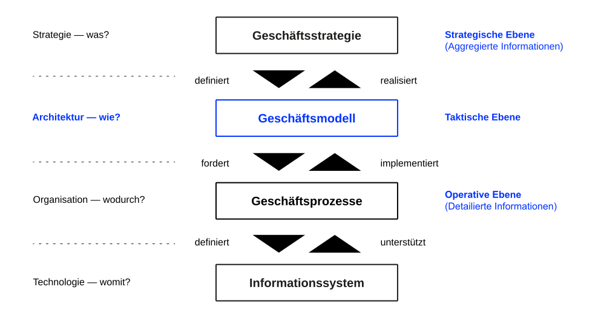

# Motivation {.vertical-center .bg-highlight}

> Information technology is at the core of how you do your business and how your business model itself evolves. *Stya Nadella (2016), CEO von Microsoft*

:::notes
In den vergangenen Kapiteln haben wir uns intensiv mit den Grundkonzepten des Informationsmanagements sowie mit Informationssystemen und deren wesentlichen Komponenten, Geschäftsprozessen und Strategien beschäftigt. Wir haben dabei gelernt, dass viele Unternehmen ohne Informationstechnologie und adäquates IT-Management nicht (mehr) funktionsfähig sind. In diesem Kapitel betrachten wir abschließend ein weiteres, zunehmend durch IT beeinflusstes Konzept auf der strategischen Ebene: __das Geschäftsmodell__.
:::

# Lernergebnisse 🎯

Nach dieser Einheit können Sie 

::: {.incremental}
- den Begriff Geschäftsmodell erläutern und diesen in das Business Engineering-Modell einordnen,
- die wesentlichen Dimensionen eines Geschäftsmodells nennen und  diese anhand von Beispielen erläutern,
- die wesentlichen Treiber hinter digitalen Geschäftsmodellen nennen, 
- die zunehmende Relevanz digitaler Geschäftsmodelle anhand dieser Treiber zeigen,
- und wesentliche Muster digitaler Geschäftsmodelle identifizieren.
:::

# Einleitung {.vertical-center .bg-highlight}

## Business Engineering

Zur Wiederholung und Einordnung: Unter __Business Engineering__ versteht man die ingenieurmäßige Vorgehensweise bei der Gestaltung eines Unternehmens.

. . .

Business Engineering überspannt den kompletten Prozess von der Strategiefindung und der Ableitung von Geschäftsmodellen bis zur optimalen Gestaltung der Abläufe sowie zugehöriger Anwendungssysteme [@abts2017grundkurs; @leimeister2021einfuhrung].

. . .

Das Business Engineering Modell kann somit um die Ebene des Geschäftsmodells ergänzt werden [@al2010developing].

:::notes
Strategie und Geschäftsmodell sind oft schwer voneinander abzugrenzen, aber sie sind nicht identisch. Eine Unternehmensstrategie legt langfristige Ziele und Maßnahmen fest, basierend auf internen Stärken und Schwächen sowie externen Chancen und Risiken. Sie beschreibt, wie sich ein Unternehmen gegenüber Konkurrenten durchsetzen kann.

Das Geschäftsmodell hingegen beschreibt, wie Unternehmensressourcen koordiniert werden, um Wert zu schaffen. Daraus leiten sich dann spezifische Geschäftsprozesse ab, die im Detail beschreiben, wie aus verschiedenen Produktionsfaktoren ein spezifisches Ergebnis erzeugt wird.

Strategien sind zukunftsorientiert und langfristig, während Geschäftsmodelle gegenwartsbezogen sind und die aktuelle Logik zur Wertschöpfung beschreiben. Eine Strategie kann zu verschiedenen Geschäftsmodellen führen, wie das Beispiel von Ryanair und Eurowings zeigt, die beide eine Preisführerschaftsstrategie verfolgen, aber unterschiedliche Geschäftsmodelle haben.
:::

# Geschäftsmodell {.vertical-center .bg-highlight}

## Definition

Ein Geschäftsmodell beschreibt die __grundlegende Logik__, mit der ein Unternehmen zusammen mit ihren Lieferanten und Partnern Wert für Kunden erzeugt und Gewinne erzielt [@teece2010business].

. . .

Ein Geschäftsmodell ist __digital__, wenn es wesentlich auf digitalen Technologien basiert und diese nutzt, um Kunden einen Mehrwert zu bieten und Erträge zu generieren [@veit2014geschaftsmodelle].

. . .

Geschäftsmodelle haben vier wesentliche Dimensionen: das __Wertversprechen__ (value proposition), die __Wertschöpfungsarchitektur__ (value architecture), das __Partnernetzwerk__ (value network) und das __Ertragsmodell__ (value finance).

:::notes
- Das __Wertversprechen__ beschreibt, welchen Nutzen ein Unternehmen seinen Kunden durch seine Produkte und/oder Dienstleistungen stiftet. Diese Dimension beschreibt, welche Kunden(segmente) anvisiert werden, was die Produkte und Dienstleistungen für die Kunden wertvoll macht und wie die Kunden gewonnen und gehalten werden sollen. IT spielt in diese Dimension eine zunehmend entscheidende Rolle.
- Die __Wertschöpfungsarchitektur__ beschreibt, wie das Wertversprechen organisatorisch und technologisch durch das Unternehmen erstellt wird, also wie die Organisation, die Ressourcen und die Kernkompetenzen eines Unternehmens zusammenspielen. 
- Das __Partnernetzwerk__ nimmt eine  unternehmensübergreifende Perspektive ein und beschreibt, wie Kunden und weitere Partner in die Wertschöpfungserstellung eingebunden sind und zusammenarbeiten. Diese Dimension zeigt damit auch die Rollen der verschiedenen Akteure und wie Wert zwischen diesen ausgetauscht wird.
- Das __Ertragsmodell__ beschreibt, wie das Unternehmen Einnahmen generiert und welche Kosten diesen gegenüberstehen.
:::

:::notes
 **Dimension**                      | **Klassisches Geschäftsmodell**                                       | **Digitales Geschäftsmodell**                                           
-------------------------------|-----------------------------------------------------------------------|-------------------------------------------------------------------------
 **Wertversprechen**           | (Physisches) Produkt und Services; limitierte Kundenintegration       | Datengetriebene Services generieren Wert; tiefe Kundenintegration
 **Wertschöpfungsarchitektur** | Traditionelle Wertschöpfungsprozesse („value chain“) und Kanäle| Datenbasierte und Plattform-orientierte Wertschöpfung                  
 **Partnernetzwerk**           | Akteure entlang der Wertschöpfungskette und zusätzliche Dienstleister | Erweitertes Ökosystem (Wettbewerber, Politik, Wissenschaft, etc.)       
 **Finanzstruktur**            | Kosten für Ressourcen und Dienstleistung; Erlöse über Verkauf         | Aufbau und Betrieb der Plattform; Erlöse im „as-a-service“-Bezahlmodell 

: Unterscheidungsmerkmale vom klassischen und digitalen Geschäftsmodelle [@veit2014geschaftsmodelle] {#tbl-dbm}

:::

## Visualisierung

{#fig-be}

:::notes
Es stellt sich die Frage, welchen Nutzen das Konzept des Geschäftsmodells hat und ob es nicht ausreicht, sich auf Strategie und Geschäftsprozesse zu konzentrieren. Obwohl es Schnittmengen gibt, repräsentieren Geschäftsstrategie, -modell und -prozesse verschiedene Informationsebenen, die für unterschiedliche Zwecke nützlich sind. Das Geschäftsmodell fungiert als Schnittstelle zwischen Unternehmensstrategie und Geschäftsprozessen sowie unterstützenden Informationssystemen.

Die Geschäftsstrategie umfasst Entscheidungen, die Unternehmen treffen, um besser als ihre Konkurrenten abzuschneiden. Das Geschäftsmodell beschreibt, wie die Teile eines Unternehmens zusammenwirken, um dieses Ziel zu erreichen. In einem komplexen und sich schnell wandelnden Umfeld müssen Unternehmen ihr Potenzial (Organisation und Technologie) mit der Strategie zur Wertschöpfung verbinden. Diese Verbindung stellt das Geschäftsmodell dar.

Das Geschäftsmodell dient als Blaupause dafür, wie ein Unternehmen aus neuen Dienstleistungen, Produkten oder Innovationen Wert schafft. Der Erfolg von Unternehmen hängt heute weniger von den Technologien selbst ab, sondern von deren sinnvoller Nutzung und Kombination.

|        | **Geschäftsmodell**                                                                                                                                                             | **Strategie**                                                                                                                                                                                                                                                                            |
|------------------|---------------------------------------------------------------------------------------------------------------------------------------------------------------------------------|------------------------------------------------------------------------------------------------------------------------------------------------------------------------------------------------------------------------------------------------------------------------------------------|
| **Orientierung** | Kundennutzen und (kooperativen) Wertschöpfung                                                                                                                                   | Wettbewerb, Umfeld und Branchenlogik                                                                                                                                                                                                                                                     |
| **Zielsetzung**  | Umsetzung von Strategien; nachhaltige Unternehmenssicherung; kontinuierliche Anpassung/Innovation des Geschäftsmodells                                                          | Aufbau und Aufrechterhaltung von Wettbewerbsvorteilen, um den Erfolg zu sichern; Differenzierung gegenüber dem Wettbewerb; Anpassung an das sich ständig wandelnde Umfeld                                                                                                                |
| **Inhalt**       | Beschreibung der Wertschöpfung über Wertversprechen, Wertschöpfungsarchitektur, Partnernetzwerk und Ertragsmodell; Anpassungsmöglichkeiten an interne und externe Veränderungen | Langfristiges Ziel und Richtung; umfassende Ist-Analyse und bewusste Planung der zukünftigen Aktivitäten unter Berücksichtigung externer und interner Faktoren (bspw. SWOT); Ableitung unterschiedlicher Geschäftsmodell-Entwürfe; Entscheidungen zur Finanzierung/Ressourcen-Allokation |

:::

# Innovation

Als __Geschäftsmodellinnovation__ werden bewusst gestaltete, neuartige, nicht-triviale Änderungen am Geschäftsmodell eines Unternehmens, also den Elementen und/oder deren Zusammenspiel, bezeichnet [@foss2017fifteen].

. . .

Geschäftsmodellinnovationen werden sowohl von __extern__ (z. B. durch neue Technologien) und/oder __intern__ (z.B. durch neue Strategien) ermöglicht und angetrieben.

## Wettbewerb {.vertical-center .bg-highlight}

> Der Wettbewerb wird in Zukunft nicht zwischen Produkten und Prozessen stattfinden, sondern zwischen Geschäftsmodellen *[@gassmann2013st, p. 4]*

:::notes
Geschäftsmodellinnovationen sind im digitalen Zeitalter kritisch, um langfristig erfolgreich zu bleiben.
:::

## Treiber

Viele Firmen, die lange Jahre für ihre innovativen Produkte und Prozesse bekannt waren, haben in den vergangenen Jahren plötzlich ihren Wettbewerbsvorteil verloren [@gassmann2013st]. 

. . .

Dies liegt oft daran, dass die Unternehmen es versäumt haben, ihr Geschäftsmodell an die sich ändernden Umweltbedingungen des digitalen Zeitalters anzupassen [@matzler2016digital]: 

:::incremental
- Intangibilisierung und Grenzauflösung (Ort, Zeit, Ressourcenzugriff)
- Sinkende Grenz- und Transaktionskosten
- Zunehmende Personalisierungsmöglichkeiten
:::

:::notes
__Auslöser und Ermöglicher von Geschäftsmodellinnovationen im digitalen Zeitalter:__

Intangibilisierung
: Wandlung physischer Produkte und ortsgebundener Services hin zu digitalen Abbildern, die Orts- und Zeit-unabhängig sind

Grenzauflösung
: Digitale Geschäftsmodelle kennen keine analogen Grenzen und Regeln und lösen alte Muster auf (Branchen, Länder, etc.)

Netzwerkeffekte
: Der Nutzen der Produkte erhöht sich mit steigender Nutzerzahl; dieser Effekt wird durch die Reichweite digitaler Angebote begünstigt

Sinkende Grenzkosten
: Produktion, Vervielfältigung und Verbreitung zusätzlicher digitaler Einheiten erhöht die Kosten nur marginal

Sinkende Transaktionskosten
: Digitalisierung ermöglicht transaktionsbasierten Geschäftsmodelle (bspw. Mikrotransaktionen, pay-as-you-live)

Demonetarisierung
: Aufgrund sinkender Kosten können Leistungen oft „gratis“ angeboten werden; monetärer Wert wird dann durch die Kundenbasis und die gewonnenen Daten erzeugt

Personalisierung
: Digitale Produkte können einfacher an individuelle Bedürfnisse angepasst und weiterentwickelt werden (Inhalt, Funktion, Leistung; Upgrades)

Ressourcenzugriff
: Die Digitalisierung erleichtert den flexiblen Zugriff auf nicht-genutzte Ressourcen und Kapazitäten („sharing economy“), die dann vermietet werden können
:::

# Muster {.vertical-center .bg-highlight}

## Definition

Muster sind hinreichend abstrakte Varianten zur Lösung genereller Problemstellungen, die für einen konkreten Fall konkretisiert und auf den jeweiligen Kontext angepasst werden müssen. 

. . .

Bei Geschäftsmodellmustern oder -typen handelt es sich im Wesentlichen um __generelle Beschreibungen der Funktionsweisen von Geschäftsmodellen__, deren Ausgestaltung in den Dimensionen sowie deren Zusammenwirken ähnlich ist.

. . .

@gassmann2013st haben in ihrem __Business Model Navigator__ 55 Muster von Geschäftsmodellen identifiziert. Einige wenige wesentliche Muster sind im Folgenden vorgestellt.

## Digital Commerce Platform

__Plattformstrategien__ gehören zu den erfolgreichsten Mustern der digitalen Wirtschaft. Sie bringen auf einer Plattform unterschiedliche Nutzergruppen zusammen, die dort miteinander interagieren. Auf einer __Digital Commerce Platform__ werden wie auf einem Marktplatz Waren und Dienstleistungen angeboten.

::: {.notes}
Werteversprechen
: Effizienter Zugang zu physischen Waren und klassischen Dienstleistungen über das Internet

Wertschöpfung
: Aufbau effizienter Marktplätze mit breiter Nutzerbasis, Skaleneffekte

Ertragsmodell
: Marge, Provision
:::

. . .

#### Beispiele

:::incremental
- __Amazon:__ Webshop sowie B2C und B2B Marketplace mit eigener Logistik (teilweise inkl. der last Mile)
- __About You:__ Online Fashion Retailer, der sowohl selbst verkauft als auch die Technologie-Plattform und das Fulfillment anbietet
:::

## Peer-to-peer Platform

Als __Peer-to-peer__ werden meist Transaktionen zwischen Privatleuten bezeichnet (bspw. Verleih von Gegenständen oder Verkauf von Dienstleistungen oder Informationen). Das Unternehmen fungiert dabei als eine Art __Mittler__, welcher für die sichere und effiziente Abwicklung der Transaktion verantwortlich ist. 

:::notes
Werteversprechen
: Einfacher Austauschs von Produkten und Dienstleistungen zwischen Privatpersonen 

Wertschöpfung
: Überbrückung unterschiedlicher Präferenzen; Netzwerkeffekte

Ertragsmodell
: Nutzungsgebühr/Provision, Abonnement, Mitgliedschaft
:::

. . .

#### Beispiele

:::incremental
- __shpock:__ Online-Marktplatz für den privaten Kauf/Verkauf von Dingen in der (unmittelbaren) Umgebung
- __Etsy:__ E-Commerce Plattform für den Kauf und Verkauf von handgemachten Produkten, Vintage und Künstlerbedarf
:::

## Digital Services

Dieses Muster beschreibt, dass __Produkte vollständig digitalisiert werden__ und ausschließlich über digitale Kanäle __„on-demand“__ bereitgestellt werden.

. . .

Bei diesem Muster bietet ein Unternehmen ein Basisprodukt oft kostenlos („free“) oder zu reduzierten Preisen an. Das Unternehmen monetarisiert dann die Daten der Nutzer und/oder bietet erweiterte Services zu höheren Preisen an („premium“) 

:::notes
Werteversprechen
: Bereitstellung bisher analoger Dienstleistungen in digitaler Form (Orts- und Zeit-Unabhängigkeit)

Wertschöpfung
: Effiziente Problemlösung durch digitale Angebote; Skaleneffekte

Ertragsmodell
: Nutzungsgebühr, Abonnement, Mitgliedschaft, Freemium
:::

. . .

#### Beispiele

:::incremental
- __Udemy:__ Online-Lernplattform für Massive Open Online Courses (MOOCs); Alternative: LinkedIn Learning
- __N26:__ Deutsche Direktbank, die sich auf das mobile Banking spezialisiert hat und keine physischen Filialen betreibt
:::

## Physical-digital Ecosystem

In diesem Geschäftsmodellmuster bieten Unternehmen physische Produkte oder klassische Dienstleistungen an, die __um digitale Dienstleistungen ergänzt__ werden („value-add Services“)

:::notes

Werteversprechen
: Kombination physischer Produkte/klassischen Dienstleistungen mit digitalen Services, die gemeinsam einen einzigartigen Mehrwert schaffen

Wertschöpfung
: Aufbau eines hybriden Ökosystems, Datenauswertung, Skaleneffekte

Ertragsmodell
: Nutzungsgebühr, Mitgliedschaft
:::

. . .

#### Beispiele

:::incremental
- __Apple:__ Hard- und Software-Hersteller, verbindet Hardware und Dienste zu einem geschlossenen hybriden Ökosystem
- __TESLA:__ Kombiniert Elektrifizierungs-Produkte mit ergänzenden (digitalen) Services (bspw. Autopilot,Supercharger-Netzwerk)
:::

# Übungen ✏️ {.vertical-center .bg-highlight}

## Grundbegriffe

Erläutern Sie in der Kleingruppe abwechselnd die Bedeutung der folgenden Begriffe.

- Business Engineering
- Strategie
- Geschäftsmodell
- Digitales Geschäftsmodell
- Partnernetzwerk
- Grenzkosten
- Transaktionskosten



## Geschäftsmodellmuster

- Wählen Sie zwei der im Skript beschriebenen Geschäftsmodellmuster aus.
- Erklären Sie sich diese gegenseitig.
- Finden Sie jeweils mindestens ein weiteres Beispiel.
- Beschreiben Sie anhand des Beispiels in eigenen Worten, wie das Unternehmen Wert für die Kunden erzeugt.



## Digitale Geschäftsmodelle

Analysieren Sie die Geschäftsmodelle von **WhatsApp** und **Temu** anhand der vier Komponenten: Wertversprechen, Wertschöpfungsarchitektur, Partnernetzwerk und Ertragsmodell.

- Welche Ressourcen und Fähigkeiten sind jeweils erfolgskritisch?
- In welches der vorgestellten Geschäftsmodellmuster lässt sich jedes Unternehmen einordnen? Begründen Sie.
- WhatsApp hat 2 Milliarden Nutzer und fast keine direkten Einnahmen. Temu macht Milliardenumsätze und schreibt Verluste. Welches Geschäftsmodell ist nachhaltiger – und warum?



:::notes

:::{.callout-note collapse=true}
#### Lösungshinweis

| Dimension                   | WhatsApp                   | Temu                                                 |
|-----------------------------|----------------------------|------------------------------------------------------|
| Wo entsteht Wert?           | Im Ökosystem (Meta Ads)    | In der Transaktion                                   |
| Warum kein/niedriger Preis? | Netzwerkeffekte maximieren | Marktanteile gewinnen                                |
| Zeithorizont                | Langfristig stabil         | Wette auf zukünftige Profitabilität                  |
| Risiko                      | Regulierung (Datenschutz)  | Kapital geht aus, bevor Profitabilität erreicht wird |

:::

## Wiederholung

Arbeiten Sie sich durch die Vorlesungsinhalte (Skripte, Notizen, Übungsblätter, Big Pictures) und identifizieren Sie Verständnislücken. Posten Sie Ihre Verständnisfragen auf Moodle, damit wir möglichst viele davon in der abschließenden Vorlesung diskutieren können.

# Lernkontrolle 🧐 {visibility="hidden"}

- Grenzen Sie Strategie und Geschäftsmodell voneinander ab. 
- Welche Aspekte eines Unternehmens beeinflussen das Geschäftsmodell bzw. werden vom Geschäftsmodell beeinflusst? Nutzen Sie zur Erläuterung auch das Business-Engineering Modell.
- Welche Rolle spielt das Informationsmanagement für das Geschäftsmodell eines Unternehmens? Diskutieren Sie die Rolle anhand eines spezifischen Geschäftsmodellmusters.
- Was sind digitale Geschäftsmodelle?
- Weshalb müssen Geschäftsmodelle im digitalen Zeitalter angepasst werden? Nennen und erläutern Sie zwei IT-bezogene Auslöser von Geschäftsmodellinnovationen unserer Zeit.

# Literatur 📚
::: {#refs}
:::
