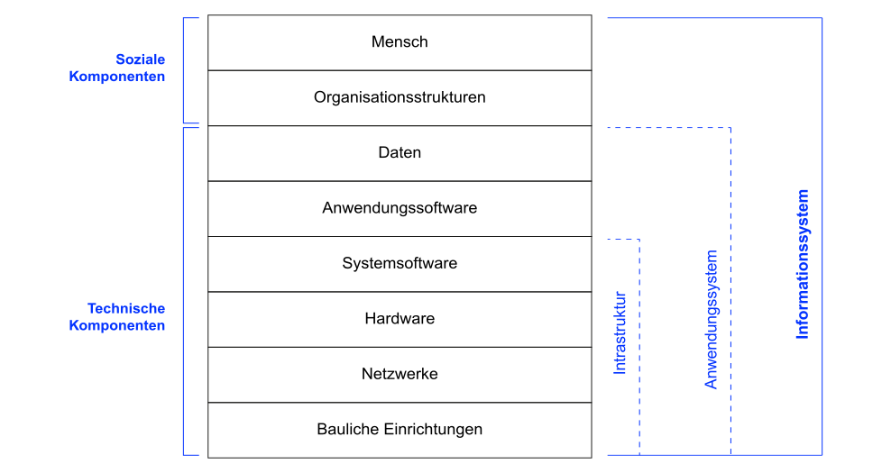
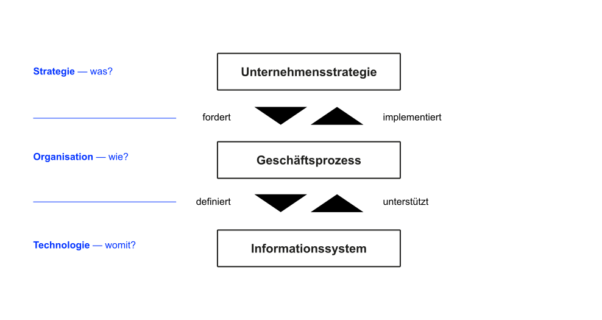

# Motivation {.vertical-center background-color="blue"}

> Information is the resolution of uncertainty. *Claude Shannon, American Mathematican (1916-2001)*

::: {.notes}
Bislang haben wir gelernt, dass Informationen im digitalen Zeitalter essenziell sind und dass Unternehmen Angebot, Nachfrage und Verwendung von Informationen aktiv gestalten müssen. Hierzu dienen Informationssysteme, die wiederum Informationstechnologie nutzen. In diesem Kapitel schauen wir uns genauer an, was Informationssysteme sind und wie diese in das Unternehmen eingebettet sind.
:::

# Lernergebnisse 🎯

Nach dieser Einheit können Sie

::: incremental
-   allgemein beschreiben, was ein **System** und was ein **Modell** ist,
-   im Speziellen erläutern, was ein Informationssystem ist und aus welchen **Komponenten** es besteht,
-   zeigen, dass ein Informationssystem ein **sozio-technisches System** ist,
-   erläutern, welche **Aufgaben** Informationssysteme im Unternehmen haben und welche **Ziele** verfolgt werden sowie
-   anhand des **Business Engineering Modells** zeigen, wie Informationssysteme im Unternehmen eingebettet sind.
:::

# Informationssysteme {.vertical-center background-color="blue"}

## Definition

Bei **Informationssystemen** handelt es sich um soziotechnische („Mensch-Aufgabe-Technik-") Systeme[^1] [@krcmar2015informationsmanagement, p. 8].

[^1]: Soziotechnische Systeme sind Systeme, die sowohl menschliche, organisatorische und maschinelle Komponenten umfassen.

. . .

Informationssysteme werden entwickelt, betrieben und genutzt, **um spezifische Aufgaben zu erfüllen** (bspw. Produkte online zu verkaufen) und die notwendigen Informationen zu bereitzustellen und zu verarbeiten.

. . .

Informationssysteme enthalten die dafür notwendige **Technologie** (insbesondere Hard- und Software) und **Daten**. Darüber hinaus umfassen Informationssysteme auch die **Organisationsstrukturen**, in die sie eingebettet sind und die **Menschen**, die mit ihnen arbeiten [@krcmar2015informationsmanagement, p. 8; @laudon2016wirtschaftsinformatik, p. 14-15].

. . .

Betriebliche Informationssysteme bilden die Basis für effektives und effizientes Informationsmanagement im (digitalen) Unternehmen.

::: notes
::: callout-note
### System

Als System wird etwas bezeichnet, das aus verschiedenen Komponenten mit unterschiedlichen Eigenschaften besteht, die aufgrund bestimmter geordneter Beziehungen untereinander als gemeinsames Ganzes betrachtet werden (können) und damit von ihrer Umwelt (anderen Systemen) abgrenzbar sind. Ein Element eines Systems kann ebenfalls ein System sein --- dieses wird dann als Subsystem bezeichnet [@alpar2000anwendungsorientierte, p. 15].
:::
:::

## Informations- und Anwendungssysteme

::: notes
Ein Informationssystem ist immer ein für eine spezifische Organisation (bspw. ein Unternehmen) individuelles System. Das bedeutet, dass es für die in dieser Organisation gegebenen spezifischen Rahmenbedingungen konstruiert wurde und nur in der gegebenen Organisation die volle Wirkung entfalten kann. Deshalb kann ein Informationssystem auch nicht einfach gekauft werden, sondern muss individuell entwickelt und angepasst werden [@laudon2016wirtschaftsinformatik, p.15].
:::

**Informationssysteme** umfassen in der Regel ein oder mehrere Anwendungssystemen (Anwendungssoftware).

. . .

**Anwendungssysteme**[^2] können "von der Stange" gekauft oder aus der Cloud als Software as a Service verwendet werden. Diese müssen dann aber in Abstimmung mit den anderen Komponenten eingeführt und zum Informationssystem ausgebaut werden.

[^2]: Ein Anwendungssystem ist ein System, das alle Programme (Anwendungssoftware) beinhaltet, die für ein bestimmtes Aufgabengebiet entwickelt und eingesetzt werden, inkl. der IT-Infrastruktur, auf der die Anwendungssoftware läuft, und der Daten, die erzeugt und genutzt werden [nach @laudon2016wirtschaftsinformatik, p.15].

. . .

Systeme lassen sich nicht immer klar als Anwendungssystem oder als Informationssystem charakterisieren. Es existieren Anwendungssysteme, die kaum losgelöst von der Organisation, in der sie verwendet werden, betrachtet werden können.

. . .

Die Begriffe Informationssystem und Anwendungssystem werden deshalb in der Praxis oft synonym verwendet.

## Visualisierung

{#fig-is}

::: notes
Ein betriebliches Informationssystem verarbeitet Informationen (Input --\> Output) und besteht aus folgenden Komponenten.

-   **Mensch**: Aufgabenträger und Benutzer des Informationssystems
-   **Aufgabe**: zu lösende betriebliche Problemstellung
-   **Informationstechnik**: Hard- und softwaretechnische Umsetzung des Informationssystems
-   **Organisatorischer Kontext**: betriebliche Umwelt, in die das Informationssystem integriert wird
:::

## Aufgaben

Informationssysteme **sammeln**, **verarbeiten**, **speichern** und **verteilen Daten und Informationen**, um die Entscheidungsfindung, Koordination, Steuerung und Kontrolle im Unternehmen zu ermöglichen bzw. zu erleichtern [@laudon2016wirtschaftsinformatik, p.15].

. . .

Informationssysteme wandeln durch *Eingabe*, *Verarbeitung* und *Ausgabe* Rohdaten in nützliche Informationen um tragen damit zur Wertschöpfung bei bzw. ermöglichen diese.

. . .

Informationssysteme sind für Unternehmen unentbehrlich geworden, sie sind entscheidend, um **effizienter** und **konkurrenzfähiger zu werden** (optimierte Kommunikation und Zusammenarbeit, bessere Entscheidungen, effizientere Geschäftsprozesse, Grundlage für neue Produkte und Dienstleistungen, etc.).

## Ziele

Informationssysteme werden in Unternehmen eingesetzt, um

-   bei der Planung, Steuerung und Kontrolle zu unterstützen,
-   Geschäftsprozesse zu beschleunigen,
-   Qualität der Produkte und des Kundenservices zu verbessern,
-   neue Organisationsformen zu ermöglichen (bspw. flache Hierarchien),
-   Kosten einsparen zu (bspw. durch Automatisierung) und
-   strategische Wettbewerbsvorteile erzielen zu können

# Einbettung {.vertical-center background-color="blue"}

## Abhängigkeiten

Informationssysteme sind in Unternehmen verwurzelt und ergeben sich insbesondere aus der Strategie und den Arbeitsabläufen eines Unternehmens und beeinflussen diese.

. . .

Deshalb müssen Informationssysteme und vorhandene Geschäftsprozesse und Organisationsstrukturen eines Unternehmens wechselseitig angepasst werden.

. . .

Diese wechselseitige Anpassung ist Voraussetzung dafür, dass die eingesetzten Anwendungssysteme als Teil der Informationssysteme von den Menschen bedient und verstanden werden.

## Business Engineering Modell

Das **Business Engineering Modell** unterstützt die Gestaltung und Veränderung von Unternehmen im digitalen Zeitalter.

. . .

Das Modell unterscheidet hierbei drei Gestaltungsebenen eines Unternehmens: **Strategie**, **Prozesse** und **Systeme** [@osterle2007business, p.14].

. . .

Die Strategieebene erarbeitet die Frage nach dem *«Was?»*, die Prozessebene nach dem *«Wie?»* und die Systemebene nach dem *«Womit?»*.

. . .

In erfolgreichen Unternehmen **unterstützen sich die Ebenen wechselseitig**: die übergeordnete Ebene definiert jeweils Anforderungen an die untergeordnete Ebene, diese wiederum unterstützt die übergeordnete Ebene [@osterle2007business].

::: notes
::: callout-note
### Modellierung
In der Praxis wird oftmals nicht direkt an einem Gegenstand, sondern mit einer Abbildung des Gegenstands gearbeitet. Eine solche Abbildung ist das Ergebnis eines Konstruktionsprozesses, das die Wahrnehmung von Inhalten eines ausgewählten Gegenstands zweckorientiert repräsentiert und wird als Modell bezeichnet.

In Modellen wie dem Business Engineering Modell werden die Eigenschaften eines Systems weggelassen, die für den Zweck als nicht relevant angesehen werden. Ein solches Modell dient dazu, das zu analysierende System besser zu verstehen, zu steuern und experimentell verändern zu können, um neue Erkenntnisse zu gewinnen.

![Darstellung des Modellierungsprozesses, aufbauend auf @leimeister2021einfuhrung [S. 119]](images/modellierung.svg){#fig-modellierung}
:::
:::

## Gestaltungsebenen

Strategieebene

:   Die gewünschte Positionierung des Unternehmens im Wettbewerb (bspw. Geschäftsfelder, Kundensegmente, Produkte und Dienstleistungen, Vertriebswege) wird festgelegt und entsprechende Ziele definiert.

. . .

Prozessebene

:   Basierend auf der Strategie werden Organisationsstrukturen und Abläufe (u.a. Verantwortlichkeiten, Berichtswege, Aktivitäten und Abläufen, Informationsbedarfe und -flüsse) so gestaltet, dass diese das Erreichen der strategischen Ziele ermöglichen.

. . .

Systemebene

:   Die Architektur der Informationssysteme und deren Komponenten (u.a., Hardware, Softwarekomponenten und Datenstrukturen) wird so gestaltet, dass diese die Prozessebene ideal unterstützen.

::: notes
::: callout-note
#### Unternehmensstrategie

Die Unternehmensstrategie definiert die Anforderungen an die Geschäftsprozesse und die verwendeten Informationssysteme eines Unternehmens. Sie leitet damit das Handeln der Organisation und ihrer Akteure.

Unter Unternehmensstrategie wird die Festlegung der grundlegenden **langfristigen Ziele** eines Unternehmens sowie der **Handlungsoptionen**, die zur Erreichung dieser Ziele erforderlich sind, verstanden. Zudem werden im Rahmen der Unternehmensstrategie die Zuweisung der verfügbaren Ressourcen durchgeführt (Ressourcen-Allokation; bspw. Investitionsmittel).

Strategie richtet den Blick immer nach Außen und versucht, die im externen Umfeld vorhandenen, Chancen und Risiken mit den Fähigkeiten und Ressourcen des Unternehmens in Einklang zu bringen (Chandler 1969).
:::
:::

## Visualisierung

{#fig-be}

:::notes

<iframe src="https://www.loom.com/embed/515d1da72b384d5589089073fbf1371c" frameborder="0" webkitallowfullscreen mozallowfullscreen allowfullscreen style="position: absolute; top: 0; left: 0; width: 100%; height: 100%;"></iframe>

:::

# Übungen ✏️ {.headline-only}

## Modellierung

Die Campus-Karte der HNU ermöglicht es ihnen, in der Mensa und Cafeteria zu bezahlen, Druckerguthaben aufzuladen, Spinde zu öffnen und vieles mehr.

Modellieren Sie das Informationssystem "Campus-Karte" anhand der vier Komponenten eines betrieblichen Informationssystems:

- **Mensch** — Wer sind die Akteure? (Nutzer, Betreiber, etc.)
- **Aufgabe** — Welche betrieblichen Problemstellungen werden gelöst?
- **Informationstechnik** — Welche Hard- und Software ist beteiligt?
- **Organisatorischer Kontext** — In welche organisatorischen Strukturen ist das System eingebettet?
- 
Visualisieren Sie Ihr Modell (bspw. in [Miro](https://miro.com/de)).

:::notes
:::smaller
Nach ca. 12 Minuten stellen 2-3 Gruppen ihre Ergebnisse vor. 

Anschließend diskutieren wir folgende Fragen:

- Was haben die verschiedenen Gruppen unterschiedlich modelliert?
- Was wurde bewusst oder unbewusst weggelassen?
- Warum sind die Modelle trotz gleichem System unterschiedlich?

Wir werden sehen, dass Modelle immer zweckorientiert und vereinfachend sind. Verschiedene Perspektiven 
führen zu verschiedenen Modellen.
:::
:::

<!--

Musterlösung (Beispiele):

Mensch:

- Studierende (Nutzer)
- Mensa-Personal (Betreiber der Terminals)
- IT-Abteilung (Systemadministration)
- Servicestelle (Support, Kartenausgabe)

Aufgabe:

- Bargeldloses Bezahlen ermöglichen
- Druckguthaben verwalten
- Zutrittskontrolle zu Räumen
- Transaktionen erfassen und abrechnen

Informationstechnik:

- Hardware: Chipkarten, Kartenlesegeräte, Terminals, Server, Auflade-Automaten
- Software: Kartenverwaltungssystem, Bezahl-/Abrechnungssystem, Schnittstellen
- Datenbank: Nutzerkonten, Guthaben, Transaktionshistorie

Organisatorischer Kontext:

- Eingebettet in HNU-Verwaltung
- Anbindung an Studierendenverwaltung
- Integration mit Mensen-Betreiber (Studierendenwerk)
- Verbindung zu Drucksystem und Gebäudeverwaltung

-->

## Business Engineering

Analysieren Sie das Campus-Karten-System anhand des Business Engineering Modells auf allen drei Ebenen:

- **Strategie** (Was?) — Welche strategischen Ziele der HNU werden unterstützt?
- **Prozesse** (Wie?) — Welche Prozesse werden durch das System ermöglicht/verändert?
- **Informationssysteme** (Womit?) — Welche Informationssysteme werden eingesetzt?

Übelegen Sie zudem, wie sich die Ebenen wechselseitig unterstützen.

- Beispiel: Wie definiert die Strategie Anforderungen an die Prozesse?
- Beispiel: Wie ermöglichen/beschränken die Systeme die Prozesse?

:::notes
:::smaller
Nach ca. 12 Minuten tragen wir die Ergebnisse zusammen.

Anschließend diskutieren wir die Frage, was passieren würde, wenn eine Ebene sich ändert? Beispiele:

- Neue Strategie "Nachhaltigkeit" 
- Technologie "Mobile Payment" verfügbar

Wir werden sehen, dass das Business Engineering Modell die Struktur und wechselseitige Abhängigkeit aufzeigt und so bei 
der Analyse und Gestaltung von Unternehmen (Strategien, Prozesse und Systeme) unterstützt.

:::
:::

<!--

Musterlösung

Strategieebene (Was?):

- Studierendenservice verbessern
- Bargeldloses Bezahlen fördern
- Effizienz in Mensen/Cafeterien steigern
- Campus-Management digitalisieren

Prozessebene (Wie?):

- Bezahlprozess in Mensa: Karte auflegen → automatische Abbuchung
- Aufladeprozess: Online-Banking, Automaten, Servicestelle
- Zutrittskontrolle: Karte an Lesegerät → Türöffnung
- Druckprozess: Authentifizierung → Freigabe → Abbuchung

Systemebene (Womit?):

- Hardware: Chipkarten, Kartenlesegeräte, Terminals, Server
- Software: Kartenverwaltungssystem, Bezahlsystem, Schnittstellen zu Mensen-Abrechnungssystem
- Daten: Nutzerkonten, Transaktionen, Guthaben, Berechtigungen

Wechselseitige Unterstützung:

- Strategie → Prozesse: Ziel "Effizienz" erfordert schnellen, bargeldlosen Bezahlprozess
- Prozesse → Systeme: Schneller Bezahlprozess erfordert zuverlässige Terminals mit kurzer Antwortzeit
- Systeme → Prozesse: Mobile Payment-Technologie würde Prozess "Karte aufladen" überflüssig machen
- Prozesse → Strategie: Effiziente Prozesse ermöglichen besseren Service (strategisches Ziel)

-->

## Operativ und strategisch

Das Campus-Karten-System unterstützt die HNU auf verschiedenen Ebenen:

- **Operative Ebene:** Tägliche Abläufe, wiederkehrende Transaktionen, kurzfristige Effizienz
- **Strategische Ebene:** Langfristige Ziele, Wettbewerbsvorteile, grundlegende Veränderungen

Wir diskutieren im Plenum folgende Fragestellungen:

- Was sind **operative Funktionen** des Campus-Karten-Systems?
    - Welche täglichen Prozesse werden unterstützt?
    - Wie trägt das System zur Effizienz bei?
- Was sind **strategische Funktionen** des Campus-Karten-Systems?
    - Welche langfristigen Ziele werden unterstützt?
    - Welche strategischen Vorteile entstehen?
- Kann ein IS gleichzeitig operativ und strategisch sein?

:::notes
:::smaller
Wir werden sehen: Die meisten IS haben sowohl operative als auch strategische Bedeutung. Die gleichen Daten/Funktionen können auf beiden Ebenen Wert schaffen.
:::
:::

<!--

**Beispiele operative Unterstützung:**

- Schnelle Bezahlabwicklung (Durchsatz in Mensa)
- Automatisierte Guthabenverwaltung
- Transaktionsprotokollierung für Abrechnung
- Zutrittskontrolle zu Räumen

**Beispiele strategische Unterstützung:**

- Positionierung als moderne, serviceorientierte Hochschule
- Datenbasis für strategische Planung (Nutzungsstatistiken)
- Grundlage für weitere Digitalisierungsschritte
- Differenzierung im Hochschulwettbewerb
- Ermöglicht neue Services (z.B. zeitabhängige Preise)

-->

## Modellvergleich

Verschiedene Stakeholder möchten das Campus-Karten-System verstehen oder verändern. Überlegen Sie: Welches Modell bzw. welche Abstraktionsebene brauchen folgende Personen?

:::column-page-right

| Stakeholder                 | Zweck                                                        | Was sollte das Modell abbilden? |
|-----------------------------|--------------------------------------------------------------|---------------------------------|
| **Hochschulleitung**        | Entscheidung über Investition in neue Campus-Card-Generation | ?                               |
| **IT-Abteilung**            | Technische Wartung und Weiterentwicklung                     | ?                               |
| **Mensa-Personal**          | Tägliche Nutzung                                             | ?                               |
| **Studierende**             | Nutzung des Systems                                          | ?                               |
| **Datenschutzbeauftragter** | Compliance prüfen                                            | ?                               |

:::

:::notes
:::smaller
Denken Sie zunächst für sich nach (ca. 5 Minuten). 

Anschließend tragen wir die Erkenntnisse im Plenum zusammen und reflektieren folgende Fragen:

- Warum brauchen verschiedene Stakeholder verschiedene Modelle?
- Was ist der Zweck des jeweiligen Modells?
- Was passiert, wenn man das falsche Abstraktionsniveau wählt?
    - Beispiel: Hochschulleitung bekommt technisches Datenbankschema → Überforderung
    - Beispiel: IT-Abteilung bekommt nur strategische Ziele ohne technische Details → Kann nicht implementieren

Wir werden sehen, dass Modelle zweckabhängig sind und auf den Informationsbedarf des Adressaten zugeschnitten sein müssen. Ein System – viele mögliche Modelle.
:::
:::

<!--

Musterlösung:

| Stakeholder | Zweck | Welche Informationen sind relevant? | Abstraktionsebene |
|-------------|-------|-------------------------------------|-------------------|
| **Hochschulleitung** | Entscheidung über Investition | Kosten, strategische Ziele, Nutzen, ROI | Hoch (Business Engineering - Strategie) |
| **IT-Abteilung** | Technische Wartung | Systemarchitektur, Schnittstellen, Datenbanken, Hardware | Niedrig (technisches Detailmodell) |
| **Mensa-Personal** | Tägliche Nutzung | Bedienung der Terminals, Fehlerbehebung, Prozessabläufe | Mittel (Prozessmodell) |
| **Studierende** | Nutzung des Systems | Wo auflade ich? Wie bezahle ich? Wo bekomme ich Hilfe? | Sehr hoch (Benutzermodell) |
| **Datenschutzbeauftragter** | Compliance | Welche Daten? Speicherdauer? Zugriffsrechte? Zweckbindung? | Mittel (Daten- und Prozessmodell) |

-->

## Erfolgsfaktoren {.scrollable}

Was macht das Campus-Karten-System erfolgreich bzw. nicht erfolgreich?

:::notes
:::smaller
Wir nehmen uns ca. 10 Minuten, um Faktoren zu sammeln. Anschließend schauen wir uns das IS Success Model von DeLone 
& McLean an. 
:::
:::

<!--

Positive Faktoren:

- Schnelles Bezahlen (keine Bargeldsuche)
- Kein Kleingeld notwendig
- Guthaben jederzeit online einsehbar
- Mehrere Auflade-Möglichkeiten
- Terminals meist verfügbar
- Automatische Abrechnung

Negative Faktoren:

- Manchmal lange Warteschlangen an Auflade-Automaten
- Karte kann verloren gehen
- Guthaben nicht übertragbar
- Support nur zu Öffnungszeiten
- Terminals gelegentlich außer Betrieb
- Guthaben verfällt bei Exmatrikulation

-->

:::notes
:::{.callout-note collapse=true}
#### IS Success Model [@delone2003delone]

Das **IS Success Model** ist eine wissenschaftliche Theorie, die erklärt, welche Faktoren den Erfolg von Informationssystemen bestimmen und wie diese Faktoren zusammenhängen.

**Die sechs Erfolgsdimensionen:**

1. **System Quality (Systemqualität)** — Technische Eigenschaften wie Zuverlässigkeit, Antwortzeit, Benutzerfreundlichkeit
2. **Information Quality (Informationsqualität)** — Genauigkeit, Vollständigkeit, Aktualität und Relevanz der bereitgestellten Informationen
3. **Service Quality (Servicequalität)** — Qualität des Supports, Schulungen, Reaktionsfähigkeit bei Problemen
4. **Use / Intention to Use (Nutzung)** — Wie häufig und intensiv wird das System genutzt?
5. **User Satisfaction (Nutzerzufriedenheit)** — Wie zufrieden sind die Nutzer mit dem System?
6. **Net Benefits (Nettonutzen)** — Welche positiven Effekte hat das System für Individuen und Organisation?

**Zentrale Aussagen der Theorie:**

- Hohe **Qualität** (System, Information, Service) führt zu höherer **Nutzung** und **Zufriedenheit**
- **Nutzung** und **Zufriedenheit** beeinflussen sich gegenseitig
- Beide führen zu positiven **Effekten** (Net Benefits)
- Die Theorie ermöglicht **Vorhersagen**: "Wenn wir die Servicequalität verbessern, wird die Nutzerzufriedenheit steigen"

Das Modell wurde in hunderten empirischen Studien getestet und ist eine der meistzitierten Theorien der Wirtschaftsinformatik.

:::
:::

## IS Success Model

Untersuchen Sie die **Erfolgsfaktoren** des Campus-Karten-Systems anhand des **IS Success Models**:

- Bewerten Sie jede Dimension (1-5 ⭐)
- Begründen Sie Ihre Bewertung mit konkreten Beispielen 
- Erklären Sie die kausalen Zusammenhänge:
  - Wie beeinflussen die Qualitätsdimensionen die Nutzung und Zufriedenheit?
  - Welche Dimension ist besonders kritisch für den Erfolg? 
- Schlagen Sie vor, wo Verbesserungen den größten Erfolg bringen würden

:::notes
:::smaller

Nach ca. 10 Minuten Gruppenarbeit stellen 2-3 Gruppen ihre Bewertungen vor (je 2 Min.).

Anschließend reflektieren wir im Plenum den entscheidenden Unterschied:

**Was ist der Unterschied zwischen dem Business Engineering Modell und dem IS Success Model?**

- Business Engineering: Beschreibt die Struktur (Ebenen) und Einbettung des IS
- IS Success Model: Erklärt, warum ein IS erfolgreich ist oder nicht; postuliert kausale Zusammenhänge

**Ist das IS Success Model ein Modell oder eine Theorie?**

- Der Name sagt "Model", aber es ist eigentlich eine Theorie!
- Es macht Vorhersagen: "Wenn die Systemqualität steigt, dann steigt die Nutzerzufriedenheit"
- Es erklärt Zusammenhänge: "Warum nutzen Studierende die Campus-Karte gern?"
- Es ist generalisierbar: Gilt nicht nur für Campus-Karten, sondern für viele IS
- Es wurde empirisch getestet: Viele wissenschaftliche Studien haben die Zusammenhänge überprüft

**Wozu brauchen wir beide – Modelle UND Theorien?**

| Aspekt        | Business Engineering (Modell) | IS Success Model (Theorie)    |
|---------------|-------------------------------|-------------------------------|
| **Zweck**     | Strukturierung, Gestaltung    | Erklärung, Vorhersage         |
| **Frage**     | Wie ist das IS eingebettet?   | Warum ist das IS erfolgreich? |
| **Aussage**   | Deskriptiv (beschreibend)     | Explanativ + Prädiktiv        |
| **Anwendung** | Projektplanung, Architektur   | Erfolgsanalyse, Evaluation    |

Beide sind wichtig: Modelle helfen uns zu gestalten, Theorien helfen uns zu verstehen und vorherzusagen.
:::
:::

<!--

Musterlösung (Beispiel):

| Dimension           | Bewertung | Begründung                                                     | Verbesserungsvorschläge                        |
|---------------------|-----------|----------------------------------------------------------------|------------------------------------------------|
| System Quality      | ****      | Meist zuverlässig, aber manchmal Terminals defekt oder langsam | Mehr Wartung, redundante Systeme               |
| Information Quality | *****     | Guthaben wird korrekt und in Echtzeit angezeigt                | -                                              |
| Service Quality     | ***       | Support nur zu Öffnungszeiten, FAQ könnte besser sein          | Online-Support, Chatbot, bessere Dokumentation |
| Use                 | *****     | Wird von fast allen Studierenden täglich genutzt               | -                                              |
| User Satisfaction   | ****      | Meistens zufrieden, aber gelegentlich Frustration              | Verbesserungen bei Service Quality             |
| Net Benefits        | ****      | Spart Zeit, bargeldlos bequem, effiziente Abläufe für HNU      | Mobile Payment als Alternative anbieten        |

Erkenntnisse:

- Hohe System- und Information Quality führen zu hoher Nutzung
- Service Quality könnte verbessert werden → würde User Satisfaction steigern
- Net Benefits sind bereits gut, könnten aber durch Mobile Payment weiter gesteigert werden
- Die Theorie hilft uns, gezielt an den richtigen Stellschrauben zu drehen

-->

# Lernkontrolle 🧐 {visibility="hidden"}

- Beschreiben Sie kurz, was nach dem Verständnis der Wirtschaftsinformatik ein betriebliches Informationssystem ist.

- Weshalb sind Informationssysteme sozio-technische Systeme?

- Zur Verwaltung der Prüfungen und Noten an der HNU wird ein Informationssystem eingesetzt. Zeigen Sie anhand dieses Beispiels vier wesentliche Komponenten eines betrieblichen Informationssystems, sowie dessen Aufgaben und Ziele.

- Betriebliche Informationssysteme können strategische und operative Ziele unterstützen. Geben Sie jeweils ein Beispiel für ein Ziel und beschreiben Sie, wie ein Informationssystem die Zielerreichung unterstützen kann.

- Neben betrieblichen Informationssystemen wie dem CRM beschreibt das Business Engineering Modell nach Oesterle (2010) zwei weitere Gestaltungsebenen. Nennen Sie diese und beschreiben Sie, wie die drei Ebenen in Beziehung stehen.

- Beschreiben Sie, was ein System und was ein Modell ist. Wozu dient ein Modell?

# Literatur 📚

::: {#refs}
:::
