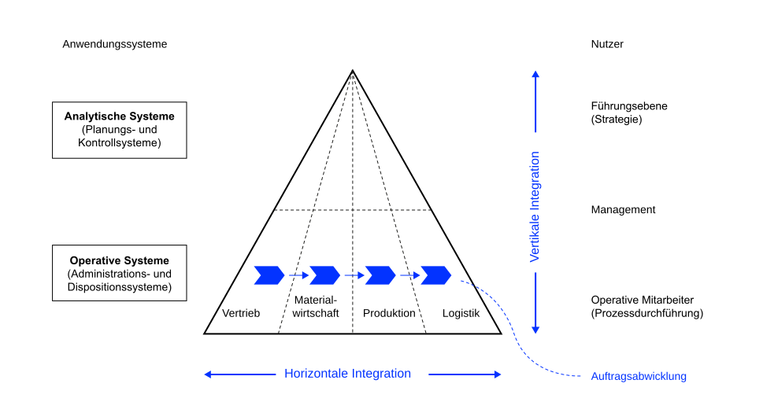
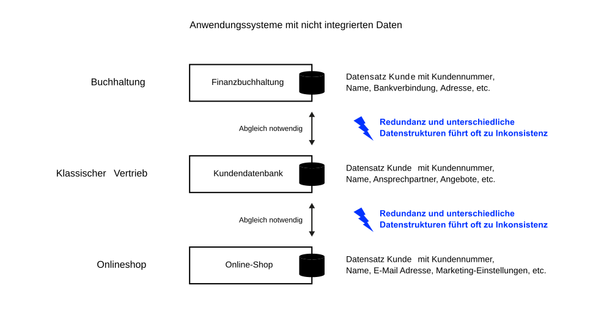
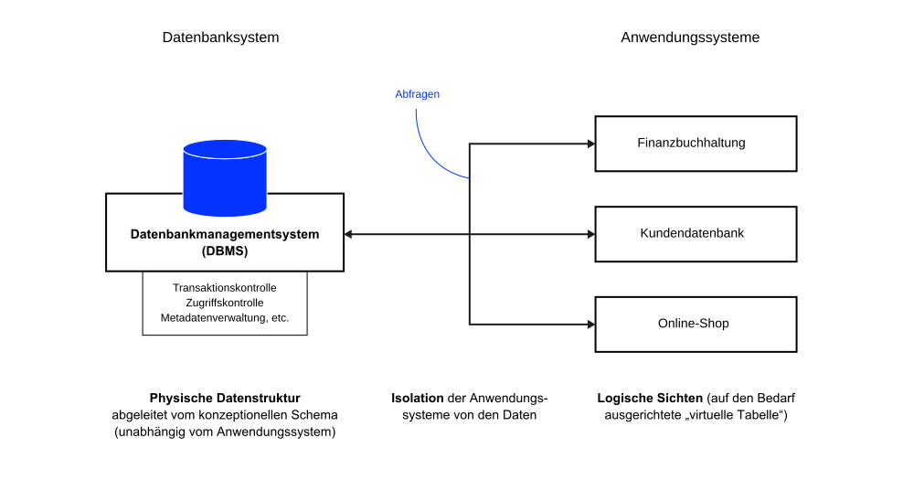

# Motivation {.vertical-center background-color="blue"}

> Das Ganze ist mehr als die Summe seiner Teile *Aristoteles, Philosoph (384 -- 322 v. Chr.)*

::: notes
Informationen sind ein wichtiger Produktionsfaktor und entstehen durch die Kontextualisierung, also Vernetzung von Daten. Mithilfe von Geschäftsprozessen erzeugt das Unternehmen Wert für den Kunden. In der Praxis sind, vor allem durch die zunehmende Arbeitsteilung und Spezialisierung, Prozesse und Daten jedoch oftmals unzureichend verknüpft. Das führt unter anderem zu Problemen wie Datenredundanzen und Inkonsistenzen, ineffiziente Prozesse und Qualitätsprobleme. In diesem Kapitel schauen wir uns an, wie durch die Integration von Daten, Funktionen und Prozessen diese Probleme reduziert werden können.
:::

# Lernergebnisse 🎯

Nach diesem Kapitel können Sie

::: incremental
-   das Konzept der Integration im Sinne einer **integrierten Informationsverarbeitung** erläutern,
-   zeigen, welche **Dimensionen der Integration** sich unterscheiden lassen,
-   die Konzepte **horizontale und vertikale Integration** anhand von Beispielen erklären,
-   erläutern, weshalb **Stammdatenmanagement** notwendig ist und wie es umgesetzt werden kann sowie
-   die Funktionsweise und Komponenten eines **Datenbanksystems** erläutern.
:::

# Integration {.vertical-center background-color="blue"}

## Notwendigkeit

Anwendungssysteme wurden und werden häufig für einzelne Unternehmen bzw. deren Abteilungen oder sogar einzelne Arbeitsplätze entwickelt.

. . .

Diese Fragmentierung steht einem arbeitsplatz-, abteilungs- oder unternehmensübergreifenden **Informationsfluss** im Weg.

. . .

**Integration** bedeutet, dass diese künstlich geschaffenen Grenzen durch die Verknüpfung von Mensch, Aufgaben und Technik wieder aufgehoben werden [@mertens2016grundzuge, p. 65].

::: notes
::: smaller
*Beispiel: Eine Kundendatenbank, ein Online-Shop und ein Finanzbuchhaltungssystem unterstützen zusammen die Auftragsabwicklung in einem Industrieunternehmen. Ohne eine Integration dieser Anwendungssysteme ist eine effiziente Abwicklung des durchgehenden Ablaufs eine Kundenbestellung nicht möglich. Wären etwa die Kundendatenbank und der Online-Shop nicht integriert, so würden Änderungen der Kundendaten, die über den Shop hereinkommen, nicht automatisch in das Kundenverwaltungssystem gelangen. Bei manuellem Abgleich der Daten durch Menschen entstehen durch Medienbrüche typischerweise Fehler und damit hohe Kosten für die Nachbearbeitung.*
:::
:::

. . .

Für die Integration bieten sich drei Ansatzpunkte bzw. **Gegenstände** an:

::: incremental
-   Datenintegration,
-   Funktionsintegration und
-   Prozessintegration [siehe @mertens2016grundzuge, p. 65].
:::

## Integrationsgegenstände

Datenintegration
:   Die Datenintegration zielt auf eine einheitliche und konsistente Bereitstellung von Daten über verschiedene Anwendungssysteme hinweg ab. Jedes Datum (z.B. die Kundenadresse) wird idealerweise nur einmal gespeichert (Single Source of Truth). Bei mehrfacher Datenhaltung werden die Kopien konsistent gehalten. Zentrale Aspekte sind die Vermeidung von Datenredundanzen, die Sicherstellung der Datenkonsistenz sowie die Schaffung einer gemeinsamen Datenbasis (bspw. mittels [Datenbanksystemen](#datenbanksysteme)).

Funktionsintegration
:   Die Funktionsintegration verbindet verschiedene betriebliche Funktionsbereiche wie Beschaffung, Produktion, Vertrieb, Rechnungswesen und Personalwesen. Ziel ist es, dass diese Bereiche auf eine gemeinsame Datenbasis zugreifen und effizient zusammenarbeiten können. Dadurch werden bereichsübergreifende Auswertungen ermöglicht und Datenredundanzen vermieden. Ein Enterprise Resource Planning (ERP) System integriert beispielsweise alle Funktionsbereiche in einem gemeinsamen Anwendungssystem.

Prozessintegration
:   Die Prozessintegration zielt auf die durchgängige systemseitige Unterstützung von Geschäftsprozessen ab, die über mehrere Funktionsbereiche hinweg verlaufen. Im Fokus steht der gesamte Ablauf eines Prozesses vom Anfang bis zum Ende – unabhängig davon, welche Abteilungen oder Unternehmensbereiche beteiligt sind. Durch die Automatisierung und Optimierung dieser bereichsübergreifenden Prozesse entlang der Wertschöpfungskette wird ein nahtloser Ablauf gewährleistet. Beispiele sind Order-to-Cash, Purchase-to-Pay oder die durchgängige Bestellabwicklung mit Rechnungsstellung und Lieferkettenmanagement.

## Voraussetzungen

Voraussetzung für eine gelingende Integration ist ein gutes Verständnis von und eine gute Übersicht über die zu integrierenden Gegenstände (Daten, Funktionen, Prozesse) sowie die eingesetzten Anwendungssysteme [@mertens2016grundzuge, p. 173].

. . .

**Unternehmensdatenmodelle** beschreiben die Datenbestände eines Unternehmens und deren Struktur (**Datenarchitektur**). In diesem Modell werden unter anderem Mindestanforderungen an Datensätze definiert, die von jedem Anwendungssystem implementiert werden müssen (bspw. Struktur der Kundennummer). Diese erleichtern unter anderem den automatischen Abgleich von Daten.

. . .

**[Prozessmodelle](../prozesse/#prozessmodellierung)** und **Organigramme** beschreiben die Funktionen und Abläufe eines Unternehmens (**Organisationsarchitektur**) und welche Informationssysteme für welche Aufgaben eingesetzt werden.

## Integrationsrichtung

Die Integrationsrichtung beschreibt die Orientierung der Integration innerhalb und zwischen den verschiedenen Hierarchieebenen eines Unternehmens [@laudon2016wirtschaftsinformatik, p. 437]:

. . .

Vertikale Integration
:   Versorgung von Informationssystemen zur Entscheidungsunterstützung ([analytische Systeme](../anwendungssysteme/#betriebliche-anwendungssysteme)) mit Daten aus den Systemen, die das Tagesgeschäft ermöglichen bzw. abbilden ([operative Systeme](../anwendungssysteme/#betriebliche-anwendungssysteme)). Diese Daten werden verdichtet und verknüpft, um daraus Informationen zu gewinnen. 

. . .

Horizontale Integration
:   Die Verbindung der operativen Anwendungssysteme entlang der betrieblichen Wertschöpfungskette auf gleicher Hierarchieebene mit dem Ziel der durchgängigen Unterstützung von Geschäftsprozessen über mehrere Unternehmensbereiche hinweg.

## Visualisierung

{#fig-hierarchie}

## Integrationsreichweite

Hinsichtlich der Reichweite der Integration unterscheidet man zwischen der innerbetrieblichen und der zwischenbetrieblichen Integration [@laudon2016wirtschaftsinformatik, p. 437]:

Innerbetriebliche Integration
:   Integrierte Anwendungssysteme verbinden unterschiedliche Unternehmensbereiche entlang der Wertschöpfungskette. [Customer Relationship Management (CRM) Systeme](../anwendungssysteme/#crm-systeme) verbinden bspw. Marketing, Vertrieb und Kundendienst.

Zwischenbetriebliche Integration
:   Anwendungssysteme von zwei oder mehr Unternehmen sind so aufeinander abgestimmt, dass Daten (bspw. Angebote, Aufträge, Lieferscheine, Rechnungen) zwischen Unternehmen und/oder Endkunden über unternehmensübergreifende Systeme digital ausgetauscht werden und so Prozesse weitestgehend automatisiert werden können (bspw. Auftragsabwicklung).

Unternehmensübergreifende Informationssysteme gewinnen mit der zunehmenden Digitalisierung immer mehr Bedeutung.

## Integrationszeitpunkt

Stapelverarbeitung und Ereignisorientierung sind zwei Ansätze, die über den Zeitpunkt der Integration entscheiden [@laudon2016wirtschaftsinformatik, p. 437]:

Stapelverarbeitung
: Bei der Stapelverarbeitung werden zu bearbeitende Daten zunächst gesammelt und dann zu einem definierten Zeitpunkt zwischen unterschiedlichen Anwendungssystemen abgeglichen (bspw. in der Nacht).

Ereignisorientierung
: Bei der Ereignisorientierung ist ein Ereignis der Auslöser von weiteren Verarbeitungsschritten. Verlässt bspw. eine Lieferung den Hof (Ereignis) werden automatisch alle relevanten Logistik-Informationen an den Kunden übertragen (Verarbeitungsschritte).

# Stammdatenmanagement {.vertical-center background-color="blue"}

## Definition

**Stammdatenmanagement** (engl. Master Data Management, MDM) befasst sich mit dem Management der Stammdaten im Unternehmen [@krcmar2015informationsmanagement, p.43]. 

. . .

**Stammdaten** sind Grunddaten eines Unternehmens, die sich auf betriebswirtschaftlich relevante Objekte beziehen. Stammdaten existieren unabhängig von anderen Daten und werden im Zeitablauf selten verändert (bspw. Kunden- oder Materialstammdaten) [@alpar2000anwendungsorientierte, p. 206].

. . .

Stammdatenmanagement umfasst in der Regel **Identifikation**, **Konsolidierung**, **Harmonisierung**
und **Integration** der Stammdaten sowie die anschließende **Synchronisation** der Daten [@krcmar2015informationsmanagement, p.43].

## Notwendigkeit

Stammdaten werden oft in **verschiedenen Anwendungssystemen** benötigt, verwaltet und gespeichert. Bspw. werden Kundendaten oftmals sowohl in Finanzsystemen und in Systemen der Logistik und/oder Marketing vorgehalten [@alpar2000anwendungsorientierte, p. 206].

. . .

Diese **Redundanz** beeinträchtigt sowohl die Konsistenz als auch die Qualität der Stammdaten. 

. . .

Der Abgleich von redundanten Daten, die auf unterschiedlichen Systemen abgelegt sind, erfordern einen hohen **organisatorischen Aufwand**.

. . .

Sind Stammdaten identifiziert und harmonisiert, können mithilfe eines **Stammdatenmanagementsystems** die Stammdaten in einer zentralen Datenbank vorgehalten und über die Systeme automatisiert synchronisiert werden.

# Datenbanksysteme {.vertical-center background-color="blue"}

## Notwendigkeit

Sind in einem Unternehmen Daten nicht ausreichend integriert, entstehen **Redundanzen** und es erhöht sich das Risiko für **Dateninkonsistenzen**. Zudem erhöht sich der **Aufwand** für die Datenerfassung [@mertens2016grundzuge, p. 36] und es fehlen die Grundlagen für die Integration von Funktionen und Prozessen.

. . .

Ein **Datenbankmanagementsystem** ermöglicht es, die Daten eines Unternehmens, deren Nutzung und entsprechende Sicherheitsrichtlinien zu integrieren und zentral zu verwalten.

. . .

Ein Datenbankmanagementsystem ermöglicht die Trennung von Programmcode und Datenhaltung. Anwendungssysteme und Benutzer arbeiten lediglich mit einer **logischen Sicht**[^1] auf die Daten.

[^1]: **Eine Sicht ist eine virtuelle Tabelle, die durch eine Abfrage definiert wird.**

. . .

Durch die **Entkopplung von Daten und Programm** wird zudem Flexibilität der Anwendungssysteme erhöht. Programme können aktualisiert werden, ohne Veränderungen an den Daten vornehmen zu müssen und vice versa.

:::notes
::: callout-note
#### Physische und logische Datenstruktur

Ein **logisches Datenmodell** (bspw. ein Relationenmodell) legt die Struktur von Datenobjekten und ihre Beziehungen untereinander fest. Das **physische Datenmodell** bezieht sich auf die Art und Weise, wie das System implementiert wird, und berücksichtigt das spezifische Datenbankmanagementsystem. Ein logisches Datenmodell dient als Grundlage für ein physisches Datenmodell.

Mittels **Sichten** kann flexibel auf die gespeicherten Daten zugegriffen werden. Man kann eine Sicht auch als virtuelle Tabelle bezeichnen, die durch eine Datenbankabfrage definiert werden. Die Abfrage kann Daten aus einer oder mehreren Tabellen des physischen Datenmodells oder aus anderen Sichten in der aktuellen Datenbank oder anderen Datenbanken verwenden.
:::
:::

## Visualisierung

{#fig-redundanzen}

## Definition

Datenbanksysteme werden zur Datenorganisation und Datenintegration verwendet und bestehen aus folgenden Komponenten [@laudon2016wirtschaftsinformatik]:

::: incremental
-   **Datenbank (DB):** eine möglichst redundanzfreie Sammlung von Daten, die so strukturiert sind, dass sie von mehreren Benutzern und Anwendungen gleichzeitig und effizient genutzt und flexibel ausgewertet und verknüpft werden können.
-   **Datenbankmanagementsystem (DBMS):** System zur Erstellung und Verwaltung von Datenbanken, die von mehreren Anwendungen genutzt werden können. Ein DBMS trennt physische und logische Datenstruktur.
:::

::: notes
#### Wichtige Anforderungen an DBMS

Nach @mertens2016grundzuge [S. 42] müssen DBMS folgende Anforderungen erfüllen:

-   **Datenunabhängigkeit**: Unabhängigkeit zwischen dem konzeptionellen Schema und Anwendungsprogrammen (logische Datenunabhängigkeit) sowie zwischen dem konzeptionellen Schema und der physischen Datenorganisation (physische Datenunabhängigkeit)
-   Geplante und **kontrollierte Datenredundanz**: Begrenzung der Redundanz auf ein kleinstmögliches bzw. zweckmäßiges Maß durch eine entsprechende Datenstruktur
-   Sicherung der **Datenkonsistenz**: Erhaltung des gleichen Änderungsstands bei mehrfach gespeicherten Datenbeständen
-   **Datenbankintegrität**: Maßnahmen zur Erhaltung der Korrektheit und Vollständigkeit der Daten. Betrifft zum einen die semantische Integrität (Vermeiden von Fehleingaben und unzulässigen Operationen durch Festlegung und Kontrolle von erlaubten Werten und Beziehungen zwischen Datenelementen) sowie die operative Integrität (Verhindern von Fehlern, wenn mehrere Anwender auf gleiche Datenbestände zugreifen)
-   **Datensicherheit**: Bewahrung der Daten vor Verfälschung, Vernichtung und unberechtigtem Zugriff
-   **Datenschutz**: Verhinderung der unberechtigten Verwendung von Daten
-   **Ausfallsicherheit**: Routinen zur Wiederherstellung der Konsistenz der Daten bspw. bei einem Absturz
:::

## Beispiel

{#fig-DBMS}

# Übungen ✏️ {.headline-only}

## Fallstudie: SportActive {.smaller}

Die **SportActive GmbH** ist ein mittelständisches Unternehmen, das Sportbekleidung und -ausrüstung verkauft.

[Vertriebskanäle]{.h4}

- Online-Shop
- Drei Filialen in süddeutschen Städten
- 45 Mitarbeiter

[Aktuelle IT-Landschaft]{.h4}

- **Online-Shop:** Eigene Kundendatenbank
- **Filialen:** Lokale Kundendatenbank je Filiale
- **Lager:** Excel-basiertes Bestandsmanagement
- **Einkauf:** Access-Lieferantendatenbank
- **Buchhaltung:** DATEV mit eigenem Kundenstamm
- **Marketing:** Newsletter-Tool mit Kontaktdatenbank

**Typische Probleme:** Falsche Rechnungsadressen, inkorrekte Lagerbestände, fehlende Kundeninfos bei Retouren, verspätete Nachbestellungen, ineffiziente Marketing-Kampagnen

:::notes
:::smaller
Diese Fallstudie wird uns durch die gesamte Übungseinheit begleiten. Sie arbeiten in Gruppen und analysieren verschiedene Aspekte der Integration.
:::
:::

<!--

Aufgabe 1a/b:   10 + 10 + ~10 Min Vorstellung   = 30 Min
Aufgabe 2a/b/c: 10 + 8 + 7 + ~15 Min Diskussion = 40 Min
Aufgabe 3:      8 + ~7 Min Diskussion           = 15 Min 
Aufgabe 4:      4 + ~6 Min Diskussion           = 10 Min
Aufgabe 5:      8 + ~7 Min Diskussion           = 15 Min
Aufgabe 6:      8 + ~7 Min Diskussion           = 15 Min

-->

## Aufgabe 1a: Prozessmodellierung {.smaller}

Wählen Sie *einen* der folgenden Prozesse und erstellen Sie eine *eEPK* für SportActive in der *aktuellen, nicht-integrierten Situation*:

:::columns
:::column
[Option 1: Einkaufsprozess (Nachbestellung)]{.h4}

- Bedarf wird festgestellt (Lagerbestand niedrig)
- Einkauf holt Angebote von drei Lieferanten ein
- Angebote werden verglichen, Lieferant ausgewählt
- Bestellung wird verschickt
- Ware wird geliefert und kontrolliert
- Bei korrekter Lieferung: Annahme, Lagerbestand aktualisieren
- Rechnung prüfen und Zahlung anweisen
:::
:::column
[Option 2: Reklamationsprozess (Online-Shop)]{.h4}

- Kunde meldet Reklamation per E-Mail
- Kundenservice prüft Berechtigung
- Bei Berechtigung: Rücksendeetikett erstellen
- Ware trifft ein und wird geprüft
- Bei Annahme: Gutschrift erstellen
- Kunde erhält Erstattung
- Lagerbestand aktualisieren
:::
:::

Ergänzen Sie: **Organisationseinheiten**, **Anwendungssysteme**, **Informationsobjekte**



:::notes
:::smaller
Nutzen Sie [yEd Live](https://www.yworks.com/yed-live) oder Papier.
:::
:::

## Aufgabe 1b: Ist-Analyse

Analysieren Sie Ihr Prozessmodell und identifizieren Sie Medienbrüche und sich daraus ergebende Probleme.

[Medienbrüche]{.h4}

- Markieren Sie alle Stellen mit manueller Dateneingabe.
- Wo entstehen Ausdrucke und Neueingaben?

[Probleme]{.h4}

- Wo entstehen durch die fragmentierte IT-Landschaft **Verzögerungen**?
- Wo entstehen **Fehlerquellen**?
- Welche Daten müssen **mehrfach erfasst** werden?

Dokumentieren Sie mindestens 3 konkrete Probleme aus Ihrem Prozess.



:::notes
:::smaller
Nach ca. 25 Minuten (gesamt) stellen 2-3 Gruppen ihre Prozessmodelle und ihre Analyse kurz vor (je 2 Min).

In der Diskussion erkennen wir die Stärke von Prozessmodelle (Verständigung, Analyse) sowie häufige Probleme und deren Ursachen.

Wir werden sehen, dass die fehlende Integration der Systeme zu erheblichen Ineffizienzen, Fehlerquellen und Verzögerungen führt – und dass beide Prozesse unter ähnlichen Problemen leiden.
:::
:::

<!--
Musterlösung Einkaufsprozess:

Medienbrüche:
- Lagerbestand in Excel muss manuell geprüft werden
- Lieferantenangebote (E-Mail) müssen manuell in Vergleichstabelle eingegeben werden
- Bestellung wird in Access erstellt, aber auch als E-Mail verschickt
- Lieferschein muss mit Bestellung und Lagerbestand manuell abgeglichen werden
- Rechnung in DATEV muss manuell mit Bestellung abgeglichen werden

Probleme:
1. Verzögerung: Lagerbestand wird nur täglich aktualisiert → verspätete Bedarfserkennung
2. Fehlerquelle: Manuelle Eingabe von Lieferantendaten kann zu Tippfehlern führen
3. Redundanz: Artikeldaten existieren in Excel (Lager), Access (Einkauf) und DATEV (Buchhaltung)
4. Inkonsistenz: Verschiedene Preise in unterschiedlichen Systemen

Musterlösung Reklamationsprozess:

Medienbrüche:
- E-Mail-Reklamation muss manuell in System übertragen werden
- Kundendaten müssen zwischen Online-Shop und Kundenservice-System abgeglichen werden
- Lagerbestand (Excel) muss manuell aktualisiert werden
- Gutschrift muss in DATEV manuell erstellt werden

Probleme:
1. Verzögerung: Kundenservice muss Kundendaten aus mehreren Systemen zusammensuchen
2. Fehlerquelle: Falsche Kundenadresse führt zu falscher Erstattung
3. Redundanz: Kundeninformationen in Online-Shop, Kundenservice-System und DATEV
4. Inkonsistenz: Lagerbestand im Online-Shop stimmt nicht mit Excel-Datei überein
-->

## Aufgabe 2a: Datenintegration

Analysieren Sie die Integration der **Daten** in dem von Ihnen gewählten und modellierten Prozess:

1. Identifizieren Sie Redundanzen (ca. 5 Datenobjekte).
2. Bewerten Sie die Kritikalität der Datenobjekte.\
   *Welches Objekt ist für den Prozess am wichtigsten?*
3. Beschreiben Sie, wo im Prozess **Inkonsistenzen** entstehen (können).\
   Welche Folgen haben diese?
4. Skizzieren Sie eine mögliche Lösung.



:::notes
:::smaller
Nach ca. 10 Minuten tragen wir die Erkenntnisse je Prozess zusammen.

Wir werden sehen, dass Datenredundanz und -inkonsistenz zentrale Probleme sind, die durch eine gemeinsame Datenbasis systematisch gelöst werden können.
:::
:::

<!--
Musterlösung (Beispiele):

Redundante Datenobjekte:
1. Kundendaten (Online-Shop, Filialen, DATEV, Marketing)
2. Artikeldaten (Online-Shop, Lager-Excel, Access-Einkauf, Filialen)
3. Lieferantendaten (Access-Einkauf, DATEV)
4. Bestandsdaten (Excel-Lager, Online-Shop, Filialen)
5. Preisdaten (Online-Shop, Filialen, Einkauf, Buchhaltung)

Am kritischsten: Bestandsdaten
- Führt zu Überverkäufen im Online-Shop
- Kunden bestellen nicht verfügbare Ware
- Hohe Kosten durch Retouren und Unzufriedenheit

Inkonsistenzen:
- Kunde ändert Adresse im Online-Shop → Rechnung geht an alte Adresse (DATEV nicht aktualisiert)
- Artikel wird verkauft → Online-Shop zeigt noch Verfügbarkeit (Excel nicht synchronisiert)
- Preis ändert sich → unterschiedliche Preise in verschiedenen Systemen

Lösung durch zentrale Datenbank:
- Alle Systeme greifen auf dieselben Daten zu
- Änderungen sind sofort für alle sichtbar
- Single Source of Truth
- Datenqualität und -konsistenz steigen
-->

## Aufgabe 2b: Funktionsintegration

Analysieren Sie die Integration von **Funktionen** der SportActive:

1. Identifizieren Sie beteiligte Funktionsbereiche.
2. Leiten Sie die gemeinsame Datenbasis ab.\
   *Welche Bereiche müssten auf gemeinsame Daten zugreifen?*
3. Welche Vorteile hätte ein System, dass die Funktionen auf einer gemeinsamen Datenbasis verbindet?



:::notes
:::smaller
Nach ca. 8 Minuten tragen wir die Erkenntnisse je Prozess zusammen.

Wir werden sehen, dass ein integriertes Anwendungssystem verschiedene Funktionsbereiche auf einer gemeinsamen Datenbasis verbindet und so bereichsübergreifende Auswertungen und effiziente Zusammenarbeit ermöglicht.
:::
:::

<!--
Musterlösung:

Beteiligte Funktionsbereiche:
- Vertrieb (Online-Shop, Filialen)
- Lager/Logistik
- Einkauf
- Buchhaltung/Finanzen
- Marketing

Gemeinsame Datenbasis notwendig für:
- Vertrieb ↔ Lager: Bestandsinformationen
- Vertrieb ↔ Buchhaltung: Kundendaten, Rechnungen
- Einkauf ↔ Lager: Bestellungen, Wareneingänge
- Alle ↔ Alle: Artikelstammdaten

Vorteile ERP-System:
1. Durchgängige Prozesse: Bestellung → Lieferung → Rechnung ohne Medienbrüche
2. Echtzeit-Transparenz: Alle Bereiche sehen aktuelle Daten
3. Bereichsübergreifende Auswertungen: z.B. Umsatz pro Artikel über alle Kanäle
4. Reduzierte Fehlerquellen: Keine mehrfache Dateneingabe
5. Effiziente Zusammenarbeit: Gemeinsame Plattform für alle Bereiche
-->

## Aufgabe 2c: Prozessintegration

Analysieren Sie den Integrationsgrad des Prozesses.

1. Identifizieren Sie Schnittstellen.
   *Wo unterbrechen Systemwechsel den Prozessfluss?*
2. Analysieren Sie Automatisierungspotenzial.
   *Welche Aktivitäten könnten bei Integration automatisiert werden?*
3. Beschreiben Sie den Soll-Prozess.



:::notes
:::smaller
Nach ca. 7 Minuten tragen wir die Erkenntnisse je Prozess zusammen.

Welche Automatisierungspotenziale sind in beiden Prozessen ähnlich?

Wir werden sehen, dass Prozessintegration Medienbrüche eliminiert, manuelle Schritte automatisiert und die Durchlaufzeit drastisch verkürzt – der Prozess wird durchgängig unterstützt.
:::
:::

<!--
Musterlösung Einkaufsprozess:

Systemschnittstellen (Ist):
- Excel (Lager) → E-Mail → Einkauf (Access)
- Access (Einkauf) → E-Mail → Lieferant
- Lieferant → Papier (Lieferschein) → Excel (Lager)
- Lieferant → E-Mail (Rechnung) → DATEV (Buchhaltung)

Automatisierungspotenzial:
- Automatische Bedarfserkennung bei Unterschreitung Mindestbestand
- Automatischer Angebotsvergleich
- Automatische Bestellauslösung
- Automatische Wareneingangsbuchung nach Kontrolle
- Automatische Rechnungsprüfung (3-Wege-Abgleich: Bestellung-Lieferschein-Rechnung)

Soll-Prozess (integriert):
1. System erkennt niedrigen Lagerbestand automatisch
2. Bedarfsmeldung wird an Einkauf gesendet
3. System holt automatisch Angebote über Schnittstellen ein (oder nutzt Rahmenverträge)
4. Einkäufer wählt Lieferant aus, System erstellt Bestellung
5. Bei Wareneingang: Scannen des Lieferscheins, System bucht automatisch ein
6. Rechnung kommt elektronisch, System gleicht automatisch ab (Bestellung-Lieferung-Rechnung)
7. Bei Übereinstimmung: Automatische Freigabe zur Zahlung

Hauptunterschiede:
- Keine Medienbrüche
- Automatische Datenflüsse zwischen Bereichen
- Echtzeit-Aktualisierung aller Daten
- Durchlaufzeit reduziert von Tagen auf Stunden
- Fehlerquote sinkt drastisch
-->

## Aufgabe 3: Integrationsrichtung

Die Geschäftsführung von SportActive benötigt täglich aktuelle Auswertungen:

- Welche Produkte verkaufen sich am besten?
- Wie entwickeln sich die Umsätze im Vergleich zum Vorjahr?
- Gibt es kritische Lagerbestände?
- Welche Kunden kaufen am häufigsten?

Dafür sollen Daten aus dem Tagesgeschäft (Online-Shop, Filialen, Lager, Einkauf) automatisch verdichtet, verknüpft und in übersichtlichen Berichten bereitgestellt werden.

[Aufgaben]{.h4}

1. Welche Art der Integration ist dies (horizontal/vertikal)?
2. Aus welchen Systemen kommen die Daten?
3. Wie müssen die Daten für die Berichte verändert werden (verdichten, verknüpfen, ...)? 
4. Auf welcher Hierarchieebene arbeiten die Quellsysteme und das Berichtssystem?



:::notes
:::smaller
Nach ca. 8 Minuten tragen wir die Erkenntnisse zusammen.

Wir werden sehen, dass dies ein Beispiel für vertikale Integration ist: Daten fließen von der operativen zur strategischen Ebene und werden dabei verdichtet und aufbereitet.
:::
:::

<!--
Musterlösung:

1. Art der Integration: **Vertikale Integration**
   - Begründung: Daten aus operativen Systemen (Tagesgeschäft) werden zu analytischen Systemen (Entscheidungsunterstützung) übertragen
   - Von unterer (operativ) zu oberer (strategisch/analytisch) Hierarchieebene
   - Daten werden verdichtet und aggregiert

2. Quellsysteme:
   - Online-Shop (Verkaufsdaten)
   - Kassensysteme Filialen (Verkaufsdaten)
   - Lager-System (Bestandsdaten)
   - Einkauf-System (Beschaffungsdaten)
   - DATEV (Finanzdaten)

3. Datenaufbereitung:
   - Verdichtung: Einzelne Transaktionen → Tagesumsätze, Monatsumsätze
   - Verknüpfung: Verkaufsdaten + Artikeldaten + Kundendaten
   - Aggregation: Summen, Durchschnitte, Top-10-Listen
   - Zeitvergleiche: Vorjahr, Vormonat
   - KPIs berechnen: Lagerumschlag, Deckungsbeitrag pro Artikel

4. Hierarchieebenen:
   - Quellsysteme: Operative Ebene (Tagesgeschäft)
   - Zielsystem: Analytische/Strategische Ebene (Management-Entscheidungen)
-->

## Aufgabe 4: Integrationszeitpunkt

Bewerten Sie für folgende Szenarien, ob *Stapelverarbeitung* oder *Ereignisorientierung* sinnvoller ist. Begründen Sie jeweils:

1. Aktualisierung Lagerbestände nach Verkauf im Online-Shop
2. Abgleich Kundendaten zwischen verschiedenen Systemen
3. Bereitstellung Verkaufsstatistiken für Geschäftsführung
4. Synchronisation Produktpreise bei Preisaktion zwischen Online-Shop und Filialen



:::notes
:::smaller
Nach ca. 4 Minuten tragen wir die Erkenntnisse zusammen.

Wir werden sehen, dass die Wahl zwischen Stapelverarbeitung und Ereignisorientierung von der Zeitkritikalität abhängt: Ereignisorientierung bei direkter Kundeninteraktion und kritischen Prozessen, Stapelverarbeitung bei periodischen Auswertungen.
:::
:::

<!--
Musterlösung:

1. Lagerbestände nach Verkauf: **Ereignisorientierung**
   - Begründung: Echtzeit-Aktualisierung verhindert Überverkäufe
   - Kritisch für Kundenzufriedenheit
   - Vermeidet Bestellungen nicht verfügbarer Ware

2. Kundendaten-Abgleich: **Stapelverarbeitung**
   - Begründung: Nächtlicher Abgleich ausreichend
   - Nicht zeitkritisch für tägliches Geschäft
   - Reduziert Systemlast

3. Verkaufsstatistiken: **Stapelverarbeitung**
   - Begründung: Tägliche Berichte ausreichend
   - Kann nachts generiert werden
   - Keine Echtzeit-Anforderung für strategische Entscheidungen

4. Produktpreise bei Preisaktion: **Ereignisorientierung**
   - Begründung: Alle Kanäle müssen zeitgleich aktuelle Preise haben
   - Verhindert Inkonsistenzen zwischen Online und Filiale
   - Rechtliche Relevanz (gleiche Preise)
-->

## Aufgabe 5: Stammdaten

Analysieren Sie die *Stammdaten* in Ihrem modellierten Prozess:

1. Benennen Sie die Stammdatenobjekte (min. 4 Beispiele)
2. Analysieren Sie eines der Stammdatenobjekte:

- Wie wird es identifiziert?
- Welche Informationen (Attribute) sind notwendig?
- In welchen Systemen/Prozessschritten werden die Daten benötigt?
- Benötigen verschiedene Bereiche unterschiedliche Sichten?



:::notes
:::smaller
Nach ca. 8 Minuten tragen wir die Erkenntnisse je Prozess zusammen.

Welche konkreten Probleme in Ihrem Prozess würde ein Stammdatenmanagementsystem lösen?

Wir werden sehen, dass Stammdaten die Grunddaten eines Unternehmens sind, die in verschiedenen Prozessen und Systemen benötigt werden – und dass verschiedene Bereiche unterschiedliche Sichten auf dieselben Daten brauchen.
:::
:::

## Aufgabe 6: Reflexion

Schauen Sie sich die [Grundformen der Prozessverbesserung](../prozesse/#verbesserung) aus der Vorwoche an:
*Weglassen, Auslagern, Zusammenfassen, Parallelisieren, Verlagern, Beschleunigen, Schleifen vermeiden, Ergänzen*

- Welche dieser Verbesserungen könnten durch *Integration* in Ihrem Prozess umgesetzt werden? Nennen Sie mindestens 3 Beispiele.
- Wie würde sich die Integration auf das *magische Dreieck* (Zeit, Qualität, Kosten) auswirken?
- Würden Sie SportActive empfehlen, die Integration *schrittweise* oder als *"Big Bang"* durchzuführen?



:::notes
:::smaller
Nach ca. 8 Minuten tragen wir die Erkenntnisse zusammen und reflektieren gemeinsam.

Welche Dimensionen des magischen Dreiecks verbessern sich durch Integration? Gibt es auch Nachteile?

Wir werden sehen, dass Integration vielfältige Prozessverbesserungen ermöglicht, alle drei Dimensionen des magischen Dreiecks mittelfristig verbessert werden – und dass eine schrittweise Implementierung für die meisten Unternehmen sinnvoller ist als ein Big Bang.
:::
:::

<!--
Musterlösung:

a) Prozessverbesserungen durch Integration:

Einkaufsprozess:
1. **Weglassen:** Manuelle Dateneingaben entfallen (Medienbrüche eliminiert)
2. **Beschleunigen:** Automatische Bedarfserkennung, keine Wartezeiten auf Genehmigungen
3. **Schleifen vermeiden:** 3-Wege-Abgleich automatisch, keine manuelle Nachbearbeitung
4. **Zusammenfassen:** Ein Mitarbeiter kann ganzen Prozess betreuen (kein Bereichswechsel)

Reklamationsprozess:
1. **Weglassen:** Keine manuelle Suche nach Kundendaten in verschiedenen Systemen
2. **Beschleunigen:** Automatische Gutschrift bei Wareneingang
3. **Verlagern:** Kunde kann Reklamation selbst online erfassen (Self-Service)
4. **Parallelisieren:** Gutschrift und Lagereinbuchung parallel

b) Auswirkungen auf magisches Dreieck:

Zeit:
- ✅ Deutlich verkürzt: Prozessdurchlaufzeit von Tagen auf Stunden
- ✅ Keine Wartezeiten durch Medienbrüche
- ✅ Echtzeit-Daten verfügbar

Qualität:
- ✅ Höher: Weniger Fehler durch Automatisierung
- ✅ Konsistente Daten
- ✅ Bessere Kundenzufriedenheit

Kosten:
- ⚠️ Kurzfristig: Hohe Investitionen in System, Schulung
- ✅ Mittelfristig: Einsparungen durch Effizienz, weniger Fehlerkosten
- ✅ Langfristig: ROI positiv

→ Alle drei Dimensionen verbessern sich mittelfristig!

c) Implementierungsstrategie:

**Empfehlung: Schrittweise Integration**

Pro schrittweise:
- Geringeres Risiko bei Problemen
- Mitarbeiter können sich schrittweise anpassen
- Lernen aus frühen Phasen möglich
- Cashflow-schonender
- Geschäftsbetrieb läuft weiter

Mögliche Phasen:
1. Phase: Stammdatenmanagement (Kunden, Artikel)
2. Phase: Integration Vertrieb-Lager (Bestandsmanagement)
3. Phase: Integration Einkauf-Lager
4. Phase: Integration Buchhaltung
5. Phase: Analytische Systeme (BI)

Contra Big Bang:
- Zu hohes Risiko für mittelständisches Unternehmen
- Gefahr: Geschäftsbetrieb steht still
- Überforderung der Mitarbeiter
- Schwer, alle Probleme im Voraus zu erkennen

Aber: Big Bang könnte sinnvoll sein, wenn:
- Altsysteme nicht mehr wartbar
- Zeitdruck (z.B. regulatorische Anforderungen)
- Sehr erfahrener Implementierungspartner
-->

# Lernkontrolle 🧐 {visibility="hidden"}

- Beschreiben Sie anhand eines Beispiels, was integrierte Informationsverarbeitung ist. Weshalb ist diese notwendig?
- Erläutern Sie die Begriffe „horizontale Integration“ und „vertikale Integration“.
- Welche Gegenstände sollten für eine effiziente Informationsverarbeitung integriert werden? Geben Sie jeweils ein Beispiel.
- Was sind Voraussetzungen für eine zielgerichtete Integration von Daten und Prozessen in einem Unternehmen?
- Erklären Sie, was Stammdaten sind und weshalb es sinnvoll ist, diese zentral zu verwalten und über Anwendungssysteme hinweg zu synchronisieren.
- Nennen Sie Vorteile einer zentralen Datenbank, die mehrere Anwendungssysteme nutzen im Vergleich zur dezentralen Datenhaltung.
- Aus welchen Komponenten besteht ein Datenbanksystem? Welche Funktion haben diese?
 

# Literatur 📚

::: {#refs}
:::
