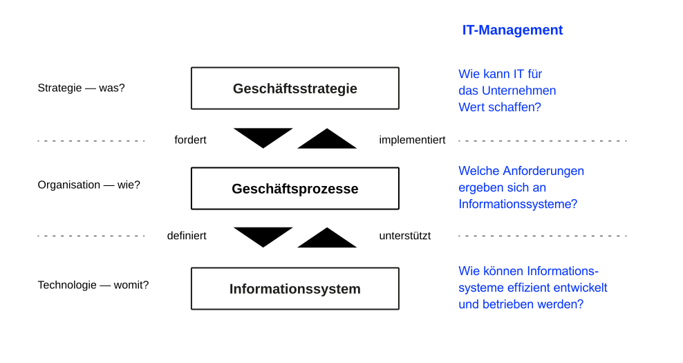
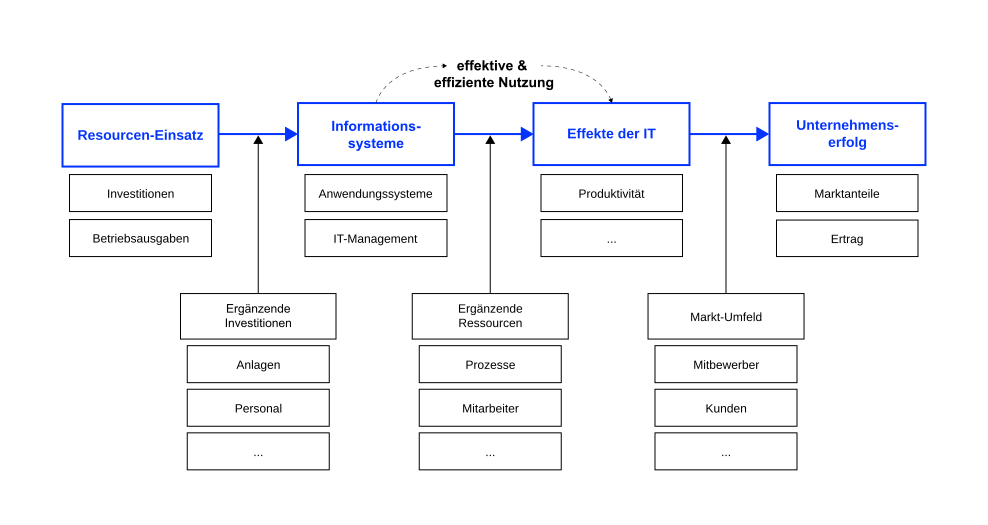
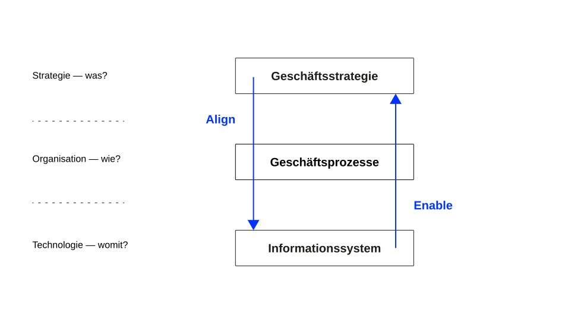
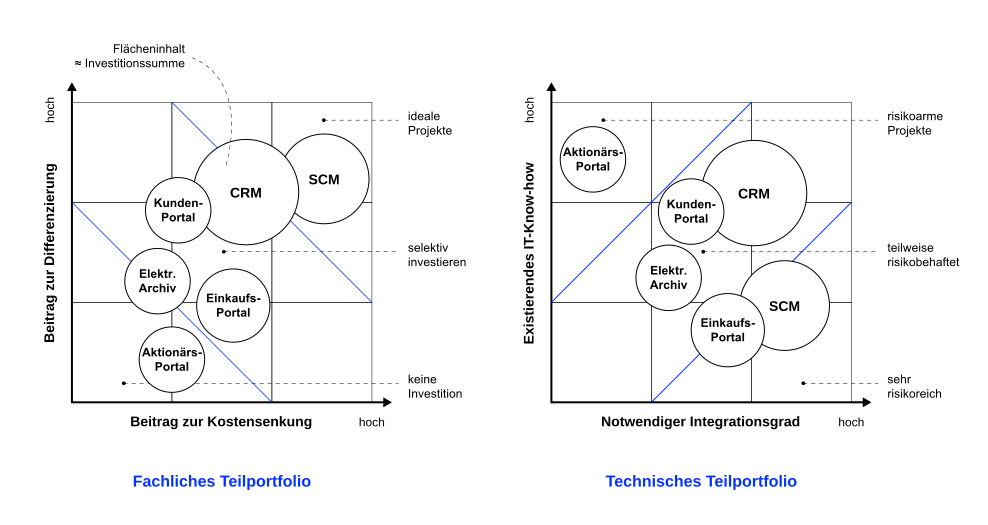
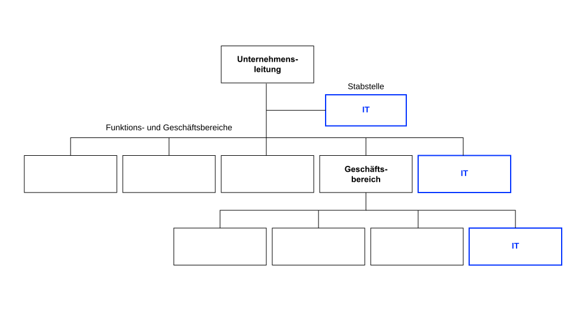
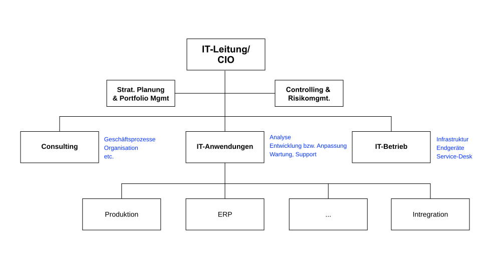

# Motivation {.vertical-center .bg-highlight}

> Ohne IT-basierte Anwendungssysteme sind viele Unternehmen überhaupt nicht mehr funktionsfähig. Das Management der Ressource IT ist damit zu einem wichtigen Thema des Managements geworden
*@mertens2016grundzuge [S. 160]*

:::notes
Informationstechnologie ermöglicht Unternehmen im digitalen Zeitalter die Entwicklung von entscheidenden Fähigkeiten. Analog zu anderen Produktionsfaktoren schafft jedoch auch IT nicht per se **Wettbewerbsvorteile** für Unternehmen. Denn es ist nicht die Technologie, die den Unterschied macht. Entscheidend ist die Art und Weise, wie die Technologie implementiert, gesteuert und genutzt  wird. In diesem Kapitel erhalten Sie einen ersten Einblick in die Notwendigkeit und Ansätze für das Management der Ressource IT.
:::

# Lernergebnisse 🎯

Nach dieser Einheit 

::: {.incremental}
- können Sie erläutern, unter welchen Bedingungen IT zum Unternehmenserfolg beiträgt,
- sind Sie in der Lage, die wesentlichen Management-Aufgaben der IT im Unternehmen zu beschreiben,
- kennen Sie die Notwendigkeit und Möglichkeiten zum Managements des IT-Projektportfolios und der IT-Landschaft,
- können den Nutzen und Kriterien für das Outsourcing von IT-Leistungen beschreiben und
- können Sie erläutern, wie IT in die Unternehmensorganisation eingebunden werden kann.

:::

# Begriffsklärung {.headline-only}

## IT-Management

Unter dem Begriff des **IT-Managements** lassen sich diejenigen Aufgaben fassen, die sich für die Leitung eines Unternehmens aus der Nutzung von IT ergeben.

. . .

Das IT-Management umfasst die **Planung, Überwachung und Steuerung** der Informationsarchitektur des Unternehmens (strategische Ebene) und der einzelnen Komponenten dieser Infrastruktur (taktische Ebene) sowie deren Nutzung (operative Ebene).

. . .

Wesentliche Aufgaben sind:

. . . 

::: {.incremental}
- Entwicklung und Umsetzung der **IT-Strategie** (IT als strategischer Wettbewerbsfaktor),
- **Gestaltung** des Aufbaus der Informationssysteme sowie
- Realisierung und **Betrieb** der IT-Landschaft
:::

## Einbettung

{#fig-be}

## Wertbeitrag der IT

Der Wertbeitrag der IT beschreibt die **subjektive Zusammenfassung der Kosten und der Nutzeffekte** einer Investition in IT-Lösungen [@krcmar2015informationsmanagement].

. . .

Die Kosten einer IT-Lösung sollten über die gesamte Lebensdauer hinweg bestimmt werden, wobei die Abschätzung des Nutzens üblicherweise schwieriger ist als die Kostenbestimmung [@mertens2016grundzuge].

. . .

Erst wenn die Informationssysteme auf die Unternehmensstrategie und die Geschäftsprozesse abgestimmt sind, kann IT einen Wertbeitrag zum Unternehmenserfolg leisten.

. . .

Durch die erfolgreiche Abstimmung kann IT die **Produktivität** erhöhen und bessere **Entscheidungen** ermöglichen sowie **neue Produkte und Services** möglich machen und sich somit zu einem strategischen Wettbewerbsfaktor entwickeln.

-----

### Visualisierung

{#fig-mechanismen}

-----

### Effekte der IT-Nutzung

Richtig eingesetzt führt IT zu höherer Produktivität und größerem Nutzen [@sambamurthy1994management], zum Beispiel:

:::incremental
- IT wird in **neue Produkte/Dienstleistungen** integriert, die z. B. zu einer erhöhten Kundenzufriedenheit führen.
- IT ermöglicht die Implementierung von **effizienteren Geschäftsprozessen**, die z. B. zu höherer Produktivität oder Mitarbeiterzufriedenheit führen.
- IT verbessert die **Entscheidungsfindung**, indem bspw. ein besseres Verständnis von Märkten und Kunden ermöglicht wird.
- IT ermöglicht **flexible und anpassungsfähige Organisationsformen**, die bspw. zu kürzeren Vorlaufzeiten bei der Produktentwicklung führen.
:::

## Umsetzung

Wir haben gesehen, dass IT erhebliche **Wertbeiträge** (Produktivität, Entscheidungen, Innovation) leisten kann.

Das gelingt jedoch nur unter bestimmten **Bedingungen** (Abstimmung auf Strategie & Prozesse):

:::medium
IT muss **strategisch geplant**, **gestaltet** und **betrieben** werden
:::

Im Folgenden betrachten wir die **Handlungsfelder des IT-Managements**, um diese Ziele zu erreichen.

#  Handlungsfelder {.headline-only}

## IT Governance

Die IT-Governance regelt **Entscheidungsrechte und Verantwortlichkeiten** für IT-Entscheidungen, um sicherzustellen, dass die IT die Unternehmensziele unterstützt [@abts2017grundkurs].

. . .

IT-Governance umfasst unter anderem folgende **Handlungsfelder**:

:::incremental
- **IT-Strategie**: Ausrichtung der IT an Unternehmenszielen und Definition langfristiger IT-Ziele
- **IT-Projektportfolio**: Auswahl und Priorisierung von IT-Investitionen nach strategischer Passung
- **Informationsarchitektur**: Gestaltung und kontinuierliche Weiterentwicklung der IT-Landschaft
- **IT-Sourcing**: Entscheidung über Eigenerstellung vs. Fremdbezug von IT-Leistungen
- **IT-Organisation**: Strukturierung der IT-Funktion und Einbindung ins Unternehmen
:::

. . .

Durch effektive IT-Governance wird sichergestellt, dass IT-Ressourcen effizient eingesetzt und IT-Risiken angemessen gesteuert werden.

## IT-Strategie {.headline-only}

Um die genannten Wertbeiträge systematisch zu realisieren, benötigen Unternehmen eine durchdachte IT-Strategie, die folgende Aspekte festlegt:

:::incremental
- die grundlegenden **langfristigen Ziele** eines Unternehmens hinsichtlich der Gestaltung und Nutzung der Informationstechnologie
- die **Handlungsoptionen**, die zur Erreichung dieser Ziele erforderlich sind sowie
- die **Ressourcen-Allokation**, insbesondere die Zuweisung von Investitionsmitteln und Betriebsausgaben festgelegt.
:::

. . .

Auch die IT-Strategie richtet den Blick nach Außen und versucht, die Chancen und Risiken verfügbarer Technologien mit den Fähigkeiten und Ressourcen des Unternehmens in Einklang zu bringen.

. . .

Die IT-Strategie definiert, in welche Technologie investiert wird, um gemeinsam mit ergänzenden Ressourcen effektive Informationssysteme zu schaffen, die durch ihre Effekte im gegebenen Marktumfeld Wettbewerbsvorteile erzielen.

-----

### Align-Enable Wirkrichtungen

:::notes
Um die Wertbeiträge zu generieren, müssen die Informationssysteme so gestaltet und gemanagt sein, dass diese die vorhandenen Prozesse und indirekt die Strategie des Unternehmens möglichst optimal unterstützen („align“).

Gleichzeitig können Informationssysteme so gestaltet werden, dass diese komplett neue Prozesse und neue Geschäftsstrategien ermöglichen. Auch solche Potenziale müssen in der Strategie-Entwicklung identifiziert und festgeschrieben werden („enable“) [@abts2017grundkurs].
:::

{#fig-align-enable}

## IT-Projektportfolio

Vor der Umsetzung eines oder mehrerer IT-Projekte mittels dem passenden [Vorgehensmodell](../10/#software-entwicklung) muss in der Regel zwischen mehreren Projektideen und deren strategischer Passung entschieden werden.

. . .

Neben **ökonomischen Aspekten** (Wertbeitrag) sollten bei der Auswahl auch **technische Kriterien** (bspw. notwendiger Integrationsgrad und vorhandenes Know-how) bewertet werden [@mertens2016grundzuge]. 

. . .

:::incremental
- In der Bewertung werden unterschiedliche **Teil-Portfolios** gebildet (bspw. fachliches und technisches Teilportfolio). 
- Projekte werden typischerweise auf Basis **subjektiver Bewertungen** fachkundiger Mitarbeiter in den Portfolios positioniert.
- Durch die Bewertung können dann **Projekte ausgewählt** werden, die bspw. einen hohen Nutzen stiften und gut machbar sind.
:::

----

#### Visualisierung

{#fig-portfolio}

## Informationsarchitektur 

Die Informationsarchitektur (oder IT-Landschaft) beschreibt alle im Unternehmen eingesetzten IT-Komponenten in folgenden Bereichen [@mertens2016grundzuge]:

:::incremental
- **Anwendungsarchitektur**: beschreibt welche Anwendungssysteme welche Geschäftsprozesse und Funktionen unterstützen. Hierbei werden unter anderem Prozesslandkarten und Wertschöpfungsdiagramme ergänzt um die eingesetzten Informationssysteme eingesetzt.
- **Datenarchitektur**: bildet die Datenbestände (*Wo sind welche Daten gespeichert?*) und deren Struktur (*Welche Datenmodelle liegen zugrunde?*) ab. Hierzu sind unternehmensweite Datenmodelle hilfreich.
- **Kommunikationsarchitektur** bildet den Datenfluss zwischen Funktionen und Datenbeständen ab.
- **IT-Architektur**: beschreibt, die technische Infrastruktur (typischerweise Server, Endgeräte, Netzwerke).
:::

. . .

Ziel des IT-Managements ist es, diese Bereiche kontinuierliche auf die Geschäftsprozesse und Aufbauorganisation abzustimmen.

## IT-Sourcing

Die Make-or-Buy-Entscheidung ist eine wesentliche Komponente der IT-Strategie und beeinflusst sowohl das IT-Projektportfolio als auch die Informationsarchitektur. Der externe Bezug von Leistungen (*„buy“*) wird oft als **Outsourcing** bezeichnet.

. . .

Bei diesem Entscheidungsproblem sollten vier Aspekte berücksichtigt werden [@mertens2016grundzuge]:

:::incremental
- Welche Aufgaben der IT werden betrachtet (was)?
- Wo könnten Vorteile des Fremdbezugs liegen (warum)?
- Wie genau wird der Fremdbezug ausgestaltet (wie) und
- Wohin wird die Leistungserstellung verlagert (wohin)?
:::

. . .

Wesentliche Gründe für das Outsourcing sind neben **Kostensenkungen** die **Konzentration auf Kernkompetenzen** und der **Zugang zu fehlendem Know-how**.

----

#### Entscheidungsmatrix

{#fig-outsourcing}

# Organisation  {.headline-only}

:::notes
Die IT sollte so organisiert und geleitet sein, dass diese an den Geschäftszielen ausgerichtet ist, verantwortungsvoll die verfügbaren Ressourcen einsetzt sowie das Risikomanagement angemessen betreibt [@meyer2003governance].
:::

## Einordnung der IT

Die Unternehmens-IT kann grundsätzlich auf drei verschiedene Arten in die Organisation eines Unternehmens eingeordnet werden: als Stabsstelle, als Linienfunktion oder in einer Mischform.

:::incremental
- **IT als Stabsstelle** der Geschäftsleitung: IT agiert als verlängerter Arm der Unternehmensleitung
- **IT als Linienfunktion**: IT agiert mit anderen Funktions- und Geschäftsbereichen auf Augenhöhe
- **Mischformen**: Zentrale Funktionen der IT sind als Stabsstelle organisiert, geschäftsspezifische Funktionen den Geschäftsbereichen untergeordnet
:::

. . .

Einige Unternehmen gliedern die IT oder Teile davon in selbstständige Unternehmen aus, um die Effizienz der Leistungserstellung durch tatsächliche Marktkräfte zu optimieren [@mertens2016grundzuge].

----

#### Visualisierung

{#fig-organisation}

## Interne Organisation 

Hauptaufgaben einer IT-Abteilung sind die Entwicklung sowie der Betrieb von Anwendungssystemen. Dazu sind ganz unterschiedliche Kompetenzen erforderlich.

. . .

Aus diesen Gründen finden sich in der IT typischerweise separate Einheiten für die **Entwicklung** und für den **Betrieb der Systeme**. Diese stellen den Kern einer IT-Abteilung dar.

. . .

Je nach Positionierung der IT umfasst diese auch folgende Einheiten:

- Strategische Planung und Architektur-Management
- IT-Controlling und IT-Sourcing
- IT-Risiko-Management und Datensicherheit
- Beratung (Entwicklung neuer Prozesse oder IT-basierter Produkte)

----

#### Visualisierung

{#fig-organigramm}

## Risikomanagement

Aufgrund der zentralen und noch wachsenden Bedeutung der IT ist sowohl das mit dem Betrieb verbundene Risiko zu berücksichtigen als der geltende Rechtsrahmen zur Speicherung und Verarbeitung von Daten [@mertens2016grundzuge].

:::incremental
- **Identifikation**, **Analyse** und **Bewertung** der mit IT verbundenen Gefahren (bspw. Hackerangriff, Stromausfall, etc.).
- **Planung** und **Umsetzung** geeigneter Maßnahmen zur Vermeidung oder Beherrschung dieser Unsicherheiten (technische oder organisatorische Maßnahmen).
- Laufende **Überwachung** und bedarfsgerechte Anpassung der getroffenen Maßnahmen.
:::

. . .

Besonderes Augenmerk gilt zudem dem **Datenschutz**, insbesondere dem Schutz personenbezogener Daten.

# Übungen ✏️  {.headline-only}

## Begriffe & Wertbeitrag

Nennen Sie ein Unternehmen und einen konkreten IT-Wertbeitrag aus einer der vier Kategorien nach @sambamurthy1994management:

- Neue Produkte/Dienstleistungen
- Effizientere Prozesse
- Bessere Entscheidungen
- Flexible Organisationsformen

Welche Voraussetzungen müssen erfüllt sein, damit dieser Wertbeitrag tatsächlich eintritt? (Bezug zu @fig-mechanismen)



## IT-Projektportfolio {.scrollable}

**Szenario:**

Ein mittelständisches Fertigungsunternehmen (350 MA) hat drei IT-Projektideen:

**Projekt A:** Migration auf Cloud-ERP (SAP S/4HANA)

- Kosten: 800k €, Dauer: 18 Monate
- Nutzen: Prozessoptimierung, Echtzeitdaten

**Projekt B:** KI-basierte Predictive Maintenance

- Kosten: 200k €, Dauer: 6 Monate
- Nutzen: Reduktion ungeplanter Ausfälle

**Projekt C:** Modernisierung IT-Infrastruktur (Server-Erneuerung)

- Kosten: 150k €, Dauer: 3 Monate
- Nutzen: Stabilität, Compliance

Ihre Aufgaben:

1. Bewerten Sie jedes Projekt nach **fachlichem Nutzen** (hoch/mittel/niedrig) und **technischer Machbarkeit** (hoch/mittel/niedrig). Begründen Sie kurz.
2. Positionieren Sie die Projekte in einem Portfolio wie @fig-portfolio.
3. Welches Projekt würden Sie priorisieren? Begründen Sie Ihre Entscheidung unter Berücksichtigung von Risiken.



## IT-Sourcing-Entscheidung

**Szenario (Fortsetzung):**  

Für die drei Projekte muss nun entschieden werden, welche Aufgaben intern (make) oder extern (buy) erbracht werden.

Nutzen Sie @fig-outsourcing und entscheiden Sie für **Projekt A (Cloud-ERP)**:

1. **Projektmanagement** – make oder buy? Begründung?
2. **Customizing/Konfiguration** – make oder buy? Begründung?
3. **Schulung der Mitarbeitenden** – make oder buy? Begründung?
4. **Betrieb nach Go-Live** – make oder buy? Begründung?

Berücksichtigen Sie dabei:

- Strategische Bedeutung (Wettbewerbsrelevanz)
- Vorhandenes Know-how (treffen Sie Annahmen)
- Kosten (treffen Sie Annahmen)



## Align-Enable-Analyse

Ein Dienstleistungsunternehmen stellt fest:

- IT wird nur als Kostenfaktor gesehen
- Systeme unterstützen Prozesse nicht effektiv
- Technische Innovationen fließen nicht in Unternehmensstrategie ein

Ihre Aufgaben:

1. Ordnen Sie die drei Probleme den Wirkrichtungen zu: Welche betreffen *Align* (IT folgt der Strategie)? Welche betreffen *Enable* (Strategie folgt den Möglichkeiten der  IT)?
2. Schlagen Sie je **eine konkrete Maßnahme** pro Problem vor: Welche Handlungsfelder sind betroffen?  Was muss das IT-Management tun?



# Lernkontrolle 🧐 {visibility="hidden"}

- Beschreiben Sie die wesentlichen Aufgaben des IT-Managements.
- Das IT-Management hat unter anderem zur Aufgabe, den Einsatz von IT so zu planen und zu steuern, dass die Geschäftsziele erreicht werden. In der Vorlesung haben wir hier zwischen zwei verschiedenen Pfaden entschieden: *align* und *enable*. Erläutern Sie anhand des Business-Engineering-Modells, was das IT-Management jeweils sicherzustellen hat.
- Nennen und erläutern Sie zwei der generischen Effekte, die IT auf den Unternehmenserfolg haben kann. Welche Voraussetzungen sind notwendig, damit diese Effekte eintreten können?
- Anhand welcher Kriterien sollten IT-Projekte bzw. Investitionen evaluiert werden?
- Geben Sie jeweils ein Beispiel für eine ausgelagerte und eine nicht-ausgelagerte Aufgabe der IT und erläutern Sie, weshalb eine Auslagerung (nicht) sinnvoll ist. 
- Erläutern Sie, weshalb das Management der IT-Landschaft zur Erhöhung der vertikalen und horizontalen Integration notwendig ist.

# Literatur 📚
::: {#refs}
:::
