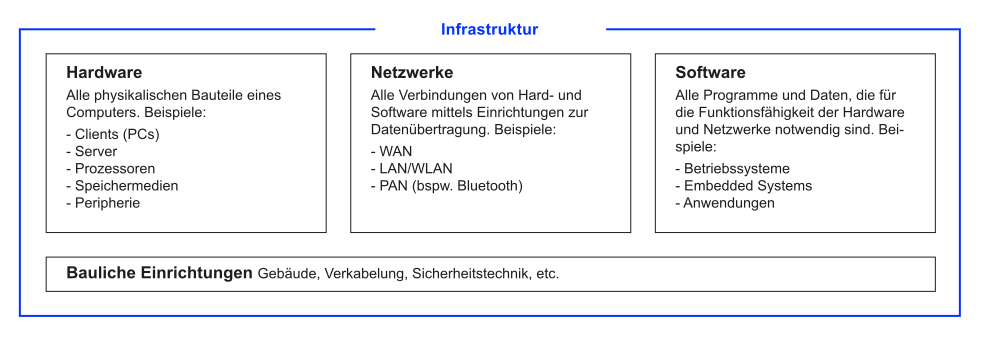
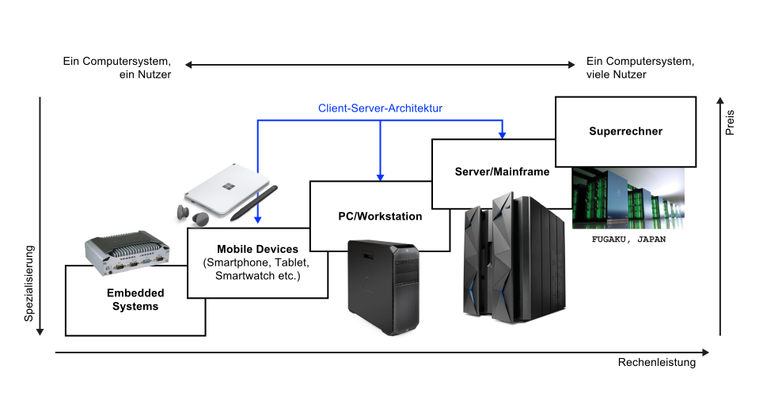
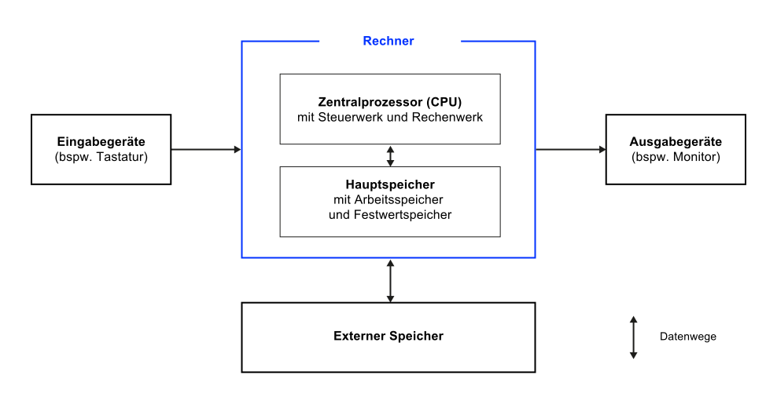
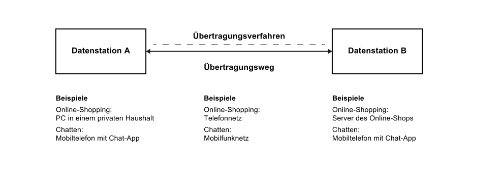
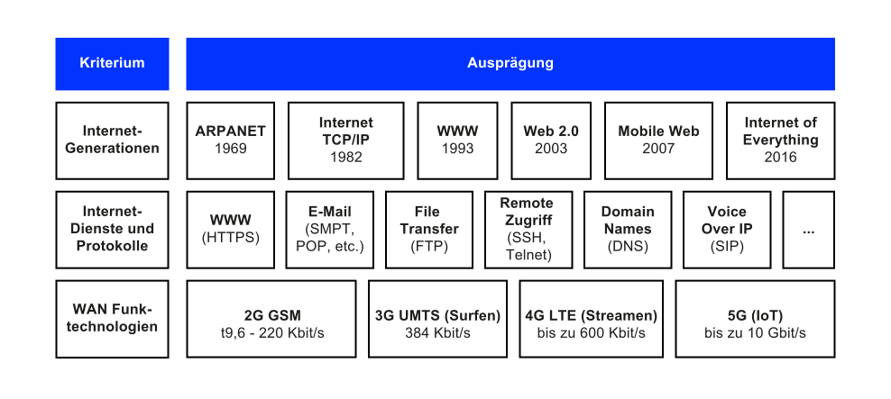
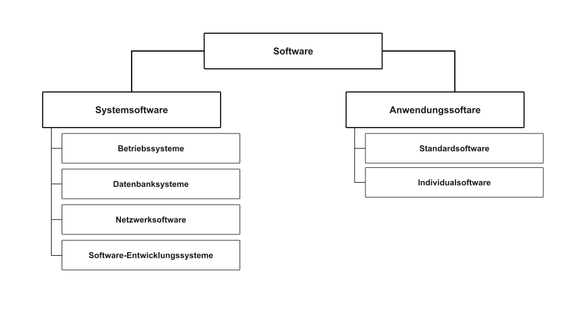
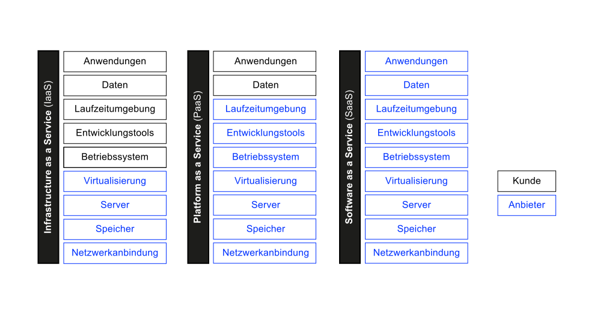
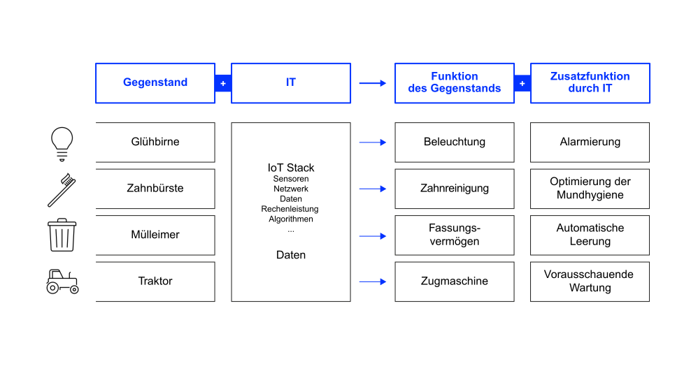

# Motivation {.vertical-center background-color="blue"}

> I don't need a hard disk in my computer if I can get to the server faster. *Steve Jobs (1997)*

. . .

> Es gibt keine Cloud -- es gibt nur die Computer anderer Leute. *Unbekannter Urheber*

::: notes
Informationstechnologien (IT) wie bspw. Serversysteme bilden die Basis heutiger Informationssysteme. In diesem Kapitel lernen Sie Basiselemente der IT-Infrastruktur sowie Basistechnologien der digitalen Transformation wie Cloud Computing und IoT kennen.
:::

# Lernergebnisse 🎯

Nach dieser Einheit

::: incremental
-   wissen Sie, was man allgemein unter **Informations- und Kommunikationstechnologie (IKT)** und **IT-Infrastruktur** versteht,
-   kennen Sie die wesentlichen **Komponenten der IT** (Hardware, Netzwerke und der Software),
-   können Sie diese und deren Funktionsweise anhand von Beispielen beschreiben,
-   verstehen Sie das Konzept des **Cloud-Computings** inkl. der wichtigsten Bereitstellungs- und Servicemodelle und
-   können das Prinzip des **Internet of Things** erläutern.
:::

# Informationstechnologie {.vertical-center background-color="blue"}

## Definition

Der Begriff **Informations- und Kommunikationstechnologie** (IKT), oft kurz als **Informationstechnologie** (IT) bezeichnet, umfasst Technik, die zum Erheben, Speichern, Übertragen und Weiterverarbeiten von Daten und Informationen eingesetzt wird [@laudon2016wirtschaftsinformatik].

. . .

IT bildet die **Basis von digitalen Informationssystemen** und ist deshalb für ihre Funktionsweise elementar.

. . .

Unterschiedliche Komponenten der IT bilden die **IT-Infrastruktur**, also alle materiellen und immateriellen Ressourcen, die benötigt werden, um am digitalen Leben teilnehmen zu können (bspw. Computer, Internetzugang, Software) [@lemke2015einfuhrung].

::: notes
::: small
Heute ist Informations- und Kommunikationstechnik in unserem Leben allgegenwärtig und wird zunehmend schwerer wahrnehmbar bzw. vielfach unsichtbar. Technik tritt aufgrund benutzerfreundlicher, integrierter und konvergenter Produkte immer mehr in den Hintergrund. Die IT-Komponenten bzw. die IT-Infrastruktur ist in vielen Produkten kaum noch als solche erkennbar (bspw. smarte Lautsprecher). Zudem werden wesentliche Komponenten der IT-Infrastruktur wie bspw. der Zugang zum Internet über mobile Netze verstärkt als gegebene, verfügbare und zuverlässige Ressourcen betrachtet, um die man sich nicht mehr spezifisch kümmern muss. Dadurch wird die IT-Infrastruktur immer stärker zur "Commodity", also zur standardisierten und mehr oder weniger homogene Handelswaren wie bspw. Strom, Erdgas, Wärme und Wasser.
:::
:::

## Kern-IT-Infrastruktur

Die Kern-Infrastruktur enthält die, für eine digitale und vernetzte Interaktion, Kommunikation und Transaktion zwischen Computern, Menschen und Maschinen notwendige, **Hardware-, Netzwerk- und Software-Komponenten**.

{#fig-infrastruktur}

# Computer {.vertical-center background-color="blue"}

## Rechnerklassen

{#fig-rechnerklassen}

::: notes
::: callout-note
#### Client-Server-Architektur

Client-/Server-Computing ist eine Architektur für die Zusammenarbeit in Netzwerken: Server, meist leistungsstarke Rechner, stellen Funktionen und Dienstleistungen zur Verfügung, Clients wie PCs können diese Dienste nutzen.

-   Der File-Server stellt seine Plattenkapazität mehreren Clients zur Verfügung.
-   Ein Print-Server organisiert vor seinem Drucker eine Warteschlange, in der die Clients aus dem ganzen Netz Druckaufträge ablegen können
-   Der Mailserver stellt allen Clients Postfächer zur Verfügung, aus denen empfangene Mails entnommen und zu versendende Mails abgelegt werden können.
:::
:::

------------------------------------------------------------------------

## Grundlegende Architektur

{#fig-vonNeumann}

::: notes
Computer folgen in der Regel der sogenannten von-Neumann-Architektur und arbeiten nach dem Grundprinzip der **Eingabe-Verarbeitung-Ausgabe (EVA)** [@abts2017grundkurs, S. 25-26]. Ein Computer umfasst Komponenten für folgende Aufgaben.

-   **Eingabe:** Daten müssen zuerst in den Rechner eingegeben werden. Hierzu stehen verschiedene Eingabegeräte zur Verfügung.
-   **Verarbeitung:** Hierzu gehören unterschiedliche Tätigkeiten wie z. B. mathematische Berechnungen, Prüfen von Daten auf Gleichheit, Vergleichen von numerischen Daten bezüglich ihrer Größe, Sortieren von Datenmengen nach bestimmten Kriterien und Umformungen von Daten nach bestimmten Regeln.
-   **Ausgabe:** Zur Präsentation oder Weiterleitung von Bearbeitungsergebnissen stehen verschiedene Geräte zur Verfügung.
-   **Speicherung:** Damit eingegebene Daten oder erzeugte Ergebnisse nicht verloren gehen, werden sie auf Datenträgern gespeichert (externe Speicher).

::: callout-note
#### Von-Neumann-Architektur

Die nach dem österreichisch-ungarischen Mathematiker J. von Neumann (1903-1957) benannte Von-Neumann-Architektur beschreibt ein **Referenzmodell**, das die **interne Struktur eines Computers**, also seinen Aufbau aus verschiedenen Komponenten sowie die Organisation der Arbeitsabläufe darstellt. Die meisten heutigen Computer verwenden diese Architektur und bestehen aus [@leimeister2021einfuhrung, S. 43]:

-   einem **Zentralprozessor** (CPU = Central Processing Unit), der die Befehle (Instruktionen) eines Programms einzeln nacheinander interpretiert und ausführt,
-   einem **Hauptspeicher**, in dem zum Zeitpunkt der Verarbeitung das auszuführende Programm und die dafür benötigten Daten gespeichert sind, und
-   den **Datenwegen** für den Datentransfer zwischen den Komponenten des Rechners und den peripheren Geräten

Für eine detaillierte Beschreibung der Komponenten siehe @leimeister2021einfuhrung.
:::
:::

# Netzwerke {.vertical-center background-color="blue"}

## Definition

Rechnernetze (oder kurz Netzwerke) dienen der **Übertragung von Daten** zwischen mehreren Rechnern, in dem sie Rechner über Übertragungswege miteinander verbinden. Dadurch ermöglichen Netzwerke unterschiedliche Formen zur computergestützten Interaktion, Kommunikation und Transaktion [@leimeister2021einfuhrung].

. . .

Netzwerke umfassen neben den physischen **Übertragungseinrichtungen** (bspw. Modem) und **Übertragungswegen** (bspw. CAT7-Kabel) auch die **Protokolle** (bspw. TCP/IP) und **Architekturen** (bspw. Client-Server-Architektur).[^1]

[^1]: Für detailiertere Beschreibungen zu Datenübertragungsverfahren und Netzwerken wie bspw. die Funktionsweise der TCP/IP Protokollfamilie lesen Sie bitte @abts2017grundkurs [S. 90ff].

## Datenübertragung

Um Daten zu übertragen, braucht man **Datenstationen**, **Übertragungswege** und **Übertragungsverfahren**. Jedes Datenübertragungssystem wird von mindestens zwei Datenstationen gebildet, die durch einen Übertragungsweg miteinander verbunden sind [@leimeister2021einfuhrung, S. 80].

{#fig-datenuebertragung}

::: notes
Eine **Datenstation** hat die Aufgabe, Daten für die Übertragung bereitzustellen, Daten zu empfangen und alle für die Kommunikation erforderlichen Funktionen auszuführen.

Unter einem **Übertragungsweg** versteht man die Verbindung von zwei Datenstationen durch Übertragungsmedien in Form physischer Verbindungen, auf denen codierte Informationen durch elektrische (bspw. Kupferkabel) oder optische Signale (bspw. Glasfaser) oder durch elektromagnetische Wellen (bspw. WiFi) übermittelt werden.

Das **Datenübertragungsverfahren** definiert, wie Daten zwischen Datenstationen über den Übertragungsweg ausgetauscht werden. Die Verfahren werden von den Protokollen und Architekturen festgelegt (wie bspw. die TCP/IP Protokollfamilie). Siehe hierzu auch das [OSI-Referenzmodell](https://de.wikipedia.org/wiki/OSI-Modell).
:::

## Klassifizierung

Computernetze können nach unterschiedlichen Kriterien klassifiziert werden, insbesondere anhand folgender Eigenschaften.

::: incremental
-   **Physik:** Übertragungsmedium (kabelgebunden -- bspw. Kupfer, Lichtwellenleiter; drahtlos)
-   **Struktur:** Topologie (bspw. Stern, Ring oder Bus; heute hauptsächlich Bus)
-   **Örtliche Begrenzung:** Netzausdehnung (bspw. Local Area Network -- LAN; Wide Area Network -- WAN)
-   **Organisation:** Betreibermodell (bspw. Öffentlich -- Public Network; privat -- Private Network)
-   **Leistung:** Übertragungskapazität (maximal möglichen Datenübertragungsmenge pro Sekunde, Bit/s)
-   **Funktion:** Verwendungszweck (bspw. Backbone-Netz, Netzknoten, lokales Netz)
:::

## Das Internet

Das Internet ist ein **weltumspannendes Rechnernetz**, das aus einer Vielzahl großer internationaler, nationaler und lokaler **Teilnetze** besteht („Netz der Netze"), die alle das **Kommunikationsprotokoll TCP/IP** verwenden.

::: incremental
-   Das Internet ist im Jahr 1969 aus dem von der Wissenschaft entwickelten und vom US-Militär initiierten Rechnernetz **ARPANET** (Advanced Research Projects Agency Network) entstanden.
-   Der Durchbruch ist auf die rasche Verbreitung von Anwendungen zurückzuführen, die durch die Entwicklung des **World Wide Web** (WWW) möglich geworden sind.
-   Die anwendungsnahen Dienste im Internet basieren auf **standardisierten Protokollen**, die zur Kommunikation zwischen Client und Server verwendet werden wie bspw. Dateiaustausch (FTP), E-Mail (SMPT, POP, IMAP), Word Wide Web (HTTP)
:::

:::notes
Details zur Geschichte finden Sie in diesem [Heise-Artikel](https://www.heise.de/hintergrund/c-t-erklaert-1993-das-Internet-9324690.html)
:::

------------------------------------------------------------------------

### Das Netz der Netze

Das Internet verbindet weltweit eine unüberschaubare Anzahl von Netzen unterschiedlicher Struktur miteinander.

{#fig-internet}

# Software

Man unterscheidet zwischen **Systemsoftware** und **Anwendungssoftware**. Systemsoftware ist zum Betrieb und zur Steuerung der Hardware und Netzwerke erforderlich, Anwendungssoftware ist für spezifische Tätigkeiten entwickelt [@mertens2016grundzuge. S. 10ff].

. . .

Das **Betriebssystem** (engl. Operating System) ist Teil der Systemsoftware. Es verknüpft die Komponenten eines Computers miteinander und stellt die Verbindung zwischen einem Benutzer bzw. Anwendungsprogramm und der Hardware her.

. . .

Eine **Anwendungssoftware** (engl. Application Software, kurz **Software**) verwendet die Ressourcen des Betriebssystems und der zugrunde liegenden Hardware. In der Alltagssprache hat sich insbesondere in Bezug auf mobile Geräte wie Smartphones die Bezeichnung **App** (für Applikation) durchgesetzt.

------------------------------------------------------------------------

## Klassifizierung

{#fig-software}

# Cloud Computing {.vertical-center background-color="blue"}

## Definition

Cloud Computing ist ein auf **Virtualisierung** basierendes **IT-Bereitstellungsmodell**, bei dem Ressourcen in Form von Infrastruktur, Anwendung und Daten über das **Internet** als verteilter Dienst von einem oder mehreren Dienstanbietern bereitgestellt werden. Diese Dienste sind nach Bedarf skalierbar und können auf einer **Pay-per-Use-Basis** bepreist werden. [@bohm2011cloud]

Cloud-Computing-Dienste werden in verschiedene **Servicemodelle** (insbesondere IaaS, PaaS und SaaS) und **Bereitstellungsmodelle** (insbesondere public, private, hybrid) unterschieden.

## Servicemodelle

{#fig-servicemodelle}

::: notes
-   **Infrastructure as a Service (IaaS):** Die Bereitstellung von Infrastruktur-Komponenten wie Server, Router, Archivierungs- und Backupsysteme oder auch ein Angebot von speziellen Hardwarekomponenten wie Druckern, Speicherkapazität oder Prozessorleistung. Diese werden virtuell und frei skalierbar angeboten und standardisiert über das Internet bereitgestellt. Der Nutzer kann die Ressourcen flexibel an seine Bedürfnisse anpassen und über das Internet, in der Regel per Weboberflächen, verwalten.
-   **Platform as a Service (PaaS):** Die Bereitstellung von Entwicklungsumgebungen, in der Regel mit integrierter Datenbank sowie Programmier- und Laufzeitumgebungen und Werkzeugen zum Management der Anwendungen. Mithilfe dieser vorkonfigurierten Dienste können Nutzer ihren eigenen Anwendungen entwickeln, ohne die zugrundeliegende Infrastruktur verwalten zu müssen. Die Plattformen sind in der Regel auf verschiedene Industrien oder Anwendungsdomänen zugeschnitten.
-   **Software as a Service (SaaS):** Die Bereitstellung standardisierten Softwarelösungen für Endverbraucher, die nur bedingt an die Wünsche des Endkunden anpassbar sind. Durch die Nutzung von SaaS entfällt die lokale Installation, Administration und Wartung der Software. Dies wird vom Anbieter vorgenommen. Der Zugriff auf die Anwendung erfolgt über das Internet.

Quelle: @leimeister2021einfuhrung [S. 100-101]

::: {style="position: relative; padding-bottom: 54.21686746987952%; height: 0;"}
<iframe src="https://www.loom.com/embed/f56fc6cba3d14349b070a64a312b96c6" frameborder="0" webkitallowfullscreen mozallowfullscreen allowfullscreen style="position: absolute; top: 0; left: 0; width: 100%; height: 100%;">

</iframe>
:::
:::

## Bereitstellungsmodelle

Die unterschiedlichen Bereitstellungsmodelle unterscheiden sich zum einem durch ihre **Zugangsform** und zum anderen durch die **Einbettung** dieser in eine bestehende IT-Infrastruktur.

::: incremental
-   **Private Cloud:** Die Dienste sind ausschließlich für die Nutzung innerhalb einer Organisation bestimmt.
-   **Public Cloud:** Die Dienste können von verschiedenen Personen und Unternehmen genutzt werden.
-   **Hybrid Cloud:** Mischung aus Private und Public Cloud (Ziel: hohe Sicherheit und Skalierbarkeit).
-   **Community Cloud:** Die Dienste können von mehreren Organisationen genutzt werden. Dazu werden mehrere Private Clouds kombiniert.
:::

::: notes
### Eigenschaften {visibility="hidden"}

Cloud Computing lässt sich über fünf spezielle Eigenschaften definieren [@leimeister2021einfuhrung, S. 99]:

-   **On-Demand Self-Service:** ein Nutzer eines Cloud-Computing-Dienstes sollte ohne eine vorherige Interaktion mit dem Anbieter zu jedem Zeitpunkt die Möglichkeit haben, auf den Dienst zuzugreifen und bei Bedarf diesen zu skalieren.
-   **Netzwerkzugriff:** ein Nutzer muss von jeder standardisierten Plattform, wie Desktop Computer, Laptops, Tablets sowie weiteren mobilen Endgeräten, auf den Dienst zuzugreifen können.
-   **Ressourcen-Pooling:** einem Nutzer werden notwendige IT-Ressourcen, wie Rechenleistung, Arbeitsspeicher oder Speicherkapazitäten, bedarfsgerecht zugewiesen. Durch die Nutzung von gleicher Hard- und Softwareinfrastruktur für verschiedene Nutzer können Kosten eingespart werden.
-   **Schnelle Anpassbarkeit und Elastizität:** Je nach Anforderungen des Kunden können die Ressourcen angepasst bereitgestellt werden. Dabei kann diese Anpassung entweder automatisiert durch den Anbieter oder manuell durch den Kunden erfolgen.
-   **Messbare Servicenutzung:** Dem Kunden wird der Dienst verbrauchsabhängig verrechnet. Dadurch entsteht eine transparente Sicht auf die empfangenen Leistungen, sowohl auf Anbieter- als auch auf Nutzerseite.
:::

# Internet of Things {.vertical-center background-color="blue"}

## Definition

Der Begriff **Internet of Things (IoT)** beschreibt das Konzept, dass virtuelle und physische Gegenstände („Dinge") über das Internet ansprechbar, erkennbar, lokalisierbar, und steuerbar sind [@leimeister2021einfuhrung, p. 97].

. . .

IoT steht für die zunehmende Vernetzung von Gegenständen und automatisierten Prozessen, die zur wachsenden Verschmelzung der physischen und digitalen Welt führt. 

. . .

Im privaten Umfeld sind sogenannte Smart Homes, also die Vernetzung von Sensoren (bspw. Temperatursensoren) und Aktoren (bspw. Heizung) im Haus bzw. in der Wohnung ein prominentes Beispiel.

. . .

Diese Art der technologischen Vernetzung von Geräten und Daten ermöglicht völlig neue Arten der Wertschöpfung.

## Funktionsweise

{#fig-IoT}

## Anwendungsfall ;-) {visibility="hidden"}

<iframe width="560" height="315" src="https://www.youtube-nocookie.com/embed/oY0mxwySaSo" title="YouTube video player" frameborder="0" allow="accelerometer; autoplay; clipboard-write; encrypted-media; gyroscope; picture-in-picture" allowfullscreen>

</iframe>

# Übungen ✏️ {.vertical-center background-color="blue"}

## Grundbegriffe

Erläutern Sie in der Kleingruppe reihum die Bedeutung der folgenden Begriffe.

-   IT-Infrastruktur
-   Von-Neumann Architektur
-   EVA-Prinzip
-   Netzwerk
-   TCP/IP
-   Systemsoftware
-   Cloud-Computing

## Betriebssysteme

Welche **Betriebssysteme** kommen in welcher Rechnerklasse zum Einsatz?

Recherchieren Sie Beispiele und ergänzen Sie @fig-rechnerklassen.

Welche davon setzen Sie selbst (wozu) ein?

## Internet of Things

Ein Szenario für das Internet der Dinge (Internet of Things, IoT) ist das Smart Home.

Diskutieren Sie Ihre Anforderungen an ein Smart Home und identifizieren Sie die zur Realisierung wichtigsten IoT-Komponenten und deren Funktionen:

- Sensoren: Welche Daten werden erfasst? (z.B. Temperatur, Bewegung, Feuchtigkeit)
- Aktoren: Welche Aktionen werden ausgeführt? (z.B. Licht einschalten, Ventile öffnen)
- Netzwerke: Wie werden die Geräte verbunden? (z.B. WLAN, Bluetooth, LPWAN)
- Datenverarbeitung: Wie und wo werden die Daten verarbeitet? (z.B. Edge Computing, Cloud Computing)
- Sicherheit: Welche Sicherheitsmaßnahmen sind notwendig? (z.B. Verschlüsselung, Authentifizierung)

Erstellen Sie eine kurze Präsentation Ihres IoT-Szenarios.

## Open Source

Systemsoftware und Anwendungssoftware sind oft **Open Source**.

1. Recherchieren Sie diesen Begriff 
2. Schreiben Sie die Eigenschaften sowie Vor- und Nachteile von Open Source Software auf.
2. Finden Sie ein Beispiel für eine Open Source Software, finden Sie heraus unter welcher Lizenz diese veröffentlicht ist und geben Sie an, was im Rahmen der Lizenz (nicht) erlaubt ist.

## Cloud-Servicemodelle

Recherchieren Sie auf der Website von [Microsoft Azure](https://azure.microsoft.com) und/oder [Amazon Web Services](https://aws.amazon.com/) je **IaaS und PaaS Servicemodell** min. ein **konkretes Angebot**. Finden Sie darüber hinaus min. ein Beispiel für **SaaS**.

Beschreiben Sie die Angebote in Ihren eigenen Worten. Begründen Sie die Zuordnung zu den Service-Modellen.

## Cloud-Computing Vor- & Nachteile

Finden Sie die **Vor- und Nachteile** des Cloud-Computings.

Fassen Sie Ihre Ergebnisse zusammen und geben Sie je Vor und Nachteil ein anschauliches Beispiel.

## Cloud Bedeutung

Weshalb sind Cloud-Services in digitalen Unternehmen heute nicht mehr wegzudenken?

Überlegen Sie insbesondere, 

- die Wichtigkeit der Nutzung mit den Eigenschaften des digitalen Zeitalters zusammenhängt und
- wie IaaS und PaaS Angebote in der Entwicklung von Produkten unterstützen, die menschlich erwünscht, technologisch machbar und wirtschaftlich tragfähig sind.

# Lernkontrolle 🧐 {visibility="hidden"}

-   Nennen und beschreiben Sie die wesentlichen Elemente der Basis-Infrastruktur.
-   Infrastruktur und (betriebliche) Anwendungen werden heute oft als Services aus der Cloud bezogen. Nennen Sie eines der in der Vorlesung besprochenen Servicemodelle und erläutern Sie dieses jeweils anhand eines konkreten Beispiels.
-   Cloud-Computing gilt als eine der Basis-Technologien der digitalen Transformation. Erläutern Sie anhand eines Merkmals von Cloud-Computing, wie diese Technologie die digitale Transformation unterstützt.
-   Nennen Sie eine weitere Technologie, die die digitale Transformation unterstützt und erläutern Sie diese.
-   Nennen Sie zwei Vorteile der Nutzung von IaaS für Unternehmen.
-   In den Rechenzentren von Unternehmen und Cloud-Anbietern werden unter anderem Systeme eingesetzt, die mit dem 64 Bit-Betriebssystem z/OS betrieben wird. Zu welcher Rechnerklasse gehören diese Systeme?
-   Nennen Sie zwei der in der Vorlesung besprochenen Eigenschaften dieser Systeme, die diese von Workstations/PCs abgrenzen.

# Literatur 📚

::: {#refs}
:::
