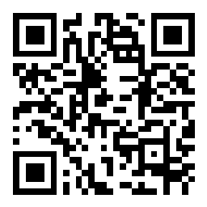
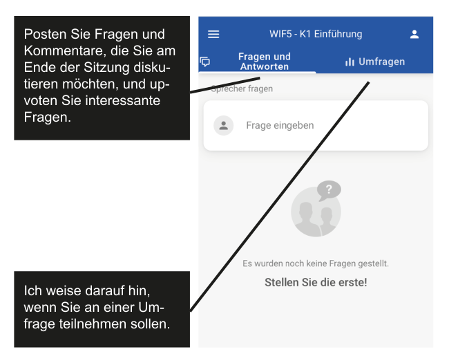

# Top{visibility="hidden" .slide-link-hidden .unlisted .unnumbered}
[Folien](slides.html)

__Drucken bzw. als PDF exportieren__  
Wenn Sie die Folien ausdrucken oder exportieren möchten, öffnen Sie die Präsentation, drücken Sie `e` auf Ihrer Tastatur und dann `Drucken`(als PDF).

# Allgemeines {visibility="hidden"}

Im Orientierungsmodul "Grundzüge Informationsmanagement " erhalten Sie einen Überblick über die IT-bezogenen Themenbereiche Ihres Studiums.

Der Kurs basiert auf einem Blended Learning Konzept (Flipped Classroom). Das bedeutet, dass Sie zu Hause die Inhalte der Vorlesung vorbereiten. Hierzu sollten Sie das Skript (in der Regel ein Foliensatz) durcharbeiten. Für fast alle Vorlesungen habe ich zudem einen kurzen Podcast mit weiteren Erläuterungen aufgezeichnen, den Sie auch anhören sollten. 

In den gemeinsamen Live-Sessions reflektieren und vertiefen wir dann die Inhalte anhand von Übungen (oft in Kleingruppen). Manche Übungen sollten Sie nach den Sessions eigenständig bearbeiten.

# Interaktion {.html-hidden .unlisted}

::: {.columns}
::: {.column width=34%}
Bitte __sli.do__ starten

- per Smartphone:  
  

- im Broswer ([sli.do](https://sli.do) öffnen Code eingeben): __351297__
:::
::: {.column width=66%}

:::
:::

# Was ist Informationsmanagement? {background-color=lightgrey background-image="images/question.jpeg" .unlisted .html-hidden}

[slid.do](https://wall.sli.do/event/g3boKvAbWjVWsoKXcGR36j?section=79a2aafc-ddd2-4d5d-88a0-48e281ad2797)

# Was möchten Sie in diesem Kurs lernen? {background-color=lightgrey background-image="images/question.jpeg" .unlisted .html-hidden}

[slid.do](https://wall.sli.do/event/g3boKvAbWjVWsoKXcGR36j?section=79a2aafc-ddd2-4d5d-88a0-48e281ad2797)

# Lernziele

Nach der Veranstaltung sollten Sie unter anderem[^1] in der Lage sein,

:::incremental
- Grundbegriffe und wesentliche __Konzepte des Informationsmanagements__ zu benennen und anhand von Beispielen zu erläutern,
- wesentliche Eigenschaften des __digitalen Zeitalters__ und Komponenten des betrieblichen Informationsmanagements zu beschreiben und zu klassifizieren,
- Treiber und Potenziale der __Digitalisierung von Unternehmen und Märkten__ zu benennen und deren Zusammenhänge zu erläutern,
- ausgewählte __Methoden des Informationsmanagements__ und zugehörige digitale Werkzeuge anzuwenden,
- eigenverantwortlich mit Lernangeboten umzugehen und wirksame __Lernstrategien__ zu entwickeln und
- den __Einsatz von digitalen Werkzeugen__ in Unternehmen zu reflektieren.
:::

[^1]: Vollständige Liste der Lernziele siehe Modulbeschreibung 

# Struktur der Vorlesung {.vertical-center .bg-highlight}

## Einheiten

Die Vorlesung ist in 10 Kapitel (`K`) gegliedert

:::incremental
- `K1` __Einführung__: Was ist das und weshalb ist es wichtig?
- `K2` __Das digitale Zeitalter__: Was macht unsere Zeit besonders?
- `K3` __IT__: Was ist die Basis von Informationssystemen?
- `K4` __Datenbanken #1__: Wie können Daten strukturiert werden?
- `K5` __Datenbanken #2__: Wie können Datenstrukturen abgebildet werden?
- `K6` __Anwendungssysteme__: Welche gibt es und wozu?
- `K7` __Geschäftsprozessmanagement__: Wie können Abläufe gesteuert werden?
- `K8` __Prozess-Modellierung__: Wie können Prozesse verständlich abbilden?
- `K9` __IT-Management__: Wie steure ich IT im Unternehmen?
- `K10` __Digitale Geschäftsmodelle__: Was ist das nächste große Ding?
:::

## Lernmaterialien

Jedes Kapitel enthält folgende Lernmaterialien: 

:::incremental
-	Vorlesungsskript
-	Podcast *(Kommentare zu den Inhalten des Kapitels und Ergänzungen; keine 1:1 Besprechung der Folien)*
-	Übungen *(Wiederholung, Reflektion und Vertiefung)*
- Referenz zu weiterführender Literatur *(insbesondere @krcmar2015grundlagen, @fank2018einfuhrung, @mertens2016grundzuge, @lemke2017einfuhrung und @bachle2021einfuhrung)*
-	Moodle-Quiz
:::

:::{.fragment}
Alle Inhalte sind prüfungsrelevant.
:::

## Ablauf und Aufwände

Der Kurs basiert auf einem Blended Learning Konzept („Flipped Classroom“)

:::incremental
- Sie erarbeiten sich die Inhalte im __Selbststudium__ *(10 x ca. 3,5 h)*
- Wir wiederholen und vertiefen in der __Veranstaltung__ *(13 x ca. 2,5 h)*
  - Zusammenfassung der Inhalte (Big Picture)
  - Antwort auf Ihre Fragen (Q&A)
  - Übungen (oft in Kleingruppen)
- In der __Portfolio-Prüfung__ wenden Sie Ihr Wissen an
  - Bearbeitung Quizze *(ca. 2 h)*
  - Bearbeitung Essay *(THE-1; ca. 6 h)*
  - Bearbeitung Übungsblatt *(THE-2; ca. 3 h)*
  - Abschlussprüfung
:::

:::notes
Der Kurs ist mit 4 ECTS gewichtet. Die ECTS entsprechen einem Arbeitsaufwand von ca. 120 h. 

Die ungefähre Verteilung des Arbeitsaufwands entnehmen Sie bitte obiger Auflistung. Die restliche Zeit ist für das Selbststudium, insbesondere die Vorbereitung auf die Abschlussprüfung (THE-3) vorgesehen.

Die Erfahrung aus vorangegangen Kursen lehrt, dass ohne die Teilnahme an den Live-Sessions und die Bearbeitung der Übungen das Bestehen des Kurses mit einer ordentlichen Note kaum möglich ist.

Dieses __Lern-Set-Up__ soll Sie dazu befähigen

-	eigenverantwortlich mit Lernangeboten umzugehen und wirksame Lernstrategien zu entwickeln,
-	den Einsatz von digitalen Werkzeugen in Unternehmen gesellschaftskritisch zu reflektieren,
-	Zusammenhänge zu erfassen, auf den Punkt zu bringen und für andere verständlich zu erklären
:::

## Prüfungsleistung

Die Vorlesung wird anhand einer __Portfolio-Prüfung__ bewertet

:::incremental
- Die Portfolio-Prüfung besteht aus vier unterschiedlichen Teilen:
  - __Quizze__ (THE-0; je ca. 2 Wochen Bearbeitungszeit, 10 Punkte)[^2]
  - __Pressemeldung__ (THE-1; ca. 3 Wochen Bearbeitungszeit, 15 Punkte)
  - __Übungsblatt__ (THE-2; ca. 2 Tage Bearbeitungszeit, 15 Punkte)
  - __Abschlussprüfung__ (ca. 60 Minuten Bearbeitungszeit, 50 Punkte)
- Die Gesamtzahl der in diesem Kurs erreichbaren Punkte beträgt 90. Sie benötigen __45 Punkte zum Bestehen__.
:::

[^2]: Bitte beachten Sie, dass die Quizze nur innerhalb eines definierten Zeitraums (variiert pro Quiz, siehe Moodle) absolviert werden können.

# Zeitplan {.scrollable .smaller}

::: {.notes}
Es ist wichtig, dass Sie sich auf die Live-Sessions vorbereiten, die Inhalte kontinuierlich reflektieren, die Übungen durchführen und Fragen stellen.
:::

::: {.column-page-right}

|Datum       |Thema                                                   |Prüfungsteil     |
|:-----------|:-------------------------------------------------------|:----------------|
|`24.03.2022`|Kick-off und Organisatorisches                          |-
|`31.03.2022`|K1 Einführung                                           |Quiz
|`07.04.2022`|K2 Das digitale Zeitalter                               |Quiz
|`14.04.2022`|Illustration — ScaleUp! & __Ausgabe Thema Essay__       |-
|`21.04.2022`|K3 Informationstechnologie                              |Quiz
|`28.04.2022`|K4 Datenbanken #1                                       |Quiz
|`05.05.2022`|K5 Datenbanken #2                                       |Quiz
|`06.05.2022`|__Deadlline Abgabe Essay__                              |THE-1
|`12.05.2022`|K6 Anwendungssysteme                                    |Quiz
|`19.05.2022`|K7 Geschäftsprozessmanagement                           |Quiz
|`02.06.2022`|K8 Prozess-Modellierung & __Ausgabe Übungsblatt__       |Quiz
|`04.06.2022`|__Deadlline Abgabe Übungsblatt__                        |THE-2
|`23.06.2022`|K9 IT-Management                                        |Quiz
|`30.06.2022`|K10 Digitale Geschäftsmodelle                           |Quiz
|`07.07.2022`|Zusammenfassung & Prüfungsvorbereitung                  |-

: Zeitplan Sommersemester 2022 (Änderungen vorbehalten) {#tbl-schedule}

:::

# Q&A? {background-color=lightgrey background-image="images/question.jpeg" .unlisted .html-hidden}

Posten Sie Ihre Fragen auf [slid.do](https://wall.sli.do/event/g3boKvAbWjVWsoKXcGR36j?section=79a2aafc-ddd2-4d5d-88a0-48e281ad2797)

## Nicht prograstinieren {background-color=black .unlisted .html-hidden}

<iframe src="https://embed.ted.com/talks/lang/en/tim_urban_inside_the_mind_of_a_master_procrastinator" width="854" height="480" style="position:absolute;left:0;top:0;width:100%;height:100%" frameborder="0" scrolling="no" allowfullscreen></iframe>

## Creating your reality {background-color=black .unlisted .html-hidden}

<iframe src="https://embed.ted.com/talks/lang/en/isaac_lidsky_what_reality_are_you_creating_for_yourself" width="854" height="480" style="position:absolute;left:0;top:0;width:100%;height:100%" frameborder="0" scrolling="no" allowfullscreen></iframe>

# Literatur 📚
::: {#refs}
:::