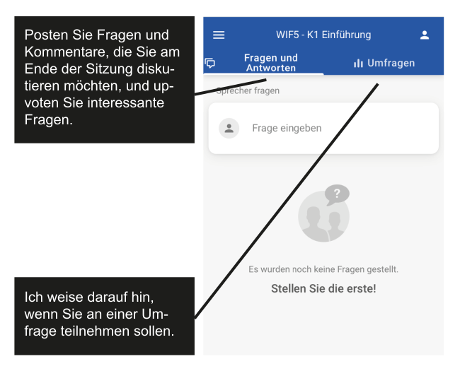

# Allgemeines {visibility="hidden"}

Im Orientierungsmodul "Grundzüge Informationsmanagement" erhalten Sie einen Überblick über die IT-bezogenen Themenbereiche Ihres Studiums.

Der Kurs basiert auf einem Blended Learning Konzept (Flipped Classroom). Das bedeutet, dass Sie zu Hause die Inhalte der Vorlesung vorbereiten. Hierzu sollten Sie das Skript zum Thema durcharbeiten. Für fast alle Vorlesungen habe ich zudem kurze Videos mit weiteren Erläuterungen aufgezeichnet.

In den gemeinsamen Live-Sessions reflektieren und vertiefen wir dann die Inhalte anhand von Übungen (oft in Kleingruppen). Manche Übungen sollten Sie nach den Sessions eigenständig bearbeiten.

# Interaktion {.html-hidden .unlisted}

::: {.columns}
::: {.column width=34%}
Bitte __sli.do__ starten

- per Smartphone:  
  

- im Broswer ([sli.do](https://sli.do) öffnen Code eingeben): __351297__
:::
::: {.column width=66%}

:::
:::

# Was möchten Sie in diesem Kurs lernen? {background-color=lightgrey background-image="images/question.jpeg" .unlisted .html-hidden}

[slid.do](https://wall.sli.do/event/g3boKvAbWjVWsoKXcGR36j?section=79a2aafc-ddd2-4d5d-88a0-48e281ad2797)

# Lernziele

Nach der Veranstaltung sollten Sie unter anderem[^1] in der Lage sein,

:::incremental
- Grundbegriffe und wesentliche __Konzepte des Informationsmanagements__ zu benennen und anhand von Beispielen zu erläutern,
- wesentliche Eigenschaften des __digitalen Zeitalters__ und Komponenten des betrieblichen Informationsmanagements zu beschreiben und zu klassifizieren,
- Treiber und Potenziale der __Digitalisierung von Unternehmen und Märkten__ zu benennen und deren Zusammenhänge zu erläutern,
- ausgewählte __Methoden des Informationsmanagements__ und zugehörige digitale Werkzeuge anzuwenden,
- eigenverantwortlich mit Lernangeboten umzugehen und wirksame __Lernstrategien__ zu entwickeln und
- den __Einsatz von digitalen Werkzeugen__ in Unternehmen zu reflektieren.
:::

[^1]: Vollständige Liste der Lernziele siehe Modulbeschreibung 

# Struktur der Vorlesung {.vertical-center .bg-highlight}

## Einheiten

Die Vorlesung ist in 12 Kapitel (`K`) gegliedert

:::{.incremental .smaller}
- `K1` __Einführung__ — Was sind Grundkonzepte des Informationsmanagements?
- `K2` __Digitale Transformation__ — Was verändert sich durch die Digitalisierung?
- `K3` __Technologie__ — Was ist die Basis von Informationssystemen?
- `K4` __Informationssysteme__ — Welche Rolle spielen betriebliche Informationssysteme?
- `K5` __Prozesse__ — Wie werden Abläufe im Unternehmen gesteuert?
- `K6` __Daten__ — Wie entstehen nützliche Informationen?
- `K7` __Integration__ — Was ist integrierte Informationsverarbeitung? 
- `K8` __Anwendungssysteme__ — Welches sind die wichtige Anwendungssysteme?
- `K9` __Scale-Up__ - Wie spielen die Elemente zusammen?
- `K10` __Implementierung__ — Wie entstehen Informationssysteme?
- `K11` __IT-Management__ — Wie werden Informationssysteme gesteuert?
- `K12` __Geschäftsmodelle__ — Wie verändern sich Märkte?
:::

## Lernmaterialien

Jedes Kapitel enthält folgende Lernmaterialien: 

:::incremental
-	__Vorlesungsskript__ *(Wiki)*
-	__Videos__ *(Kommentare zu ausgewählten Inhalten)*
- __Big Picture__ *(Visuelle Zusammenfassung der Kapitel)*
-	__Übungen__ *(Wiederholung, Reflektion und Vertiefung)*
- Referenz zu weiterführender __Literatur__ *(insbesondere @mertens2016grundzuge, @lemke2017einfuhrung und @bachle2021einfuhrung, alle als E-Books verfügbar)*
-	__Moodle-Quizze__
:::

:::{.fragment}
Alle Inhalte sind prüfungsrelevant.
:::

## Ablauf und Aufwände

Der Kurs basiert auf einem Blended Learning Konzept („Flipped Classroom“)

:::incremental
- Sie erarbeiten sich die Inhalte im __Selbststudium__ *(12 x ca. 2,5 h)*
- Wir wiederholen und vertiefen in der __Veranstaltung__ *(13 x ca. 2,5 h)*
  - Zusammenfassung der Inhalte (Big Picture)
  - Antwort auf Ihre Fragen (Q&A)
  - Übungen (oft in Kleingruppen)
- In der __Portfolio-Prüfung__ wenden Sie Ihr Wissen an
  - Bearbeitung von 10 Quizzen *(ca. 5 h)*
  - Erstellung der Pressemeldung *(ca. 6 h)*
  - Bearbeitung Übungsblatts *(ca. 1 h)*
  - Abschlussprüfung *(40 Minuten, plus Vorbereitungszeit)*
:::

:::notes
Der Kurs ist mit 4 ECTS gewichtet. Rechnen Sie deshalb mit einem Arbeitsaufwand von ca. 100 h. 

Die ungefähre Verteilung des Arbeitsaufwands entnehmen Sie bitte obiger Auflistung. Die restliche Zeit ist für das Selbststudium, insbesondere die Vorbereitung auf die Abschlussprüfung vorgesehen.

Die Erfahrung aus vorangegangen Kursen lehrt, dass ohne die Teilnahme an den Live-Sessions und die Bearbeitung der Übungen das Bestehen des Kurses mit einer ordentlichen Note kaum möglich ist.

Dieses __Lern-Set-Up__ soll Sie dazu befähigen

-	eigenverantwortlich mit Lernangeboten umzugehen und wirksame Lernstrategien zu entwickeln,
-	den Einsatz von digitalen Werkzeugen in Unternehmen gesellschaftskritisch zu reflektieren,
-	Zusammenhänge zu erfassen, auf den Punkt zu bringen und für andere verständlich zu erklären
:::

## Prüfungsleistung

Die Vorlesung wird anhand einer __Portfolio-Prüfung__ bewertet

:::incremental
- Die Portfolio-Prüfung besteht aus vier unterschiedlichen Teilen:
  - __Quizze__ (je ca. 2 Wochen Bearbeitungszeit, 20 Punkte)[^2]
  - __Pressemeldung__ (ca. 2 Wochen Bearbeitungszeit, 20 Punkte)
  - __Übungsblatt__ (ca. 2 Tage Bearbeitungszeit, 10 Punkte)
  - __Abschlussprüfung__ (40 Minuten Bearbeitungszeit, 40 Punkte)
- Die Gesamtzahl der in diesem Kurs erreichbaren Punkte beträgt 90. Sie benötigen __45 Punkte zum Bestehen__.
:::

[^2]: Bitte beachten Sie, dass die Quizze nur innerhalb eines definierten Zeitraums (variiert pro Quiz, siehe Moodle) absolviert werden können.

## Zeitplan {.scrollable .smaller}

::: {.notes}
Es ist wichtig, dass Sie sich auf die Live-Sessions vorbereiten, die Inhalte kontinuierlich reflektieren, die Übungen durchführen und Fragen stellen.
:::

|Datum       |Thema                                                   |Prüfungsteil     |
|:-----------|:-------------------------------------------------------|:----------------|
|`06.10.2022`|Kick-off                                                |-
|`13.10.2022`|`K1` Einführung                                         |Quiz
|`20.10.2022`|`K2` Digitale Transformation                            |Quiz
|`27.10.2022`|`K3` Technologie                                        |Quiz
|`03.11.2022`|`K4` Informationssysteme                                |Quiz
|`10.11.2022`|`K5` Prozesse & __Ausgabe Thema Pressemeldung__         |-
|`17.11.2022`|`K6` Daten                                              |Quiz
|`24.11.2022`|`K7` Integration                                        |Quiz
|`30.11.2022`|__Abgabe Pressemeldung__                                |Pressemeldung
|`01.12.2022`|`K8` Anwendungssysteme                                  |Quiz
|`08.12.2022`|`K9` ScaleUp! & __Ausgabe Übungsblatt__                 |-
|`09.12.2022`|__Deadline Übungsblatt__                                |Übungsblatt
|`15.12.2022`|`K10` Implementierung                                   |Quiz
|`22.12.2022`|`K11` IT-Management                                     |Quiz
|`12.01.2023`|`K12` Geschäftsmodelle                                  |Quiz
|`19.01.2023`|Wrap-Up & Prüfungsvorbereitung                          |-

: Zeitplan Wintersemester 2022/23 (Änderungen vorbehalten) {#tbl-schedule}

# Q&A? {background-color=lightgrey background-image="images/question.jpeg" .unlisted .html-hidden}

Posten Sie Ihre Fragen auf [slid.do](https://wall.sli.do/event/g3boKvAbWjVWsoKXcGR36j?section=79a2aafc-ddd2-4d5d-88a0-48e281ad2797)

## Nicht prograstinieren {background-color=black .unlisted .html-hidden}

<iframe src="https://embed.ted.com/talks/lang/en/tim_urban_inside_the_mind_of_a_master_procrastinator" width="854" height="480" style="position:absolute;left:0;top:0;width:100%;height:100%" frameborder="0" scrolling="no" allowfullscreen></iframe>

# Literatur 📚
::: {#refs}
:::