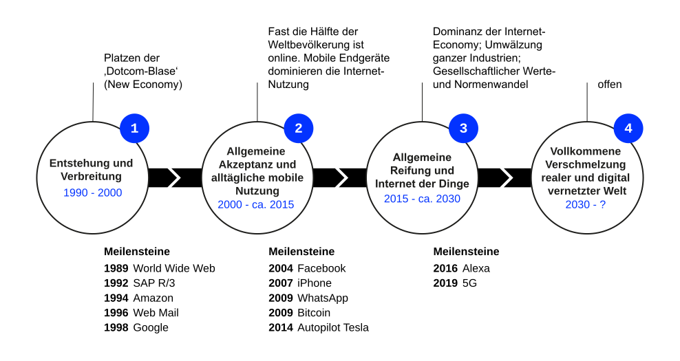
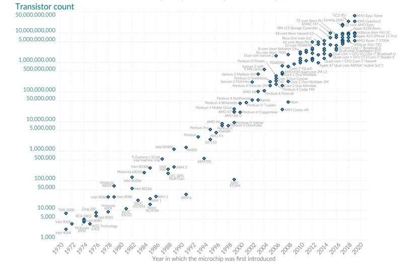
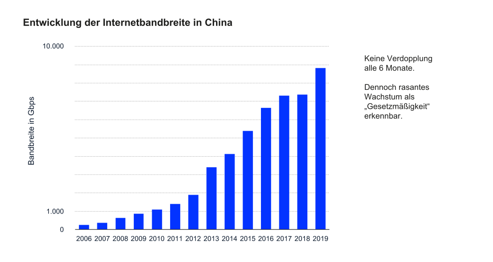
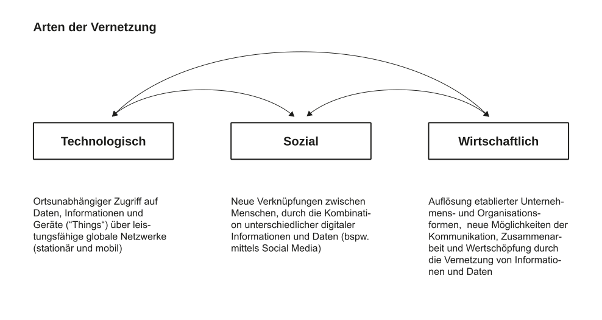
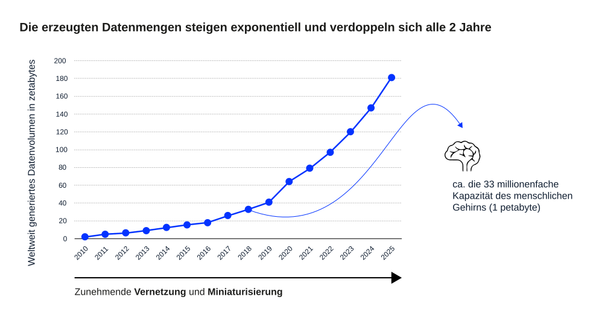

# Motivation {.vertical-center .bg-highlight}

> Wir sind längst in einer digitalisierten Welt angekommen. Die Digitalisierung betrifft nicht mehr nur klassische IT-Unternehmen, sondern Unternehmen quer durch sämtliche Branchen und Sektoren. Neue oder veränderte Geschäftsmodelle entstehen: Autos werden per App geteilt, Sprachen werden online gelernt und Musik wird gestreamt. Aber auch die Industrie wandelt sich: 3D-Drucker stellen Maschinenteile her, Roboter bauen diese zusammen, und ganze Fabriken sind intelligent miteinander vernetzt.   
*Bundesministerium für Wirtschaft und Energie (BMWI) 2020* 

:::notes
Wie aus diesem Zitat deutlich wird und bereits im vorherigen Kapitel beschrieben, prägt die __Digitalisierung__ und deren Auswirkungen den Zeitabschnitt, in dem wir leben. Dieser wird oft als __digitales Zeitalter__ bezeichnet. Digital, weil es maßgeblich durch Informations- und Kommunikationstechnologien, deren rasante Weiterentwicklung und tiefgreifenden Auswirkungen geformt wird.

In diesem Kapitel schauen wir uns die Eigenschaften des digitalen Zeitalters, die prägenden Gesetzmäßigkeiten sowie die resultierenden Transformationsprozesse genauer an. Letztere werden oft unter dem Begriff der __digitalen Transformation__ zusammengefasst.
:::

# Lernergebnisse 🎯

Nach dieser Einheit können Sie

::: {.incremental}
- die wesentlichen __Eigenschaften des digitalen Zeitalters__ beschreiben,
- Herausforderungen mittels des Konzepts __VUCA__ nennen,
- zeigen, in welchen Ebenen __Vernetzung__ vorangetrieben wird und welche konkreten Effekte damit verbunden sind, 
- die __prägenden Gesetzmäßigkeiten__ des digitalen Zeitalters erläutern,
- erkären, was man unter dem Begriff __digitale Transformation__ versteht und welche Ziele diese verfolgt und
- anhand der Methode __Design Thinking__ erläutern welche Art von Werkzeugen benötigt werden.
:::

# Digitales Zeitalter {.vertical-center .bg-highlight}

:::{.html-hidden}
> Ich habe früher dazu einmal „Neuland“ gesagt. Das hat mir einen großen Shitstorm eingebracht. Deshalb will ich das jetzt nicht einfach wiederholen. Jedenfalls ist es aber in gewisser Weise noch nicht durchschrittenes Terrain. […] Das Ganze ist im Grunde eine revolutionäre Phase.   
*Angela Merkel, ehemalige Bundeskanzlerin (2018)*
:::

## Definition

Als das __Digitale Zeitalter__ wird der Zeitabschnitt verstanden, in dem Informationen wesentlich sind und der maßgeblich durch Informations- und Kommunikationstechnologien geprägt ist. 

. . .

Das Adjektiv __digital__ beschreibt, wie Informationen repräsentiert, gespeichert, verarbeitet und übertragen werden (mithilfe von diskreten elektronischen Signalen).

. . .

:::incremental
- Die Wertschöpfung von Unternehmen ist maßgeblich bestimmt von digitalen __Daten__ (Verarbeitung, Übertragung, Nutzung).
- Es gibt  kaum einen Bereiche der Arbeits- und Lebenswelt (__Prozesse, Produkte und Dienstleistungen__), die nicht von IT bestimmt sind.
- IT schafft weitreichende soziale und wirtschaftliche __Netzwerke__.
- Es lösen sich bislang geltende Grenzen von __Raum und Zeit__ zunehmend auf.
:::

:::notes
Die unzähligen Möglichkeiten der Vernetzung von Daten durch die digitale Speicherung, Verarbeitung und Übertragung sowie der technologische Fortschritt, insbesondere die __Miniaturisierung der IT__, leistungsfähige __Netzwerke__ zum Austausch von Daten und Informationen und die dadurch entstehende __Mobilität__ prägen gesellschaftliche Entwicklungen und entscheiden über soziale Strukturen und wirtschaftlichen Erfolg von Menschen und Unternehmen [@lemke2017einfuhrung, p. 14].
:::

## Evolutionsstufen

{#fig-evolution}

::: {.notes}

### Stufe 1
In der __ersten Evolutionsstufe__ (Entstehung und Verbreitung) von ca. 1990 bis 2000 stand vor allem die Vernetzung von Computern im Vordergrund der Entwicklung. Eine wesentliche Rolle spielte hierbei die Erfindung des World Wide Webs (WWW) als zentraler Dienst des Internets zur Übertragung von Daten ([zur ersten Website des Internets](http://info.cern.ch/hypertext/WWW/TheProject.html)). 

Das WWW ermöglichte erstmals den gleichzeitigen Austausch von Text-, Bild-, Audio- und Video-Daten über eine grafische Benutzeroberfläche (Browser). Zudem konnten diese Daten relativ einfach erstellt, verknüpft (Links) und verbreitet werden. 

In den späten 90er Jahren entstand die ‚New Economy‘ als Erscheinungsform eines Marktes, der auf (informationsbasierte) Dienstleistungen, die über das Internet erbracht werden, ausgerichtet ist (bspw. digitaler Handel). Das Platzen dieser Marktblase wurde aufgrund zu hoch gesetzter Erwartungen verursacht und beendet diese erste Stufe des digitalen Zeitalters.

### Stufe 2
In der __zweiten Evolutionsstufe__ (Akzeptanz und alltägliche Nutzung) von 2000 bis ca. 2015 setzten sich digitale Dienste und (informationsbasierte) Dienstleistungen. Das Internet wurde durch die Verfügbarkeit unterschiedlicher mobiler Endgeräte (bspw. iPod, iPhone, iPad) sowie breitbandiger Internet-Zugang für die Masse zunehmend verfügbar und zunehmend mobil. Zudem begannen die sozialen Angebote im Internet die Kommunikation und Interaktion von Menschen tiefgreifend zu verändern (bspw. Facebook).

### Stufe 3
In der __dritten Evolutionsstufe__ (zunehmende Vernetzung) um 2015 bis ca. 2030 setzt sich das "Internet der Dinge" durch. Die Vernetzung von physischer und digitaler Welt ist das zentrale Merkmal dieser Stufe. Viele Produkte und Alltagsgegenstände werden durch Vernetzung und dem (automatisierten) Austausch digitaler Daten und Informationen ‚intelligent‘ bzw. ‚smart‘ (bspw. die Zahnbürste). Physische Produkte erweitern zunehmend ihren Nutzen durch digitale Lösungen (bspw. Zahnputztipps).

### Stufe 4
In der __vierten Evolutionsstufe__ (vollkommene Verschmelzung) sollen reale und digitale Welten vollständig verschmelzen (Stichwort "Metaverse"). Digitalisierung und Vernetzung sind dann weltweit integraler Bestandteil des alltäglichen Lebens.

Nach @lemke2015einfuhrung [p. 19ff]

:::

# Mechanismen {.vertical-center .bg-highlight}

Der rasante technische Fortschritt und dessen Konsequenzen formen das digitale Zeitalter. Beide lassen sich anhand von vier Gesetzmäßigkeiten veranschaulichen.

::: {.notes}
- __Moore’s Law__,
- __Gilder’s Law__,
- __Metcalfe's Law__ und
- dem Grundsatz __Code is Law__
:::

## Moore’s Law

__Die Leistung in der digitalen Hardware wächst exponentiell __

. . .

Das Moorsche „Gesetz“ besagt, dass sich bei gleichem Preis die Komplexität integrierter Schaltkreise und damit die __Leistungsfähigkeit__ der Informations- und Kommunikationstechnik (IKT) alle 18 Monate verdoppelt [@moore1965cramming].

. . .

Es sind also regelmäßige Leistungsschübe und damit die Voraussetzung für __Innovationssprünge__ zu erwarten.

:::notes
{#fig-moore}
:::

## Gilder’s Law

__Die Übertragungsleistung digitaler Netze wächst exponentiell__

. . .

Das Gildersche „Gesetz“ besagt, dass sich die __Bandbreite der Datenübertragung__ mindestens dreimal schneller als die Leistungsfähigkeit der Computer erhöht [@gilder2000telecosm].

. . .

Die Verfügbarkeit von Daten und die notwendige Bandbreite zur Übertragung beeinflussen sich wechselseitig — sind mehr Daten verfügbar wird eine höhere Bandbreite benötigt, ist eine höhere Bandbreite verfügbar werden mehr Daten übertragen.

:::notes
{#fig-gilder}
:::

## Metcalfe's Law

__Ab einer bestimmten Größe eines Netzwerks übersteigt der Nutzen die Kosten__

Das Metcalfesches „Gesetz“ besagt, dass der __Wert eines Netzwerkes__ in etwa im Quadrat mit der Anzahl seiner verbundenen Nutzer steigt [@lemke2017einfuhrung] [^1].

[^1]: Der Nutzwert $U$ des Netzwerks kann exakt mit $U = n(n - 1) = n^2 - n$ beschrieben werden. In großen Netzwerken kann der Nutzwert mit $U = n^2$ angenähert werden (Faustregel).

. . .

Die Faustregel geht davon aus, dass der Nutzen des Netzwerkes proportional zur Anzahl der möglichen Verbindungen zwischen den Teilnehmern wächst, während die Kosten nur proportional zur Anzahl der Knoten selbst wachsen.

. . .

Dadurch lässt sich erklären, weshalb heute in der Regel nur wenige, sehr große Netzwerke erfolgreich sind (bspw. WhatsApp).

:::notes
__Beispiel Soziale Netzwerke__
Je mehr Nutzer ein soziales Netzwerk hat, umso attraktiver wird dieses, weil so die Chancen steigen, dort die eigenen Freunde und Bekannten zu finden. Und je mehr Nutzer ein Netzwerk hat hat, desto mehr Geld verdient es (bspw. durch Werbung). Mit diesen Gewinnen kann nicht nur das Netzwerk verbessert, sondern durch den Zukauf von Unternehmen (anderen Netzwerken) neue Märkte erschließen und das Netzwerk erweitern. So kann man beispielsweise die Dominanz von Facebook erklären, aber auch die von Amazon
:::

## Code is Law

__Technologie bestimmt wie Freiheit und Rechte definiert werden__

Weil digitale Technologien immer stärker unsere Lebens- und Alltagswelt prägen, können diese zunehmend über Rechte und Freiheit bestimmen.

. . .

Der Begriff „Code is Law“ besagt, dass im Programmcode festgelegte Regeln eine quasi-gesetzgeberische Macht haben [@lessig2009code]. 

. . .

Diese Regeln werden oft implizit und beiläufig festgeschrieben und eben nicht im Parlament diskutiert. Es wird deshalb von Vielemn eine stärkere Rolle des Staates bei der Regulierung des Internets gefordert, um zumindest verfassungsrechtlichen Grundrechte zu schützen.

:::notes
__Beispiele für Code is Law__

- Chinas Social Credit Score  
Allgegenwärtige Überwachung und Vergabe von Punkten für aus Sicht der Regierung positives Verhalten bzw. Entzug für negatives Verhalten mit dem Ziel der Verhaltensänderung.
- Facial Recognition Surveillance   
Große Städte wie London setzen Gesichtserkennung ein, um Verdächtige in großen Menschenmassen zu identifizieren und strafrechtliche Untersuchungen einzuleiten
:::

# Digitale Transformation {.vertical-center .bg-highlight}

> „It‘s too late, all of the technology has changed and our competitors have leapfrogged us.“
*Dilbert, American comic strip written and illustrated by Scott Adams*

. . .

Die prägenden Mechanismen des digitalen Zeitalters führen in **großer Geschwindigkeit** zu **weitreichenden Veränderungen** in Wirtschaft und Gesellschaft.

## Definition

Der Begriff digitale Transformation fasst die __transformatorische Wirkung der Digitalisierung__ auf soziale, politische, wirtschaftliche und ökologische Systeme zusammen—der Wandel zur digitalen Wirtschaft und Gesellschaft. 

. . .

Digitale Transformation steht auch als __Überbegriff__ für eine Ansammlung von unternehmerischen __Fähigkeiten__, __Methoden__ und __Tools__ und deren organisatorische Einbindung zum Verstehen und Gestalten dieses Umbruchs [@lemke2017einfuhrung].

. . .

In der Wirtschaft beschreibt digitale Transformation einen __organisatorischen Veränderungsprozess__, bei dem digitale Technologien eingesetzt werden, um radikale Veränderungen im Unternehmen zu bewirken.

## Stufen

Die Reichweite der von digitalen Technologien ausgehenden Veränderungen auf Unternehmen kann in fünf Stufen beschrieben werden. Für die digitale Transformation stehen zumeist die Stufen 3 bis 5 im Fokus.

:::incremental
- **Lokale Unterstützung** — Einführung von Anwendungssysteme für einen Bereich
- **Unternehmensweite Intergration** — Zusammenführung von Daten verschiedener Anwendungssysteme (siehe [Datenintegration](../7/#integrationsgegenstände); Abläufe und Aufgabenverteilung bleiben weitgehend erhalten.
- **Reorganisation von Kernprozessen** — Neugestaltung der für die Wettbewerbsposition entscheidenden Prozesse
- **Veränderung von Arbeitsteilung und Zusammenarbeit** — Neugestaltung die Zusammenarbeit von Unternehmen in Lieferketten
- **Innovation von Geschäftsmodellen** — Einführung neuer Produkte, Dienstleistungen und/oder Erlösmodellen
:::

# Konsequenzen

## Ortsunabhängigkeit

Durch leistungsfähige Funknetze, mobile Endgeräte und entsprechender Software __lösen sich nach und nach Grenzen auf__ — zu bestimmten Zeiten an bestimmten Orten zu sein ist immer weniger wichtig.

. . .

Mobile Endgeräte (Smartphones, Tablets, Wearables) und Technologien wie mobiles Internet (5G) und Near Field Communication (NFC) ermöglichen neue Formen der Vernetzung zwischen Unternehmen, Kunden, Mitarbeitern und anderen Stakeholdern.

. . .

Die sich daraus ergebenden Formen der Zusammenarbeit (bspw. Mobile Work) sowie Produkte und Dienstleistungen (bspw. Standortbezogene Dienste) werden unter dem Schlagwort __Mobility__ zusammengefasst.

:::notes
#### Ein Anwendungsfall ;-) {visibility="hidden"}

<iframe width="560" height="315" src="https://www.youtube-nocookie.com/embed/EtcC5S7hZpw" title="YouTube video player" frameborder="0" allow="accelerometer; autoplay; clipboard-write; encrypted-media; gyroscope; picture-in-picture" allowfullscreen></iframe>
:::

----

## Stärkere Vernetzung

{#fig-vernetzung}

----

## Größeres Datenvolumen

:::notes
Die zunehmende technologische Vernetzung führt unter anderem auch dazu, dass im digitalen Zeitalter enorme Mengen strukturierter und unstrukturierter Daten erzeugt und übermittelt werden. Die Vernetzung dieser Daten ermöglicht und beschleunigt wiederum Veränderungen in Wirtschaft (bspw. neue Geschäftsmodelle) und Gesellschaft (bspw. abnehmende Anonymität).
:::

{#fig-datenvolumen}

----

## VUCA

__Volatilität__ (volatility), __Unsicherheit__ (uncertainty), __Komplexität__ (complexity) und __Mehrdeutigkeit__ (ambiguity) vestärken sich zunehmend. Diese Effekte werden unter dem Synonym __VUCA__ zusammengefasst.

:::incremental
- __Volatilität__: die Welt verändert sich rasant. Die Veränderungen werden unvorhersehbarer, immer drastischer und immer schneller.
- __Unsicherheit__: Ereignisse sind kaum vorhersehbar. Erfahrungen aus der Vergangenheit sind weniger nützlich. Planung wird immer schwieriger.
- __Komplexität__: Probleme und deren Auswirkungen werden vielschichtiger und schwerer zu verstehen. Ebenen vermischen sich. Ursache und Wirkung sind nicht mehr klar zu erkennen.
- __Mehrdeutigkeit__: Anforderungen sind widersprüchlicher und paradoxer. Das persönliche Wertesystem wird auf die Probe gestellt.
:::

:::notes
Gründe dafür liegen in den Konsequenzen der Digitalisierung (unter wachsende Vernetzung, Datenerhebung und -auswertung, Mobilität), der Globalisierung, aber auch in veränderten Bedürfnissen von Kunden und Mitarbeitern.

<iframe src="https://www.loom.com/embed/8d645db556e749cf827f9e5885474e1a" frameborder="0" webkitallowfullscreen mozallowfullscreen allowfullscreen style="position: absolute; top: 0; left: 0; width: 100%; height: 100%;"></iframe>

Um in einer von VUCA geprägten Welt erfolgreich zu bleiben, müssen Unternehmen zunächst die Gesetzmäßigkeiten verstehen und sich dann tiefgreifend verändern — sowohl in Bezug auf die Rolle digitaler Technologie als auch hinsichtlich Arbeitsweisen und Organisationsformen [@leimeister2021einfuhrung, p. 283].
:::

# Übungen ✏️ {.vertical-center .bg-highlight}

## Gesetzmäßigkeiten

Erklären Sie sich gegenseitig die drei "Gesetzmäßigkeiten" nach Moore, Gilder und Metcalfe.

Überlegen Sie anhand von Beispielen, wie die Gesetzmäßigkeiten die Eigenschaften des digitalen Zeitalters (_Volatilität_, _Unsicherheit_, _Komplexität_ und _Mehrdeutigkeit_) vestärken.

## Code is Law

Lesen Sie folgenden Artikel auf Heise.de: ["Amazon-Zusteller: KI-Kamera im Führerhaus senkt Lohn durch falsche Strafen"](https://www.heise.de/news/Amazon-Zusteller-KI-Kamera-im-Fuehrerhaus-senkt-Lohn-durch-falsche-Abstrafung-6198126.html) 

Erläutern Sie das Konzept `Code is Law` anhand dieses Beispiels.

Nehmen Sie an, die Technologie würde richtig entscheiden — wäre die Maßnahme von Amazon dann in Ordnung? Weshalb?

## Digitale Transformation

Warren G. Bennis, ein ehemaliger US-amrerikanischer Wirtschaftswissenschaftler wird folgendes Statement zugeschrieben:

> The factory of the future will have only two employees: a man and a dog. The man will be there to feed the dog. The dog will be there to keep the man from touching the equipment. *Warren G Bennis*

Diskutieren Sie, ob Sie dieser Aussage zustimmen und sammeln Sie Argumente für Ihre Position. Beziehen Sie Ihre Argumente auf die Inhalte dieses Kapitels.

## Design Thinking {.scrollable}

Um die digitale Transformation meistern zu können, müssen Unternehmen sicherstellen, dass sie die sich ständig verändernden Bedürfnisse der Kunden bzw. der Nutzer kennen und sie digitale Produkte und Angebote schaffen, die auf deren Bedürfnisse abgestimmt sind. Ein hilfreiches Werkzeug aus dem Werkzeugkasten der agilen Methoden ist __Design Thinking__.

Recherchieren Sie zu der Methode und versuchen Sie folgende Fragen zu beantworten:

- Wann schaffen Innovationen Wert?
- Welches Vorgehen schlägt die Methode vor?
- Was ist ein MVP und weshalb ist dieser wichtig?
- Was bedeutet „Fail fast, fail forward”?
- Weshalb sind agile Methoden für die digitale Transformation wichtig?

Recherchieren Sie  nach einer Fallstudie, die beschreibt, wie eine digitale Innovation mit Hilfe von Design Thinking entwickelt wurde. Zeigen Sie anhand dieses Beispiels, weshalb es sich um eine Innovation handelt, wie Design Thinking angewendet wurde (Vorgehen) und ob ein MVP entwickelt wurde.

:::notes
:::{.callout-note}

### Design Thinking

Design Thinking ist Denkhaltung, Vorgehensmodell und Methodenbaukasten gleichermaßen. Design Thinking zielt darauf ab, mit Methoden des Desings nutzer- und kundenorientierte Ergebnisse zur Lösung von komplexen Problemen zu liefern. Die Methode baut auf einem interaktiven Prozess und den drei Prinzipien Kundenzentrierung, Iteration und Prototyping sowie die Lösungsoffenheit auf. 

Der Design-Thinking-Prozess stellt den Menschen und seine Bedürfnisse in den Mittelpunkt. Es wird daher häufig von Human-Centered-Design gesprochen. Voraussetzung dafür ist, dass eine potenzielle Zielgruppe bereits bei Beginn des Prozesses gegeben ist. Durch Rückkopplung wird diese frühzeitig in die Problemdefinition und Lösungsfindung einbezogen. Mögliche Nutzer werden befragt aber auch beobachtet und begleitet. Lösungen und Ideen werden in Form von Prototypen im Design Thinking früh sichtbar und vermittelbar gemacht, damit potenzielle Anwender sie – noch lange vor der Fertigstellung oder Markteinführung – testen und Feedback geben können. 

Nicht-Designer, beispielsweise Entrepreneure oder Manager, können mithilfe von Design Thinking neue Sichtweisen auf Probleme und mögliche Lösungen erhalten. Die Methode kombiniert Empathie gegenüber den Nutzern und seinen Problemen mit Kreativität auf der Suche nach geeigneten Lösungen unter Einsatz rationaler Überlegungen bei der Analyse, Bewertung und Auswahl der verschiedenen Alternativen. Ziel des Design Thinking ist die Entwicklung von Innovationen, beispielsweise die Entwicklung innovativer Produkte, Services oder Erlebnisse.

Quelle: @lemke2017einführung
:::
:::

# Lernkontrolle 🧐 {visibility="hidden"}

Weitere Aufgaben zur Prüfungsvorbereitung

- Das digitale Zeitalter ist geprägt von Vernetzung. Erläutern Sie anhand eines Unternehmens Ihrer Wahl die unterschiedlichen Aspekte der Vernetzung.
- Der Erfolg vieler digitaler Plattformen wie WhatsApp lässt sich anhand einer Gesetzmäßigkeit des digitalen Zeitalters gut erklären. Nennen Sie und erläutern Sie diese Gesetzmäßigkeit.
- Nennen Sie eine Herausforderung des digitalen Zeitalters und erläutern Sie daran, weshalb agile Methoden wie Design Thinking für die erfolgreiche Bewältigung der digitalen Transformation hilfreich sind.
- Erläutern Sie anhand eines Beispiels eine Ebene auf der Veränderungen notwendig sind, um die digitale Transformation zu meistern.

# Literatur 📚
::: {#refs}
:::
