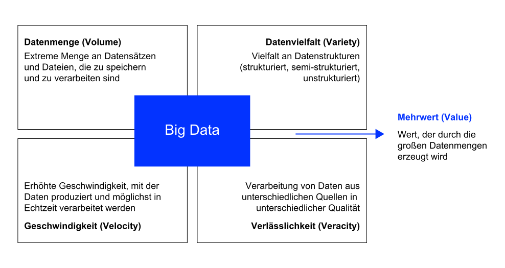
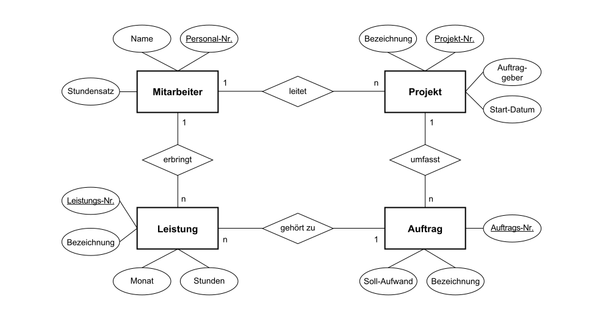
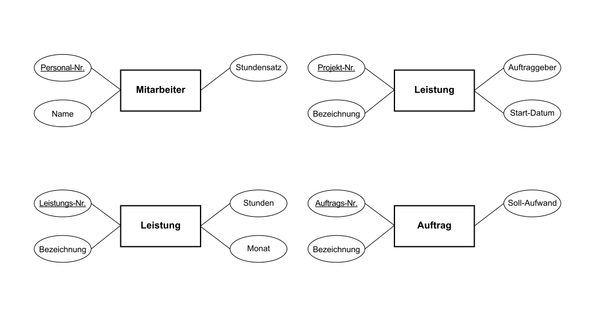
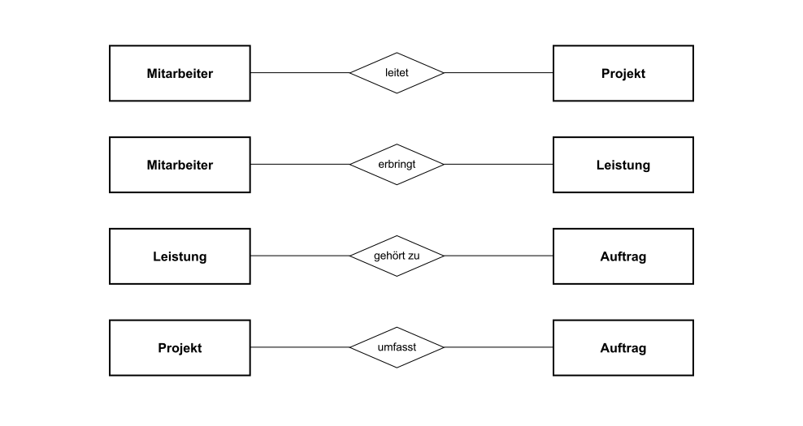
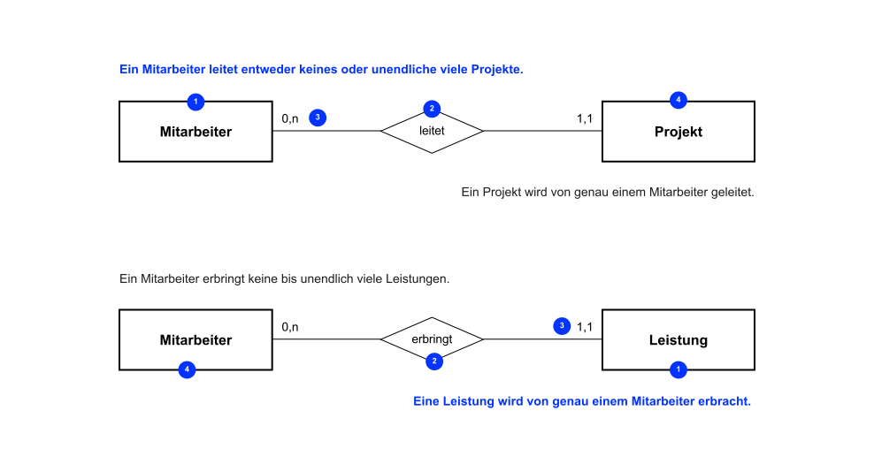
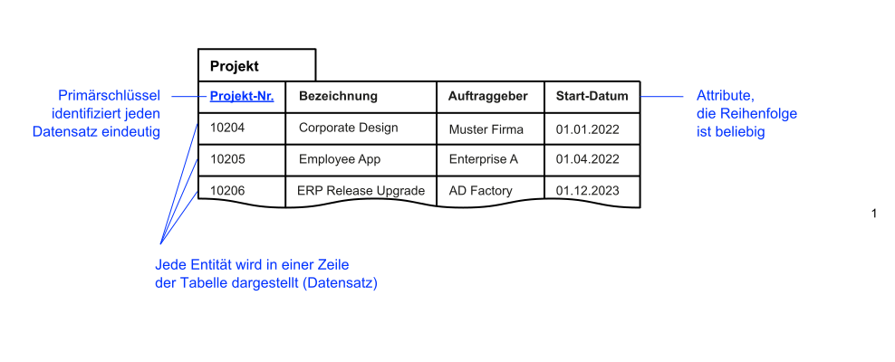
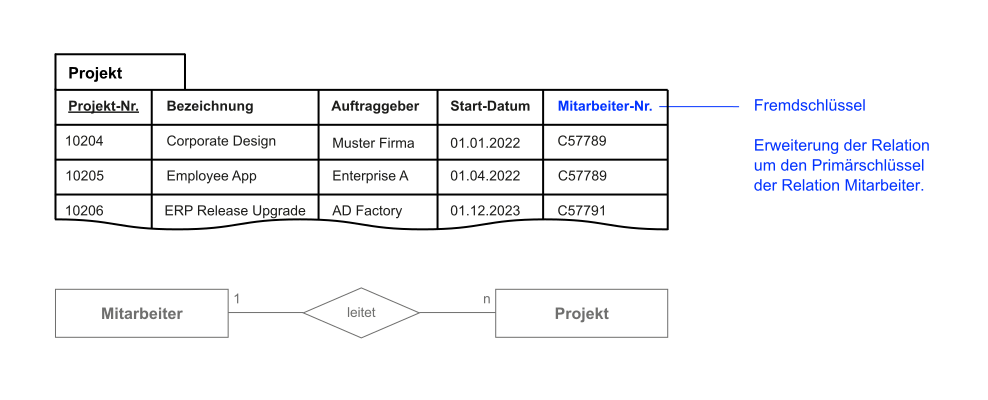
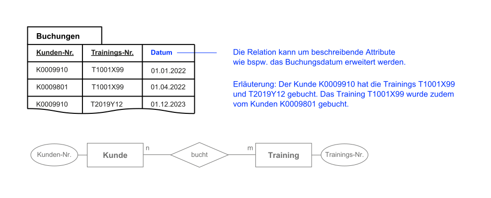

# Motivation {.vertical-center background-color="blue"}

> The world's most valuable resource is no longer oil, but data. *Steve Jobs (1997)*

::: notes
In den letzten beiden Kapiteln haben wir uns mit Informationssystemen und Geschäftsprozessen beschäftigt. Informationssysteme werden in Geschäftsprozessen eingesetzt, um sicherzustellen, dass die benötigten Daten in der passenden Form in der richtigen Qualität zum richtigen Zeitpunkt zur Verfügung stehen. In diesem Kapitel schauen wir etwas genauer an, was Daten sind und wie diese strukturiert sein müssen, damit diese für das Unternehmen Wert erzeugen.
:::

# Lernergebnisse 🎯

Nach dieser Einheit können Sie

::: {.incremental}
- erläutern, was Daten sind und wie diese klassifiziert werden können,
- erklären, weshalb Daten zur Nutzung in modernen Informationssystemen __strukturiert__ werden sollen,
- die Besonderheit von __Big Data__ erläutern,
- die Begriffe __Datenredundanzen__ und __Dateninkonsistenzen__ sowie sich daraus ergebende Probleme erläutern,
- die Notwendigkeit und das Vorgehen der __Datenmodellierung__ beschreiben,
- ein einfaches __Entity-Relationship-Diagramm__ (ERM) zu entwerfen und daraus das __Relationenmodell__ abzuleiten.
:::

# Daten {.vertical-center background-color="blue"}

## Definition

Daten sind eine Menge an Zeichen, die einer bestimmten Syntax folgen, einen bestimmten Zweck haben und maschinell verarbeitet werden können.

. . .

Daten beschreiben __Objekte der realen Welt__ durch deren __Merkmale__ und deren __Beziehungen__ zueinander [@mertens2016grundzuge].

. . .

*Beispiel: Ein Datensatz kann ein Objekt „Artikel" durch dessen Merkmalen (z. B. Preis, Bezeichnung etc.) und Beziehungen zu anderen Objekten (z. B. Bestellungen, Lieferung) beschreiben.*

. . .

Ob aus Daten Informationen werden, ist davon, ob der __Empfänger__ die Daten in einen sachlichen __Kontext__ setzen und ihnen so Bedeutung zuordnen kann.

## Klassifizierung

Daten können beispielsweise nach folgenden Kriterien klassifiziert werden:

::: incremental
-   Zeichenart bzw. __Datentyp__: numerische (Ziffern), alphabetische (Buchstaben des Alphabets) und alphanumerische Daten (Ziffern, Buchstaben und Sonderzeichen)
-   __Erscheinungsform__: akustische (z. B. menschliche Laute), bildliche (z. B. Grafiken) und schriftliche Daten (z. B. Texte)
-   __Formatierung__: Formatierte (z. B. formgebundene Tabellen) und unformatierte Daten (z. B. formfreie Texte)
-   __Verwendungszweck__: selten zu verändernde Stammdaten (z. B. Personalstammdaten wie Namen und Adressen) und transaktionsorientierte Bewegungsdaten (z. B. Lagerzu- und --abgänge)
-   Stellung im __Verarbeitungsprozess__: Eingabe- und Ausgabedaten
:::

## Struktur

Die effiziente Nutzung von Daten in Informationssystemen erfordert eine __grundlegende Struktur__ zur Systematisierung bzw. Hierarchisierung von Daten:

::: incremental
-   Jeder __Datensatz__ besteht aus einem oder mehreren __Datenfeldern__,
-   die Datenfelder haben für alle Datensätze das gleiche Format,
-   die Datenfeldern eines Datensatzes hängen in aller Regel inhaltlich zusammen,
-   alle zusammengehörigen Datensätze werden in einer __Tabelle__ zusammengefasst,
-   eine die __Datenbank__ vereint die logisch zusammengehörenden Tabellen,
-   die Tabellen enthalten keine redundanten Daten, sind also __redundanzfrei__, und
-   die Datensätze weisen keine Widersprüche auf, sind also __konsistent__.
:::

::: notes
::: callout-note
#### Datenredundanzen und Dateninkonsistenzen

Die Strukturierung von Daten in einer Datenbank hat unter anderem auch zum Ziel, Datenredundanzen und Dateninkonsistenzen zu vermeiden.

- __Datenredundanzen:__ das mehrfache Vorkommen identischer Datenelemente in verschiedenen Tabellen und/oder Datenbanken (kurz Speicherorten, bspw. dieselben Kundendaten werden in zwei verschiedenen Systemen gespeichert)
- __Dateninkonsistenzen:__ für dasselbe Attribut sind unterschiedliche Werte in gespeichert. Kommt vor, wenn Änderungen an Datenelementen nicht gleichzeitig an allen redundanten Speicherorten nachvollzogen werden.
:::
:::

## Big Data

Der Begriff __Big Data__ meint wörtlich die „großen Daten", also massive Datenmengen bzw. Massendaten, die sich durch die folgenden Eigenschaften auszeichnet [@leimeister2021einfuhrung, S. 201]:

:::incremental
- Enorme Größe
- Eine hohe Komplexität
- Schnelllebigkeit oder schnelles Aufkommen neuer Daten
- Schwach oder gar nicht strukturiert
:::

. . .

__Big Data Analytics__ beschreibt die __Fähigkeit__, diese großen Datenmengen mit hoher Geschwindigkeit (oft in Echtzeit) zu verarbeiten, um wertvolle Einsichten zu gewinnen (oft auf Basis von Wahrscheinlichkeiten) [@lemke2015einfuhrung].

## Visualisierung

{#fig-bigData}

# Datenmodellierung {.vertical-center background-color="blue"}

## Ziel

Ziel der Datenmodellierung ist die Beschreibung der Unternehmensdaten in einem __Datenmodell__.

. . .

Ein unternehmensweites Datenmodell, bildet die __relevanten Objekte__ aller Bereiche des Unternehmens ab (Krcmar 2015).

. . .

Die Datenmodellierung findet __vor__ der Umsetzung bzw. Implementierung von Informationssystemen statt.

. . .

Im Rahmen der Datenmodellierung wird zunächst ein __konzeptionelles Schema__ erstellt. Dieses stellt alle relevanten Objekte, deren Eigenschaften sowie Beziehungen dar. Davon ausgehend wird dann ein __logisches Datenmodell__ abgeleitet (hier Tabellen).

::: notes
::: callout-note
### Unternehmensdatenmodell

Das Unternehmensdatenmodell beschreibt die Zusammenhänge zwischen den für die fachlichen Aufgaben (bspw. Vertrieb und Produktion) erforderlichen Daten. Im Rahmen der Modellierung werden für verschiedene Aufgaben gemeinsam verwendete Daten identifiziert (bspw. Produkte) und die Voraussetzungen für die redundanzfreie und konsistente Verwendung geschaffen.
:::
:::

## Konzeptionelles Schema

Im konzeptionellen Schema (oder auch konzeptionelles Datenmodell) werden alle inhaltlichen Anforderungen an die Datenbank erfasst. Dies geschieht meist mittels einer grafisch orientierten, __formalen Modellierungssprache__.

. . .

Die am weitesten verbreitete Modellierungssprache ist das __Entity Relationship Model (ERM)__ nach Chen [@bachle2021einfuhrung].

. . .

Das Modell unterscheidet __Entitätstypen__ (relevante Objekte), __Attribute__ (Eigenschaften der Objekte) und __Beziehungen__ zwischen Entitätstypen.

## Beispiel

{#fig-konzeptionellesSchema}

## Logisches Datenmodell

Ein logisches Datenmodell ist ein an dem für die physische Speicherung der Daten orientiertes Datenmodell.

. . .

Es wird aus dem __konzeptionellen Schema__ abgeleitet und dient als Basis für die Implementierung der spezifischen Datenbank.

. . .

In der Praxis sind relationale Datenbanksysteme am weitesten verbreitet. Deshalb kommt dem __relationalen Modell__ die größte Bedeutung zu.

. . .

Grundlage des Relationenmodells ist die Relation, eine zweidimensionale Tabelle mit einer festen Anzahl von Spalten und einer beliebigen Anzahl von Zeilen [@leimeister2021einfuhrung].

. . .

Eine Relation entspricht einem __Entitätstypen__, jede Zeile der Tabelle entspricht einer __Entität__, die Spalten einer Tabelle entsprechen den __Attributen__.

# ERM {.vertical-center background-color="blue"}

## Entitätstypen

__Entitätstypen__ sind reale oder abstrakte Informationsobjekte mit einer eigenständigen Bedeutung wie Rollen (bspw. Kunde), Organisationseinheiten (bspw. Werk), oder Objekte (bspw. Artikel) [@bachle2021einfuhrung].

. . .

Eine __Entität__ ist eine einzelne, konkrete Ausprägung eines Entitätstyps (bspw. der Kunde *Hans Dampf*).

. . .

Grafisch werden Entitätstyps im Entity Relationship Modell durch Rechtecke repräsentiert.

::: notes
*Beispiel: Wesentliche Aufgabe einer Anwendung zur Zeiterfassung ist es, für die Abrechnung Leistungen von Mitarbeitern zu Projektaufträgen zu erfassen. Aus dieser Aufgabenstellung heraus ergeben sich als relevante Entitätstyps __Mitarbeiter__ (Rolle), __Leistung__ (reales Objekt), __Auftrag__, und __Projekt__ (abstrakte Informationsobjekte).*
:::

## Attribute

Anhand von Attributen werden __Eigenschaften von Entitätstypen__ beschrieben [@bachle2021einfuhrung].

. . .

Ihre konkreten Ausprägungen, die __Attributwerte__, definieren eine einzelne Entität.

. . .

Attribute werden durch __Ellipsen__, die durch Linien mit den Rechtecken der entsprechenden Entitätstypen verbunden sind, dargestellt.

Attribute, die der eindeutigen Identifikation dienen[^1], sogenannte __Schlüsselattribute__, werden unterstrichen.

[^1]: In Schlüsselattributen kommt jeder Attributwert nur einmal vor, ist also eindeutig. Über Schlüsselattribute können Entitäten eindeutig identifiziert werden.

----

####  Beispiel (Zeiterfassung)

{#fig-entities}

## Beziehungen

Über __Beziehungstypen__ werden Verknüpfungen zwischen Entitätstypen beschrieben (bspw. Mitarbeiter *leitet* Projekt [@bachle2021einfuhrung].

. . .

Relationen werden in Form von __Rauten__ dargestellt und mit Prädikatsverben bezeichnet.

. . .

Die Bezeichnungen sollen gewählt werden, dass sie auf alle Entitäten der verknüpften Entitätstypen zutreffen.

----

####  Beispiel (Zeiterfassung)

{#fig-relationen}

## Kardinalität

Die Kardinalität legt fest, an wie vielen konkreten Beziehungen die verknüpften Entitäten beteiligt sein können oder müssen [@bachle2021einfuhrung].

. . .

Grundsätzlich lassen sich 1 zu 1 (1:1), 1 zu n (1:n) sowie n zu m (n:m) Beziehungen unterscheiden.

. . .

Je nach Notationsart wird die Kardinalität unterschiedlich dargestellt. So unterscheidet sich die Notation nach Chen wesentlich von der (min;max)-Notation.

----

####  Beispiel (Zeiterfassung)

{#fig-kardinalität}

## (min;max)-Notation

In der (min,max)-Notation werden genaue __Unter- und Obergrenzen__ der zulässigen Anzahl Objekte innerhalb einer Beziehung angegeben. Damit wird festgelegt, dass jede Entität dieses Typs mindestens an min und höchstens an max. Beziehungen des Beziehungstyps teilnimmt.

. . .

In der (min,max)-Notation wird die Kardinalität im ER-Modell umgekehrt zu Chen-Notationen positioniert

----

####  Beispiel (Zeiterfassung)

{#fig-minMax}

# Relationenmodell {visibility="hidden"}

Für relationale Datenbanksysteme gilt:

-   Jede Relation ist eine __zweidimensionale Tabelle__. Diese entspricht meistens einem Entitätstyp.\
    *m:m-Beziehungen erfordern die Bildung einer eigenen Relation. Die Primärschlüssel der beteiligten Entitätstypen werden vererbt.*
-   Jede Zeile der Tabelle beschreibt eine bestimmte Entität.
-   Die Spalten entsprechen den Attributen.
-   Die Entitäten werden durch Attributwerte, also Ausprägungen der Attribute, beschrieben.
-   Die Zeilen müssen paarweise untereinander verschieden sein. Es gibt also keine zwei identischen Zeilen. Um das sicherzustellen, benötigt jede Relation einen Primärschlüssel.
-   Die Reihenfolge der Zeilen spielt keine Rolle, ebenso die der Spalten.
-   Attribute sind stets atomar, also nicht in kleinere Einheiten zerlegbar

## Relationen

Eine Relation entspricht (meistens) einem Entitätstyp.

{#fig-relation}

::: notes
*Beispiel: Im vorherigen Kapitel wurde das ERM eines Zeiterfassungssystems skizziert. Ein wesentlicher Entitätstyp ist das Projekt. Dieser kann mit den Attributen in eine Relation überführt werden.*
:::

## 1:1- und 1:n-Beziehungen

Bei 1:1 und 1:n-Beziehungen wird der __Primärschlüssel__ der verbundenen Relation ergänzt.

::: notes
*Beispiel: Ein Projekt wird immer von einem Mitarbeiter geleitet, ein Mitarbeiter kann beliebig viele Projekte (inkl. keines) leiten (1:n-Beziehung). Umgesetzt wird diese Beziehung im Relationenmodell durch die Erweiterung der Relation __Projekt__ um den Primärschlüssel der Relation __Mitarbeiter__, der __Mitarbeiter-Nr.__ *

## n:m-Beziehungen

Eine n:m-Beziehung wird durch eine neue Relation realisiert, die sogenannte __Koppeltabelle__.

::: notes
*Beispiel: Ein Kunde kann mehrere Trainings buchen. Ein Training kann aber auch von mehreren Kunden gebucht werden. In der neuen Relation `Buchungen` stellen die Primärschlüssel als Fremdschlüssel die Beziehung dar. Die Kombination der Fremdschlüssel `Kunden-Nr,` und `Trainings-Nr.` wird zum Primärschlüssel der Koppeltabelle `Buchungen`.*
:::

# Übungen ✏️ {.vertical-center background-color="blue"}

## Daten oder Information

Diskutieren Sie, worin sich die drei Beispiele unten unterscheiden und unter welchen Bedingungen es sich um Daten oder Informationen handelt.

{#fig-datenInformation}

## Online-Shop

Sie möchten das Datenmodell für einen Online-Shop erstellen. Über den Shop können Kunden Bestellungen aufgeben. Jede Bestellung besteht aus Artikeln. Die Artikel werden von Lieferanten geliefert. Die Artikel können verschiedenen Kategorien zugeordnet werden.

Jeder Kunde hat eine Kundennummer. Zudem werden Name, E-Mail, Bankverbindung und andere Daten gespeichert. Jeder Artikel hat eine Artikel-Nummer, eine Beschreibung, ein Bild und ein Preis. Jede Bestellung hat eine Bestellnummer. Eine Kategorie ist über eine ID und eine Bezeichnung charakterisiert. Ein Lieferant hat in unserem Shop eine Lieferantennummer und einen Namen.

Erstellen Sie das Entity-Relationship Modell. Prüfen Sie, ob jeder Entitätstyp ein Schlüsselattribut besitzt. Zeichnen Sie sowohl die Kardinalität nach Chen als auch nach der (min;max)-Notation ein.

Leiten Sie aus dem ERM das Relationenmodell ab. Ergänzen Sie in jeder Relation zwei Datensätze.

## Auftragsverwaltung

In einer Agentur ist jeder Auftrag in Unteraufträge gegliedert. Die Mitarbeiter erfassen die geleisteten Stunden pro Tag und verknüpfen diese mit dem passenden Unterauftrag.

Mitarbeiter haben eine Personalnummer, einen Namen und einen festgelegten Stundensatz. Jeder Auftrag hat min. die Auftragsnummer, eine Bezeichnung, einen Auftraggeber ein Auftragsdatum. Jeder Unterauftrag hat eine Unterauftragsnummer, eine Bezeichnung und einen festgelegten Sollaufwand. Eine Leistung besteht min. aus der Leistungsnummer, einer Bezeichnung, dem Monat der Leistungserstellung und den Ist-Stunden.

Entwerfen Sie das ER-Modell.

Leiten Sie aus dem ERM das Relationenmodell ab. Ergänzen Sie in jeder Relation zwei Datensätze.

## Big Data

Überlegen Sie, wo Ihnen im Alltag Anwendungen begegnen, die Big Data nutzen.

Geben Sie ein Beispiel und erläutern Sie anhand der 4+1 Vs weshalb es sich um Big Data handelt.

# Lernkontrolle 🧐 {visibility="hidden"}

- Datenmodelle beschreiben Objekte der realen Welt anhand ihrer Merkmale und ihrer Beziehung zueinander. Zeigen Sie dies anhand eines einfachen ERM.
- Erläutern Sie den Unterschied zwischen Stamm- und Bewegungsdaten.
- Geben Sie ein Beispiel für Datenredundanzen und erläutern Sie Probleme, dich sich daraus ergeben (können).
- Worin unterscheiden sich das konzeptionelle Schema vom logischen Datenmodell?
- Weshalb sollten Datenmodelle vor der Erstellung eines Informationssystems erstellt werden?
- Welche Funktion hat ein Schlüsselattribut?
- Was ist eine Koppeltabelle und wann wird diese benötigt?

# Literatur 📚

::: {#refs}
:::
