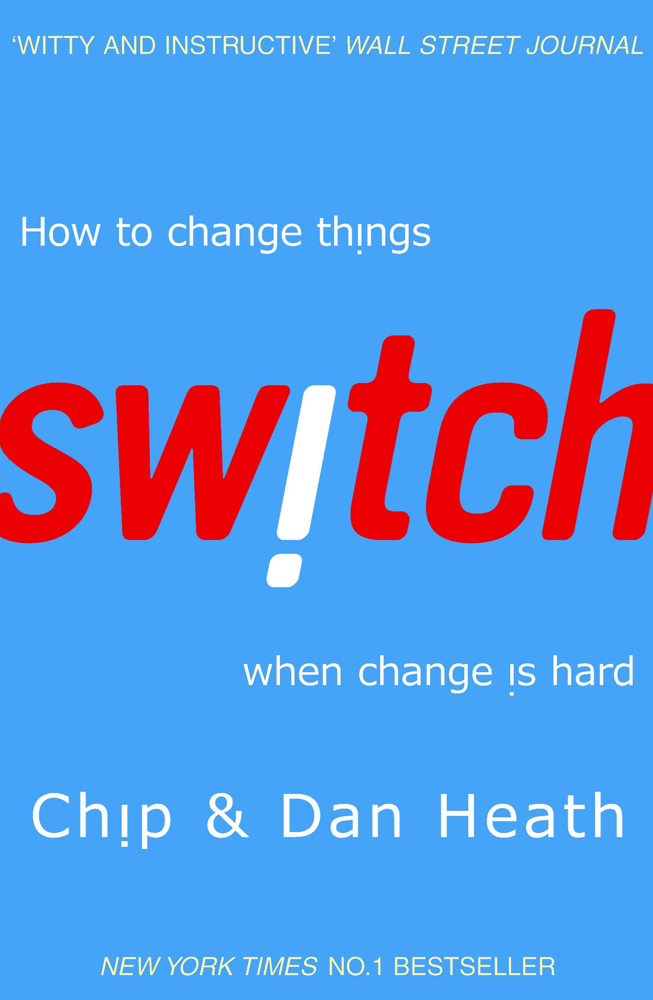

# Introductory Remarks {.section-title time="15"}

## Motivation {.vertical-center .bg-highlight .no-headline}

:::html-hidden
:::large
All change
= behavior change
:::
:::

> For something to change, somebody somewhere has to start behaving differently—in other words, all change is ultimately behavior change. *Chip Heath, American author*

:::notes
This class is about theories and tools that may help you to lead change in different contexts. As to that, we will get to know a useful framework for understanding change, as well as methods and tools that might help you to make changes you want to make but can't.
:::

## Exercise {.unlisted .unnumbered .html-hidden .discussion-slide}

A **bad habit** is something where you have all the information you need to see it's a bad behavior, yet you keep doing it anyway.

:::fragment
:::medium
Are you engaged in some kind of behavior you want to change but struggle with? **Why?**
:::
:::

:::fragment
Write it down. This behavior is **your case** for the rest of the session.
:::

:::notes
- Did you set up an alarm to get up this morning?
  *If so, did you hit snooze? Twice?*
- Have you ever been on diet?
  *If so, did you have fun? Did you quit before reaching your goals?*
- Do you do sports as much as you think you should?
:::



## Knowing vs. Doing

:::large
[A fundamental tension of psychology:]{.fragment .fade-in-then-semi-out} [[knowing]{.highlight-color} what the right answer is vs. [doing]{.highlight-color} it.]{.fragment}
:::

:::fragment
Psychological theory explains why this gap exists.
:::

:::notes
Theory helps us to understand why change interventions work or fail, to predict outcomes in new situations, to generalize beyond specific cases, and to justify the change strategies we choose.
:::

# Two Minds {.section-title time="30"}

## Dual-Process Theory

:::fragment
:::medium
System 1 *vs.* System 2
:::

Psychology assumes that two **interacting systems** shape thinking and behavior at all times [@kahneman2011thinking].
:::

:::fragment
| System 1 | System 2 |
|----------|----------|
| Fast, automatic | Slow, deliberate |
| Effortless | Effortful |
| Associative | Rule-based |
| Intuitive | Controlled |

: Characteristics of System 1 and System 2 according to @kahneman2011thinking {#tbl-sys1sys2}

:::

:::html-hidden
:::fragment
Both systems operate simultaneously and often conflict [@kahneman2011thinking].
:::
:::

:::notes
Daniel Kahneman's dual-process theory describes cognition through two modes of processing that @kahneman2011thinking himself calls "useful fictions": characters that make the interplay of mental processes easier to think about, rather than separate brain regions.

- System 1 is the brain's "autopilot." It operates automatically and quickly, with little or no effort and no sense of voluntary control. It handles our intuition, instant impressions, and emotional reactions.
- System 2 is the "pilot." It allocates attention to the effortful mental activities that demand it, including complex computations. The operations of System 2 are often associated with the subjective experience of agency, choice, and concentration.

We tend to identify ourselves with System 2 (the conscious, reasoning self), but System 1 is actually the one running the show most of the time. System 2 is "lazy": it usually accepts what System 1 suggests without checking, leading to cognitive biases and errors in judgment.
:::

## Elephant and Rider

:::medium
> I was a rider on the back of an elephant. [...] I can direct things, but only when the elephant doesn't have desires of his own. When the elephant really wants to do something, I'm no match for him. *@haidt2006happiness*
:::

:::fragment
| Metaphor | Corresponds to |
|---|---|
| Elephant | Automatic, emotional processes (System 1) |
| Rider | Controlled, reflective processes (System 2) |

: Elephant and rider as a metaphor for dual-process theory [@haidt2006happiness] {#tbl-elephant-rider}
:::

:::notes
@haidt2006happiness translates dual-process theory into an image: the rider (controlled, reflective processing) sits on top of the elephant (automatic, emotional processing). The rider can plan, analyze, and steer, but the elephant is six tons heavier. Whenever the two disagree about the direction, the elephant usually wins.

The metaphor explains the knowing-doing gap: the rider *knows* what the right answer is, while the elephant determines what we *do*. Effective change therefore addresses both.
:::

## The Switch Framework

:::: {.columns}

::: {.column width="30%"}
{width="80%"}
:::

::: {.column width="70%"}
@heath2011switch build on Haidt's metaphor and add a third element: the **path.**

> If you want to change things, you've got to appeal to both. The rider provides the planning and direction, and the elephant provides the energy. [...] A reluctant elephant and a wheel-spinning rider can both ensure that nothing changes. But when elephants and riders move together, change can come easily. *@heath2011switch*
:::

::::

### Theoretical Mapping {visibility=hidden}

- **Direct the rider:** give clear direction, reduce mental paralysis.
- **Motivate the elephant:** find the emotional connection.
- **Shape the path:** reduce obstacles, tweak the environment, make the journey easy.

Successful change requires addressing all three simultaneously; they're interdependent, not sequential.

| Component | Core mechanism | Theory covered in this unit |
|---|---|---|
| **Direct the rider** | Reduce cognitive load through clarity | Dual-process theory, self-control limits |
| **Motivate the elephant** | Engage the emotional and motivational system | Endowed progress, identity, growth mindset |
| **Shape the path** | Modify the environment to reduce friction | Fundamental attribution error, implementation intentions, social learning |

: Theoretical foundations of the Switch framework {#tbl-switch}

## Elephant, Rider, Path {.unlisted .html-hidden .discussion-slide}

<iframe width="800" height="400" src="https://www.youtube.com/embed/X9KP8uiGZTs" title="YouTube video player" frameborder="0" allow="accelerometer; autoplay; clipboard-write; encrypted-media; gyroscope; picture-in-picture" allowfullscreen></iframe>

## Three Hypotheses About Change

:::html-hidden
[Direct the rider]{.large .fragment .fade-in-then-semi-out}\
[Motivate the elephant]{.large .fragment .fade-in-then-semi-out}\
[Shape the path]{.large .fragment .fade-in-then-semi-out}
:::

:::notes

- **Direct the rider**
    - What looks like resistance is often a lack of clarity.
    - Change requires crystal clear direction[^milk].
- **Motivate the elephant**
    - What looks like laziness is often exhaustion[^exhaustion].
    - Change requires engaging the emotional side[^hospitals].
- **Shape the path**
    - What looks like a people problem is often a situation problem.
    - Change requires an environment that makes change more likely[^defaults].

[^milk]: Steve Booth-Butterfield and Bill Reger, professors at West Virginia University, were contemplating ways to persuade people to eat a healthier diet. They concluded that you don't need to change *drinking* behavior, but *purchasing* behavior. Thus, they launched a campaign that was punchy and specific in motivating people to buy low-fat (1%) milk (instead of the fuzzy message to act healthier) [@booth2004message].

[^exhaustion]: @heath2011switch base this hypothesis on ego depletion, which has not replicated [@hagger2016multilab]. Read "exhaustion" as the effect of stress, cognitive load, and the sustained effort of acting against established habits.

[^hospitals]: In 2004, Donald Berwick, a doctor and the CEO of the Institute for Healthcare Improvement, wanted to save a massive number of lives by reducing the "defect" rate in healthcare (e.g., administration of medication at the wrong time). Besides providing a crystal clear direction, he also motivated people by making them feel the need for change; he confronted hospital administrators with the mother of a girl who'd been killed by a medical error [@berwick2006100].

[^defaults]: @johnson2003defaults compared organ-donor consent rates across European countries. Where citizens had to opt in, consent stayed low (e.g., 12% in Germany); where citizens had to opt out, consent approached 100% (e.g., 99.98% in Austria).

:::

## Exercise {.unlisted .unnumbered .html-hidden .discussion-slide}

:::medium
Analyze the behavior you identified in the opening exercise.
:::

1. **Rider:** What does your rational mind know/understand?
2. **Elephant:** What does your emotional self want/feel/fear?
3. **Path:** What environmental factors support the current behavior?



# Direct the Rider {.section-title time="40"}

## Discussion {.unlisted .unnumbered .html-hidden .discussion-slide}

Mental paralysis is the feeling of being overwhelmed and unable to think or act, often caused by too many thoughts, emotions, or stimuli. It can feel like a "brain freeze" or "brain crash," making it difficult to organize thoughts, process information, and start tasks.

:::medium
Paralysis in the face of ...
:::

Tell us about a time when you experienced **mental paralysis.**\n
How did it manifest? How could it have been avoided?

## Rider Limits

:::medium
Willpower is an unreliable change strategy.
:::

:::html-hidden
:::incremental
- Good intentions translate only weakly into behavior [@webb2006does]
- Under stress, behavior shifts from goals to habits [@schwabe2009stress]
- People with high self-control rely on it less: they avoid temptation and build habits [@hofmann2012everyday; @galla2015more]
:::

:::fragment
Change strategies relying purely on willpower are likely to fail.
:::
:::

:::notes
Two claims about the rider need to be kept apart.

The first claim is that willpower is a finite resource that depletes with use, as proposed by the strength model of self-control [@baumeister2007strength]. In the original experiments, participants who exerted self-control on one task (e.g., resisting tempting food) gave up sooner on a subsequent task (e.g., persisting on difficult puzzles). This "ego depletion" effect has not held up. A pre-registered replication across 23 laboratories found an effect close to zero [@hagger2016multilab], the proposed glucose mechanism has not been confirmed, and depletion-like effects appeared mainly in people who believed that willpower is limited [@job2010ego; @job2015implicit]. Ego depletion is a prominent example of an intuitive, widely popularized finding that failed to replicate; check the evidence behind any framework before you apply it.

The second claim, that willpower is an unreliable change strategy, rests on independent evidence:

- **Intention-behavior gap:** A meta-analysis of experimental studies found that a medium-to-large change in intentions produced only a small-to-medium change in behavior [@webb2006does].
- **Stress and habits:** Under acute stress, people shift from goal-directed to habitual behavior [@schwabe2009stress].
- **Avoidance over resistance:** In an experience-sampling study, people high in trait self-control reported fewer temptations and resisted them less often [@hofmann2012everyday]; their self-control operates largely through beneficial habits [@galla2015more].

Successful self-controllers arrange their lives so that fewer conflicts with the elephant arise, which is the rationale for the path component of the Switch framework.

:::callout-note
#### Rider Strengths and Weaknesses

**Strengths of the rider:**

- Visionary: willing to make short-term sacrifices for long-term payoffs
- Strong analytical skills that work well when parameters are known, assumptions are minimal, and the future is not fuzzy (not the case with big changes)
- Clever tactician

**Weaknesses of the rider:**

- Unreliable under stress and cognitive load
- Paralysis in the face of ambiguity
- Restless focus on problems rather than solutions
:::
:::

## Strategies {.html-hidden}

What can you do to resolve mental paralysis and/or resistance?

[Follow the bright spots]{.large .fragment .fade-in-then-semi-out}\
[Script the critical moves]{.large .fragment .fade-in-then-semi-out}\
[Point to the destination]{.large .fragment .fade-in-then-semi-out}

## Follow the Bright Spots

:::large
> Investigate **what's working** and clone it. *@heath2011switch*
:::

### Example: Sternin in Vietnam

In 1990, Jerry Sternin was working for *Save the Children*, asked to open a new office in Vietnam "to make a difference" within 6 months [see e.g., @marsh2004power].

:::incremental
- Many children suffered malnutrition, a result of many intertwined problems: poor sanitation, universal poverty, no clean water, etc. (true but useless analysis).
- Sternin synthesized the "conventional wisdom" about feeding kids (*norms*).
- Sternin looked for very poor kids who are bigger and healthier than the typical child and analyzed what the mothers were doing differently (*positive deviations*).
- Sternin organized cooking groups where the mothers got highly specific instructions (*Rider*) and the feeling that they can make their kids healthier (*Elephant*), which also changed the culture of the village (*Path*).
- Six months later, 65 percent of the kids were better nourished and stayed that way; years later the program reached 2.2 million Vietnamese people.
:::

### Conclusion {.no-headline .vertical-center}

:::large
Switch from a problem focus to a [solution focus]{.highlight-color}.
:::

:::notes

Ask the **exception question:** when does the problem you're fighting not happen?

1. Gather data on the issue
2. Study the data to find the **bright spots**[^brightSpots] (the positive deviants)
3. Make sure you understand the "normal way" things are done
4. Study the bright spots to see what they're doing differently
5. Make sure none of those practices are "exceptional" in some way
6. Find a way to reproduce the practices of the bright spots among other people

[^brightSpots]: Bright spots don't have to be shining success stories, just look for situations when things are working better than others.

:::

## Script the Critical Moves

:::large
> Don't just think big picture,\
think in terms of specific behavior. *@heath2011switch*
:::

### Example: Brazilian Southern Line

In 1996, GP Investimentos bought parts of the Brazilian railway network (a deteriorating mess) and set a young talent in charge: Alexandre Behring.

:::incremental
- Behring only had 30 million Brazilian reals in cash on its balance sheet (i.e., nothing).
- To change direction and guide decision-making, Behring developed four rules:
    - Money is only invested in projects that provide higher revenue in the short term.
    - The best solution to a problem is the one that costs the least money up front.
    - Quick fixes are preferred to slower options that provide superior long-term fixes.
    - Reusing or recycling existing materials is better than acquiring new materials.
- In 2000, the company's performance improved from a net loss of 80 million reals to a net profit of 24 million reals.
:::

### Conclusion {.no-headline .vertical-center}

:::large
If you want to change things, be clear about how people should act.
:::

:::notes

Change brings new choices that create uncertainty, which can paralyze the rider and frighten the elephant (*the paradox of choice*[^ParadoxChoice]). Reduce uncertainty by:

- Remove ambiguity from the vision
- Transform aspiration (*the change idea*) into action (*specific behavior*)
- Get rid of any abstraction
- Give priority to critical moves that evoke more parts of the framework

> Clarity resolves resistance. *@heath2011switch [p. 72]*

[^ParadoxChoice]: @schwartz2004doing popularized the idea that more choice can make people worse off [see also @schwartz2009paradox]. A meta-analysis found a mean choice-overload effect close to zero, with large variation across studies [@scheibehenne2010can]. Treat choice overload as a conditional effect, most plausible when options are hard to compare and preferences are unclear, as is common during major change.

:::callout-note
#### Checklist: Critical Moves

- Does it evoke emotion? *(Find the feeling)*
- Does it feel do-able? *(Shrink the change)*
- Was it a part of success stories in the past? *(Find the bright spots)*
- Will your team see the connection with the big picture? *(Point to the destination)*
- Would it provide a quick win? *(Shrink the change)*
- Would it create positive peer pressure? *(Rally the herd)*
- Is it consistent with the way people think about themselves in the firm? *(Grow your people)*

:::
:::

## Point to the Destination

:::large
> Change is easier when you know where you're going and why it's worth it. *@heath2011switch*
:::

### Example: No Dry Holes

By the late 1980s, BP struggled to find new oil reserves.

:::incremental
- In 1989, BP had an average accuracy rate of just 1 out of 5 (global standard).
- The oil explorers behaved like salesmen and put pressure to drill every well (the logic behind: the payoff on hitting one big well will cover for the ones they did not hit).
- To reduce cost per barrel, the CEO posed a clear destination: **"No Dry Holes,"** meaning no random shots, but systematic tests (using the knowledge they had).
- But No Dry Holes created an even bigger shift in BP's culture: no one rationalized failure by saying *'Oh, we hit a dry well, but we learned'*.
- Years later, BP's hit rate had risen to 2 out of 3 [@heath2011switch].
:::

### Conclusion {.no-headline .vertical-center}

:::large
Paint a specific, rich, detailed picture of what the destination looks like to motivate people.
:::

:::notes

Some of @heath2011switch recommendations

- Avoid metrics as destinations (SMART goals are fine, but they should also be inspiring enough to motivate the elephant).
- Reduce uncertainty and, thus, opportunities for rationalization[^rationalization].
- Consider moving from process (e.g., *100% handwashing compliance*) to outcome (e.g., *0% hospital-acquired infection*).
- If "backsliding" is a problem, consider a black and white goal (i.e., a goal that brooks no dissent)[^BWGoal].
- Back up the destination postcard with a good behavioral script: describe the moves for a jump start.

[^rationalization]: When the elephant really wants something, the rider can be trusted to find rationalizations for it.
[^BWGoal]: Please consider that black and white goals create a danger of demoralization if you don't meet them consistently.

:::

## Exercise {.unlisted .unnumbered .html-hidden .discussion-slide}

:::medium
Your case: direct the rider.
:::

1. **Bright spot:** When did you already manage the behavior, at least partly? What was different then?
2. **Critical move:** Script one specific action you will take, stated so concretely that anyone could observe it.
3. **Destination:** Describe in one sentence what success looks like.



# Motivate the Elephant {.section-title time="25"}

## Discussion {.unlisted .unnumbered .html-hidden .discussion-slide}

:::medium
Information vs. feeling
:::

Can you think of any situations in life where you or others have tried to get people to change their minds with information, rather than with feelings?

How could those situations be approached differently to be more effective?

## Strategies {.html-hidden}

What can you do to prevent exhaustion?

[Find the feeling]{.large .fragment .fade-in-then-semi-out}\
[Shrink the change]{.large .fragment .fade-in-then-semi-out}\
[Grow your people]{.large .fragment .fade-in-then-semi-out}

## Find the Feeling

:::large
> Knowing something isn't enough to cause change. Make people feel something. *@heath2011switch*
:::

### Example: Chemotherapy Game

After enduring weeks of brutal chemotherapy in the hospital, the children struggled to faithfully take their medications at home.

:::fragment
> If you skip 20 percent of your doses, you don't have a 20 percent higher chance of getting cancer again. Your odds go up 200 percent. *Steve Cole, research director for HopeLabs*
:::

:::fragment
HopeLab developed a game called Re-Mission [@kato2008video].
:::

:::incremental
- They played *Roxxi*, a nanorobot in a silver suit that moved through the bloodstream and bombarded tumor cells with electro-green chemo beams; in between, *Smitty*, a mentor robot, provided additional information about chemotherapy and recovery.
- Kids adherence to their medication plans increased significantly.
:::

### Conclusion {.no-headline .vertical-center}

Things you see are more likely to evoke emotion than things you read.

:::large
Make the need for change clear (tangible).
:::

:::notes

- Be cautious with negative emotions when people need to think flexibly or creatively. *Negative emotions* are effective to motivate people to tackle short-run challenges that require clear, forceful action.
- Inspire positive emotion, e.g., by pointing to a bright spot.
- Positive emotions broaden and build our repertoire of thoughts and action and encourage us to play.

:::callout-note
#### Camera Crew Test
Imagine that, in making the case for change to your people, you weren't allowed to speak to them directly. Instead, you had a camera crew at your disposal who would film anything you wanted them to film, and you could pick any 10 minutes of footage that they shot. What would be happening in that footage?
:::
:::

## Shrink the Change

:::large
Downsize the change until it no longer frightens the elephant.
:::

### Example: Car Wash Stamps

A local car wash ran a promotion featuring loyalty cards [@nunes2006endowed].

:::incremental
- Group A: For every car wash bought, customers got a stamp on their card.
  Eight stamps meant a free car wash.
- Group B: Customers needed to collect ten stamps, but they were given a "head start"
  (2 stamps have already been added).
- A few months later, only 19% of group A had earned a free wash vs. 34% of group B.
:::

:::fragment
> People find it motivating to be partly finished with a longer story than to be at the starting gate of a shorter one. *@heath2011switch*
:::

### Conclusion {.no-headline .vertical-center}
 

:::large
> Small  targets lead to small victories, small victories can trigger momentum. *@heath2011switch*
:::

:::notes

As the elephant is easily demoralized [@heath2011switch], make use of the **endowed progress effect.** This is the idea that if you provide some type of artificial advancement toward a goal, a person will be more motivated to complete the goal [@nunes2006endowed].

- Show progress, plan for small wins (i.e., immediate, meaningful payoffs).
- Set goals within reach, don't let success feel too distant.
- Care for a boost of hope that change is possible.

:::

## Grow Your People

[Identities are central to the way people make decisions]{.large} [@march2009primer].

### Example: Junior-High Math Students

@blackwell2007implicit set up a study for seventh-grade math students in school in a low socioeconomic environment.

:::incremental
- The experimental group was taught that the brain is like a muscle that can be developed with exercise (two hours over eight weeks).
- The control group was taught generic study skills.
- The teachers, unaware of which group their students were assigned to, identified students who they thought had experienced a positive change during the term, whereof 76% were in the experimental group.
:::

:::fragment
> One hardcore, turned-off, low-effort kid in the group said, 'You mean I don't have to be dumb?' From that day on, he worked. *@heath2011switch*
:::

### Conclusion {.no-headline .vertical-center}

:::large
Create a sense of identity and convey a growth mindset.
:::

:::notes

- Any change measure that violates a person's identity easily fails (i.e., identity threat).
- Inspire people to be the kind of person who would make the change (i.e., engage in identity work).
- Changing identities is a quest, and every quest involves failure.
- Because the elephant hates failure, you should create the expectation of failure.
- A growth mindset helps to grow [@dweck2017mindset], as it frames failure as a natural part of the change process (not of the situation).
- A growth mindset helps to establish confidence that the elephant is capable of conquering the change (it feels "big" relative to the challenge).

:::smaller
Large-scale studies report small average effects of growth-mindset interventions on academic achievement, concentrated among lower-achieving and disadvantaged students [@sisk2018mindset; @yeager2019national]. Use the concept to frame failure as part of the change process, and keep expectations about effect size modest.
:::
:::

## Exercise {.unlisted .unnumbered .html-hidden .discussion-slide}

:::medium
Your case: motivate the elephant.
:::

1. **Feeling:** What feeling could carry the change? What would the camera crew film?
2. **Shrink:** Downsize the change to a first step you could take this week. Where are you already partly finished?
3. **Identity:** Complete the sentence: "I am the kind of person who ..."



# Shape the Path {.section-title time="30"}

## Discussion {.unlisted .unnumbered .html-hidden .discussion-slide}

:::medium
Environment shapes behavior.
:::

Think back over your day: when and where did your environment significantly shape your behavior?

## Strategies {.html-hidden}

What can you do to make change more likely?

[Tweak the environment]{.large .fragment .fade-in-then-semi-out}\
[Build habits]{.large .fragment .fade-in-then-semi-out}\
[Rally the herd]{.large .fragment .fade-in-then-semi-out}

## Tweak the Environment

:::large
> When the situation changes, the behavior changes. So change the situation. *@heath2011switch*
:::

### Situation over Person

:::medium
People *vs.* situation problems
:::

We systematically overestimate personal factors and underestimate situational factors when explaining behavior: the **fundamental attribution error** [@ross1977intuitive].

:::fragment
Classic demonstration [@darley1973bystander]:
:::

:::incremental
- Seminary students preparing a talk on the Good Samaritan
- Manipulated time pressure (situation)
- Encountered a person in need en route
- Rushed students rarely helped, regardless of personality
:::

:::notes
@ross1977intuitive demonstrated that people tend to explain others' behavior in terms of stable personality traits while ignoring powerful situational forces.

The seminary study by @darley1973bystander is particularly striking because it shows that even people thinking about helping (preparing a talk on the Good Samaritan parable) and who likely have helping-oriented values (seminary students) are overwhelmingly influenced by situational factors (being in a hurry).

When people fail to change, we tend to blame their character, motivation, or ability. Often, the real problem is the situation, and modifying the context is more effective than trying to change people directly.
:::

### Example: Kaiser Medication Vests

At Kaiser South San Francisco Hospital, nurses administer about 800 medications a day.

:::incremental
- Nurses are impressively accurate: on average, they commit approx. 1 error per 1,000 medications administered.
- However, a single error can be harmful or even deadly.
- In an effort to reduce medication errors, distraction was identified as a cause.
- Distraction is neither a Rider (*understanding*) nor an Elephant problem (*motivation*).
- Instead of changing nurses' behavior, the hospital introduced medication vests, signaling that nurses are administering drugs and should be left alone.
- Errors dropped by 47 percent.
:::

### Conclusion {.no-headline .vertical-center}

:::large
Situations trump personal attributes.
:::

:::notes

- Avoid the fundamental attribution error.
- Emphasize the "tweak" (*focus on small changes*).
- Investigate your environment quickly (*What one thing can you shift to make the right behaviors more likely?*).
- Try to rearrange the environment to remove the obstacles, provide signposts that show people which way to turn, eliminate steps (*1-click ...*).

:::

## Build Habits

:::large
> When behavior is habitual, it's "free"—it doesn't tax the rider. Look for ways to encourage habits. *@heath2011switch*
:::

### Action Triggers

:::medium
Pre-loading decisions through implementation intentions
:::

Specifying the when, where, and how of goal pursuit significantly increases success rates [@gollwitzer1999implementation].

:::fragment

| Simple Goal                 | Implementation Intention                                                   |
|-----------------------------|-----------------------------------------------------------------------------|
| "I intend to exercise more" | "If it's Monday at 7am, I will put on running shoes and run for 20 minutes" |
| Weak commitment             | Strong commitment                                                           |
| Moment-of-choice decision   | Pre-decided action                                                          |

: Comparison of a simple goal and implementation intention {#tbl-impint}

:::

:::notes
Implementation intentions are specific plans that spell out when, where, and how you will act. They follow the format "If situation X arises, then I will perform response Y" [@gollwitzer1999implementation].

Why they work:

- Transfer control from self to environment (the cue triggers the action)
- Reduce need for conscious deliberation at critical moments
- Create automatic situation-behavior links through mental rehearsal

A meta-analysis by @gollwitzer2006implementation found a medium-to-large effect (d = .65) on goal attainment across health behaviors, environmental actions, and academic performance.
:::

### Example: Piggybacking

:::incremental
- If you often forget to take your vitamins in the morning, put the vitamin bottle on top of the toothpaste.
- Brushing your teeth is an established routine that reliably triggers the new behavior.
- Hospitals could apply the same logic: place sanitizer next to the trays holding patient charts, so that "squeeze and rub" precedes "take the chart" [@heath2011switch].
:::

### Conclusion {.no-headline .vertical-center}

:::large
Let cues, not willpower, trigger the new behavior.
:::

:::notes

Some of @heath2011switch recommendations to encourage habits:

- **Set an action trigger:** The power of action triggers is that decisions are "pre-loaded." If you want to act in a new way, picture the exact time and situation when you will execute the plan.
- **Piggyback a new habit on an old one:** It's easiest to start a new routine when you can build it on an existing routine that takes place at a specific time and place.
- **Create a checklist:** Suppose you had a five-item checklist for the most important routines in your business. What 5 things do you need to do every time?
- **Stand up your meetings:** "Stand-up meeting" are a way to keep discussions brief and focused. Given the way your meetings have evolved, what habits have you implicitly encouraged (whether good or bad)? Are there ways you could alter the format of your meetings, the routine, to make them more effective? If so, set an action trigger: I'm going to pilot this new "meeting style" next Thursday with the staff meeting.
- **Publicize your action triggers:** What is the aspect of your change efforts that people tend to put off, or that tends to get displaced in favor of more "urgent" work? Ask your team to set action triggers, and to announce their intentions publicly in a meeting.

:::

## Rally the Herd

:::large
> Behavior is contagious.\
> Help it spread. *@heath2011switch*
:::

### Social Proof

:::medium
If others do it, it must be appropriate.
:::

Behavior is learned through observation and shaped by what others do [@bandura1977social; @cialdini2006influence].

:::incremental
- **Vicarious learning:** people learn by observing others
- **Descriptive norms:** what most people actually do
- **Injunctive norms:** what people approve of
:::

:::notes
@bandura1977social Social Learning Theory demonstrates that people learn behaviors by observing others, particularly those they identify with or admire. His Bobo doll experiments showed children imitating aggressive behaviors they observed in adults.

@cialdini2006influence principle of social proof shows that people look to what others are doing to determine appropriate behavior, especially in ambiguous situations.
:::

### Example: Hotel Towels

@goldstein2008room tested different signs asking hotel guests to reuse their towels.

:::incremental
- Standard environmental message ("help save the environment"): 35% reuse
- Descriptive norm ("the majority of guests reuse their towels"): 44% reuse
- Descriptive norm referring to the same room ("the majority of guests in this room ..."): 49% reuse
:::

### Conclusion {.no-headline .vertical-center}

:::large
Make the desired behavior visible and show that others already do it.
:::

:::notes
Descriptive norms work when the desired behavior is already common. When the undesired behavior is common, highlighting it backfires: signs in Petrified Forest National Park that emphasized how many visitors steal petrified wood increased theft. In such cases, injunctive norms ("please don't remove the wood") are more effective [@cialdini2003crafting].

Some of @heath2011switch recommendations to spread behavior:

- **Be smart about social pressure:** If the majority of people on your team are already following the new plan, then publicize that fact, social pressure will influence the others to conform.
- **Design a free space:** Sometimes it is helpful to create small-scale settings within a community that are removed from the direct control of dominant groups, are voluntarily participated in, and generate the cultural challenge that precedes mobilization [@polletta1999free].
- **If people embrace change, make sure their actions are visible:** Fight resistance echo chambers by showcasing people who are actively supporting the change. Shine a spotlight on the early signs of success.
:::

## Exercise {.unlisted .unnumbered .html-hidden .discussion-slide}

:::medium
Your case: shape the path.
:::

1. **Tweak:** Name one change to your environment that makes the desired behavior easier or the old behavior harder.
2. **Action trigger:** Write one implementation intention: "If ..., then I will ..."
3. **Herd:** Who could make the change visible or do it with you?

You now hold a complete Switch plan for your case.



# Synthesis {.section-title time="20"}

## Rider x Elephant x Path

:::medium
All three components matter.
:::

:::incremental
- **Rider without elephant:** clear plans, but no motivation to act\
  *(Example: detailed New Year's resolutions abandoned by February)*
- **Elephant without rider:** energy without direction\
  *(Example: enthusiasm for "change" but no clear path forward)*
- **Both without path:** fighting against the environment\
  *(Example: asking people to do things digitally in a paper-loving bureaucracy)*
:::

:::fragment
:::medium
Success = all three aligned
:::
:::

## Scope and Limits

| Model                                        | Level                | Focus                                |
|----------------------------------------------|----------------------|--------------------------------------|
| Unfreeze, change, refreeze [@lewin1951field] | Organization         | Phases of a change process           |
| Eight-step process [@kotter1996leading]      | Organization         | Leadership actions along the process |
| Switch [@heath2011switch]                    | Individual and group | Behavioral levers at each step       |

: Switch compared with organizational change models {#tbl-change-models}

:::incremental
- Switch is a popular-science synthesis, not an empirically validated model.
- Several underlying findings are contested (ego depletion, choice overload, growth mindset).
- Shaping emotions and environments raises ethical questions about manipulation [@thaler2008nudge].
:::

:::notes
Organizational change models such as @lewin1951field's three phases or @kotter1996leading's eight steps describe *how a change process unfolds* and what leaders should do along the way. Switch operates at a finer grain: it explains why individuals and groups do or do not adopt the behaviors a change process requires. The models complement each other; for instance, "shrink the change" and "rally the herd" support Kotter's "generate short-term wins" and "anchor new approaches in the culture."

The attribution of "unfreeze, change, refreeze" to Lewin is itself contested: @cummings2016unfreezing show that Lewin mentioned the three steps only briefly and that later authors turned them into the canonical model associated with his name.

@heath2011switch assemble findings from different research traditions into a memorable framework; the framework itself has not been tested as a whole. Some of its building blocks have weakened under replication (see the notes on self-control and growth mindset). Use Switch as a structured checklist for designing interventions, and check the evidence behind each specific lever.

Tweaking environments and engaging emotions are forms of influence that bypass deliberation. @thaler2008nudge argue for "libertarian paternalism": nudges should be transparent, easy to opt out of, and aligned with the interests of the people being nudged. Apply the same test to your own change interventions.
:::

## Exercise {.unlisted .unnumbered .html-hidden .discussion-slide}

:::medium
Redesign a failed change.
:::

Think of a change initiative you've witnessed that **failed.**

1. **Diagnose:** Which component(s) were missing or weak, and how did that manifest?
2. **Redesign:** Propose one strategy per component (rider, elephant, path).
3. **Pitch:** Prepare a one-minute summary for the plenum.



# Closing {.section-title time="10"}

## Challenges

You want to learn how to lead change more effectively? Here are three challenges that might help you along the way.

:::incremental
- **Level 1:** *Start small.* Implement one element of the Switch plan you drafted in class (e.g., your action trigger or environmental tweak) for two weeks, and log each day whether the behavior occurred.
- **Level 2:** *Run the full plan.* Run the complete plan for four weeks; use your log to identify where you slipped and which component was weakest, then adjust the plan.
- **Level 3:** *Lead a group change.* Identify a change problem within a group (e.g., at work) and secure a mandate for it; design one intervention per component (rider, elephant, path), make the interventions transparent to the people affected, and review the results with the group after four weeks.
:::

## Reading List

For digging deeper, start with the book this unit is based on [@heath2011switch] and the articles cited here. Beyond that:

- **Elephant and rider:** @haidt2006happiness, the origin of the metaphor; @kahneman2011thinking on dual-process theory
- **Identity and mindset:** @brown2015identities on identity work in organizations; @dweck2017mindset, read together with @yeager2019national on realistic effect sizes
- **Habits and environment:** @wood2019good on how habits form and how to change them; @thaler2008nudge on choice architecture and its ethics
- **Organizational change:** @kotter1996leading on the eight-step process; @kotter2012heart on the role of emotions ("see, feel, change"); @cummings2016unfreezing on how Lewin's three-step model came about
- **Evidence and replication:** @hagger2016multilab as a case study of a popular finding that did not replicate

# Q&A {.html-hidden .unlisted .headline-only .bg-highlight .qa-slide}
# Literature {.literature-slide}
:::{#refs}
:::
