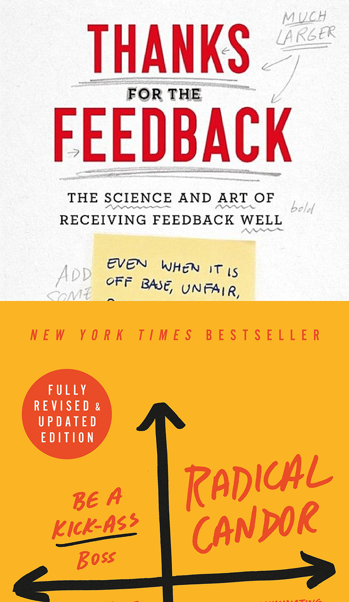
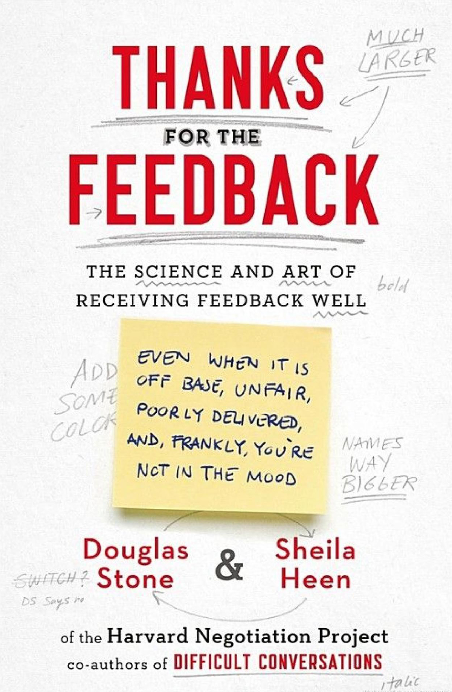
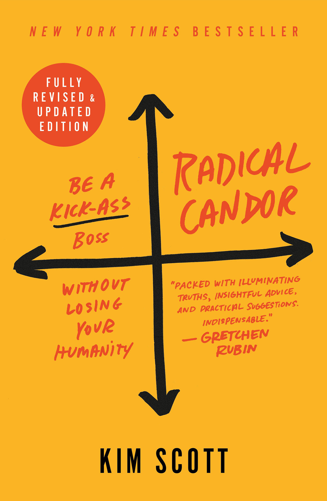
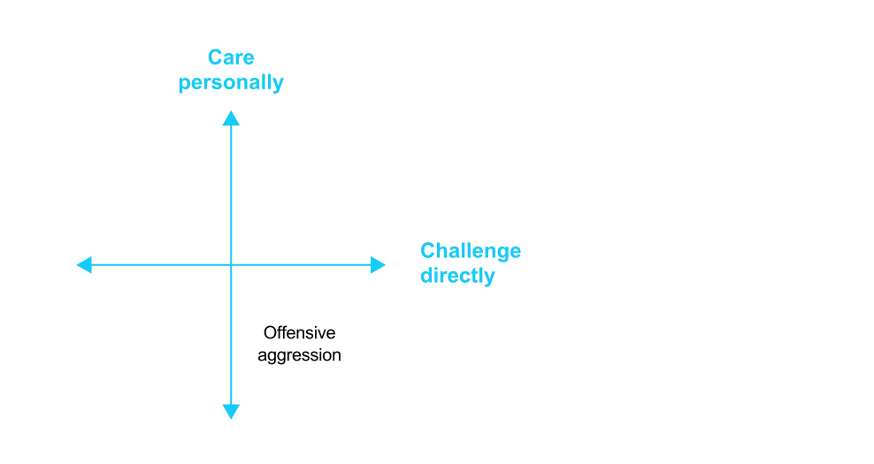
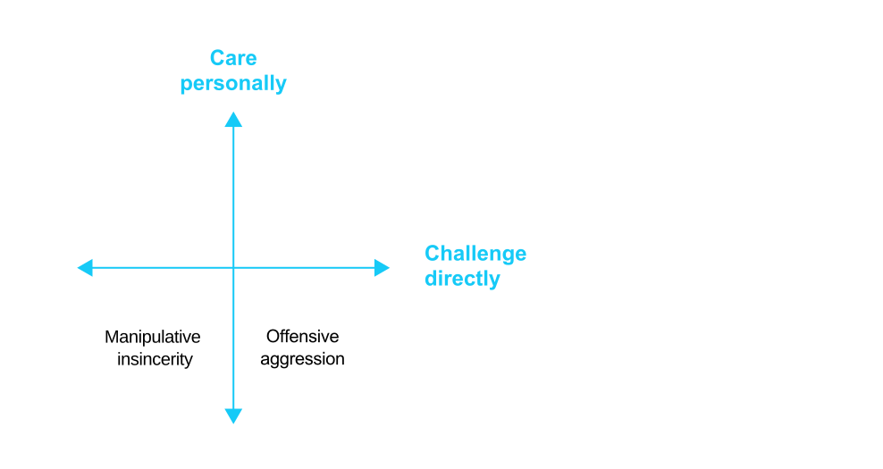
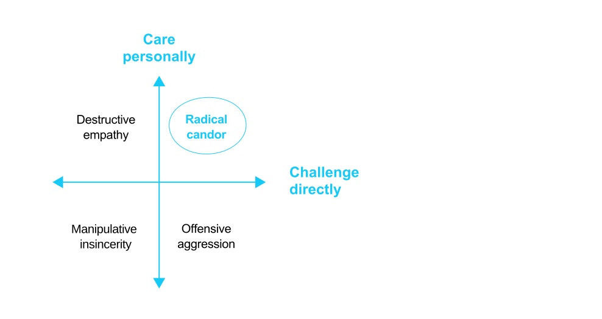
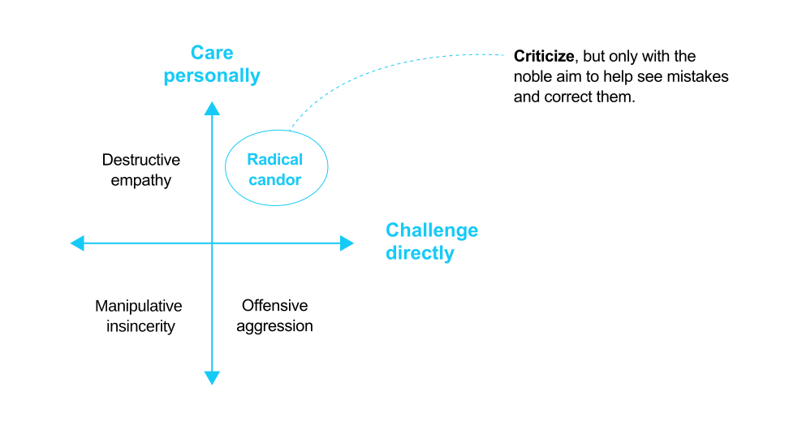
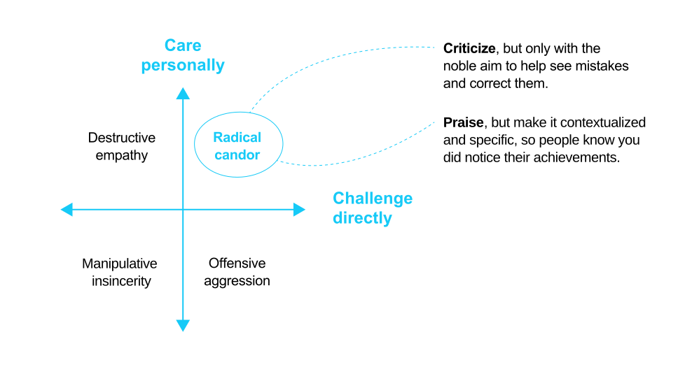

:::{.content-visible when-format="revealjs"}

# Agenda

:::medium
- Prologue and foundations [25 min]{.smaller}
- Receiving feedback [45 min]{.smaller}
- [Break]{.highlight}
- Giving feedback [50 min]{.smaller}
- A radically candid workplace [20 min]{.smaller}
- Synthesis [20 min]{.smaller}
- Challenges and wrap-up [5 min]{.smaller}
:::

:::

# Prologue {.vertical-center background-color="#0333ff" .no-headline}

:::medium
Actively seeking feedback, rather than merely enduring it, can have a profound impact.
:::

:::fragment
> Feedback-seeking behavior—as it is called in the research literature—has been linked to higher job satisfaction, greater creativity on the job, faster adaptation in a new organization or role, and lower turnover. And seeking out negative feedback is associated with higher performance ratings. *@stone2014thanks [p. 9]*
:::

:::notes
This class is about theories and tools that help you seek, receive, and give valuable feedback, the cornerstone for developing effective leadership and high-performance cultures. Because the receiver decides what happens with feedback [@stone2014thanks], we start with the receiving side and then turn to the giver. Valuable feedback signals that you (a) expect a lot and (b) nurture a lot.
:::

## Feedback Experience {.unlisted .unnumbered .html-hidden .discussion-slide}

Reflect on both perspectives below and discuss your findings with your neighbor(s):

[Feedback receiver]{.h4}

- Describe valuable feedback you received at work. What made it effective?
- Recall feedback that went badly. What made it ineffective or harmful?

[Feedback giver]{.h4}

- Describe a time when you gave feedback successfully. What contributed to its effectiveness?
- Recall a time when giving feedback failed. What went wrong?

Finally, pick one situation in which you need to give feedback soon and note it down; this is **your case** for the rest of the session.



# Foundations {.headline-only}

## Core Literature

::::columns

::: {.column width="30%"}

:::html-hidden
{#fig-books}
:::

:::notes
{#fig-feedback}

{#fig-candor}
:::

:::

::: {.column width="70%"}
This unit is inspired by and (partly) based on the books *Thanks for the Feedback* by @stone2014thanks and *Radical 
Candor* by @scott2019radical.

>Feedback is everywhere. We may not be able to exert complete control over what someone else thinks of us but we can certainly do something about what we choose to do with the feedback. "Thanks for the Feedback" is a sensible, breezily written book. *Financial Times*

>With Radical Candor, Kim has bottled some of Google's magic and shared it with the world. *Shona Brown, former SVP Business Operations at Google*
:::

::::

## Opening Remarks {.no-headline .vertical-center background-color="#f5f5f5"}

:::medium
> After all, humans are naturally [wired for learning.]{.fragment .highlight-current-blue}\
> [...] In addition to our desire to learn and improve, we long for something else that is fundamental: 
> [to be loved, accepted, and respected just as we are]{.fragment .highlight-current-blue}. *@stone2014thanks [p. 6-8]*
:::

:::notes
Feedback tells you how other people see you. People who consistently take feedback better are more successful in their lives and work. Being open to feedback allows for learning and growth. Being resistant to it allows problems to fester and escalate, and can ultimately destroy relationships.
:::

## Mixed Evidence

:::medium
Feedback improves performance on average, yet [in more than a third of cases it makes performance worse.]{.fragment .highlight-current-blue}
:::

:::fragment
Feedback that shifts attention from the task to the self is the least effective [@kluger1996effects].
:::

:::notes
In their meta-analysis of feedback interventions, @kluger1996effects found a moderate positive average effect on performance (d = 0.41), yet more than one third of the interventions decreased performance. Effects weakened when feedback drew the recipient's attention to the self, e.g., through praise or criticism of the person, and strengthened when feedback focused on the task and on how to close the gap between current and desired performance.

For the receiver, this threat to the self explains why feedback often triggers defensive reactions. For the giver, it implies that feedback should describe the situation and the behavior; the CORe method operationalizes this.
:::

## Types of Feedback

:::html-hidden
[Appreciation]{.fragment .fade-in .medium}   
[To see, acknowledge, connect, motivate, thank.]{.fragment .fade-in-then-semi-out}

[Coaching]{.fragment .fade-in .medium}   
[To enhance knowledge, skill, capability, and growth, *or* to address feelings or an imbalance in the relationship.]{.fragment .fade-in-then-semi-out}

[Evaluation]{.fragment .fade-in .medium}   
[To tell where you stand, align expectations, and inform decision making.]{.fragment .fade-in-then-semi-out}

[We need all three!]{.fragment .link-color}

:::

:::aside
Source: @stone2014thanks
:::

:::notes

According to @stone2014thanks, there are 3 types of feedback:

- **Appreciation:** Great job!
- **Coaching:** You could fix this part.
- **Evaluation:** Here's where you stand.

We need all three, but

a. we should know the purpose of the feedback and discuss it; and
b. separate evaluation from coaching and appreciation (though all coaching includes a bit of evaluation)

### Appreciation {visibility=hidden}

Appreciation is recognition and thanks. It lets you know that your efforts are noticed, making you feel worthwhile. It taps into our primitive need for acceptance. It can be motivating; the anticipation of being appreciated can encourage a person to put in extra effort. It can also be very personal.

### Coaching {visibility=hidden}

Coaching is advice. It is aimed at helping you improve, learn, grow, or change, either to meet new challenges or to correct an existing problem. It helps you focus your time and energy where it matters, maintain strong relationships, and keep your efforts productive. Coaching can also address the feelings of the giver or an imbalance in the relationship [@stone2014thanks].

### Evaluation {visibility=hidden}

Evaluation is assessment. It accomplishes a number of things:

- It tells you where you stand, how you rank, or how you are doing in relation to expectations and to other people. Report cards, performance reviews, medals, and even nicknames are all evaluations.
- It aligns expectations between two people. Your performance review lets you know what your manager wants from you.
- It clarifies consequences. Your rating determines your bonus.
- It guides decision making. We decide whether or not to apply for the new position based on our understanding of how much our managers currently value us.
:::

# Receiving Feedback {.headline-only}

:::notes
It is important when seeking feedback that you are clear about what you are looking for: evaluation, coaching, or appreciation. This will prevent confusion or frustration if you receive a different type of feedback than you are expecting.
:::

## Discussion {.unlisted .unnumbered .html-hidden background-color=black}

:::large
What is your advice for feedback receivers?
:::

## Triggers to Dismiss Feedback

:::notes
The main difficulty when we receive feedback is that it triggers emotional reactions that cloud our judgment and prevent us from properly understanding the feedback. By understanding what triggers you and how your own wiring affects your reactions, you can gain control over them.

"Triggers" are instinctive and usually negative knee-jerk responses that cause us to dismiss feedback or get angry about it. Triggers fall into three general categories [@stone2014thanks]:

- Truth triggers
- Relationship triggers
- Identity triggers
:::

:::html-hidden

[Truth triggers]{.fragment .fade-in .medium}     
[Emotional responses to feedback because we feel it is wrong, unhelpful, or unfair.]{.fragment .fade-in-then-semi-out}     

[Relationship triggers]{.fragment .fade-in .medium}     
[Emotional responses to the feedback giver that override the content of the feedback.]{.fragment .fade-in-then-semi-out}

[Identity triggers]{.fragment .fade-in .medium}     
[Emotional responses to feedback that threatens our sense of who we are.]{.fragment .fade-in-then-semi-out}  

:::

## Truth Triggers

:::html-hidden
Feedback is often vague, which makes it easy to spot what is wrong with it and dismiss the rest [@stone2014thanks].

:::fragment
Thus, ... 
:::

:::incremental
1. ... reflect **where the data and interpretations are coming from** and going to; 
2. ask **what is different about the data and our interpretations;**
3. and ask **what is right about the feedback** to find out what is legitimate. 
:::

:::medium
:::fragment
To see yourself and your blind spots,\
we need help from others.
:::
:::

:::

:::notes
When our truth trigger is activated, we reject the content of the feedback and label it as wrong, unhelpful, or unfair. To counteract this instinct, you should fully examine the feedback so that you can properly decipher the "truth" of the feedback.

Feedback usually has two parts: a "looking back" part ("This is what I noticed") and a "looking forward" part ("This is what you should do"). The "looking back" part consists of observations and interpretations of those observations, how a person feels about them. The forward-looking part of the feedback is about next steps: advice, consequences, and expectations.

To find common ground, recognize that different people have different "truths." Your views of another person are subjective, your interpretations are not necessarily more correct than other people's, and your assessment of how to fix problems may vary.

### Controlling the Truth Triggers {visibility=hidden}

Understanding feedback requires examining not only the other person's thoughts and feelings, but also your own. There are two key strategies: finding your own blind spots and looking for differences rather than "wrongs."

#### Find Your Blind Spots and Referrals {visibility=hidden}

A "blind spot" is something that we ignore or give little importance to, but that other people see clearly. When other people give us feedback on a trait we are blind to, we dismiss it as untrue. Recognizing our blind spots can prevent this from happening. There are two main categories of blind spots:

- **Behavioral patterns:** a person often engages in behavioral patterns that they themselves are not aware of, but that others around them clearly see.
- **Your "tells":** your face, voice, and other nonverbal behaviors can reveal your true thoughts and emotions.

These are amplified by:

- **Emotional bias:** we discount our emotions, while others count them double.
- **Attribution:** we attribute our failure to the situation, while others attribute it to the character.
- **Impact-intent gap:** we judge ourselves by our intentions, while others judge us by our impact on them.

#### Look for Differences and Rights, Not Wrongs  {visibility=hidden}

Instead of wondering why the feedback is wrong, acknowledge that you and the other person see things differently and try to figure out why. When you master difference-spotting in this way, you will be able to better understand the other person's views and move from "No, that is wrong" to "Tell me more" [@stone2014thanks].

Finally, ask yourself what is right about the other person's feedback. Figure out what is meaningful about the feedback, what might be worth trying, and how you can make sense of it that might be helpful [@stone2014thanks].

:::

## Relationship Triggers

We sometimes react to who gave the feedback more than what it said.

:::html-hidden
:::fragment
:::medium
To manage [switchtracking]{.fragment .highlight-current-blue}[^switchtracking], [spot the two topics]{.fragment .highlight-current-blue} and [discuss them separately.]{.fragment .highlight-current-blue} Also, try to [see the whole system[^system]]{.fragment .highlight-current-blue}.
:::
:::
:::

[^switchtracking]: Switchtracking is a communication pattern where feedback conversations derail because people end
up discussing two different topics simultaneously, like trains on parallel tracks that never meet.

[^system]: If you look for the system, ask, e.g., are there differences in opinion, values, and habits, role clashes as well as processes, policies or other players that reinforce the problem?

:::notes
We can manage these relationship triggers by disentangling our reaction to the feedback from our reaction to the person giving it. There are two primary relationship triggers [@stone2014thanks]:

- **Our opinion of them:** When receiving feedback, we are often quick to look for something that disqualifies the person from giving it (skill or judgment; credibility; and trustworthiness of the giver)
- **Their treatment of us:** Our perception of how the other person treats us often determines whether or not we accept or ignore their feedback.

### Switchtracking {visibility=hidden}

Often when we are relationship-triggered, we "switchtrack": We respond to a piece of feedback with a reciprocal piece of feedback that is usually aimed at the person raising the issue rather than the issue itself. The conversation splits and starts following two entirely different tracks. For example, if your roommate tells you they are tired of you not cleaning up the kitchen, and you respond, "Why are you always so critical of me?", you have just switchtracked the conversation. When we don't realize we are dealing with two separate topics, we end up talking over one another instead of resolving problems [@stone2014thanks].

### Controlling Relationship Triggers {visibility=hidden}

Control your relationship triggers by properly managing switchtracking and then stepping back to see the whole system. The goal in controlling a relationship trigger is to recognize when you have two topics on the table, and address each properly.

- **Spot the two topics:** Be alert for conversations where one person raises an issue and the second person responds with a statement or question that focuses on the first person themselves, instead of the content of the issue.
- **Discuss the two topics:** Give each topic its own track by acknowledging that you are now talking about two different things. Then, decide with the other person which topic to discuss first.
- **Watch for additional triggers:** Just because you have identified two separate topics doesn't mean you are out of the woods. Be alert for ambiguities that might hint at deeper issues lurking below, and address them explicitly.

Sometimes, we are too close to a situation to see it clearly. Viewing your conflict as part of a system can help you get a fuller understanding of how and why you might be clashing with someone else, and gives you more control over the influences around you.

:::

## Identity Triggers

Your identity is the story you tell yourself about yourself:     
*what you are good at, what you stand for, what you are like.*

. . .

When feedback challenges this story, your sense of identity can start to collapse, and you have run into an **identity trigger.**

:::html-hidden
:::fragment
:::medium
[Counter your emotional reactions]{.fragment .highlight-current-blue} and [shift from a fixed to a growth mindset]{.fragment .highlight-current-blue}.
:::
:::
:::

:::notes

How well we tell our identity story affects how we take in and use feedback [@stone2014thanks]. 

### Controlling Identity Triggers {visibility=hidden}

Before you can decide what you think of the feedback, counter your emotional reactions thoughtfully. @stone2014thanks proposes to ...

- ... **be prepared, be mindful:** be aware of your reactions in the moment; slow down when you feel yourself getting emotional;
- **separate your emotions from the story:** name your feelings explicitly so that you can judge how they are affecting your interpretation of the feedback;
- **contain the story:** change your point of view, imagine you are an observer of your own situation, or imagine how you'll see it five years from now. Try to see the humor in it that you'll probably see one day in the future; and to
- **accept the limits of your control:** accept the fact that you can't control how others feel about you. If you still can't get a handle on your emotional reactions to feedback despite your best efforts, seek help from friends, family, or professionals.

### Adopting a Growth Mindset {visibility=hidden}

How you take in feedback depends on whether you see your traits as fixed or as evolving [@dweck2017mindset; @stone2014thanks].

| | Fixed mindset | Growth mindset |
|---|---|---|
| Traits | Stable and finished | Evolving |
| Feedback | Commentary on who you are ("Last week I was great, this week I'm a failure.") | Commentary on what you did ("Last week I nailed my sales pitch; this week I dropped the ball.") |
| Setbacks | Permanent failures | Opportunities for learning |
: Fixed and growth mindset when receiving feedback {#tbl-mindset}

To adopt a growth mindset, consider the following guidelines proposed by @stone2014thanks:

- **Listen for coaching rather than evaluation:** coaching relates to what you do rather than who you are, so it's easier to take.
- **Separate judgment from evaluation:** Focus on the assessment and consequences piece of an evaluation you receive; don't fixate on how you think this reflects on you in the other person's eyes.
- **Give yourself a "shadow score":** Rate yourself on how well you handle the evaluation from the other person. Recognizing when you handle bad feedback well will help you bounce back from it sooner.
:::

## Exercise {.unlisted .unnumbered .html-hidden .discussion-slide}

Return to the feedback that went badly from the opening reflection.

:::incremental
1. **Alone:** Which trigger fired: truth, relationship, or identity? Note what you thought, felt, and did.
2. **Alone:** Apply the matching control strategy: separate data from interpretation and ask what is right about the feedback (truth); spot the two topics (relationship); separate your emotions from the story and give yourself a shadow score[^shadow] (identity).
3. **In pairs:** Your partner interviews you with "Tell me more about…" and "What might be right about it?"
4. Note one part of the feedback you would accept today.
:::

[^shadow]: A shadow score is a second grade you give yourself for how well you handle the feedback, regardless of the evaluation itself; you may receive a poor evaluation and still earn a top score for how you respond to it [@stone2014thanks].

:::notes
Students work on feedback they actually received, so the triggers are real but no longer acute. Give five minutes for the individual analysis and eight minutes for the pair interviews. Partners ask questions only; they do not evaluate the original feedback or the student's reaction.
:::



## Incorporating Feedback

:::large
:::light-grey
[Focus on one thing,]{.fragment .highlight-current-blue} 
[look for options,]{.fragment .highlight-current-blue} 
[test with small experiments,]{.fragment .highlight-current-blue} 
[get properly motivated,]{.fragment .highlight-current-blue} 
[and make the other feel valued.]{.fragment .highlight-current-blue} 
:::
:::

:::notes

Five techniques that can help you find specific ways to incorporate feedback into your life:

- **Focus on one thing:** Sometimes feedback has several strands and encompasses a wide area. Focus on just one specific aspect of it first.
- **Look for options:** Make sure you understand the other person's true concerns and determine what your options are for addressing them.
- **Test with small experiments:** Try out advice on a small scale before committing to a larger change.
- **Get properly motivated:** Increase the benefits of positive changes by adding rewards. Increase the costs of not changing by adding more consequences. Keep in mind that when making changes, things will get harder before they get easier.
- **Make the other person feel valued:** Be open to their advice, and they will likely be open to yours later.
:::

# Giving Feedback {.headline-only}

## Discussion {.unlisted .unnumbered .html-hidden background-color=black}

:::large
What is your advice for feedback givers?
:::

## Core Idea {background-color="#f5f5f5"}

:::medium
Challenging others [and]{.link-color} encouraging them to challenge you
helps build trusting relationships because it shows ...
:::

:::incremental
1. ... that **you care** enough to point out both the things that aren't going well and those that are, 
2. ... that you are willing to admit when you are wrong 
3. ... and that **you are committed to fixing mistakes** that you or others have made. 
:::

:::aside
Source: @scott2019radical
:::

## Two Dimensions

@scott2019radical advises leaders to be guided by two principles:

[Caring personally]{.fragment .large .fade-in}    
[Care about your people on a personal level]{.fragment}

[AND]{.fragment .large .fade-in}    

[Challenging directly]{.fragment .large .fade-in}    
[Have conversations where you criticize or disagree with decisions your people made]{.fragment}

:::notes
As a leader, a significant aspect of your job is **dealing with the personal and professional problems** of the people that report to you or work with you in a less hierarchical setting. Kim Scott[^Scott] even states that **relationship maintenance** should be a top priority when you move into a leadership position. She advises leaders to practice radically candid communication, a straightforward and humanizing management style that follows the principles outlined below.

[^Scott]: A leader of high-profile teams in the Silicon Valley at Google, Apple and Twitter.

#### Caring Personally

Caring personally means caring about people for more than just their jobs. As a leader, you need to care about them on a personal level. This includes learning more about them as a person (their interests, motivations, and ambitions) and learning more about their **"whole self,"** who they are outside of work and how their personal life might impact their needs at work.

When you show that you care personally about your employees, their **trust** in you grows. This has far-reaching implications: When your employees trust you and feel that you have their best interests at heart, they will be honest with you, more receptive to your feedback, and more confident in your decisions. Likewise, you will find that you can be more honest with them and have more confidence in their decisions. Research on trust in organizations supports this: trust affects work outcomes directly and also moderates how people interpret and respond to the behavior of their leaders and colleagues [@dirks2001role].

We often fail to care personally. One reason is that work culture encourages us to **stay professional** and **hide our feelings.** Another one, less virtuous, is a tendency to become arrogant once you find yourself in a boss chair.

#### Challenging Directly

Challenging directly means having difficult but necessary conversations with your employees, e.g., conversations where you criticize or disagree with decisions they've made. These conversations might feel too difficult, especially if you haven't had a chance to build a caring, trusting relationship with the person in question. However, you have to let the principle of challenging directly drive you into these discussions for several important reasons.

First, these conversations offer the recipient of the feedback an opportunity to improve and avoid further problems and difficult conversations. Second, by being direct, you show that you care about the person and their improvement enough to put up with the inconvenience of a difficult conversation. This, of course, helps you build a trusting relationship with the person you are talking to.

If, on the other hand, you didn't adhere to the principles of radical candor and avoided the conversation, your employee would continue to fall short, and they would probably know it. If you constantly reassure them that everything is "fine," it shows that you are not being honest with them when necessary, and that destroys the potential for a trusting relationship.
:::

## Radical Candor Framework

:::html-hidden
:::r-stack
![Radical Candor framework [@scott2019radical]](images/framework-1.svg){.fragment height="350"}

{.fragment height="350"}

{.fragment height="350"}

{.fragment height="350"}

{.fragment height="350"}

{.fragment height="350"}

{.fragment height="350"}

:::
:::

:::notes

![Radical Candor framework [@scott2019radical]](images/framework.svg){#fig-framework}

The framework is meant as a compass to guide individual conversations to a better place.

Being radical candid, you can and should

- **criticize,** but only with the aim of helping people see mistakes and correct them. Criticism from a place of radical candor is specific to the recipient; be attuned to how your criticism is landing and be prepared to adjust it if it is not quite right.
- **praise,** but make it sincere, contextualized, and specific, so people know you noticed their achievements. Give guidance both when things go poorly and when things go well.

If you succeed in both dimensions, your guidance is Radical Candor. But what if you fail, in one of those or in both? To demonstrate that, @scott2019radical draws a coordinate system, where *care personally* is Y, and *challenge directly* is X. This way, she comes up with three other types of guidance, analyzing those through the prism of criticism and praise.

#### Obnoxious Aggression

Obnoxious aggression happens when a boss treats employees without respect, belittling and publicly embarrassing them. Obnoxiously aggressive criticism can be effective but at a very high cost: it "sometimes gets great results short-term but leaves a trail of dead bodies in its wake in the long run." Similarly, praising people aggressively (for example, under wrong circumstances) can make them feel underestimated or even ashamed instead of valued.

#### Manipulative Insincerity

Manipulative insincerity occurs when a leader neither cares personally nor challenges directly, often out of a desire to be liked or to gain political advantage. In this case, both criticism and praise are used to play on other people's emotions. Even obnoxiously aggressive guidance is better; at least, you know what to expect.

#### Ruinous Empathy

Ruinous empathy occurs when bosses are trying to reduce tension but instead create even more pain, prioritizing friendly communication over improving performance. Ruinously empathetic bosses avoid criticism entirely and let issues go unresolved rather than insist on solving them. Their praise is superficial and feels like flattery because it lacks substance.

Radical candor is different. You can criticize, but only with the noble aim to help see mistakes and correct them. You can praise, but make it contextualized and specific, so people know you did notice their achievements.
:::

## Principles

@scott2019radical offers some guiding principles to help you commit to radical candor and to best set up your employees for sincere feedback:

:::{.incremental .html-hidden}
- Focus #1: **Humility:** your goal is shared understanding
- Focus #2: **Helpfulness:** you are doing this to help
- Focus #3: **Immediacy:** in the moment, or shortly thereafter
- Focus #4: **In-person:** not via text
- Focus #5: **Public praise, private criticism**
- Focus #6: **Caring personally does not mean personalizing**
:::

:::notes

#### Humility

Humility is important in both criticism and praise. Criticism without humility can make people feel defensive, and praise without humility can sound insincere or arrogant. There are three concepts on which humble leadership should be based:

- **Precise framing of your feedback:** When you are giving feedback, frame it around three things: the situation, the person's behavior, and the outcome. This helps you avoid arrogant generalizations about the person, both in criticism and praise.
- **An effective filter:** After feedback that didn't go well, write down what was actually said in the conversation and what you were thinking during the conversation; this helps you to figure out where the conversation went wrong.
- **Separation of reality and experience:** Remember that your experience or subjective observation of a situation is not necessarily the objective truth; this will help you invite challenge as much as you hand it out. Give people the opportunity to tell you about their reality.

#### Helpfulness

Radically candid feedback does the heavy lifting by clarifying what the problem is, so your employee can find the solution more quickly; this is accomplished through three helpful actions:

- **Making your intentions clear.** Criticism usually prompts defensive reactions. When you state that your intent is to help, not to be hurtful, your employees become more receptive to your feedback.
- **Being as precise as possible.** It's tempting to give vague criticism so you don't have to dive into the discomfort of fully discussing a tough situation. Precision about what's good or bad about someone's behavior clearly demonstrates what they should do more or less of.
- **Outsourcing help when possible.** Helping each of your team members personally with their issues would be impossibly time-consuming. Instead, look for external help to offer to your employees when appropriate and available.

#### Immediacy

Feedback is most effective when it comes immediately after a situation that deserves attention. It is not a good idea to save feedback for meetings for several reasons:

- You run the risk of forgetting the very thing you wanted to talk about or the specifics of a situation.
- You'll often find that problems are too far in the past to be fixed, or that successes are too far in the past to build on. 

Consistent feedback allows employees to understand and contextualize how their work is perceived or used. Without the context that comes with praise or criticism, employees feel that their work is not noticed or appreciated and become unmotivated and bored with their work.

Make sure your schedule allows for post-meeting feedback by stopping meetings 5 minutes before schedule, or by scheduling meetings a minimum of 15 minutes apart. **Good feedback doesn't need to take a long time; the best feedback is consistent and specific.**

#### In-Person

It's best to deliver your feedback in person: you can see how your feedback is being received by the other person, and you avoid misunderstandings that can come from the nuances of written communication.

#### Public Praise, Private Criticism

As a general rule of thumb, you should always default to giving praise in public and criticism in private.

- Public praise tends to be more meaningful for the recipient and demonstrates what your team should do more of.
- Public criticism tends to trigger defensiveness.

#### Avoiding Personalization

When giving criticism, make sure that you are criticizing the problem or the idea, rather than the person. Attributing a character trait to someone as an explanation for their behavior doesn't get to the root of the problem. 

**If your criticism starts with "you are," rethink it.**

#### Cultural Context

Norms for negative feedback vary across cultures. @meyer2014culture places cultures on a scale from direct to indirect negative feedback: some deliver criticism bluntly, in public, and with "upgraders" such as "absolutely" or "totally"; others soften it with "downgraders" such as "kind of" or "slightly" and give it only in private. Calibrate how directly you challenge to the recipient's background, and state your intention explicitly when working across cultures.

:::

## Getting to the Core

[[C]{.link-color}ontext]{.fragment .fade-in .medium}\
[What is the specific situation?]{.fragment .fade-in-then-semi-out}

[[O]{.link-color}bservation]{.fragment .fade-in .medium}\
[What was said or done?]{.fragment .fade-in-then-semi-out}

[[R]{.link-color}esult]{.fragment .fade-in .medium}\
[What is the most meaningful consequence to you and to them?]{.fragment .fade-in}

[n[e]{.link-color}xt steps]{.fragment .fade-in .medium}\
[What are the expected next steps?]{.fragment .fade-in-then-semi-out}

:::notes

The **CORe method** [@scott2019radical] increases the probability that your feedback tells the other person precisely what was good or bad and what to do more or less of.

Example: *"After the meeting, when I told you that you said 'um' a lot and recommended a speech coach (C), you made a brush-off gesture (O). This makes me feel like you weren't hearing me and won't go to the speech coach I'm recommending, which would be a shame 
because if you stop saying 'um' so much, you'll be more effective (R). Go to the damn speech 
coach (E)!"*

:::

## Exercise {.unlisted .unnumbered .html-hidden .discussion-slide}

Return to your case from the beginning of the session. No case at hand? Use *"Your presentation was unclear."*

:::incremental
1. Rewrite the feedback using CORe: context, observation, result, next steps.
2. Swap drafts with your neighbor. Place their draft in the Radical Candor framework and check that it describes observable behavior and ends with a concrete next step.
3. Revise your draft once based on the comments.
:::

:::notes
Sample solution for the fallback statement: *"In yesterday's client presentation (C), you spent the first ten minutes on methodology before showing results (O). The client asked twice for the recommendation, and we ran out of time for questions (R). Next time, open with the recommendation and move the method to the appendix (E)."*
:::



## Preparation

:::html-hidden
:::large
[Consider the logistics, ]{.fragment .fade-in-then-semi-out}
[concentrate on the message, ]{.fragment .fade-in-then-semi-out}
[manage emotions, ]{.fragment .fade-in-then-semi-out}
[practice and repeat.]{.fragment .fade-in}

:::
:::

:::notes
How to set up feedback discussions depends on many factors, e.g., the issue you are addressing and your relationship with the other person. In any case, consider the following [@hbr2016feedback]:

- **Consider the logistics** when you prepare for feedback discussions. It is easy to take our surroundings for granted, but they have a big impact on any interaction. Paying attention to details like these will help make conversations more productive.
  + **Timing:** Choose a time when you and the other person will both be at your best, e.g., at the beginning of the day.
  + **Duration:** Think about how much time a given feedback conversation is likely to take if it goes well, and if it goes poorly.
  + **Physical location:** Choose a location that suits the needs of the conversation, ensures sufficient privacy, and minimizes interruptions and distractions.
  + **Proximity:** Think about the optimal proximity between you and the other person at that moment (e.g., authority vs. strong connection)
- **Concentrate on the message:** Focus on facts, not assumptions; the CORe method helps to structure the message. Either way, take enough time to prepare your message.
- **Manage emotions:** Express just enough emotion to engage the other person but not so much that you provoke a hostile or defensive reaction, shut down the conversation, or damage the relationship.
- **Practice and repeat:** As with any skill you're trying to master, experiment in low-risk situations before jumping into a high-stakes feedback conversation.
:::

## When to Give Feedback {visibility=hidden}

Offering feedback can be most useful in the following instances [@hbr2016feedback]:

- When good work, successful projects, and resourceful behavior deserve recognition
- When there is a high likelihood that a person's skills can be improved because there is an opportunity to use those skills again
- When the person is already expecting feedback, either because a feedback meeting has been scheduled in advance or because they know you have observed the behavior
- When a problem cannot be ignored because the person's behavior is negatively impacting a colleague, the team, or the organization

In other cases, giving feedback can have a detrimental effect on the situation. Avoid giving feedback in these circumstances:

- When you do not have all the information about a particular incident
- When the only feedback you can give involves factors that the recipient cannot easily change or control
- If the person needing the feedback appears to be very emotional or particularly vulnerable immediately after a difficult event
- If you do not have the time or patience to give the feedback in a calm and thorough manner
- If the feedback is based on your personal preferences rather than the need for more effective behavior
- If you have not yet formulated a possible solution that will help the feedback recipient move forward

If you give positive feedback frequently, your negative feedback, if warranted, will seem more credible and less threatening.

## Pitfalls of Positive Feedback

:::html-hidden
[People don't trust]{.fragment .fade-in .large}   
[Invest in the relationship, don't use positive feedback to soften the blow.]{.fragment .fade-in-then-semi-out}   

[People take offense]{.fragment .fade-in .large}   
[Don't use feedback to create a "social debt", i.e., to get what you want.]{.fragment .fade-in-then-semi-out}   

[We praise the wrong]{.fragment .fade-in .large}   
[Praise effort, not ability.]{.fragment .fade-in-then-semi-out}   
:::

:::notes
Praise is supposed to make employees feel good and motivate them, but often it does just the opposite. @hbr2016feedback outlines three common problems and ways to avoid them:

1. **People don't trust the praise.** Often managers say something nice before they deliver unpleasant feedback. Invest in the relationship, don't use positive feedback to soften the blow.
2. **People resent it.** Managers also use positive feedback to overcome resistance to requests: positive feedback creates a sense of obligation, a social debt. Don't use feedback to get what you want.
3. **We praise the wrong things.** Praising intelligence, talent, and abilities backfires. It often causes people to stick to their comfort zones and get really defensive when they hit setbacks. Praise effort, not ability [@dweck2017mindset].
:::

## Gauging Feedback {visibility=hidden}

Pay attention to the other person's reaction to see your feedback is landing the right way.

. . . 

Respond accordingly:

:::incremental
- **You encounter a strong emotion?**   
Acknowledge the emotion and avoid the temptation to let go of your challenge.
- **Not sure if you are being heard?**   
Check to see if you are understanding their reaction.
- **Are you being rebuffed?**   
Let the person know that you don't feel heard and that this is important.
:::

. . .

One effective way to keep tabs on how your feedback is landing is to ask your employees and colleagues to rate your feedback.

# A Radically Candid Workplace {.headline-only}

## Set an Example

To build trust, you should first ask for radically candid guidance: seeing you react well to criticism will naturally build your team's trust and their respect.

. . .

@scott2019radical proposes the following steps to take when asking a team for criticism.

:::{.incremental .html-hidden}
- Step #1: **Request public criticism:** foster trust and psychological safety
- Step #2: **Kick things off with a question:** what can I ... ?
- Step #3: **Push through discomfort to get answers:** wait a few seconds
- Step #4: **Manage your response:** listen with the intent to understand, don't get defensive
- Step #5: **Demonstrate your gratitude:** reward the candor by getting it and working to address it
:::

:::notes

#### Request Public Criticism

As a leader, you need to be willing to be publicly criticized to 

- demonstrate to your team that there's value in criticism, and that its intent is to make everyone better at their jobs,
not to be hurtful;
- establish you as a strong leader who isn't afraid to make mistakes and is open to learning;
- get everyone's feedback as efficiently as possible; and
- save time by hearing each criticism once, instead of over and over again across multiple meetings.

#### Opening with a Question

Asking questions can provide a jumping-off point for coming up with issues that need addressing, and helps cut through the discomfort of offering criticism, e.g.

- How can I better support you?
- What is something I'm doing that you find frustrating?

Keep a close eye on the balance of praise and criticism you are receiving in public feedback sessions. 

#### Pushing Through Discomfort

Hesitation and silence don't indicate an absence of issues; they indicate that you'll have to keep pushing to get sincere feedback from your employees. There are several ways to accomplish this:

- **Create silence:** count to six after asking for criticism. Your employee may be more uncomfortable with silence than with criticizing you, and will say what's on their mind to fill the space.
- **Keep asking:** Keep insisting that they come up with something.
- **Notice body language:** If someone says they have no criticism, but their body language clearly says otherwise, bring it to their attention.

#### Manage Your Response

When someone offers you criticism, it's crucial that you respond in a way that shows that their criticism is welcome and well-received; this is where trust is built.

- Don't tell them how their criticism is wrong or not radically candid.
- Be careful not to become angry or defensive in response to what they are saying. 
- Listen with the intent to clarify and fully understand the criticism. 
- Repeat what's been said and check that your interpretation is correct.

#### Demonstrate Your Gratitude

Showing your gratitude for criticism encourages people to keep giving it. **The best way to show gratitude for criticism is responding with demonstrated change.**

- If it's a change that can be done right away, do so. 
- If it's a change that can't be accomplished right away, make a perceptible effort toward the change

It's important to express gratitude for criticism even when you think it's unfair, or don't agree. Arguing with or dismissing criticism you disagree with will only serve to undermine the trust you are trying to build, so instead focus on ways to work through it.

Steps you should take, if you do not agree:

- Find something in the criticism that you can agree with 
- Make sure you fully understand what the other person is expressing
- Tell them you'd like to think about it and get back to them. 
- In your follow-up, explain clearly why you disagree, or why making a change won't be possible.

Once you get the ball rolling and your employees are gaining confidence in giving you guidance, you need to start giving them guidance in return.
:::

## Team Practices

:::html-hidden
[Nurture relationships]{.fragment .fade-in .large .blue}   
[Make the other person feel "known", respond to even small bids for attention]{.fragment .fade-in-then-semi-out}

[Impede gossiping]{.fragment .fade-in .large}    
[Never allow an employee to talk about one of their colleagues while they are not present]{.fragment .fade-in-then-semi-out}

[Recognize, publicly]{.fragment .fade-in .large}    
[Create learning opportunities by having team members share accomplishments and mistakes.]{.fragment .fade-in-then-semi-out}
:::

:::notes
Making sure your team learns how to effectively give guidance to one another is essential to building a radically candid workplace [@scott2019radical].

- **Nurture relationships:** Make each team member feel "known" by learning about their goals and circumstances, and respond even to small bids for attention; these relationships provide the trust that candid guidance requires.
- **Impede gossiping:** Commit your team members to challenging directly and caring personally by never allowing an employee to talk about a colleague who is not present; ask them to raise the issue with the colleague directly.
- **Recognize publicly:** Create learning opportunities by asking team members to get comfortable sharing their accomplishments and mistakes.

A simple way to achieve public recognition is to award two prizes (such as stuffed animals or trophies) at weekly staff meetings; Scott calls them the *Killer Whale* and the *Whoops-a-Daisy*. Any employee can nominate another for the achievement award by naming an accomplishment or outstanding work they have seen from their colleague during the week. Any employee can nominate themselves for the mistake award by stating a mistake they made during the week.

::: {.callout-note collapse="true"}
#### Understanding Motivation

To build an effective team, a leader must recognize the **diversity of its members.** 

@scott2019radical divides workers in two categories: rock stars and superstars.

- **Rock stars** are on a **gradual growth trajectory:**    
They are happy in their current role and focus on stability.   
To motivate rock stars, you can give them bonuses or simply say thank you for their work. 
- **Superstars** are on a **steep growth path:**     
They always look for a change and are very ambitious.    
Superstars get inspired when you constantly challenge them and give them new opportunities.

Cohesiveness of a team depends on the contributions of both rock stars and superstars, in a proportion that is relevant to a particular type of work.

These labels are not permanent; growth trajectories and goals change constantly, based on work or life events that dictate the amount of work someone can take on. Someone who was once a high performer may reach a point where they are no longer invested in the work and become a low performer, or one of your superstars may have a situation in their home life that slows their growth for the time being. For example, Scott, usually in a superstar role, found herself needing extra time to readjust after the birth of her twins. She asked to be placed in a rock star role for several years, allowing her to spend more time with her family. When she was ready, she jumped back onto her superstar trajectory.

Because circumstances are constantly changing, it's important that you frequently check in with your employees to learn about what's going on in their lives, talk about their ambitions, and ensure that their growth trajectory suits them. Some recommendations:

- Superstars: Make sure you are offering them challenges and projects that will help them continue to learn.
- Rock stars: Make sure you are offering them what they need to feel appreciated and continue doing consistent strong work.
- Mediocre: Think of what you can offer them to give them a boost, such as classes or projects, or consider if they'd do better elsewhere.
- Low performance with expected rapid growth: Think of what you can offer them in terms of clearer guidelines, better training, or a transfer to a role they are better suited for.
:::

::: {.callout-note collapse="true"}
#### Collaboration

![The getting stuff done wheel [@scott2019radical]](images/gsd-wheel.svg){#fig-gsd}

A key goal of a radically candid workplace is to build a highly collaborative climate and a team that works together to accomplish much more than anyone could individually [@scott2019radical]. The principle of personal caring is particularly important to a collaborative atmosphere for several reasons. First, it allows you to shift perspectives, that is, to incorporate someone else's way of thinking or acting into your own way of thinking or acting. Second, caring interrupts the self-serving mindset of focusing only on results.

Collaboration is a lengthy process that should involve every team member who is affected by the results. According to the *get stuff done* wheel [@scott2019radical], there are seven steps to effective collaboration: listen, clarify, debate, decide, persuade, execute, and learn. You should move through the steps quickly so that collaboration is perceived as a rewarding task rather than a chore, but not skip any step; the success of each step builds on the success of the previous one.

##### Listen

Your job as a leader is to listen to every person on your team, with the goal of amplifying their voice.

You can apply **quiet listening** by inserting silence in your conversations in order to create space for the other person to speak. To be an effective quiet listener, focus on building conversations that make everyone feel comfortable. But be aware that people may waste their time trying to guess what you want, or present their own ideas as yours in meetings or conversations.

**Loud listening,** in contrast, is about saying things that will cause the other person to react or counter; this usually happens when you express a firm opinion and ask for a response. The advantage of this method is that no one wastes time trying to figure out what you think: it is very clear. Besides, this way you quickly get to the bottom of opposing points of view and logic holes.
You can encourage the confidence to challenge by stating your idea clearly, and then explicitly asking that the other person challenges your idea.

##### Clarify

Good thinking often needs clarification. It can be provided by brainstorming, when you quickly differentiate between good and bad ideas, or a 1:1 conversation, when you discuss the details without any judgment in a friendly environment.

It's also crucial to remind yourself and your team that when presenting an idea, it's the presenter's responsibility to make sure everyone understands, not the other way around.

##### Debate

It must be a discussion where "individual egos and self-interest don't get in the way of an objective quest for the best answer." Debates take time and emotional energy, but are very productive.

- **Make sure ego doesn't get in the way of good ideas.** Set clear rules before debates, such as no interruptions or no criticism without an idea of your own. Reject anyone who puts forth an idea as "theirs" instead of involving the whole team, or who uses the opinions of absent people to support their opinions.
- **Expect disagreement.** A good debate doesn't happen when everyone at the table agrees; make it clear that you expect someone to look at the issue from a different perspective.
- **Know when to pause:** Debates can become heated. It is your job to know your team members well enough to recognize when they're approaching their limit, pause the debate, and decide when to resume it.
- **Know your audience.** Realize that there may be team members who don't like debates. Make the goals and expectations of the debate clear from the beginning to reduce discomfort with the debate.
- **Set a deadline for your decision:** Everyone must have the same expectations for when a decision will be made.
- **Don't make a decision just to end the debate.** Don't take work away from your team by making quick decisions.

##### Decide

When it comes time to make a decision, make sure the right people are the decision-makers. Keep in mind that the most senior people, and you, as the boss, are often considered decision-makers, but they are not necessarily the people with the best information. Your decision-makers should be those who are close to the facts surrounding a situation, and thus have the best possible information to make a decision.

##### Persuade

It might feel pointless to put effort into persuading people to go along with a decision once you have already made it, but it's critical that everyone who will be helping you execute the decision is persuaded of its value; skipping this step leaves key people feeling unimportant and disconnected. Moreover, it is not enough to explain the mere logic: you will have to appeal to people's emotions, as well as focus on your past accomplishments.

##### Execute

Do not get far away from the people executing the task. Be a part of the team.

##### Learn

It takes a huge amount of discipline to pause and step back to actually learn from your experience. Examining what could have gone more smoothly, and why, is what drives growth.
:::
:::

# Synthesis {.headline-only}

## Conversation Structure

:::html-hidden
[The open]{.fragment .fade-in .large}     
[Get aligned with the other person]{.fragment .fade-in-then-semi-out}     

[The body]{.fragment .fade-in .large}     
[Discuss the content of the feedback]{.fragment .fade-in-then-semi-out}

[The close]{.fragment .fade-in .large}     
[Clarify commitments, expectations, and follow-up]{.fragment .fade-in-then-semi-out}  
:::

:::notes

Giver and receiver shape a feedback conversation together. Broadly speaking, feedback conversations have three parts making up an overall arc [@stone2014thanks]:

- **The open:** where you get aligned with the other person
- **The body:** where you discuss the content of the feedback
- **The close:** where you clarify commitments, expectations, and follow-up

### The Open {visibility=hidden}

As a receiver, get on the same page as your feedback giver by asking yourself the following questions; as a giver, answer them explicitly at the start:

- What kind of feedback is this? Evaluation, coaching, or appreciation?
- What is the giver's intent?
- Who has the final word? When your manager gives you a suggestion, is it just that, a suggestion? Or is it a requirement?
- Is this feedback negotiable? Know up front if an evaluation is final or if there is something you can do to change it.

### The Body {visibility=hidden}

This is the content part of the talk. Make sure to hit each of these points in this section:

- **Listen:** really pay attention to your feedback-giver and ask focused questions to let them know you're listening. Also listen to your own internal voice and watch for triggers.
- **Clarify:** ask the other person to clarify their advice or to specify the consequences and their expectations.
- **Add your own input:** complete the picture they are painting by explaining your observations, interpretations, and feelings.
- **Referee your conversation:** Try to diagnose and describe communication problems as they come up so that you can propose solutions in real time.

### The Close {visibility=hidden}

When wrapping up your discussion, address:

- **Action plan:** Who is going to do what specifically when you each leave the meeting?
- **Benchmarks:** How will progress be measured?
- **Consequences:** What happens if the benchmarks are not met?
- **Procedure:** How are you going to approach this topic again?
- **Strategies:** If you are not coming up with solutions that directly solve your conflict, what strategies will you each adopt to accommodate the other successfully?
:::

## Integration {visibility=hidden} 

| Element | Function | Source |
|---|---|---|
| Types of feedback | Purpose of the conversation | @stone2014thanks |
| Triggers | Filter on the receiver's side | @stone2014thanks |
| Radical Candor | Stance of the giver | @scott2019radical |
| CORe | Structure of the message | @scott2019radical |
| Conversation structure | Shared process | @stone2014thanks |
: Feedback frameworks of this unit {#tbl-integration}

The frameworks of this unit address different parts of one feedback conversation. The types of feedback clarify what the conversation is for; mismatched expectations about the type (e.g., the receiver wants appreciation while the giver offers coaching) are a frequent source of failure. Radical Candor defines the stance from which the giver speaks, and CORe structures the message itself. On the receiving side, the triggers explain why even well-formed feedback gets dismissed, and the controlling strategies keep the receiver in the conversation. The open-body-close structure ties both sides into a shared process.

Across all elements, effective feedback keeps attention on the task and the behavior, consistent with the meta-analytic findings of @kluger1996effects.

## Closing Video {.unlisted .no-headline background-color=black}

<iframe width="800" height="400" src="https://www.youtube.com/embed/bd2WKQWG_Dg" title="Bring your whole self to work | Mike Robbins | TEDxBerkeley" frameborder="0" allow="accelerometer; autoplay; clipboard-write; encrypted-media; gyroscope; picture-in-picture" allowfullscreen></iframe>

:::notes
In his TEDxBerkeley talk *Bring Your Whole Self to Work,* Mike Robbins argues for authenticity at work. The talk connects the caring-personally dimension of Radical Candor with the team practices: candid feedback requires relationships in which people know and trust each other.
:::

# Challenges

You want to learn how to give (and receive) more helpful feedback? Here are three challenges that might help you along the way.

:::incremental
- **Level 1:** Start a *feedback diary*. Note situations where you had to give (and/or received) feedback. Write down what was said. Analyse the intention and the CORe of the feedback. Was it radically candid? What has it triggered in the receiver? How could the feedback be improved?
- **Level 2:** *Give and ask for feedback*, multiple times. Practice by applying the knowledge taught here and/or outlined in the [Radical Candor workbook](assets/radical-candor_workbook.pdf). Reflect on how the techniques have improved your feedback conversations and relationships (including trust).
- **Level 3:** *Spread the word*. Teach your team at work, a group of friends or your family about the radical candor framework (e.g., using the [one-pager](assets/radical-candor-one-pager.pdf) and the [workbook](assets/radical-candor_workbook.pdf)). Introduce [*Whoops-a-Daisy & the Killer Whale*](assets/whoops-a-daisy-and-killer-whale.pdf) and practice it at least once a week over the upcoming weeks (remember the [CORe model](assets/core-model.pdf)). Reflect on how the feedback culture and your relationships have changed.
:::

# Reading List {.scrollable}

For digging deeper, I recommend the following articles and books:

- Feedback-seeking: @ashford1986feedback, @ashford2003reflections, @gong2017toward, @wu2014feedback, @crommelinck2013understanding
- Feedback-seeking and proactivity at work: @grant2008dynamics
- Formative feedback: @shute2008focus
- Feedback giving and receiving: @stone2014thanks
- Radical candor: @scott2019radical
- Feedback interventions and performance: @kluger1996effects
- Trust in organizations: @dirks2001role
- Mindset: @dweck2017mindset
- Cultural differences in feedback: @meyer2014culture
- Destructive criticism: @baron1988negative, @raver2012destructive
- Fundamental attribution error: @tetlock1985accountability
- Actor-observer asymmetry: @malle2006actor
- Confirmation bias: @nickerson1998confirmation
- Self-esteem and negative feedback: @brown2010high

# Q&A {.html-hidden .unlisted .headline-only background-image="../assets/bg.jpg"}

# Literature

:::{#refs}
:::
