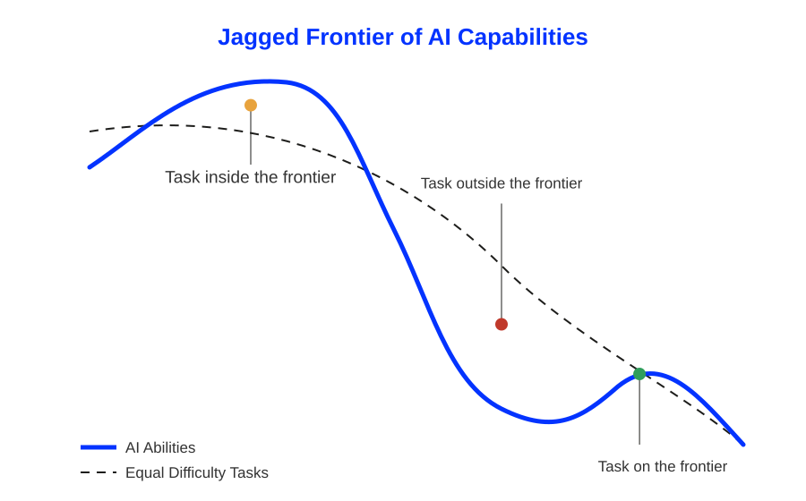

:::{.content-visible when-format="revealjs"}

# Agenda

:::medium
- Motivation & reflection [20 min]{.smaller}
- The light side [25 min]{.smaller}
- The dark side [40 min]{.smaller}
- [Break]{.highlight} [15 min]{.smaller}
- The jagged frontier [30 min]{.smaller}
- Exercise: probe the frontier [15 min]{.smaller}
- Interaction modes [30 min]{.smaller}
- Exercise: rewrite the moment [15 min]{.smaller}
- Challenges & wrap-up [10 min]{.smaller}
:::

:::

# Motivation {.vertical-center background-color="#0333ff" .no-headline}

:::html-hidden
:::large
Generation is cheap.\
[Verification not.]{.fragment}
:::
:::

:::fragment
:::medium
How can we structure our work with AI to ensure that the sum is greater than the parts, rather than less?
:::
:::

:::notes
The widespread deployment of generative AI has created an illusion of frictionless productivity. Empirical studies of high-stakes knowledge work show a recurring **complementarity deficit:** naive human-AI combinations often underperform both unassisted humans and autonomous AI models [@vaccaro2024when; @brodeur2026aiassisted]. @brodeur2026aiassisted give a stark demonstration: in a large-scale reproducibility-assessment task, AI-assisted teams outperformed AI-led teams, but neither beat human-only teams.

Generating plausible text, code, or strategic analysis now costs near-zero marginal cognitive effort. The cost of evaluating, verifying, and debugging what that generation produces has stayed constant, or increased. That asymmetry, the **generation-verification gap,** is the starting point for this session.

Artificial intelligence is neither a uniform productivity multiplier nor a cognitive replacement. It behaves like an **asymmetric amplifier:** it amplifies whatever interaction structure surrounds it, good or bad. Without deliberate, evidence-based interaction architectures, pairing capable humans with capable AI frequently yields outcomes that are worse, more homogeneous, and harder to maintain than unassisted work.

The session is underpinned by three concepts:

- **Complementarity vs. substitution:** does the pairing produce something neither party could produce alone, or does the AI simply replace human effort?
- **Naive delegation vs. co-construction:** is the human handing off a task wholesale, or actively shaping how the AI contributes to it?
- **Epistemic agency:** does the human retain ownership of judgment, or does the AI's confident output quietly replace the human's own reasoning?

:::

## Exercise {.unlisted .unnumbered .html-hidden .discussion-slide}

:::medium
Think about the last time you used an AI tool for university or work.
:::

Did it save you time **overall,** once you count the time spent reviewing, correcting, and rewriting what it produced?

Discuss with a neighbor.



# The Light Side {.headline-only}

## Execution Velocity

:::fragment
:::large
AI reduces the time it takes to progress from a blank page to a first draft.
:::
:::

:::html-hidden
:::incremental
- Substantial completion-time reductions in routine writing and standard coding tasks [@noy2023experimental; @peng2023impact; @merali2025scaling]
- Rapid prototyping and cold-start knowledge retrieval
- Reduced friction when summarizing unfamiliar material
:::
:::

:::notes
Field and lab experiments consistently find large completion-time reductions for routine writing, standard coding, and initial drafting once generative AI is introduced into the workflow. @noy2023experimental found that ChatGPT cut the time professionals needed for writing tasks by roughly 40 percent while improving output quality, as judged by peer graders. @peng2023impact found comparable gains for developers using GitHub Copilot, and @merali2025scaling extend the pattern to consulting, data-analyst, and management tasks more broadly.

Beyond raw speed, AI reduces the friction of **cold-start knowledge retrieval:** instead of searching, skimming, and synthesizing background material, a worker can ask directly and get a serviceable orientation within seconds. This is valuable, but it is also where the light side quietly borders the dark side: speed at the input stage does not guarantee speed, or quality, at the output stage. That tension carries through the rest of the session.
:::

## Equalizer Effect

:::fragment
:::large
AI narrows the gap between novices and experts, at least initially.
:::
:::

:::html-hidden
:::fragment
According to brynjolfsson2023generative and @cruces2025does, disproportionate performance gains accrue to novices and bottom-quartile performers.
:::
:::

:::notes
@brynjolfsson2023generative studied customer-support agents using a generative AI assistant and found that the assistant raised the productivity of novice and low-skilled agents substantially more than that of experienced agents. AI acted as an immediate scaffold, elevating baseline output to a competent standard and compressing the internal performance variance of the team. @cruces2025does found the same pattern in a randomized experiment on education-based productivity gaps: generative AI narrowed the gap between lower- and higher-skilled workers substantially.

This "bottom-up leveling" is genuinely valuable for onboarding and for closing skill gaps quickly. It also raises a question we return to under the dark side: what happens to the *learning* that used to occur while novices struggled through that gap unassisted?
:::

## Divergent Thinking

:::fragment
:::large
More ideas, further apart, faster.
:::
:::

:::html-hidden
:::fragment
Higher ideation fluency and greater semantic distance between ideas when individuals brainstorm with an LLM [@doshi2024generative; @hubert2024current].
:::
:::

:::notes
When individuals query LLMs during early brainstorming, they tend to produce more ideas per minute and ideas that are further apart in meaning (higher semantic distance) than when brainstorming alone [@doshi2024generative]. @hubert2024current go further, finding that current generative language models outperform humans on standard divergent-thinking tasks. For an individual working alone, this is a genuine creativity boost.
:::

## Summary {.scrollable}

| Mechanism                         | Changes                                              | Evidence                                                  |
|-----------------------------------|------------------------------------------------------|-----------------------------------------------------------|
| **Execution velocity**            | Faster drafts, faster prototypes, faster orientation | @noy2023experimental; @peng2023impact; @merali2025scaling |
| **The equalizer effect**          | Novices and low performers gain the most             | @brynjolfsson2023generative; @cruces2025does              |
| **Individual divergent thinking** | More ideas, greater semantic distance                | @doshi2024generative; @hubert2024current                  |

: Three well-replicated, immediate benefits of individual AI use {#tbl-lightside}

# The Dark Side {.headline-only}

## Cognitive Offloading

:::fragment
:::large
Faster answers today,\
weaker retrieval tomorrow.
:::
:::

:::html-hidden
:::incremental
- Immediate problem-solving speed increases with AI help
- Independent exam performance drops significantly afterward [@bastani2024generative]
- Continuous assistance is associated with erosion of unaided professional judgment in high-stakes domains [@lancet2025endoscopist]
:::
:::

:::notes
@bastani2024generative ran field experiments with high-school students working through math problems, some with access to a generative AI tutor and some without. Students with AI access solved practice problems faster and with fewer errors. When the AI was removed for a subsequent unaided exam, however, their performance dropped significantly relative to the control group. The likely mechanism is that AI assistance bypassed the active retrieval and struggle that normally consolidate learning.

A parallel pattern has been observed in professional settings that depend on trained intuition. @lancet2025endoscopist report a multicentre observational study, not a randomized trial, finding a **deskilling risk:** endoscopists accustomed to continuous AI assistance during colonoscopy showed reduced unaided polyp-detection accuracy once that assistance was removed. The mechanism is the same as in the classroom case: **the effort that used to build the skill has been offloaded, so the skill stops accumulating,** though the observational design means confounds (such as which endoscopists were assigned AI support) cannot be fully ruled out the way a randomized trial would.

This is not an argument against AI-assisted learning as such. However, we need to be deliberate about *when* assistance is appropriate.
:::

## Review Bottleneck

:::fragment
:::large
AI writes faster than humans can review.
:::
:::

:::html-hidden
:::fragment
Fast generation produces high volumes of superficially correct but subtly flawed work [@he2026aiwrites; @he2026speed]; [downstream, this shows up as silent coupling and structural complexity in code and analysis [@xu2025aiassisted; @borg2026echoes].]{.fragment}
:::
:::

:::notes
Generation happens at machine speed, but verification, the reading, tracing, and testing needed to catch subtle errors, still happens at human speed [@he2026aiwrites]. In a separate longitudinal study of open-source projects, @he2026speed find that Cursor AI raises short-term commit velocity while measurably increasing long-term code complexity. The result is a volume of output that looks correct on a first pass but accumulates undetected flaws.

In software engineering specifically, @xu2025aiassisted find that AI-assisted code, while faster to produce, is associated with **decreased productivity for experienced developers** once maintenance is accounted for: AI-generated code tends to introduce silent coupling between components and structural complexity that is expensive to unwind later. @borg2026echoes corroborate this at the codebase level, tracing downstream maintainability costs directly to AI-assisted commits. The technical-debt bill arrives months later, in the review, refactor, or incident that the shortcut eventually causes, not at commit time.
:::

## Fixation and Homogenization Trap

:::fragment
:::large
Everyone converges on the model's first idea.
:::
:::

:::html-hidden
:::incremental
- **Micro-mechanism:** early exposure to AI output anchors the human's own search space [@wadinambiarachchi2024effects; @lin2026stimulating]
- **Macro-outcome:** because LLMs sample around dense semantic centroids, many independent users converge on similar solutions, collapsing collective variance [@doshi2024generative; @boussioux2024crowdless; @zhou2025when]
- AI evaluation models tend to favor smooth, conventional structures over genuinely novel or eccentric ideas [@williams2026search]
:::
:::

:::notes
Two mechanisms compound each other here.

1. At the individual level, **idea fixation:** @wadinambiarachchi2024effects show that designers and analysts who see an AI-generated concept early in their process tend to anchor on its framing, even when instructed to generate independently, narrowing the space of solutions they go on to consider. @lin2026stimulating replicate the pattern in product design specifically, comparing generative AI against traditional ideation methods.
2. At the collective level, this compounds into a **variance collapse.** Large language models sample text from dense regions of their learned probability distribution, so their outputs cluster around a small number of "central" answers. @doshi2024generative show that while an *individual* using an LLM produces more ideas (the light-side finding on divergent thinking), a population of *many* people using the same LLM produces conceptually more similar outputs to each other than an equivalent population working unaided. @boussioux2024crowdless find the same collapse in crowdsourced problem-solving, and @zhou2025when show it compounding over time: once continuous AI use stops, individual creativity fails to recover even as homogeneity keeps climbing. Individual creativity goes up; collective diversity goes down.

A related, subtler effect: @williams2026search find that AI systems used to evaluate ideas (screening pitches, ranking submissions) tend to favor smooth, familiar narrative structures over genuinely novel or "weird" ones, penalizing exactly the kind of outlier idea that breakthrough innovation tends to require.

The practical implication for teams: if everyone on a project queries the same model the same way, the team's apparent productivity gain can mask a real loss of strategic and creative diversity.
:::

## Reasoning Biases

:::fragment
:::large
Confident answers are persuasive, correct or not.
:::
:::

:::html-hidden
:::incremental
- **Automation bias:** high-confidence, incorrect AI suggestions mislead decision-makers [@qazi2025automation; @goh2024influence]
- **Selective adherence:** people accept wrong AI advice that confirms their priors, and reject correct advice that contradicts them [@alonbarkat2023human]
:::
:::

:::notes
@vasconcelos2023generation reframe overreliance as a rational cost-benefit choice rather than a simple cognitive bias: across five studies, people relied on an AI's answer more when verifying it was harder or costlier, and, strikingly, giving the AI's reasoning as an explanation did not reduce overreliance on its own, it only helped when it genuinely lowered the cost of checking the answer. @qazi2025automation and @goh2024influence document the downstream consequence directly in clinical diagnostic reasoning: physicians shown a confident but incorrect AI suggestion were measurably more likely to reach the wrong diagnosis themselves. The real danger is that verifying AI output is often costly enough that people rationally choose not to, even when they could, not that people trust AI too much in general.

A closely related failure is **selective adherence,** the term coined by @alonbarkat2023human in a study of public-sector decision-making: decision-makers tend to accept AI suggestions that confirm what they already believed, and reject AI suggestions that contradict their priors, regardless of which suggestion was actually correct. @rounding2025impact confirm the pattern in a multi-country randomized trial of physician decision-making. This means AI can *amplify existing bias*, beyond simply adding noise to decision-making, by giving it an authoritative-sounding second opinion.

Both failures point to the same design requirement for human-AI collaboration: verification needs to be structured, not left to intuition.
:::

## Summary {.scrollable}

| Issue                         | Mechanism                                                   | Evidence                                                           |
|-------------------------------|-------------------------------------------------------------|--------------------------------------------------------------------|
| **Cognitive atrophy**         | Offloaded effort stops building the underlying skill        | @bastani2024generative; @lancet2025endoscopist                     |
| **Reviewer's bottleneck**     | Generation outpaces verification, debt accumulates silently | @he2026aiwrites; @he2026speed; @xu2025aiassisted; @borg2026echoes  |
| **Fixation & homogenization** | Individual anchoring plus collective variance collapse      | @wadinambiarachchi2024effects; @doshi2024generative; @zhou2025when |
| **Reasoning biases**          | Automation bias and selective adherence to AI advice        | @vasconcelos2023generation; @alonbarkat2023human                   |

: Four systemic penalties hidden behind the light side's immediate gains {#tbl-darkside}

# The Jagged Frontier {.headline-only}

## The Experiment

:::html-hidden
::::columns
:::{.column width="50%"}
**Task A: Shoe Launch**

Conceptualize and launch a new shoe, across 18 subtasks covering creativity, analytical thinking, writing, and persuasiveness. Open-ended work, graded with rubrics.
:::

:::{.column width="50%"}
**Task B: Strategy Case**

Recommend to the CEO which brand to invest in, using spreadsheet data and interview notes. The spreadsheet looks complete; the decisive details appear only in the interviews.
:::
::::

:::fragment
758 BCG consultants, randomly assigned to no AI, GPT-4, or GPT-4 plus a prompt-engineering overview [@dellacqua2026jagged].
:::

:::fragment
:::medium
For which task did GPT-4 improve consultants' performance?
:::
:::
:::

:::notes
@dellacqua2026jagged ran a preregistered randomized field experiment with 758 consultants at Boston Consulting Group, using GPT-4 as it stood in April 2023. Each consultant was assigned to one of three conditions: a control group working without AI, a group with GPT-4 access, and a group with GPT-4 access plus a short overview of prompt-engineering techniques.

**Task A** asked consultants to conceptualize and launch a new shoe. It decomposed into 18 subtasks spanning creativity, analytical thinking, writing, and persuasiveness: generating product ideas, segmenting a market, drafting marketing copy, penning an inspirational memo to employees. These are open-ended assignments with no single correct answer, so they were graded against rubrics by human evaluators.

**Task B** asked consultants to recommend to a CEO which of several brands to invest in. They received spreadsheet data on the brands and notes from internal interviews. The spreadsheet appears complete and self-sufficient, but the details that determine the correct recommendation appear only in the interview notes. Pasting the task straight into GPT-4 yields a plausible, well-argued, and wrong answer.

Both tasks are realistic consulting work, both look comparably hard, and nothing on their surface signals which one the model can handle.
:::

## The Result

| Outcome                    | Task A: Shoe Launch | Task B: Strategy Case      |
|----------------------------|---------------------|----------------------------|
| **Without AI**             | 4.4 / 10 quality    | 84.5 % correct             |
| **With AI**                | 5.7 to 5.9 / 10     | 60.0 to 70.6 % correct     |

: GPT-4 raised quality on one task and lowered correctness on the other [@dellacqua2026jagged] {#tbl-jagged-results}

:::fragment
On Task B, wrong answers written with AI were rated 29 % more convincing than wrong answers written without it.
:::

:::notes
On **Task A,** consultants with GPT-4 completed 12.2 % more subtasks, worked 25.1 % faster, and produced work rated 30 to 40 % higher in quality. The control group averaged 4.4 out of 10; the AI-assisted groups averaged 5.7 to 5.9. The gains were largest at the bottom of the skill distribution: consultants in the bottom half of baseline performance improved by 31 %, those in the top half by 11 %. Every group gained, and the prompt-engineering overview added further improvement.

On **Task B,** the same tool reversed the sign. The control group reached the correct recommendation 84.5 % of the time. Consultants with GPT-4 reached it 70.6 % of the time, and consultants with GPT-4 plus the prompt-engineering overview only 60.0 %, an average drop of 19 percentage points. The group with prompt training performed worst, a difference significant at the 10 % level. A plausible explanation is heavier reliance on the tool, though the study does not measure this directly.

On Task B, graders also rated the coherence and persuasiveness of each recommendation, blind to whether it was correct. AI-assisted answers scored 18 to 25 % higher, both among correct answers (+22 %) and among incorrect ones (+29 %). AI-assisted consultants reached wrong conclusions more often and defended them more persuasively. Quality of argument and correctness of conclusion came apart, which removes the cue a reviewer would normally use to catch an error. On Task A, persuasiveness entered the quality score as one of four graded dimensions and was not reported separately.

Two limits on the evidence are worth stating. The "jagged frontier" framing was developed after the fact and was not part of the preregistration, and only one task was tested outside the frontier. The contrast shows that both cases exist; it does not indicate how often each occurs.
:::

## Why "Jagged"?

{#fig-jagged}

:::notes

:::medium
AI capability does not follow how difficult a task feels to us.
:::

@fig-jagged plots two curves over the same set of tasks. The dashed grey curve is the reference line of **equal difficulty:** every task along it costs a human the same effort. The solid blue curve is **AI capability** over those same tasks, and it does not track the reference line at all. It climbs above it in places and drops well below it in others. Where the blue curve sits above the dashed line, the task is **inside the frontier** and the model handles it well. Where the blue curve falls below, the task is **outside the frontier** and the model fails while still producing fluent, confident output. Where the two curves touch, the task sits **on the frontier.**

The BCG experiment supplies two points on that picture. Open-ended creative and persuasive work, which feels like the harder, more human assignment, sat comfortably inside the frontier. A structured data task with a correct answer, which feels like the kind of thing a machine should excel at, sat outside it. Our sense of what is hard for us is a poor guide to what is hard for the model.

The frontier is also not fixed. Each model generation redraws it, and the version of a task that defeated GPT-4 in 2023 may be routine for a current model. The boundary moves without announcing itself, which means the position of any given task has to be established by testing.
:::

## Exercise {.unlisted .unnumbered .html-hidden .discussion-slide}

:::medium
Probe the frontier.
:::

In pairs plus AI:

1. Pick one real task from your own coursework or work that you'd consider delegating to AI. *(2 min)*
2. Try it. Then actively try to break it: push an edge case, add an unusual constraint, or ask the model to show its work, looking for a spot where the output *looks* right, but you can't actually tell if it is. *(5 min)*
3. Report: what did you try, did you find a spot where the output was wrong or unverifiable, and what made that spot different from where it worked fine? *(3 min)*



:::notes
This exercise deliberately does not use a fixed "trap" task. Any task simple enough to fit a 10-minute classroom slot is also simple enough for current AI tools to solve reliably. Canonical traps like Simpson's-paradox-style word problems, measurement-artifact reasoning, or small constraint-satisfaction puzzles are consistently caught by current models with tool access. Chasing a harder trap just restarts the same arms race next semester.

Instead, the exercise turns "finding the frontier" itself into the task. This is self-updating by construction and enacts the session's opening claim (the generation-verification gap) directly, rather than illustrating it with a canned example.

Debrief prompt: aggregate what groups found across the room. Likely patterns to draw out: tasks needing private or unavailable information, tasks needing domain expertise the group itself lacks to verify, tasks with many interacting constraints, and tasks where "wrong" is a judgment call rather than a fact. If a group found nothing, that's a legitimate and interesting result too, ask what that implies about where the frontier currently sits for their kind of work, and how they'd know if it moved.

Use the patterns to motivate the next slide: missing information, expertise the group cannot verify, and interacting constraints map onto verifiability and modularity.
:::

## Conclusions

Human-AI Pairing helps under following conditions:

:::medium
:::incremental
- **Verifiability:** an error can be caught by a cheap mechanical check.
- **Modularity:** the subtask can be isolated from the rest of the analysis.
- **Expertise:** the gain is largest for weaker performers and smallest for experts.
:::
:::

:::notes
Verifiability, modularity, and the expertise gradient form a working heuristic for deciding what to delegate. They are assembled from several studies rather than taken ready-made from any one of them, so it is worth separating what the evidence establishes from what we infer.

@vaccaro2024when meta-analyze over 100 experiments reporting more than 300 effect sizes, and their headline result is sobering: on average, human-AI combinations performed *worse* than the better of human alone or AI alone. Two moderators explain the variation. The first is task type, with losses concentrated in decision-making tasks and significantly greater gains in content creation. The second is which party is stronger alone: combinations gained when the human outperformed the AI, and lost when the AI outperformed the human. This maps onto the BCG experiment cleanly. Task A is content creation and produced gains; Task B is a decision task and produced losses. @hemmer2025complementarity approach the question conceptually and locate the sources of complementarity in information and capability asymmetries, meaning each party must hold something the other lacks for the pairing to add anything.

Verifiability
: Delegation pays off when a wrong answer announces itself cheaply, through a failing test, a linter, a recomputed figure, or a source that either exists or does not. @vasconcelos2023generation supply the mechanism: across five studies, people relied on an AI's answer in proportion to how costly it was to check, and explanations reduced overreliance only when they genuinely lowered that checking cost. Their work concerns overreliance and explanation design and does not itself propose a criterion for selecting tasks; the step from their cost-of-verification mechanism to a delegation rule is ours.

Modularity
: A subtask is worth handing over when it can be cut out of the larger analysis whole, so that the scope of any error stays bounded and locatable. Task B fails this test: the correct recommendation requires combining the spreadsheet data with the interview notes, so no part of it can be delegated without carrying the whole judgment along. Read this criterion as our operational reading of why decision tasks fare badly in @vaccaro2024when, not as a separate empirical finding.

Expertise
: Who benefits is contested, and the studies do not all point the same way. @becker2025measuring give the cleanest evidence for a net expert penalty: in a randomized trial, experienced open-source developers took 19 % longer to complete tasks with AI tools than without, while believing they had worked faster. @xu2025aiassisted find a related pattern in repository data after Copilot adoption, where core developers reviewed 6.5 % more code and produced 19 % less original code, with the aggregate gains concentrated among peripheral contributors. @cui2025effects, across three field experiments with software developers, report larger gains for less experienced developers but no net loss for experienced ones. @dellacqua2026jagged show the same gradient without a reversal: on Task A, consultants in the bottom half of baseline performance gained 31 % and those in the top half 11 %. What all four share is compression of performance differences. Whether the effect turns negative for experts depends on the setting, so treat a net expert loss as something to test in your own context.

The practical diagnostic before delegating anything: *if the AI gets this wrong, how would I find out, and how far would the error spread before I did?*
:::

# Interaction Modes {.headline-only}

## Overview

:::medium
Four interaction modes that relate to the failure risks.
:::

::::columns
:::{.column width="50%"}
:::incremental
- **Socratic Scaffold** protects skill acquisition
- **Centaur Modularizer** structures large workflows
:::
:::

:::{.column width="50%"}
:::incremental
- **Cognitive Forcer** mitigates overreliance
- **Delayed Access** preserves creative variance
:::
:::
::::

:::notes
Each of the four modes targets one of the failure modes established under the dark side. None of them asks you to stop using AI. All of them ask you to change *when* and *how* you bring it into the workflow.
:::

## The Socratic Scaffold

:::large
Cognitive protection for skill acquisition
:::

:::html-hidden
:::fragment
The model is prohibited from giving direct solutions. It is prompted to act as an examiner: asking guiding questions, hinting at missing boundary conditions, checking the human's mental model.
:::
:::

:::notes
**Objective:** skill acquisition, conceptual learning, and problem formulation, without the mental atrophy documented in @bastani2024generative.

**Mechanism:** the human explicitly instructs the model not to output a direct solution or completed code. Instead, the model is prompted to behave like an examiner or tutor: it asks clarifying questions, points to missing boundary conditions or edge cases, and checks whether the human's stated reasoning is sound, without supplying the reasoning itself. @prather2024interactions explore a related idea in programming education, structuring practice around prompt problems that keep the learner reasoning about the solution rather than just consuming AI-generated code.

**When to use it:** any situation where the point of the task is what you learn from doing it, not just the artifact you produce, coursework, first attempts at a new technique, early-career skill building.
:::

## The Centaur Modularizer

:::large
Structural separation for large, multi-step workflows
:::

:::html-hidden
:::fragment
The human owns strategy, problem architecture, and final synthesis. The AI is delegated bounded, non-overlapping subroutines, formatting, extraction, boilerplate.
:::
:::

:::notes
**Objective:** navigating large, multi-step analytical or writing workflows without losing coherence or accumulating undetected errors, directly addressing the reviewer's bottleneck discussed under the dark side.

**Mechanism:** enforce strict spatial and functional separation between human and AI contributions, following the "centaur" pattern documented by @dellacqua2026jagged and studied further in a team setting by @delacqua2025cybernetic. The human retains complete ownership of strategy, problem architecture, and final synthesis. The AI is delegated bounded, non-overlapping subroutines, formatting, data extraction, boilerplate code, first-pass summaries, where the scope of a possible error is small and easy to locate.

**When to use it:** large deliverables (reports, codebases, presentations) where losing the thread of the overall argument to the AI would be costly, but where clearly delimited sub-tasks are genuinely verifiable and modular (recall the verifiability and modularity criteria).
:::

## The Cognitive Forcer

:::large
Adversarial review for high-stakes decisions
:::

:::html-hidden
:::fragment
The human commits to an independent hypothesis in writing first. The AI is then prompted as an adversarial red team to find edge-case failures and unstated assumptions.
:::
:::

:::notes
**Objective:** high-stakes decision-making, policy analysis, and code review, directly countering the automation bias and selective adherence documented by @vasconcelos2023generation, following the cognitive forcing functions proposed by @bucinca2021trust.

**Mechanism:** before consulting the model at all, the human must commit, in writing, to an independent hypothesis, recommendation, or architecture. Only after that commitment exists is the AI introduced, and only in an adversarial role: it is prompted explicitly to red-team the human's position, to poke holes, surface edge-case failures, and expose unstated assumptions.

**Why the order matters:** asking for a critique *after* you have committed to a position removes the anchoring effect that a first AI answer otherwise has on your own thinking. It also converts the AI from a source of the decision into a check on the decision, structurally undermining automation bias rather than relying on individual vigilance to overcome it.

**When to use it:** irreversible or costly decisions, code review before merge, any moment where being wrong quietly is more expensive than being challenged loudly.
:::

## Exercise {.unlisted .unnumbered .html-hidden .discussion-slide}

:::large
Rewrite the moment
:::

1. Recall a specific time an AI tool gave you a confident answer that turned out to be wrong, or that you never actually checked. What was the task? What made you trust it? *(3 min, individually)*
2. Share your story. Together, diagnose: could you have caught the flaw if you had formed your own view *first*? What was missing from how you used the AI in the moment? *(5 min, in pairs)*
3. Draft the Cognitive Forcer rewrite: the one-paragraph hypothesis you would have written before consulting the AI, and the prompt that would have turned it into your adversarial reviewer instead of your source. *(5 min, in pairs)*

It would be great if a few share the most surprising or relatable story with the plenum.



:::notes
Unlike a scripted case study, this exercise won't converge on one clean outcome, and that's the point: the stories will span writing, coding, research, personal decisions, and the details will differ. What generalizes is the *mechanism*, not the specific task, so steer the debrief toward that: across whatever examples come up, was the common failure "I trusted the first answer" rather than "the AI was too smart to catch"? Did anyone's story already contain an implicit hypothesis they just never wrote down or acted on?

If a pair can't find a clean example of being fooled, that's useful too, ask what they did differently that made them check, and whether that habit generalizes.
:::

## Delayed AI Access

:::large
Preserving variance in creative and strategic work
:::

:::html-hidden
:::fragment
Enforce an initial period of unassisted divergent thinking. Introduce AI downstream, using diverse prompting personas to break out of central semantic distributions.
:::
:::

:::notes
**Objective:** creative ideation, strategic direction, and novel product design, directly countering the fixation and homogenization trap discussed under the dark side.

**Mechanism:** enforce an initial period of fully unassisted human divergent thinking, generating your own ideas before you see the model's, to establish a genuine personal variance baseline before any AI framing can anchor it (recall @wadinambiarachchi2024effects on idea fixation). AI is introduced only downstream, for expansion and elaboration, and ideally through diverse prompting personas rather than a single default query, deliberately pushing the model away from the dense central region of its output distribution that drives the collective variance collapse documented by @doshi2024generative. @wan2025diverse show directly that varying the AI's persona across a team measurably mitigates this homogenization effect in collaborative ideation.

**When to use it:** early-stage brainstorming, product concepting, strategy formation, anywhere that the *diversity* of the option set matters as much as the quality of any single option.
:::

# Challenges

You want to become a more deliberate collaborator with AI, not just a faster one? Here are three challenges that might help you along the way.

:::incremental
- **Level 1 (Reflect):** Keep a 14-day AI reliance diary. Log every AI interaction relevant to your studies or work, noting where the task sat on the jagged frontier, whether your stance was passive or active, how long verification took, and any moment you noticed automation bias in yourself. Close with a written reflection on your personal dependency and verification bottlenecks.
- **Level 2 (Change):** Over three weeks, commit to applying at least two of the four protocols above (Cognitive Forcer and Delayed Access work well together) across your coursework or projects. Compare your outputs against your usual habits: what changed in cognitive effort, in the maintainability of what you produced, and in what you actually remember afterward?
- **Level 3 (Grow):** Design and run a small field experiment (4 to 8 people, a study group or a work team). Compare a human-only team, a naive-AI team, and a Centaur-style team on the same complex deliverable. Write up whether true complementarity appeared, whether technical debt accumulated, and whether the AI-assisted teams' outputs converged more than the human-only team's did.
:::

# Reading List {.scrollable}

For digging deeper, I recommend the sources cited here, organized by theme.

**Frontiers and productivity**

- The jagged technological frontier: @dellacqua2026jagged
- Productivity effects of generative AI: @noy2023experimental
- Generative AI at work: @brynjolfsson2023generative
- Generative AI and developer productivity (GitHub Copilot): @peng2023impact
- Scaling laws for AI-assisted knowledge work: @merali2025scaling
- Generative AI and education-based productivity gaps: @cruces2025does

**Cognitive offloading and reliance**

- Generative AI and learning: @bastani2024generative
- Endoscopist deskilling after AI exposure: @lancet2025endoscopist
- Cognitive forcing functions: @bucinca2021trust
- Explanations, overreliance, and the cost of verification: @vasconcelos2023generation
- Generative AI and critical thinking: @lee2025impact

**Fixation and collective homogenization**

- Individual creativity vs. collective diversity: @doshi2024generative
- AI more creative than humans on divergent thinking: @hubert2024current
- Generative AI and design fixation: @wadinambiarachchi2024effects
- Generative AI and divergent thinking in product design: @lin2026stimulating
- The crowdless future: generative AI and collective problem-solving: @boussioux2024crowdless
- When ChatGPT is gone: creativity and homogeneity over time: @zhou2025when
- Diverse AI personas and homogenization: @wan2025diverse
- Diagnosing the limits of convergent AI: @williams2026search

**Reasoning biases and verification**

- Automation bias and selective adherence in public-sector decisions: @alonbarkat2023human
- Automation bias in AI-assisted diagnostic reasoning: @qazi2025automation
- LLM influence on diagnostic reasoning: @goh2024influence
- LLM assistance and physician decision-making: @rounding2025impact

**Complementarity and downstream technical debt**

- AI-assisted teams vs. AI-led vs. human-only teams: @brodeur2026aiassisted
- Field experiment on generative AI and teamwork: @delacqua2025cybernetic
- AI writes faster than humans can review: @he2026aiwrites
- Speed at the cost of quality (Cursor AI): @he2026speed
- AI-assisted programming and developer productivity: @xu2025aiassisted
- Downstream effects of AI assistants on maintainability: @borg2026echoes
- The expert penalty in high-skilled work: @cui2025effects
- Early-2025 AI and experienced developer productivity: @becker2025measuring
- When combinations of humans and AI are useful: @vaccaro2024when
- Complementarity in human-AI collaboration: @hemmer2025complementarity
- Prompt problems for learning programming: @prather2024interactions

# Q&A {.html-hidden .unlisted .headline-only background-image="../assets/bg.jpg"}

# Literature

:::{#refs}
:::