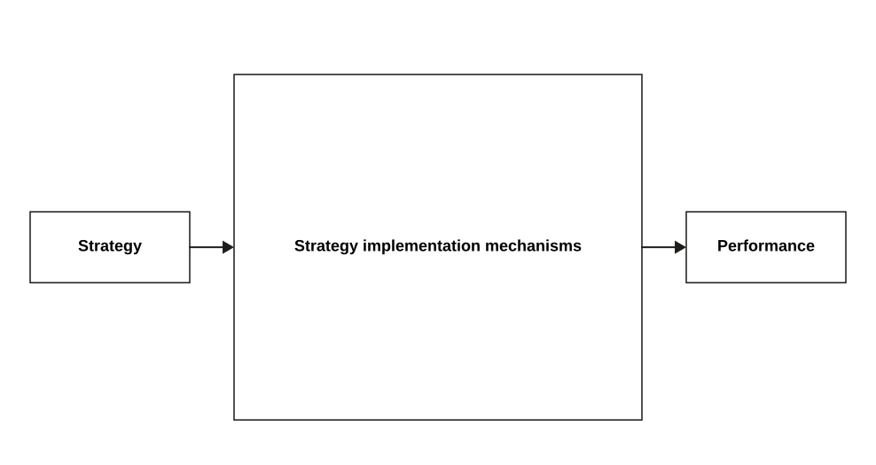
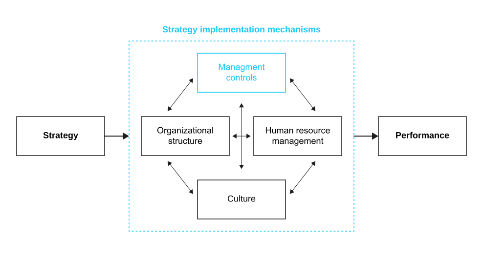
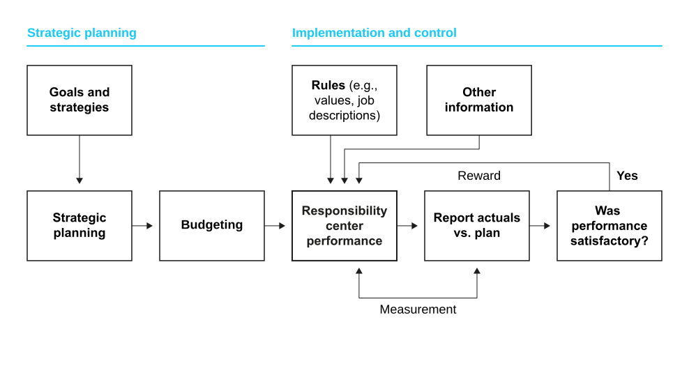

# Introductory Remarks {.section-title time="10"}

## Recap {.html-hidden .unlisted .discussion-slide}

:::medium
Think briefly about the contents of our last class, then let's discuss.
:::

1. Name the three primary financial statements and state which one captures a single point in time.
2. Explain the difference between ROA and ROE in one sentence.
3. Pick one performance measurement dysfunction and propose a prevention mechanism.



## Learning Objectives

After this unit, you should have a solid understanding of

::: incremental
- time value of money concepts and net present value for investment evaluation;
- cost types and their role in budgeting and performance measurement;
- the management control framework linking strategy formulation to task execution;
- planning and budgeting processes that translate strategy into operational targets;
- different types of responsibility centers and their appropriate performance measures;
- variance analysis methodology for systematic performance diagnosis;
- and common performance management frameworks.
:::

# Time Value of Money {.section-title time="35"}

## Overview

Money has different values at different points in time due to its earning potential: a euro today is worth more than a euro tomorrow because of:

::: incremental
-   **Opportunity cost:** money can be invested and earn a return.
-   **Risk:** future cash flows may be uncertain.
-   **Inflation:** purchasing power decreases over time.
-   **Preference:** people prefer current consumption to future consumption.
:::

:::: fragment
::: medium
[Key idea:]{.highlight-color} to compare cash flows at different times, we convert them to a common basis: either all future values or all present values.
:::
::::

## Future Value (FV)

The formula for calculating the future value (FV) from the present value (PV) is as follows:

$FV = PV \times (1 + i)^n$

::: smaller
-   $PV$ = present value\
-   $i$ = interest rate per period\
-   $n$ = number of periods
:::

*Example:*

FV of 1,000 € in 3 years given a 5% annual interest rate:\
$FV = 1000 \times (1 + .05)^3 = 1,157.63$

## Present Value (PV)

Formula to discount the present value (PV) from a future value (FV) is as follows:

$PV = \frac{FV}{(1 + i)^n}$

::: smaller
-   $PV$ = present value\
-   $i$ = interest rate per period\
-   $n$ = number of periods
:::

*Example:*

PV of 1,000 received in 3 years given a 5% annual interest rate:\
$PV = \frac{1000}{(1.05)^3} = 863.84$

## Interest Rates {visibility=hidden}

There are two different interest rates being used:

-   **Nominal interest rate:** stated annual rate, not accounting for compounding frequency.
-   **Effective annual rate (EAR):** accounts for intra-year compounding.

$EAR = \left( 1 + \frac{i_{nom}}{m} \right)^m - 1$

::: smaller
-   $i_{nom}$ = nominal annual interest rate\
-   $m$ = number of compounding periods per year
:::

*Example:*

Nominal rate 12%, monthly compounding ($m = 12$):\
$EAR = (1 + 0.12/12)^{12} - 1 \approx 12.68\%$

## Annuities

::: medium
An annuity is a [series of equal payments]{.highlight-color} or receipts occurring at [regular intervals]{.highlight-color}.
:::

::: notes
In financial valuation, the concept is used to calculate the present and future value of cash flows, which is critical for making business decisions.
:::

**Future value of an annuity:**\
*What is the future value of a constant annual cash flow have at the end of the period?* $FV_{OA} = PMT \times \frac{(1 + i)^n - 1}{i}$

**Present value of an annuity:**\
*What is the present value today of a future annual cash flow for multiple years?* $PV_{OA} = PMT \times \frac{1 - (1 + i)^{-n}}{i}$

::: smaller
$PMT$ = payment per period
:::

## Net Present Value (NPV)

::: medium
Net present value (NPV) is a financial metric used to [evaluate the profitability of an investment]{.highlight-color} or project.
:::

Steps:

1.  Estimate cash inflows and outflows over time.
2.  Chose a discount rate[^2] and discount each cash flow to present value.
3.  Sum present values: if positive, project adds value.

[^2]: The discount rate is the rate of return you could earn on an alternative investment with a similar level of risk. It's used to "discount" future cash flows back to their present-day value. A common discount rate is a company's weighted average cost of capital (WACC).

$NPV = \sum_{t=0}^n \frac{CF_t}{(1 + r)^t}$

::: smaller
-   $CF_t$ = cash flow in period $t$\
-   $r$ = discount rate
:::

## NPV Example

What is the NPV of an investment with cash flows shown below if the Weigthed Average Cost of Capital (WACC) is 10%?

::: fragment
| Year    | Cash Flow (€) | Discount Factor (10%) | Present Value (€) |
|---------|---------------|-----------------------|-------------------|
| 0       | -10,000       | 1.0000                | -10,000.00        |
| 1       | 3,000         | 0.9091                | 2,727.27          |
| 2       | 4,000         | 0.8264                | 3,305.79          |
| 3       | 5,000         | 0.7513                | 3,756.57          |
| **NPV** |               |                       | **-210.37**       |

: The economic value added by the investment calculated for the time $t_0$ as compared to an investment which returns exactly the WACC every year and has the same investment volume {#tbl-npv-example}

Decision: Since NPV \< 0, the project would **not** be accepted at a 10% WACC.
:::

# Cost Types {.section-title time="15"}

## Overview

:::: medium
::: fragment
Understanding different cost types is essential for designing budgets, conducting variance analysis, and making informed resource allocation decisions within performance management systems.
:::
::::

:::html-hidden
::: incremental
- **Direct vs. indirect costs:** Traceable to specific products/services (*direct*) versus allocated overhead (*indirect*)
- **Fixed vs. variable costs:** Remain constant (*fixed*) versus change with activity levels (*variable*)
- **Standard costing:** Predetermined benchmarks for materials, labor, and overhead 
- **Activity-based costing (ABC):** allocates overhead using cost drivers rather than volume 
:::
:::

::: notes
### Types {visibility=hidden}

**Direct vs. indirect**  

- *Direct*: Materials, direct labor, easily assigned to a cost object.
- *Indirect*: Factory rent, administrative salaries, need allocation rules.

Direct costs are often controllable by operational managers; indirect cost allocation impacts perceived profitability of products or units.

**Fixed vs. variable**  

- *Fixed*: Stay the same within a relevant range (e.g., rent, salaried staff).  
- *Variable*: Change with output (e.g., raw materials, piece-rate labor).  
- Many costs are *semi-variable* (e.g., utilities with base fee + usage).  

Understanding cost behavior is key for forecasting, flexible budgeting, and interpreting performance against targets.

**Standard costing**  

- Establishes *rate* and *usage* standards for inputs.  
- Variances (e.g., material price variance, labor efficiency variance) pinpoint performance issues.  

Standard costing supports responsibility-center evaluation and cost control.

**Activity-based costing (ABC)**  

Identifies activities, assigns resource costs to activities, and then to cost objects via drivers (e.g., setups, purchase orders).  

Improves decision-making on pricing, process improvement, and outsourcing.

::: callout-note
##### Activity-Based Costing in SaaS

- Annual cost of customer support team: €300,000  
- Total support tickets per year: 15,000 → cost driver rate = €20/ticket  
- Enterprise customers: 500 tickets/year → €10,000 support cost per enterprise client  
- SMB customers: 50 tickets/year → €1,000 support cost per SMB client  

**Insight:** Enterprise clients consume far more support resources.  

ABC informs pricing tiers, SLAs, or self-service portal investment. It improves customer profitability analysis and aligns service design with strategic goals.
:::


:::


# Management Control {.section-title time="60"}

## Definition 

:::medium
Management control [is the [process]{.highlight}]{.fragment} [by which managers [influence other members]{.highlight} of the organization]{.fragment} [to [implement the organization's strategies]{.highlight} [@anthony2014management].]{.fragment}
:::

:::incremental
- It's the bridge between strategy formulation ("what we want to do") and task control ("how we execute specific tasks")
- Focuses on ensuring that organizational resources are obtained and used effectively and efficiently to accomplish the organization's objectives
:::

## Management Control x Strategy

::: {.r-stack .html-hidden}
{.fragment height="420"}

{.fragment height="420"}
:::

::: notes
{#fig-managementControl}

-   **Organization structure** specifies the roles, reporting relationships, and division of - responsibilities that shape the decision-making within an organization.
-   **Human resource management** is the selection, training, evaluation, promotion, and termination of employees so as to develop the knowledge and skills required to execute organizational strategy.
-   **Culture** refers to a set of common beliefs, attitudes, and norms that explicitly or implicitly guide managerial actions.
:::

## Management Control Framework

::: {.r-stack .html-hidden}
![Formal management control system [@anthony2014management, p. 105]](images/mcs-1.svg){.fragment height="420"}

{.fragment height="420"}

{.fragment height="420"}

{.fragment height="420"}
:::

::: notes
![Formal management control system [@anthony2014management, p. 105]](images/mcs.svg){#fig-mangementControlSystem}

Traditional management control approaches often focus on top-down command and control mechanisms, where authority and decision-making are centralized at the top levels of the organization. The emphasis is on planning, setting targets, monitoring performance, and taking corrective actions if necessary. The control mechanisms are typically based on formal rules, procedures, and hierarchical structures.

-   Strategy formulation (what to do) → Management control (ensure it happens) → Task control (do tasks right).
-   Mechanisms: org structure, HRM, culture, planning/measurement/feedback.
-   Process: plan → budget → measure → analyze → act.
:::

## Planning and Budgeting Process

::::: html-hidden
:::: medium
::: fragment
The planning and budgeting cycle [translates [strategic objectives]{.highlight}]{.fragment} [into [operational plans]{.highlight}]{.fragment} [through [resource allocation]{.highlight}]{.fragment} [and [performance targets]{.highlight} that guide organizational action [@anthony2007management].]{.fragment}
:::
::::
:::::

::: notes
**Strategic planning (3–5 years)**

-   Defines long-term direction, competitive positioning, and required capabilities.
-   Produces high-level targets and priorities that cascade into annual plans.
-   Sets the frame for capital investments, product/market focus, and talent needs.

**Operating budgets (annual)**

-   Translate strategy into detailed revenue, cost, and profit plans for responsibility centers (departments, business units).
-   Broken down by month or quarter to monitor seasonal effects and track progress.
-   Include both financial and operational measures.

**Typical budget components**

-   Revenue budget: Sales volumes × unit prices.
-   Production budget: Units to be produced, considering opening inventory and sales forecasts.
-   Expense budget: Operating costs by category (e.g., labor, materials, overhead).
-   Capital budget: Planned investments in assets, technology, or infrastructure.
-   Cash flow budget: Expected cash inflows and outflows to ensure liquidity.

**Functions of the planning & budgeting process**

-   Coordination: Aligns activities across functions and units.
-   Authorization: Provides spending limits and resource approvals.
-   Performance benchmark: Sets measurable targets against which actual results are compared.
-   Communication: Signals priorities and expectations throughout the organization.
-   Risk planning: Anticipates contingencies and resource needs under different scenarios.

**Types of budgeting approaches**

-   Annual budget: Fixed for the year; common but can become outdated in volatile environments.
-   Rolling budget: Updated regularly (e.g., quarterly) to maintain a forward-looking 12–18 month horizon.
-   Zero-based budget: Every expense must be justified each period, not just incremental changes.
-   Activity-based budget: Links costs to the activities that generate them, improving cost control.

**Modern CPM practices**

-   Rolling forecasts: Replace static annual targets with continuously updated projections based on latest data.
-   Driver-based planning: Links forecasts and budgets to key business drivers (e.g., sales pipeline, customer churn rate) for more responsive resource allocation.
-   Integration with performance management systems: Ensures that financial targets are consistent with KPI frameworks such as the Balanced Scorecard, reducing siloed planning and gaming behavior.
:::

## Responsibility Center Design

Organizations structure accountability through different responsibility center types:

:::: html-hidden
::: medium
[[Cost centers]{.highlight} focus on expense control]{.fragment .fade-in-then-semi-out fragment-index=1}[, [revenue centers]{.highlight} on sales generation]{.fragment .fade-in-then-semi-out fragment-index=2}[, [profit centers]{.highlight} on bottom-line results]{.fragment .fade-in-then-semi-out fragment-index=3}[, and [investment centers]{.highlight} on return on invested capital [@anthony2007management].]{.fragment .fade-in-then-semi-out fragment-index="4"}
:::
::::

::: notes
-   **Cost centers:** engineered vs discretionary; measure vs budget.
-   **Revenue centers:** sales & market share; limited cost control.
-   **Profit centers:** accountable for P&L; enables decentralization.
-   **Investment centers:** ROI/ROCE/EVA; highest autonomy.
-   **Design principles:** align responsibility with controllability; match measures to objectives; support structure & strategy.
:::

::: fragment
The choice of center type determines KPI sets and bonus formulas; e.g., ROI/EVA for investment centers versus margin or contribution for profit centers.
:::

## Variance Analysis

:::: medium
::: fragment
Variance analysis [compares [actual results]{.highlight}]{.fragment} [to [planned targets]{.highlight}]{.fragment} [to understand the [causes of performance deviations]{.highlight}]{.fragment} [and guide [corrective action]{.highlight} [@anthony2007management].]{.fragment}
:::
::::

::: notes
**Purpose**  

- Identify and quantify **causal factors** behind differences between budgeted and actual results.  
- Provide actionable insight, not just variance reporting.  
- Support continuous improvement and learning loops in CPM.

**Approach** [@anthony2007management]:  

1. Identify the causal factor affecting profits (e.g., sales price, volume, cost of materials).  
2. Disaggregate the overall profit variance into these causal factors.  
3. Measure the profit impact of each factor individually.  
4. Apply ceteris paribus vary one factor at a time, holding others constant to isolate its effect.  
5. Layer complexity sequentially start with a simple commonsense breakdown, then refine as needed.  
6. Stop when complexity outweighs insight focus on factors with real decision value.

Many organizations perform variance analysis *monthly* at business unit and corporate level; some prefer *quarterly* for broader trends.

**Performance management perspective**  

Meeting the budget must not equal optimal performance; variances must be interpreted in context (market changes, strategic shifts).

Sophisticated CPM uses variance analysis not only for *control* but also for *learning*:  

- Adjust forecasts and rolling budgets based on variance patterns.  
- Identify systemic issues (e.g., persistent unfavorable cost variances).  
- Feed insights into KPI governance to ensure measures remain relevant.
:::

### Variance Analysis Disaggregation

:::notes
**Common variance breakdowns**  

- **Revenue variance**  
  - *Volume variance:* change due to actual units sold vs. budgeted.  
  - *Mix variance:* change due to the proportion of products/services sold.  
  - *Price variance:* change due to actual selling prices vs. budgeted.  
- **Expense variance**  
  - *Manufacturing expenses:* material cost, labor efficiency, overhead absorption.  
  - *Other expenses:* SG&A, marketing, R&D.
:::

```{mermaid}
%%{init: {
  'theme': 'base',
  'themeVariables': { 'fontFamily': 'Arial' },
  'flowchart': { 'curve': 'linear' }
}}%%
flowchart TD
    A[Total Variance Profit]
    A --> B[Other costs]
    A --> C[Manufacturing costs]
    A --> D[Revenue]

    B --> B1[Administration]
    B --> B2[Marketing & Sales]
    B --> B3[R&D]

    C --> C1[Variable costs]
    C --> C2[Fixed costs]

    C1 --> C1a[Material]
    C1 --> C1b[Direct labor]
    C1 --> C1c[Variable overhead]

    D --> D1[Selling price]
    D --> D2[Volume / Mix]

    D2 --> D2a[Market share]
    D2 --> D2b[Market size]

    %% White background and horizontal centering
    classDef default fill:#ffffff,stroke:#000,stroke-width:1px,color:#000;
    %% Bold root + first level
    classDef bold font-weight:bold,stroke-width:2px;
    class A,B,C,D bold;

```

# Financial Performance Frameworks {.section-title time="40"}

:::notes
Theories from economics, psychology, and organizational behavior identify the **drivers** of effective performance management. Frameworks operationalize these insights into **practical measurement systems** that guide resource allocation, align incentives, and support decision-making. They provide the **how:** structured approaches to measuring, analyzing, and improving performance.
:::

## Overview

:::large
[Du Pont Pyramid,]{.fragment .fade-in-then-semi-out} 
[Tableau du Bord,]{.fragment .fade-in-then-semi-out} 
[Balanced Scorecard,]{.fragment .fade-in-then-semi-out} 
[Performance Pyramid,]{.fragment .fade-in-then-semi-out}
[and Performance Prism.]{.fragment .fade-in-then-semi-out}
:::

:::notes
- The **Du Pont Pyramid** focuses on analyzing return on investment (ROI) by breaking it down into key financial ratios. It examines profitability through the relationships between net income, sales, and asset turnover. The framework is useful for understanding the drivers of financial performance.
- A **Tableau du Bord** (a French term for "dashboard") provides a comprehensive approach to performance measurement. It encompasses both financial and non-financial metrics, presenting a holistic view of organizational performance. This framework is particularly useful for monitoring and managing various aspects of performance in a visually intuitive manner.
- The **Balanced Scorecard** is a strategic performance measurement framework that takes a balanced approach by considering multiple perspectives. It includes financial metrics along with customer satisfaction, internal processes, and learning and growth. This framework is valuable for aligning organizational activities with the overall strategy and ensuring a balanced assessment of performance.
- The **Performance Pyramid** offers a hierarchical representation of performance metrics, starting from financial indicators at the top and extending to operational metrics at the base. This framework organizes metrics into different levels based on their strategic relevance and impact. It provides a structured approach to performance measurement with a clear linkage to strategic goals.
- The **Performance Prism** is a holistic framework that goes beyond traditional measures by considering stakeholders and their interests. It incorporates key elements such as stakeholders, strategies, processes, capabilities, and stakeholder satisfaction. This framework is valuable for providing a broader perspective on performance and assessing the impact on various stakeholders.

Each framework offers a unique perspective on performance measurement. A combination of these frameworks may provide a more comprehensive understanding of performance.
:::

## Framework Evolution

:::: medium
::: fragment
As organizations mature, control systems [evolve from [financial-only]{.highlight}]{.fragment} [to [integrated, adaptive systems]{.highlight}.]{.fragment}
:::
::::

:::fragment
Stages:
:::

:::incremental
1. Financial control focus (DuPont)  
2. Balanced approaches (BSC)  
3. Value-based management (EVA)  
4. Stakeholder integration (Performance Prism, Integrated Reporting)  
5. Dynamic, AI-enabled, real-time controls
:::

:::fragment
Choose frameworks appropriate to current maturity and adaptability needs.
:::

## Exercise {.discussion-slide}

Form groups, research one of the frameworks and prepare a short presentation summarising its key tenets and making explicit connections to the content discussed so far.



# Closing {.section-title time="10"}

## Key Takeaways

::: incremental
-   **TVM & investment appraisal** connect performance to value creation
-   **Cost behavior** shapes budgets, variance analysis, and allocation decisions
-   **Control frameworks** connect strategy to operations
-   **Responsibility centers, budgeting, and variance** are core CPM tools
-   **Performance frameworks** evolve from financial-only to integrated, adaptive systems
:::

## Review and Consolidation {.scrollable .slide-parts}

The following questions are designed to review and consolidate what you have learned and are a good starting point for preparing for the exam.

::: slide-part
::: smaller
- Apply NPV to evaluate investment proposals. Explain the components of WACC and their impact on investment decisions.
- Differentiate between direct/indirect and fixed/variable costs. Explain how cost behavior affects responsibility center performance measurement.
- Differentiate between strategy formulation, management control, and task control. Explain how management control bridges strategy and operations.
- Design appropriate responsibility centers for different organizational contexts. Explain the controllability principle and its implications.
- Describe the planning and budgeting process and its role in strategy implementation. Compare annual versus rolling budget approaches.
:::
:::

::: slide-part
::: smaller
- Conduct comprehensive variance analysis for a business unit, decomposing total variance into price, volume, mix, and cost components.
- Compare and contrast DuPont analysis, EVA, and Balanced Scorecard for different organizational scenarios. Recommend which framework(s) would be most appropriate and why.
- Analyze how performance measurement systems should evolve as organizations mature and environments change. Provide specific examples of adaptive changes.
:::
:::

# Questions? {.html-hidden .unlisted .headline-only .bg-highlight .qa-slide}

# Literature {.literature-slide}

::: {#refs}
:::
