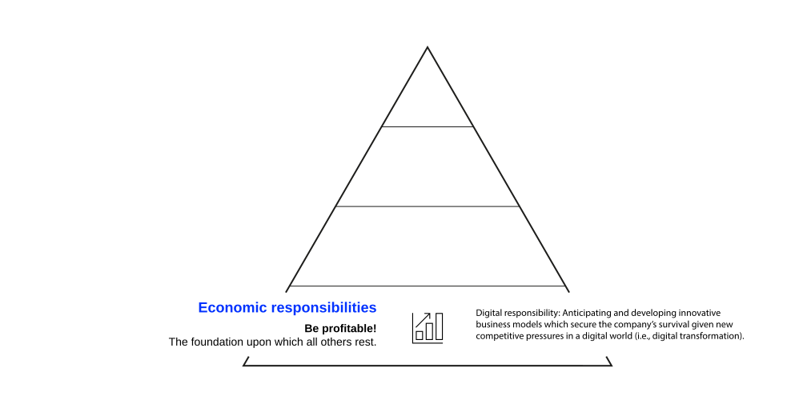
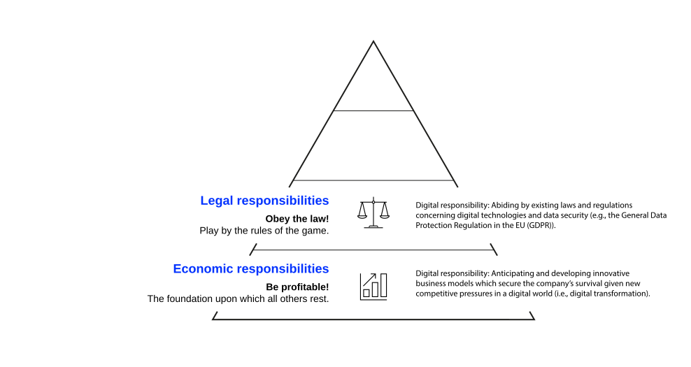
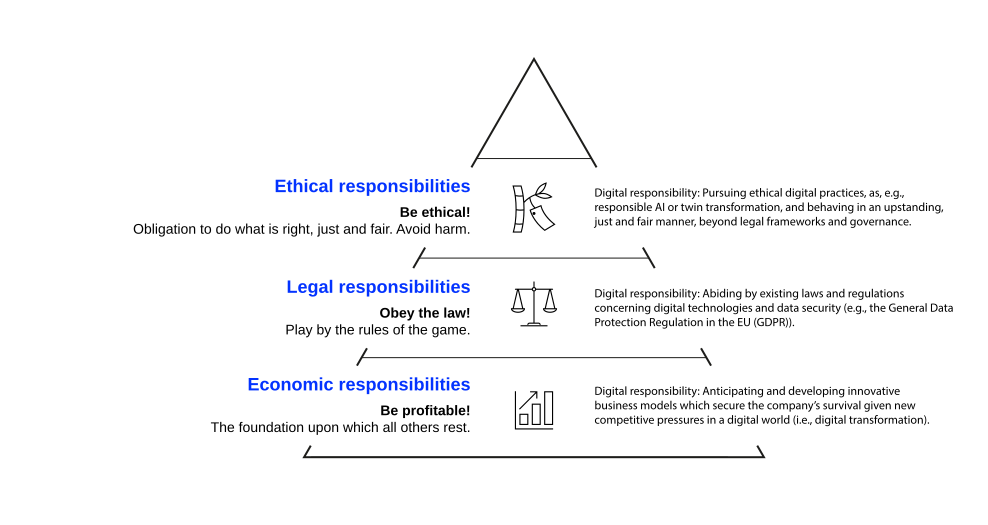
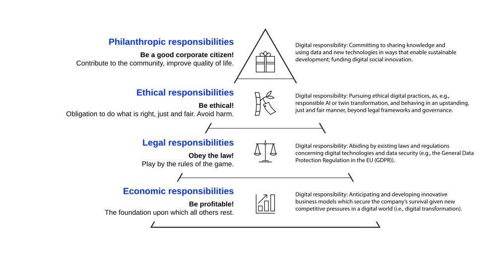

:::{.content-visible when-format="revealjs"}

# Agenda

:::medium
- Intro [5 min]{.smaller}
- Ethics and values [30 min]{.smaller}
- Ethics x strategy [20 min]{.smaller}
- CSR foundations [20 min]{.smaller}
- [Break]{.highlight}
- CSR and performance [30 min]{.smaller}
- Implementation [40 min]{.smaller}
- Ethics in practice [15 min]{.smaller}
- Wrap-up & Q&A [10 min]{.smaller}
:::

:::

# Learning Objectives

After this section, you should have a solid understanding of

:::incremental
- what ethics, business ethics and corporate social responsibility is, including their key components;
- the origins of ethical dilemmas in business and the significance of approaching these;
- the impact of CSR on various stakeholders;
- the strategic advantages and potential challenges associated with implementing business ethics/CSR initiatives in a company;
- the concept of structural ambidexterity in relation to ethical strategy implementation;
- and when and why good ethics in strategic management pay back.
:::

# Introduction {.headline-only}

## Prologue

:::fragment
:::medium
> A single individual can usually only commit small sins; a large firm can commit grandiose ones. *Claes Gustafsson in @mintzberg2014strategy*
:::
:::

:::fragment
> If you have integrity, nothing else matters. If you don't have integrity, nothing else matters. *Alan Simpson, Institute for Business Ethics*
:::

:::notes
The quotes introduce two key themes we'll explore in this chapter: the nature of ethical behavior and the amplified consequences when organizations act unethically. Recent corporate scandals demonstrate how ethical failures can rapidly destroy decades of value creation, making ethics a critical strategic consideration rather than just a compliance issue.
:::

## Reflection {.unlisted .unnumbered .html-hidden .discussion-slide}

:::large
What is a "grandiose sin" in the tech world from the last year(s)?
:::



:::notes
A warm-up to surface what students already carry into the room. Expect data breaches, algorithmic harms, labour practices in the supply chain, and AI training-data disputes. Collect three or four on the board and keep them visible; the amplification effect later in the unit explains why each scaled the way it did.
:::

## Ethics

::::: html-hidden
:::: medium
::: fragment
**Morality** is the [set of norms, values, and beliefs]{.fragment .highlight-current-blue} embedded in social processes [that defines right and wrong for a community.]{.fragment .highlight-current-blue}
:::
:::fragment
**Ethics** is the [reasoned study of that morality]{.fragment .highlight-current-blue}, [producing rules and principles]{.fragment .highlight-current-blue} that can be applied to a specific case [@crane2019business].
:::
::::
:::::

:::notes
Ethics is the study of morality and the application of reason to determine the rules and principles that establish right and wrong in a given situation [@crane2019business]. The term comes from the Greek word 'ethos,' which means character.

@crane2019business separate two terms that are routinely used interchangeably. **Morality** is the set of norms, values, and beliefs embedded in social processes that defines right and wrong for a community. **Ethics** is the reasoned study of that morality, producing rules and principles that can be applied to a specific case. Morality is what a community already holds; ethics is the work of examining it.

Moral systems vary across cultures and shift over time, which would leave a multinational with nothing but competing local conventions. Ethical reasoning is what allows a firm to argue about those differences rather than simply report them.

Ethical theories reflect on what is morally good and how individuals ought to behave, offering guidance for making moral decisions in various contexts, including business situations.

In strategic management, ethics provides frameworks for evaluating the rightness or wrongness of strategic choices, not just their effectiveness or efficiency. This distinction is crucial because effective strategies that are ethically problematic can create long-term risks and undermine sustainable competitive advantage.
:::

## Values and Moral Systems

:::medium
The right conduct includes those lines of actions that are desirable in terms of the objectives and moral values of our society [@bowen1953social].
:::

:::fragment
Key considerations for strategic management:
:::

:::incremental
- Morality is an aspect of culture: different cultures have different moral systems
- Moral values also change over time
- Some moral values change slowly, over centuries
- Others change more quickly, needing just decades
- Catastrophic events may cause moral values to change abruptly
:::

:::notes

This temporal and cultural variation in moral systems creates complexity for multinational organizations operating across different cultural contexts and time periods.

Research by @hofstede2010cultures demonstrates significant cultural variations in ethical values, while studies by @inglehart2018cultural show how values evolve within societies over time. This creates strategic challenges for global organizations that must navigate different ethical expectations across markets.

The COVID-19 pandemic provides a recent example of how external shocks can rapidly shift societal expectations regarding corporate responsibility, particularly around employee safety, community support, and stakeholder care.
:::

## Reflection {.unlisted .unnumbered .html-hidden .discussion-slide}

A company is just a nexus of contracts [@jensen1976theory].

:::large
Is there a moral (or social) responsibility for firms?
:::



:::notes
[Shareholder primacy]{.h4}

Companies are a nexus of contracts with no independent moral agency [@friedman1970social; @jensen1976theory]

- A corporation is a legal fiction: an artificial construct that exists solely to serve shareholders
- Managers are agents hired by shareholders (principals) with a fiduciary duty to maximize profits, the agency relationship formalized by @jensen1976theory and treated in [Corporate Performance Management](../cpm/index.qmd#agency-theory)
- "The social responsibility of business is to increase its profits" within legal and ethical bounds [@friedman1970social]
- Spending shareholder money on social causes without their consent is taxation without representation [@friedman1970social]
- If managers want to be charitable, they should do so with their own money, not shareholders'

Contracts are amoral legal instruments. Attributing "responsibility" to a corporation is a category error.

The two sources do different work. @friedman1970social supplies the normative claim about what managers ought to do; @jensen1976theory supply the economic model of the firm that makes the claim coherent. Students routinely credit the nexus-of-contracts view to Friedman, and it is Jensen and Meckling's.

[Stakeholder theory]{.h4}

Companies are embedded in networks of relationships with moral obligations to multiple stakeholders [@freeman2010stakeholder]

- Stakeholders include employees, customers, suppliers, communities: anyone affected by corporate decisions [@freeman2010stakeholder]
- Value creation requires coordination among all stakeholders, not just shareholders
- Managers must balance competing stakeholder interests, not maximize returns for one group
- Long-term success depends on maintaining trust and legitimacy with all stakeholders
- Corporations are moral agents because they make choices that affect people's lives

Organizations develop cultures, values, and identities that transcend individual contracts. They can act responsibly or irresponsibly.

@donaldson1995stakeholder separate three claims that are routinely collapsed into one, which is the distinction to push students towards when the discussion stalls on whether stakeholder theory is "true":

- **Descriptive:** firms do have stakeholder relationships, as a matter of observable practice.
- **Instrumental:** managing those relationships well produces better financial performance. This is the claim @barnett2012does test, and the claim the U-shape qualifies.
- **Normative:** stakeholder interests have intrinsic worth, independent of whether serving them pays. @donaldson1995stakeholder treat this as the theory's actual foundation.

The instrumental claim can lose empirically and leave the normative claim untouched. Friedman and Freeman disagree least about the facts and most about which of the three a firm owes anything to.

:::

## Corporate Moral Responsibility

:::: medium
::: fragment
Firms do not function in a vacuum. They function in [the context of a (wider) social environment]{.fragment .highlight-current-blue}, which imposes on them [certain moral demands and responsibilities]{.fragment .highlight-current-blue} [@mintzberg2014strategy].
:::
::::

:::fragment
Foundation of corporate responsibility:
:::

:::incremental
- A company is a collection of human and social groupings
- General expectations regarding acceptable conduct underpins such groupings
- Values such as loyalty, credibility, diligence, cooperation, moral conduct are manifest in organisations
:::

:::notes

Research by @freeman2010stakeholder demonstrates that organizations exist within networks of relationships that create mutual obligations and expectations, making ethical behavior a strategic necessity rather than an optional add-on.

Values such as loyalty, credibility, diligence, and cooperation are manifest in organisations because the groupings depend on them. What counts as "right" is set by the intersection of moral principles and stakeholder expectations within a specific social and cultural context.
:::

## Business Ethics

::::: html-hidden
:::: medium
::: fragment
Business ethics refers to [the principles of right and wrong conduct within organizations]{.fragment .highlight-current-blue} that [guide decision making and behavior]{.fragment .highlight-current-blue} [@david2016strategic].
:::
::::

:::fragment
An [ethical dilemma]{.link-color} arises when a choice must be made between conflicting moral principles, and every available option violates one of them.
:::
:::::

:::notes
Business ethics refers to the principles of right and wrong conduct within organizations that guide decision making and behavior [@david2016strategic].

Business ethics is a form of *applied ethics* that deals with ethical principles and moral issues that arise in business environments. It encompasses all aspects of business conduct and is relevant to the behavior of individuals and entire organizations.

Business ethics ensures that business practices, decisions, and operations adhere to ethical standards and contribute positively to society while fulfilling the company's objectives and obligations to stakeholders [@drucker1981business]. This is particularly important when *ethical dilemmas* occur. Ethical dilemma occurs when individuals or groups face challenging situations requiring choice between conflicting moral principles or values.

Research by @trevino2014managing shows that ethical dilemmas in business often involve conflicts between different stakeholder interests, short-term vs. long-term considerations, or competing ethical frameworks.
:::

:::fragment
Why do these foundations become strategically relevant?
:::

# Ethics x Strategy {.headline-only}

## Strategic Imperatives

Following concerns make the idea of an ethical strategy relevant:

:::incremental
- The concept of ethics and morals applies to corporations just as it applies to individuals
- The question of doing right is not easy in complex organizational contexts
- Ethical business practices can create "shared value" and **competitive advantage** [@porter2011creating]
- Wrong actions can not only be costly (i.e., value destruction), but also cause **long-term damage**
- Organizations are difficult to turn once strategic direction is set
:::

:::notes
Recent examples of rapid value destruction through ethical failures include Volkswagen's emissions scandal (2015), which cost over $30 billion in fines and settlements, and Facebook's Cambridge Analytica scandal (March 2018), which triggered regulatory investigations, a $5 billion FTC settlement, and a lasting shift in the company's regulatory exposure.

Facebook's $120 billion single-day market value loss is often attributed to this scandal, but it came on 26 July 2018 following the Q2 earnings call, driven by slowing user growth and a warning that revenue growth would decelerate as the company moved to put privacy first. The scandal shaped that guidance rather than causing the drop directly. The distinction is worth making in class: ethical failures rarely destroy value in a single visible event, they raise the cost of operating for years afterwards.

This demonstrates that ethical considerations are fundamental to strategic risk management and long-term value creation.
:::

----------

::::html-hidden

Core principle:

:::fragment
:::large
Good ethics is good business.\
:::
:::

:::fragment
:::large
Bad ethics can derail even the best strategic plans.
:::
:::

::::

## Amplification Effect

:::html-hidden
:::large
Ethical failure = value destruction
:::
:::

:::: medium
::: fragment
Strategic decisions affect [multiple stakeholders]{.fragment .highlight-current-blue} across [extended time horizons]{.fragment .highlight-current-blue} with [amplified consequences]{.fragment .highlight-current-blue}.
:::
::::

:::fragment
This amplification effect makes organizational ethics both more complex and more critical than individual ethical decisions.
:::

:::notes
The transition from individual to organizational ethics involves several key amplification factors:

- **Scale amplification:** Organizations can affect thousands of employees, millions of customers, and entire communities through single strategic decisions.
- **Time amplification:** Strategic decisions create path dependencies that influence organizational behavior for years or decades.
- **Complexity amplification:** Organizations operate across multiple jurisdictions, cultures, and stakeholder groups with different ethical expectations.
- **Visibility amplification:** Organizational actions receive greater scrutiny from media, activists, and regulatory bodies than individual actions.

This amplification makes ethical strategic management both more challenging and more important for long-term organizational success.
:::

## Cultural and Value Changes

Two current social and cultural changes create **ethical conflicts and dilemmas of strategic concern** [@mintzberg2014strategy]:

::::: html-hidden
[[Rapid technological development]{.medium}, e.g.]{.fragment}

:::fragment
- AI and algorithmic decision-making in business processes
- Data privacy and digital rights management
:::

[[Environmental changes]{.medium}, e.g.]{.fragment}

:::fragment
- Climate change and sustainability reporting requirements
- Supply chain transparency and human rights compliance
:::
:::::

:::notes
**Rapid technological development**

- New technology could harm people's personal integrity
- Fast pace leaves little time for moral reflection
- Creates unforeseen ethical challenges (AI, data privacy concerns)
- Generative AI raises questions about intellectual property, bias, and misinformation

Research by @floridi2019translating highlights how digital technologies create new ethical challenges that require proactive organizational responses.

**Environmental changes**

- Increased awareness of environmental issues and effects on future generations
- New moral and ethical concerns about sustainability
- Climate change as moral imperative for business action
- Increased stakeholder expectations for environmental responsibility

Studies by @eccles2014impact show that stakeholder expectations regarding environmental responsibility have fundamentally shifted, creating new strategic imperatives for organizations.

These changes create strategic imperatives for organizations to anticipate and prepare for ethical challenges ahead.
:::

# Corporate Social Responsibility {.headline-only}

## Evolution

::::: html-hidden
::: fragment
Corporate Social Responsibility (CSR) has evolved from [consideration of issues beyond narrow requirements]{.fragment .highlight-current-blue} [@davis1973case] to [societal expectations of organizations]{.fragment .highlight-current-blue} [@carroll1979three] to [policies reflecting wider societal good]{.fragment .highlight-current-blue} [@matten2008implicit].
:::
::::fragment
:::medium
> CSR is context-specific organizational actions and policies that take into account stakeholders' expectations and the triple bottom line of economic, social, and environmental performance. *@aguinis2012what*
:::
::::
:::::

:::notes
Historical evolution of CSR definitions:

> The firm's **consideration of, and response to**, issues beyond the narrow economic, technical, and legal requirements of the firm. *@davis1973case*

> The economic, legal, ethical, and discretionary **expectations** that society has of organizations at a given point in time. *@carroll1979three*

> The **policies** and practices of corporations that reflect business responsibility for some of the wider societal good. Yet the precise manifestation and direction of the responsibility lie at the discretion of the corporation. *@matten2008implicit*

This evolution shows increasing sophistication in understanding corporate social responsibility as both a response to societal expectations and a strategic choice by organizations.

More recently, research by @aguinis2012what provides a contemporary definition: "CSR is context-specific organizational actions and policies that take into account stakeholders' expectations and the triple bottom line of economic, social, and environmental performance."
:::

## Core Features

:::html-hidden
CSR captures three core features [@moon2014corporate]:

:::medium
Responsibilities of organizations
[**to society** (i.e., being accountable)]{.fragment .fade-in-then-semi-out}
[and **for society** (i.e., compensation and value add)]{.fragment .fade-in-then-semi-out} 
[as well as **good business practices.**]{.fragment .fade-in-then-semi-out}
:::
:::

:::notes
CSR definitions capture three core features [@moon2014corporate]:

1. **Responsibility to society** (being accountable): Organizations are accountable to societal stakeholders for their actions and impacts
2. **Responsibility for society** (compensating for negative impacts and adding to societal welfare): Organizations have obligations to contribute positively to society and mitigate negative effects
3. **Good business practices** (ethically, responsibly, and sustainably): Organizations should conduct business in ways that meet ethical, responsible, and sustainable standards

These features reflect the multi-dimensional nature of CSR as both a social obligation and a business strategy.

Research by @porter2011creating emphasizes that the most effective CSR initiatives address social challenges that intersect with business opportunities, creating "shared value" for both society and the organization.
:::

## Pyramid x Digital Responsibility

::: {.r-stack .html-hidden}

![The CSR pyramid [@carroll1991pyramid] extended by digital responsibilities as discussed by @herden2021corporate](images/csr-pyramid-1.svg){.fragment height="420"}

{.fragment height="420"}

{.fragment height="420"}

{.fragment height="420"}

{.fragment height="420"}

:::

:::notes

![The CSR pyramid [@carroll1991pyramid] extended by digital responsibilities as discussed by @herden2021corporate](images/csr-pyramid.svg){#fig-pyramid}

Carroll's CSR pyramid [@carroll1991pyramid] helps managers recognize that different types of obligations are in constant tension with each other and are not mutually exclusive. The model includes four levels:

**1. Economic responsibility** (required by society)

Core principle: Be profitable

- Generate high and consistent profitability
- Establish and maintain strong competitive position
- Operate at high efficiency level
- Maximize sales, minimize costs

*Stakeholder impact: Primarily affects owners, shareholders, and employees*

**Digital extension** [@herden2021corporate]:

- Find innovative business models to secure competitive advantage in the digital world
- Leverage digital tools to optimize operations and improve efficiency
- Address new competitive pressures arising from digitalization

**2. Legal responsibility** (required by society)

Core principle: Obey all laws and regulations

- Operate consistently with government and legal expectations
- Show complete compliance with all regulations
- Adhere to laws governing business operations

*Stakeholder impact: Affects owners, shareholders, employees, and consumers*

**Digital extension** [@herden2021corporate]:

- Comply with data protection laws (e.g., GDPR in EU)
- Ensure cybersecurity compliance and data security regulations
- Address legal issues around emerging technologies (e.g., facial recognition)
- May require support from government, academics, or consultancies to manage complex digital regulations

**3. Ethical responsibility** (expected by society)

Core principle: Do what is right, fair, and just

- Meet expectations of social and ethical standards
- Adapt to new or developing ethical and moral standards
- Assert ethical leadership in industry and community

*Stakeholder impact: Affects all stakeholder groups*

**Digital extension** [@herden2021corporate]:

- Address ethical considerations related to data privacy, artificial intelligence, and automation
- Ensure digital practices support employees, consumers, and the environment rather than exploit them (i.e., twin transformation)
- Develop unbiased AI systems that treat all people fairly without discrimination
- Provide transparency in algorithms and AI decision-making
- Protect digital well-being and prevent technology addiction
- Ensure socially compatible automation with employee retraining and redeployment
- Safeguard digital freedom and human rights online
- Prevent digital surveillance overreach

*Ethical responsibilities change over time based on societal expectations*

**4. Philanthropic responsibility** (desired by society)

Core principle: Be a good corporate citizen

- Give to charitable organizations
- Provide community support programs
- Engage in voluntary social initiatives

*Stakeholder impact: Most affects the community*

**Digital extension** [@herden2021corporate]:

- Support digital social innovation initiatives
- Use technology to drive social good and enable sustainable development
- Promote digital inclusion to provide technology access in underserved communities
- Fund digital social entrepreneurship and innovation schemes
- Share knowledge and data for societal benefit
- Address digital divide through corporate programs

Note: Left to managerial judgment as society provides no clear guidance

| Type of Responsibility               | Societal Expectation                        | Explanations                                                |
| :----------------------------------- | :------------------------------------------ | :---------------------------------------------------------- |
| Economic responsibility              | *Required* of business by society           | Be profitable. Maximize sales, minimize costs               |
| Legal responsibility                 | *Required* of business by society           | Obey all laws, adhere to all regulations                    |
| Ethical responsibility               | *Expected* of business by society           | Do what is right, fair, and just. Assert ethical leadership |
| Philanthropic responsibility         | *Desired/expected* of business by society   | Be a good corporate citizen.                                |

: The levels of the CSR pyramid [@carroll1991pyramid] {#tbl-pyramid}

The pyramid structure suggests that economic and legal responsibilities form the foundation, with ethical and philanthropic responsibilities building upon them.

Recent research by @schwartz2003integrative has critiqued the hierarchical nature of the pyramid, arguing for a more integrated approach where all dimensions can be simultaneously important.
:::

## Corporate Digital Responsibility {visibility=hidden}

The digital extensions to Carroll's pyramid are drawn from a longer inventory. @herden2021corporate identify 20 topics of corporate digital responsibility, organized by ESG dimension. Read it as a checklist for locating where a digital business actually carries exposure, rather than as a list to memorize:

**Environmental topics:**

- Energy and carbon footprint of ICT infrastructure
- Digital waste and e-waste management

**Social topics:**

- Digital cohesion (seamless technology integration)
- Digital influence and responsible platform oversight
- Digital well-being and healthy technology use
- Digital empowerment and increased opportunities
- Socially compatible automation
- Unbiased AI and algorithmic fairness
- Digital self and online identity management
- Digital inclusion and accessibility
- Digital surveillance and privacy protection
- Digital freedom and human rights online

**Governance topics:**

- Reliability of digital systems
- Data transparency
- Data collection and storage practices
- Data ownership and privacy rights
- Data responsibility and stewardship
- Data security
- Data usage and accessibility
- Robot ethics and autonomous systems

## Reflection {.unlisted .unnumbered .html-hidden .discussion-slide}

:::medium
Does it pay to be socially responsible?
:::

Take 10 minutes to discuss the insights you gained from reading @barnett2012does.

Prepare to ...

- give reasons why CSR might positively impact financial performance,  and to
- provide real-life examples and identify activities or characteristics of socially responsible companies.



:::notes
Economists generally say no to this question and philanthropists say yes. @barnett2012does answer that it depends on how good you are.

They find a U-shaped relationship between corporate social performance and corporate financial performance: firms with low social performance outperform firms with moderate social performance, and firms with high social performance perform best of all. The costly position is the middle, not either end.

The mechanism is **stakeholder influence capacity,** the accumulated ability to convert social investment into stakeholder responses that pay back. Capacity builds slowly and only through a sustained, visible track record. Firms at the low end never carry the costs. Firms in the middle carry them without having accumulated the capacity to earn a return. Firms at the high end have built enough capacity that further investment pays.

Students usually arrive with the intuition that some CSR is good and too much is wasteful. The paper contradicts that intuition, and the contradiction is the teaching point. The homework questions set in [Organizational Design](../organization/index.qmd) ask what was counterintuitive in the findings; this is the answer.
:::

## CSR-Performance Relationship

::::: html-hidden
:::: medium
::: fragment
@barnett2012does find [a U-shaped relationship]{.fragment .highlight-current-blue} between social and financial performance: [low performers do better than moderate ones,]{.fragment .highlight-current-blue} [and high performers do best of all.]{.fragment .highlight-current-blue}
:::
::::
:::::

:::notes
@barnett2012does test the shape of the relationship between corporate social performance (CSP) and corporate financial performance (CFP) rather than assuming it is linear:

- Firms with **low CSP** achieve higher CFP than firms with moderate CSP.
- Firms with **moderate CSP** sit at the bottom of the curve.
- Firms with **high CSP** achieve the highest CFP of all.

The explanation the authors offer is **stakeholder influence capacity:** the accumulated ability to turn social investment into stakeholder responses that pay back. Capacity accrues only through a consistent, visible track record, which makes it behave like the path-dependent resources discussed in [Resources and Capabilities](../resources/index.qmd). Competitors cannot buy it, and it takes years to build.

Firms in the middle carry the costs of social investment without having accumulated the capacity to convert it. This is the CSR analogue of being [stuck in the middle](../competition/index.qmd#stuck-in-the-middle), the position that fails because it commits to neither direction.

Meta-analysis by @margolis2003misery examining 127 studies found a small but positive correlation between CSR and financial performance, while @orlitzky2003corporate found stronger relationships when CSR is strategically aligned with business capabilities. @barnett2012does explain why averages of this kind come out small: pooling firms from different points on a U-shaped curve cancels the opposing effects against each other.
:::

## Strategic Investment Decisions

The U-shape turns the CSR question from how much to how committed:

::::html-hidden
:::medium
[[low commitment]{.highlight}:\
costs avoided, no capacity built]{.fragment .fade-in-then-semi-out fragment-index=1}\
[[the middle]{.highlight}:\
costs carried without the capacity to convert them]{.fragment .fade-in fragment-index=3}\
[[high commitment]{.highlight}:\
capacity accumulated, investment pays back]{.fragment .fade-in-then-semi-out fragment-index=2}
:::
::::

:::notes

**Low commitment**

Firms at this end avoid the costs of social investment altogether. They forgo the differentiation, risk mitigation, and access to socially conscious consumers and investors that sustained CSR can produce, and their financial performance is not dragged down by expenditure that earns nothing back.

**The middle**

This is the position the U-shape warns against. Firms here spend on social initiatives without having built the stakeholder influence capacity that converts spending into returns. The recurring symptoms:

- CSR run as episodic campaigns rather than a sustained commitment
- Initiatives unconnected to what the firm is actually good at
- Visible effort that stakeholders read as inauthentic, which is what the greenwashing charge amounts to

**High commitment**

Firms here have accumulated enough capacity that further social investment pays. Reaching this end requires sustaining investment through the middle of the curve, where returns are at their worst, which is exactly why the position resists imitation and carries strategic value.

The practical implication is uncomfortable. A firm unwilling to commit over years may do better to invest little than to invest moderately. CSR initiatives should be aligned with core competencies, responsive to the stakeholders who matter most, integrated with strategy rather than bolted on, and sustained long enough to accumulate capacity.
:::

# Implementation {.headline-only}

## Structural Ambidexterity

:::medium
Firms need [structural ambidexterity]{.link-color}[: the ability to exploit current profitable technologies ([economic responsibility]{.link-color})]{.fragment} [while exploring ethical/sustainable future innovations ([ethical responsibility]{.link-color}) simultaneously.]{.fragment}
:::

:::notes
Structural ambidexterity was introduced in [Organizational Design](../organization/index.qmd#structural-ambidexterity) as the separation of exploitation and exploration into distinct organizational units, applied there to the CIO and CDO roles. The same structural logic applies to ethics: the responsibilities at the base of Carroll's pyramid are exploited through existing operations, while the ethical and philanthropic levels require exploration that current operations have no incentive to fund.

Anthropic shows the mechanism in its strongest form, with the separation written into the governance structure itself rather than into the org chart.
:::

## Strategic Response Framework

:::html-hidden
To achieve **structural ambidexterity** given ethical strategic concerns, it is desirable to develop ethics sensitivity in the company:

::::medium
:::incremental
- Identify core values
- Teach employees about ethics
- Make moral views clear
- Plan for the future
:::
::::

:::

:::notes
Given that there are always grounds for ethical strategic concerns, it is desirable to develop ethics sensitivity in the company, and a routine to probe the general ethical climate of the firm [@mintzberg2014strategy].

Strategic response framework:

1. Identify core values: Establish clear organizational values and principles that guide decision-making
2. Teach employees about ethics: Educate employees about ethical behavior and decision-making processes
3. Make moral views clear: Communicate standards throughout organization with clear and consistent expression of moral convictions
4. Plan for the future: Anticipate and prepare for ethical challenges ahead, including possible cultural and value-related changes

Implementation mechanisms:

- Codes of conduct: Useful means of influencing ethical climate when properly implemented and visibly supported by management
- Cultural expression: Has strong unifying cultural effect and provides intellectual power to manage ethical conflicts
- Future preparation: Predict and prepare for cultural and value-related changes

All four steps are cultural work, which is why they are slow and why they stick once done. @schein2010organizational locates the decisive layer below the published code of conduct, in the basic underlying assumptions a firm never states aloud. A code that contradicts those assumptions is read as decoration, and employees follow the assumptions. This is the same mechanism that makes culture a candidate resource under VRIO in [Resources and Capabilities](../resources/index.qmd#culture-as-resource): competitors can copy a published code within months and cannot copy what sits beneath it.

:::

## Ethics x Strategic Analysis

CSR affects customer willingness to pay, cost structures, employee satisfaction, and supplier relationships.

:::: medium
::: fragment
Ethics and CSR considerations should, thus, be [integrated into both external and internal audits]{.fragment .highlight-current-blue} as [sources of opportunities and threats, strengths and weaknesses]{.fragment .highlight-current-blue}.
:::
::::

:::fragment
Carrying the analysis through means treating ethical exposure as a named risk and measuring the outcome alongside the financial one.
:::

:::notes
Integrating ethics into strategic analysis means three concrete things.

**In the audits themselves.** Ethical factors enter the SWOT as sources of opportunity and threat, strength and weakness, rather than sitting in a separate CSR report [@carroll2004managing]. Strategic options are then evaluated against stakeholder criteria, not shareholder criteria alone [@harrison2010stakeholder].

**As risk.** Ethical exposure belongs in the risk register with everything else. @kaplan2012managing distinguish preventable risks, which rules and compliance can control, from strategy risks, which a firm accepts knowingly in exchange for returns. Most ethical exposure in digital business is the second kind: it cannot be eliminated by a code of conduct, only managed deliberately.

**As measurement.** KPIs have to carry both the financial and the ethical outcome, or the ethical one is not managed [@kaplan2001balanced]. The frameworks for doing this were covered in [Corporate Performance Management](../cpm/index.qmd#financial-performance-frameworks); the Performance Prism is the one built explicitly around stakeholders. The caution from that unit applies with full force here: a badly specified ethical metric invites exactly the gaming described under [performance measurement dysfunctions](../cpm/index.qmd#performance-measurement-dysfunctions), and a gamed ethics metric is worse than none, because it manufactures evidence of a responsibility the firm is not exercising.

### Value Creation Through CSR {visibility=hidden}

**Willingness to pay:** Customers may pay premium for socially responsible products

- Sustainable products command price premiums
- Ethical sourcing appeals to conscious consumers
- Environmental benefits create differentiation

**Cost structure:** CSR initiatives may reduce long-term operational costs

- Energy efficiency reduces utility costs
- Waste reduction lowers disposal expenses
- Employee engagement reduces turnover costs

**Employee value (WTS):** strong CSR enhances employee satisfaction and reduces turnover costs

- Purpose-driven work increases engagement
- Values alignment improves retention
- CSR attracts top talent

**Supplier relations (WTS):** ethical practices improve supplier relationships and terms

- Fair trade practices build supplier loyalty
- Long-term partnerships reduce procurement costs
- Ethical sourcing creates stable supply chains

### CSR in External Audit {visibility=hidden}

**Environmental factors to consider**

- Social and cultural expectations regarding corporate responsibility
- Environmental regulations and sustainability standards
- Stakeholder activism and pressure groups
- Industry sustainability trends and benchmarks

**Opportunities from CSR**

- New market segments interested in sustainable products
- Partnership opportunities with NGOs and social organizations
- Government incentives for sustainable practices
- Enhanced reputation and brand value

**Threats from poor CSR**

- Consumer boycotts and negative publicity
- Regulatory penalties and legal action
- Investor pressure and divestment
- Talent retention and recruitment challenges

### CSR in Internal Audit {visibility=hidden}

**Strengths from strong CSR**

- Enhanced employee engagement and retention
- Strong stakeholder relationships
- Sustainable cost advantages
- Innovation capabilities driven by social/environmental challenges

**Weaknesses from poor CSR**

- Reputational vulnerabilities
- Regulatory compliance gaps
- Limited access to certain markets or talent
- Higher operational risks

:::

## Decision Heuristics

:::medium
How do we translate abstract ethical strategy into daily decisions?
:::

::::columns
:::{.column .fragment}

**The *"gut" checks*:** quick heuristics for immediate assessment

:::incremental
- The *newspaper test*: How would this strategic choice look on the front page of the WSJ?
- The *universality test*: Would we be comfortable if our competitors or suppliers did this to us?
- The *mom test*: Would you be proud to explain this decision to a family member?
:::
:::

:::{.column .fragment}

**The *process check*:** for (digital) product development contexts

:::incremental
- Intended: What are the product vision and target benefits?
- Unintended: What are the potential negative side effects?
- Mitigation: Who is the most vulnerable user, and how do we protect them?
:::
:::
::::

:::notes
While strategy sets the direction, ethics lives in the micro-decisions made by teams every day. We need heuristics to bridge the gap between the "CSR Pyramid" and the code commit.

The *"gut" checks* are rapid reputational risk assessments. The *newspaper test* (famously used by Warren Buffett) connects directly to the amplification effect: decisions in a digital age are rarely private.
The *process check* refers to consequence scanning. It is an agile ceremony that fits into sprint planning. Instead of asking "Can we build it?", it forces the engineering and product teams to ask "What happens if this works better than we expect?" or "How could this feature be weaponized?"

These checks convert *ethics* from a compliance bottleneck into a design feature, reducing *ethical debt* later in the lifecycle.
:::

## Ethics in Practice: Patagonia

::::html-hidden

Patagonia's $10 million tax cut donation to environmental causes is a good example of values-led strategic positioning:

:::incremental
- Reinforced brand values and customer loyalty.
- Attracted environmentally conscious employees.
- Generated positive media coverage worth millions.
- Aligned with long-term business sustainability strategy.
:::
::::

:::fragment
:::medium
Are there examples from (big) tech too?
:::
:::

:::notes

Patagonia's $10 million tax cut donation to environmental causes illustrates how ethical decisions can create strategic value:

- **Customer value:** the tax cut donation reinforced Patagonia's environmental positioning, strengthening customer loyalty among environmentally conscious consumers willing to pay premium prices.
- **Employee value:** the tax cut donation attracted and retained employees who share environmental values, improving engagement and reducing turnover costs.
- **Media value:** the tax cut donation generated extensive positive media coverage, providing marketing value far exceeding the $10 million donation.
- **Brand value:** the tax cut donation strengthened Patagonia's authentic positioning as an environmental advocate, differentiating it from competitors perceived as "greenwashing."

Overall, the decision aligned with Patagonia's mission and long-term business sustainability strategy, as environmental degradation threatens outdoor recreation markets.

This example demonstrates how ethical decisions that appear costly in the short term can create significant strategic value when aligned with organizational purpose and stakeholder expectations.

Similar examples include Ben & Jerry's social activism, Interface Inc.'s Mission Zero environmental initiative, and Unilever's Sustainable Living Plan, all demonstrating strategic value creation through ethical positioning.
:::

## Ethics in Practice: Anthropic I

Anthropic was founded by former OpenAI executives who left due to "safety drift", structured as a Public Benefit Corporation (PBC) that obliges its board to weigh the safety mission alongside shareholder return.

:::html-hidden
:::incremental
- In 2022, Anthropic had a working LLM (Claude 1) but refused to release it to avoid sparking a dangerous AI arms race (lost *first mover advantage*).
- Instead of "patching" bad behavior, they train models on a "Constitution" (e.g., UN Declaration of Human Rights), embedding ethics into the product core rather than compliance checklists.
- A Long-Term Benefit Trust, whose trustees hold no financial stake, elects and can remove a majority of the board: a structural counterweight to profit seeking.
:::
:::

:::fragment
:::medium
Every one of these commitments was made while Anthropic answered only to private investors.
:::
:::

:::notes 

1. Structural ambidexterity: Anthropic is a PBC, so the board carries a duty to the stated public benefit alongside its duty to shareholders. This allows them to raise billions (Amazon/Google) while giving the mission standing in board deliberations. The Long-Term Benefit Trust is the enforcement mechanism: it is a Delaware purpose trust holding a separate class of stock that carries no economic rights, and through it the financially disinterested trustees elect four of the seven directors, with the remaining three elected by shareholders.
2. Ethical debt vs. tech debt: by delaying their release to build "Constitutional AI," they paid a huge short-term cost (market share lost to ChatGPT). However, they argue this reduces *ethical debt*: the risk of their model causing catastrophic harm later that would destroy the company.
3. The Decision Heuristic: their "Constitutional AI" is the ultimate implementation of the "Newspaper Test." They literally teach the AI to ask: "Is this response helpful, honest, and harmless?" before generating output.
4. The pivot: every commitment above was designed under private ownership, where a concentrated group of aligned investors could absorb the cost of withholding a finished product or accepting a slower release. Public ownership changes who carries that cost and who has standing to object to it. Put the question to the room before moving on, and let them predict which of the three commitments is most exposed.

:::

## Ethics in Practice: Anthropic II

Anthropic filed to go public in October 2026, eight days after committing [5% of its shares]{.link-color} to a public benefit fund.

:::html-hidden
:::incremental
- The fund is a wholly owned LLC, with a further 2% of shares at the board's discretion for every 50% rise in company value above an undisclosed baseline.
- Stated uses are nonprofit donations, direct distributions to affected populations, and work on AI's labour impact. Lobbying and political donations are excluded.
- A Delaware PBC board must balance the public benefit against shareholder return, and a listing supplies shareholders with standing to contest the balance it strikes.
:::
:::

:::fragment
:::medium
We'll see if the structure can withstand the pressure from shareholders.
:::
:::

:::{.smaller}
Status as of 7 November 2026: fund announced 18 October, S-1 filed 26 October, Nasdaq listing targeted for mid-November under the ticker ANT.
:::

:::notes

**What was announced.** On 18 October 2026 Anthropic committed 5% of its shares to the Anthropic Public Benefit Fund, structured as a wholly owned LLC, with a further 2% of shares at the board's discretion for each 50% increase in company value above a baseline the company has not disclosed. The S-1 was filed publicly on 26 October.

**Three questions for the room, none with settled answers.**

1. *Does an equity commitment bind harder than a revenue pledge?* A share of revenue is an operating expense a future board can cut in a weak quarter. A share of equity dilutes existing holders once and then tracks the company's value. Students should be able to argue which form a board could more easily walk back.

2. *Who controls the fund?* It is wholly owned by Anthropic rather than an independent foundation with its own trustees, the additional tranches are discretionary, and the baseline is undisclosed. Ask what would have to be true for the commitment to count as binding rather than announced.

3. *Why eight days before the S-1?* The public record supports two readings: a commitment locked in before public shareholders arrive, or positioning ahead of a sale. Choosing between them on the available evidence is the judgment this unit trains.

**On the governance claim.** A Delaware public benefit corporation requires directors to balance shareholder interests, the interests of those materially affected, and the stated public benefit. It does not entitle a board to disregard returns. The Long-Term Benefit Trust supplies the harder constraint, since its financially disinterested trustees elect a board majority. Whether that arrangement survives a dual-class listing intact is a question the risk factors in the S-1 address directly, and reading them is a worthwhile exercise for anyone taking this further.

**The contrast with Patagonia carries the section.** Patagonia moved ownership into a trust and left the pressure of outside capital behind. Anthropic is entering public markets and attempting to carry the mission along in its charter and board structure. Two opposite structural answers to one problem, and a student can argue either as the sounder design.

**A note on using this material.** The listing is expected within days of this session, so the facts above will move. The governance question does not: a structure is only shown to bind once something tests it, and students can follow the outcome themselves in real time.

:::

# Key Takeaways

:::incremental
- **Moral systems vary** across cultures and shift over time, so a single global standard of conduct is never available to a multinational
- **Amplification** is what separates organizational from individual ethics: scale, time horizon, complexity, and visibility turn one decision into thousands of consequences
- **Carroll's pyramid** sorts responsibilities by what society requires, expects, and desires, and each level now carries a digital extension
- **The U-shape** makes moderate, episodic CSR the weakest position; returns accrue to sustained commitment that builds stakeholder influence capacity
- **Ethics belongs in the audits,** the risk register, and the KPIs, not in a separate report
- **Heuristics carry strategy into daily decisions:** the newspaper, universality, and mom tests for reputational exposure, consequence scanning for product work
- **Structure can hold ethics in place** when incentives will not, as Anthropic's charter and Patagonia's ownership model both show
:::

# Review and Consolidation {.scrollable}

The following questions are designed to review and consolidate what you have learned and are a good starting point for preparing for the exam.

:::smaller
- Define ethics and explain how moral systems vary across cultures and time periods.
- Explain the concept of corporate moral responsibility and how it differs from individual ethical responsibility.
- Provide examples of ethical dilemmas in business. How should organizations approach and resolve these ethical challenges?
- Describe Carroll's CSR pyramid and analyze the strategic implications of each level.
- Analyze the U-shaped relationship between CSR and financial performance. Why do firms with moderate social performance underperform firms at both ends, and what role does stakeholder influence capacity play?
- Compare and contrast different approaches to implementing ethical strategies in organizations.
- Discuss how ethical considerations should be integrated into strategic analysis frameworks (external and internal audits).
- Analyze how contemporary challenges (AI, data privacy, climate change) create new ethical strategic imperatives for organizations.
- Evaluate the mechanisms through which ethical strategies create value for different stakeholder groups.
:::

# Homework

To be prepared for the case study next week:

**Listen to:** [Meta: The Complete History & Strategy](https://www.acquired.fm/episodes/meta) (full episode)

**Come prepared with:**

1. One **pivotal strategic decision** from Meta's history
2. Which **lecture theme** it exemplifies 
3. One **discussion question** to share with the class

# Q&A {.html-hidden .unlisted .headline-only background-image="../assets/bg.jpg"}

# Literature

:::{#refs}
:::
