:::{.content-visible when-format="revealjs"}

# Agenda

:::medium
- Intro [5 min]{.smaller}
- Organizational alignment [30 min]{.smaller}
- Structure x strategy [40 min]{.smaller}
- [Break]{.highlight}
- Structural options [40 min]{.smaller}
- Structure x digital transformation [25 min]{.smaller}
- Structural transitions [20 min]{.smaller}
- Wrap-up & Q&A [5 min]{.smaller}
:::

:::

# Learning Objectives

After this section, you should have a solid understanding of

::: incremental
-   the concept of organizational alignment and the dimensions along which a firm can be aligned or misaligned;
-   the 7S framework as a tool for diagnosing where alignment has broken down;
-   the need to match a firm's structure with its strategy;
-   different types of organizational structure;
-   advantages and disadvantages of these structural types;
-   key strategic issues related to CDO/CIO roles;
-   the concept of structural ambidexterity and how it relates to CDO/CIO roles;
-   as well as the need for and characteristics of periods of convergence and upheaval.
:::

# Organizational Alignment {.headline-only}

## Definition

::::: html-hidden
:::: medium
::: fragment
@powell1992organizational defines organizational alignment as [the fit between an organization's design variables,]{.fragment .highlight-current-blue} [such as structure and planning formality,]{.fragment .highlight-current-blue} [and its context variables,]{.fragment .highlight-current-blue} [such as size and environmental uncertainty.]{.fragment .highlight-current-blue}
:::
::::
:::::

::: notes
@powell1992organizational works in the contingency tradition and defines organizational alignment as the "proper alignment of endogenous design variables (such as organization structure or degree of planning formality) with exogenous context variables (such as environmental uncertainty, technology, or organizational size)" [@powell1992organizational, p. 120].

Alignment therefore spans two relations. The design variables a firm controls must be internally consistent with one another, and they must fit the context the firm operates in. Size and environment enter as context variables, which is why most of the alignments examined below are organization-to-context fits rather than purely internal ones.

This coherence is not theoretical, it has real performance implications. @powell1992organizational shows empirically that organizational alignments produce supernormal profits, independent of traditional industry and strategy variables, aligning with the resource-based view of the firm [@teece1982towards].

Achieving high organizational alignment serves as a unique source of competitive advantage. Firms that keep their design variables consistent with one another and matched to their size and environment are better equipped to enhance performance, respond to market changes, and create distinctive positions in their industries.
:::

## Effects of Alignment

:::: medium
::: fragment
Firms with a high degree of alignment [are better equipped to adapt to changes in their external environment,]{.fragment .highlight-current-blue} [are more resilient to threats]{.fragment .highlight-current-blue} and [better able to capitalize on emerging opportunities.]{.fragment .highlight-current-blue}
:::
::::

:::fragment
@powell1992organizational tests five organizational alignments against profitability:
:::

::::: html-hidden
:::: smaller
::: incremental
- **Internal structural fit:** differentiation and integration
- **Size-structure fit:** size and formalization
- **Size-planning fit:** size and planning comprehensiveness
- **Industry-structure fit:** environmental stability and formalization
- **Industry-planning fit:** environmental stability and planning comprehensiveness
:::
::::
:::::

::: notes
- **Internal structural fit:** Lawrence and Lorsch's internal consistency hypothesis [@lawrence1967organization], which holds that high-performing firms employ structural integration only to the extent their structural differentiation requires. Too little integration leaves the organization chaotic; too much stifles it. @powell1992organizational measures differentiation through physical dispersion, decentralization, automation, and complexity, and integration through rules, budgets, control systems, planning committees, task forces, and liaison roles.
- **Size-structure fit:** the match between organizational size and structural formalization. Larger organizations adopt more formal procedures because personal control becomes impractical as size increases. Misalignment occurs when structure becomes either too informal to manage organizational complexity or too bureaucratic for the actual scale of operations.
- **Size-planning fit:** the match between organizational size and formal planning comprehensiveness, measured through goal-setting, environmental scanning, and analysis. Increased size brings greater environmental demands and internal complexity, so large organizations require comprehensive, formal strategy-making, whereas less comprehensive processes suffice in smaller ones.
- **Industry-structure fit:** the match between environmental stability and structural formalization. Formal, mechanistic structures suit stable environments; informal, organic structures suit unstable ones.
- **Industry-planning fit:** the match between environmental stability and formal planning comprehensiveness. @powell1992organizational operationalizes environmental stability as industry membership, contrasting a stable industry (wood upholstered furniture) with an unstable one (women's dresses).

**Results.** The first three alignments hold beyond industry, market share, generic strategy, firm size, and firm age. Internal structural fit is the strongest of the five (partial correlation of 0.32), followed by size-structure fit (0.22) and size-planning fit (0.19). The two industry alignments reach only the 0.10 level, carry signs running against the hypotheses, and do not survive alternative measurement; @powell1992organizational concludes that they "do not convincingly demonstrate the effects of the industry-structure or industry-planning fits" [@powell1992organizational, p. 129].

Among these, internal structural fit appears to be the most significant source of competitive advantage and is the clearest evidence in the study that alignment skill operates independently of industry and strategy content.

:::small
Please note: the study is cross-sectional and draws on 113 CEO survey responses from two US manufacturing industries. @powell1992organizational establishes correlation rather than causation and calls for longitudinal corroboration.
:::
:::

## Discussion {.discussion-slide .html-hidden}

When Roy Jakobs became CEO in 2022, Philips faced a crisis with its CPAP recall and struggled with organizational misalignment. The company had grown into a diversified conglomerate spanning lighting, consumer electronics, and healthcare.

[The full case is written up in [Case: Royal Philips](case.qmd).]{.smaller}

:::medium
How would you assess Philips' organizational alignment at that point using Powell's alignment dimensions?\
Which dimension(s) were most problematic?
:::



:::notes

Philips in 2022 exhibited severe misalignment: 

- **Internal structural fit** was critically compromised with incoherent strategy spanning unrelated industries, cultural-process disconnects revealed by the CPAP crisis (stated patient safety values vs. actual quality failures), and siloed business units preventing organizational learning. 
- **Size-structure fit** was problematic as the 77,000-employee diversified conglomerate structure created excessive complexity without corresponding synergies (prompting the 13 % workforce reduction).
- **Industry-structure fit** was misaligned as the rigid, diversified structure couldn't respond with the agility required by dynamic healthcare environments demanding rapid innovation, stringent regulatory compliance, and AI integration.

:::

## McKinsey 7S Framework

![McKinsey 7S Framework [@channon2015mckinsey, p. 137]](images/7s.svg){#fig-7s}

::: notes
Based on organizational alignment thinking, McKinsey proposed the 7S Framework (@fig-7s) [@channon2015mckinsey] as a tool to help identify critical alignment issues by ensuring seven elements are aligned and mutually reinforcing [@hayes2002theory].

Where @powell1992organizational focuses on the fit of design variables with organizational context, the 7S framework supplies the internal-coherence reading of alignment, treating structure, systems, shared values, and strategy as elements that must reinforce one another.

**Hard elements**

-   **Strategy:** Set of actions planned in response to environmental changes to improve competitive positioning
-   **Structure:** Division of activities; integration and coordination mechanisms\
-   **Systems:** Formal and informal procedures for measurement, reward and resource allocation

**Soft elements**

-   **Shared values:** Key beliefs and aspirations forming core of corporate culture
-   **Skills:** Organization's core competencies and distinctive capabilities
-   **Staff:** People as resources needing nurturing, development, and allocation
-   **Style:** Typical behavior patterns of key groups like CEOs, managers, professionals

The 7s framework emphasizes that all elements must work together; weakness in any area can undermine overall organizational effectiveness [@peters1982search]. It can be applied to identify critical alignment issues, determine what needs realignment to improve performance and to maintain alignment during change (restructuring, new processes, mergers, leadership changes).
:::

## Discussion {.discussion-slide .html-hidden}

Philips' transformation under Jakobs leadership can be analyzed using the 7S framework. 

:::medium
For which element(s) can you identify specific changes Jakobs has implemented?\
:::

Which element was the most critical to address first, and why?



:::notes

Specific changes

- **Strategy:** Complete refocusing on healthcare technology, divesting non-healthcare businesses, AI integration across all products
- **Structure:** 10,000 job cuts (13% workforce reduction), creation of Chief Patient Safety and Quality Officer reporting directly to CEO, simplified organizational hierarchy
- **Systems:** New quality assurance processes, regular performance review forums between staff and leadership, improved escalation mechanisms for product issues
- **Shared values:** Explicit elevation of patient safety and quality as foundational principles, "patient safety is #1 priority"
- **Skills:** Building AI capabilities enterprise-wide, focus on healthcare innovation and digital health expertise 
- **Staff:** Cultural transformation initiatives, employee engagement increased 12 points despite workforce reduction through respectful communication 
- **Style:** "Dutch directness" with transparent communication, emphasis on "explaining the why," open forums for discussing problems without fear

Shared values was the most critical starting point because the CPAP crisis fundamentally revealed a values failure: patient safety was not truly prioritized despite being stated as important. Jakobs explicitly made this his first move: "It had to be crystal clear from the moment I took charge that for me, safety was the number one priority." Without resetting the foundational values, all other changes (structure, systems, processes) would lack legitimacy and coherence: you cannot build effective structures and systems around values that aren't genuinely held. Strategy was simultaneously critical as the second foundational element, since refocusing on healthcare provided the strategic clarity needed to align all other elements; without knowing what business Philips would be in, structural and system changes would be directionless.

The 7S framework reveals that Jakobs followed a deliberate sequence: establish foundational elements first (shared values + strategy), then adapt hard elements to support them (structure + systems), while continuously working on people elements (staff + skills + style) to embed the transformation culturally.

:::

# Structural Adaptation {.headline-only}

## Structure Follows Strategy

::: medium
Changes in strategy often require changes in organizational structure because structure [dictates how objectives and policies are established]{.fragment .highlight-current-blue} and [determines how resources are allocated]{.fragment .highlight-current-blue} [@david2016strategic].
:::

::: notes
The claim originates with @chandler1962strategy, whose study of DuPont, General Motors, Standard Oil, and Sears found that each adopted a new structure only after a change in strategy had made the existing one unworkable, and only after a period of declining performance had made the mismatch impossible to ignore. Structure followed strategy, but it followed late and at a cost.

@david2016strategic give two reasons why strategic changes require structural ones:

1.  **Objective and policy setting:** Structure largely dictates how objectives and policies will be established throughout the organization. Different structures create different decision-making processes, communication patterns, and authority relationships.
2.  **Resource allocation:** Structure determines how resources will be allocated throughout the organization. Different structures create different priorities, funding mechanisms, and resource flows.

Chandler's route is not the only one. Several of the alignment dimensions @powell1992organizational tests act on structure directly: size drives formalization, and environmental stability drives structural form, without passing through a strategic decision at all. This is why generic strategy sits in Powell's control set rather than his alignment set. Strategy is one driver of structure; context is the other.
:::

## Triggers for Structural Change

:::: html-hidden
::: medium
Structural change arrives along two routes: [a strategic decision the current structure cannot execute,]{.fragment .highlight-current-blue} [or a shift in size or environment the current structure no longer fits.]{.fragment .highlight-current-blue}
:::
::::

::: notes
Four situations call for structural change, and they sort into the two routes.

**Via strategy**

*Strategic objective changes*

-   Shift from growth to efficiency focus
-   Move from cost leadership to differentiation strategy
-   Change from local to global orientation

*Market or product evolution*

-   Entry into new geographic markets
-   Launch of new product lines
-   Diversification into unrelated businesses

**Directly from context**

*Environmental shifts*

-   Technological disruptions requiring new capabilities
-   Regulatory changes demanding new compliance structures
-   Competitive pressures requiring faster decision-making

*Internal factors*

-   Organizational growth beyond current structure's capacity
-   Performance problems indicating structural misalignment
-   Cultural transformation initiatives

The routes differ in what a manager can anticipate. A strategic decision is made inside the firm, so its structural consequences can be planned alongside it. A shift in size or environment arrives whether or not anyone decided on it, and surfaces first as performance problems that are easy to attribute to something else.

What the four have in common: the fit between design and context is broken.
:::

## Discussion {.discussion-slide .html-hidden}

:::medium
Which triggers prompted Philips' structural changes?
:::

- Were these changes primarily driven by strategic objective changes, market evolution, environmental shifts, or internal factors?
- Could Philips have avoided the crisis if they had restructured earlier?



:::notes

Philips' structural changes were triggered by convergence of all four categories, with internal factors as the immediate catalyst:

**Internal factors (dominant)**

- CPAP recall (500+ deaths) revealed fundamental organizational failures 
- Performance problems and cultural dysfunction preventing safety issue escalation 
- Leadership transition (van Houten → Jakobs, 2022)

**Environmental shifts**

- AI/digital health disruption requiring new capabilities 
- Regulatory pressure (FDA consent decree)

**Strategic objective changes**

- Shift from diversified growth to focused healthcare differentiation
- Move from conglomerate to specialized health technology leader

**Market evolution**

Healthcare transformation toward value-based care and integrated digital solutions

**Internal factors were dominant:** the crisis forced immediate action and revealed structure was constraining strategy, compounded by environmental shifts making diversified structure increasingly untenable.

**Proactive restructuring could have prevented or mitigated the crisis.** Years of consumer complaints, business unit silos preventing quality oversight, complexity (77,000 employees across unrelated industries) straining coordination.

The CPAP crisis illustrates that structural misalignment creates latent vulnerabilities that become catastrophic when factors converge. Proactive realignment requires leaders to recognize when incremental change is insufficient and initiate frame-breaking change before crisis forces it, especially difficult in safety-critical industries where the cost of waiting is measured in lives.

:::

## Integration Moves

A strategic decision that changes what the firm owns takes one of three forms:

::: html-hidden
::: medium
[Vertical integration (forward or backward),]{.fragment}  [horizontal integration,]{.fragment} [and related diversification.]{.fragment}
:::

::: fragment
Each of them increases the number of differentiated units that have to be coordinated.
:::
:::

::: notes
These are the concrete moves behind the first route. A firm that integrates forward, buys a competitor, or enters a related business has made a strategic decision whose structural consequences follow directly, which is why @harrigan1985strategies treats integration choices and structural requirements as one problem rather than two.

### Vertical Integration {visibility="hidden"}

Gaining control over distribution channels or retailers: *forward integration*

-   **Structural implications:** Need for coordination between manufacturing and distribution units
-   **Example:** Apple's retail stores requiring integration between product development and retail operations
-   **Structure needs:** Strong coordination mechanisms, shared information systems, integrated planning

Gaining control over suppliers or raw material sources: *backward integration*

-   **Structural implications:** Integration of supply chain and manufacturing operations
-   **Example:** Steel companies owning iron ore mines requiring integrated supply chain management
-   **Structure needs:** Coordinated procurement and production planning, integrated cost management

### Horizontal Integration {visibility="hidden"}

Gaining control over competitors in same industry

-   **Structural implications:** Consolidating similar operations, eliminating redundancies
-   **Example:** Bank mergers requiring integration of branch networks and systems
-   **Structure needs:** Standardized processes, centralized functions, unified culture

### Related Diversification {visibility="hidden"}

Entering businesses related to current operations

-   **Structural implications:** Leveraging shared resources and capabilities across businesses
-   **Example:** Disney's integration across movies, theme parks, and merchandise
-   **Structure needs:** Matrix or SBU structure with strong coordination mechanisms
:::

## Coordination Mechanisms

@lawrence1967organization identify four mechanisms for coordinating units that have been deliberately differentiated:

::: incremental
1.  **Differentiation:** Maintain specialized capabilities in each unit
2.  **Integration mechanisms:** Create coordination systems across operations
3.  **Conflict resolution:** Establish processes for resolving inter-unit conflicts
4.  **Information systems:** Develop shared information and control systems
:::

::: notes
The word "integration" carries two separate meanings in this section:

**Integration as a corporate strategy** is a move in the market: buying a supplier, a distributor, or a competitor, or entering a related business. It changes what the firm owns.

**Integration as an organizational mechanism** is what @lawrence1967organization study: the rules, budgets, control systems, committees, task forces, and liaison roles that hold differentiated units together. It changes how the firm coordinates what it already owns.

The two connect in one direction. Every integration strategy adds differentiated units, which raises the coordination load, which is what the mechanisms above address. A firm that acquires without building the mechanisms owns more and coordinates worse.

@lawrence1967organization also supply the standard for how much coordination is enough: integration should match the degree of differentiation, no more and no less. This is the same internal structural fit that @powell1992organizational found to be the strongest single predictor of profitability in his study (see [Effects of Alignment](#effects-of-alignment)). Over-integrating a loosely differentiated firm is as costly as under-integrating a highly differentiated one.

For detailed treatment of integration strategies and structure, see @harrigan1985strategies and @porter1985competitive.
:::

# Structural Options {.headline-only}

## Overview

::: medium
Organizations can choose from [simple structures]{.fragment .highlight-current-blue} for small firms, [functional structures]{.fragment .highlight-current-blue} for specialization, [divisional structures]{.fragment .highlight-current-blue} for diversification, [matrix structures]{.fragment .highlight-current-blue} for complex coordination, or [strategic business units]{.fragment .highlight-current-blue} for managing a portfolio.
:::

::: notes
The five forms are not a ranking. Each resolves the same three trade-offs differently: efficiency against innovation, speed of decision against quality of coordination, and cost against flexibility. Reading them in sequence shows the price of each choice rather than a best answer, which is why the section closes on performance implications rather than a recommendation.

For detailed analysis of structural choices, see @galbraith2014designing and @burton2015organizational.
:::

## Simple Structure

::: {.r-stack .html-hidden}
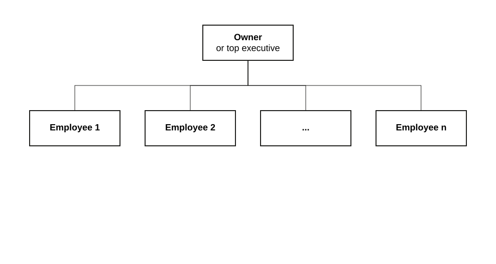{.fragment height="420"}

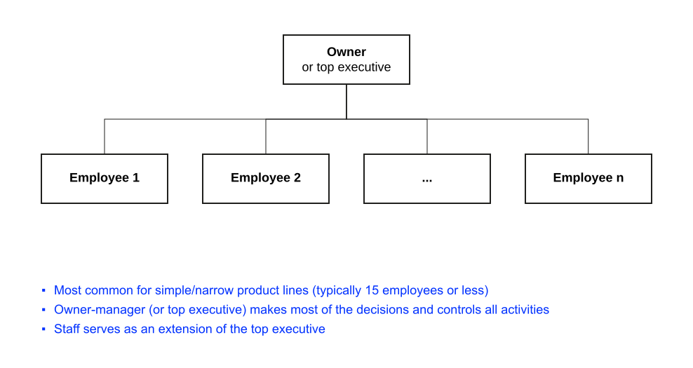{.fragment height="420"}
:::

::: notes
{#fig-simple}

@fig-simple shows the form in its minimal version.

-   **Characteristics:** Minimal hierarchy, centralized decision-making, informal processes [@dess2014strategic]
-   **When appropriate:** Small, entrepreneurial organizations; early development stages; dynamic environments
-   **Advantages:** Quick decisions, flexibility, low costs, close relationships
-   **Disadvantages:** Limited scalability, over-reliance on few people, information overload at top
:::

## Functional Structure

::: {.r-stack .html-hidden}
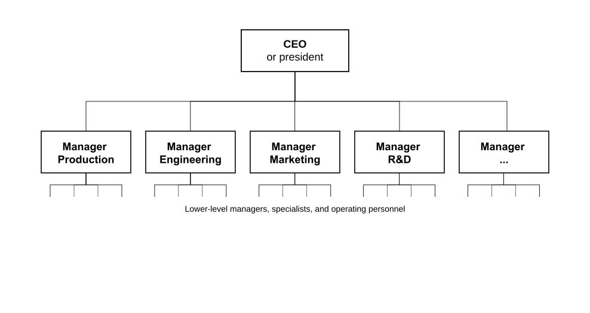{.fragment height="420"}

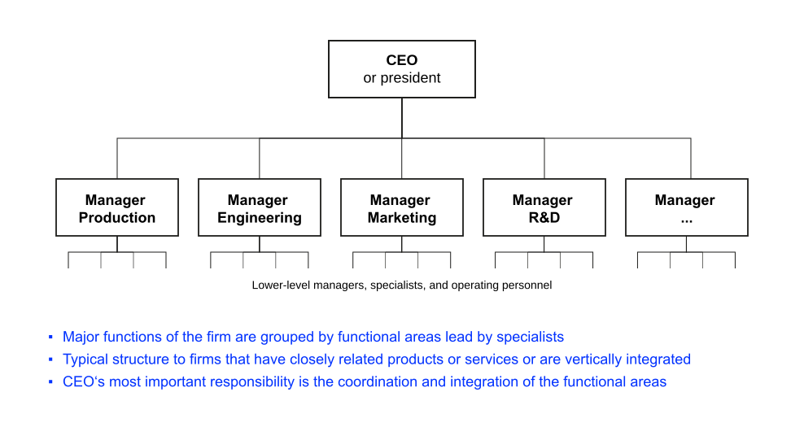{.fragment height="420"}
:::

::: notes
{#fig-functional}

@fig-functional shows the grouping by specialism.

-   **Characteristics:** Employees grouped by specialized functions, clear hierarchy, centralized decisions [@dess2014strategic; @david2016strategic]
-   **When appropriate:** Single product/service lines, stable environments, deep expertise needs
-   **Advantages:** High specialization, efficient resource use, clear roles, economies of scale
-   **Disadvantages:** Poor cross-functional coordination, slow market response, potential silos
:::

## Divisional Structure

::: {.r-stack .html-hidden}
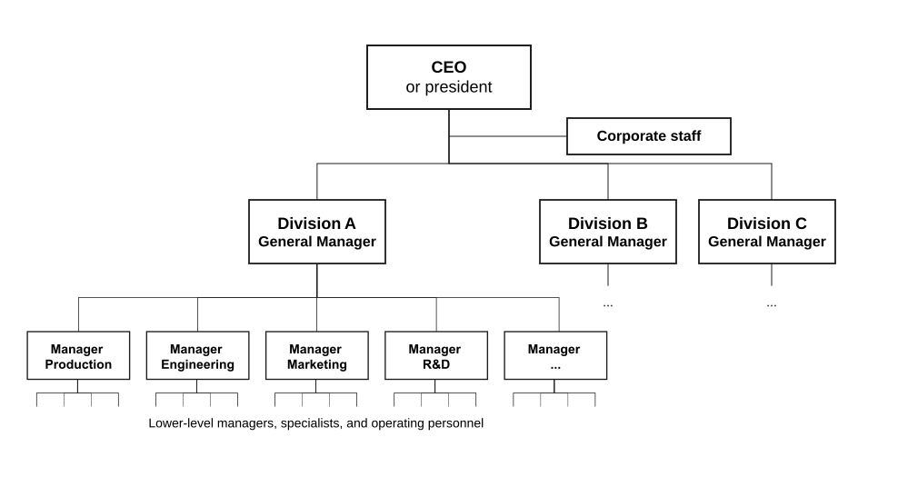{.fragment height="420"}

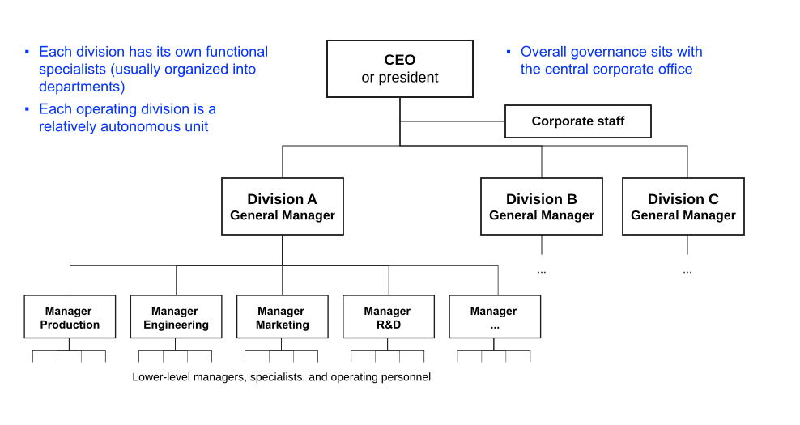{.fragment height="420"}
:::

::: notes
{#fig-divisional}

@fig-divisional shows the semi-autonomous units reporting to a corporate centre.

- **Characteristics:** Semi-autonomous units by product/market/geography, profit accountability [@dess2014strategic; @david2016strategic]
- **When appropriate:** Large diversified organizations, multiple markets/products, dynamic environments
- **Advantages:** Market focus, quick response, clear accountability, management development
- **Disadvantages:** Resource duplication, coordination challenges, increased costs
:::

## Discussion {.discussion-slide .html-hidden}

Philips historically operated with a divisional structure across multiple industries (lighting, healthcare, consumer electronics, semiconductors).

:::medium
What do you think were the advantages of this structure for Philips in the 1990s-2000s?
:::

:::medium
From your point of view, why did these turn into disadvantages?
:::



:::notes
Advantages in the 1990s-2000s:

- **Risk diversification:** multiple revenue streams protected against industry-specific downturns
- **Technology spillovers:** core competencies in electronics and optics transferred across divisions (lighting expertise → X-ray tubes → medical imaging)
- **Resource allocation flexibility:** profitable mature businesses (lighting, consumer electronics) funded emerging healthcare innovations 
- **Appropriate structural fit:** divisional structure matched organizational size and enabled decentralized accountability

Why advantages became disadvantages (2010s-2020s):

- **Technology synergies disappeared:** healthcare required specialized AI/software capabilities unrelated to consumer products; LED lighting diverged from medical imaging technology. 
- **Regulatory divergence intensified:** healthcare became heavily regulated (FDA, patient safety) while consumer products remained minimally regulated, creating incompatible governance requirements and risk profiles. 
- **Strategic focus dilution:** specialized competitors (Siemens Healthineers, GE Healthcare) outmaneuvered Philips. The CPAP crisis revealed the fatal cost: patient safety issues buried in silos because corporate leadership was distracted across multiple industries. 
- **Capital market penalty:** investors valued focused "pure plays" over conglomerates. Successful spin-offs (ASML, NXP, Signify) proved diversified Philips was worth less than sum of parts.
- **Coordination costs exceeded benefits:** Administrative overhead of managing 77,000 employees across unrelated businesses with duplicated functions outweighed any remaining synergies.

The divisional structure **lost strategic fit between structure and environment**. When technology platforms diverged, regulations intensified, and competition demanded specialization, diversification advantages evaporated while costs (complexity, diluted focus, governance challenges) amplified. Healthcare became a distinct industry requiring safety culture incompatible with consumer product management: what once enabled flexibility now created dangerous rigidity.
:::

## Matrix Structure

::: {.r-stack .html-hidden}
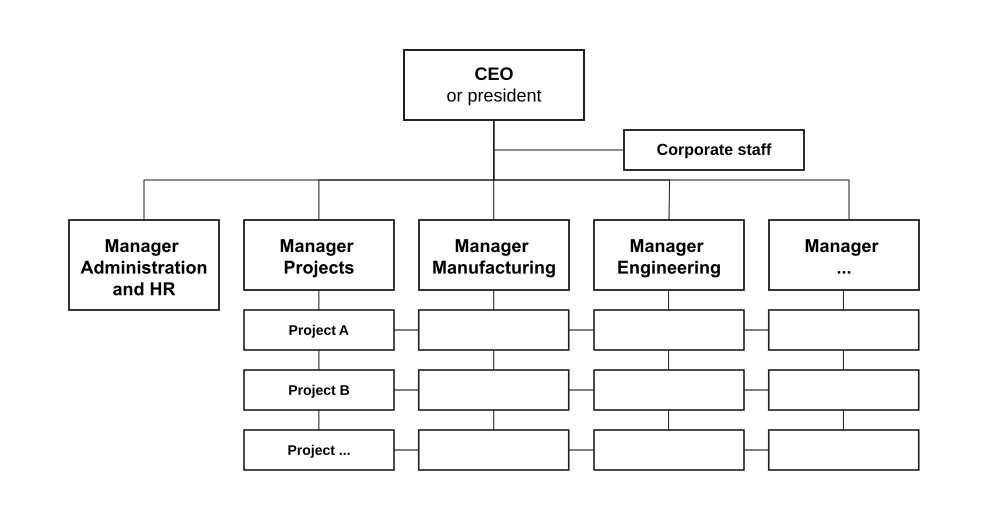{.fragment height="420"}

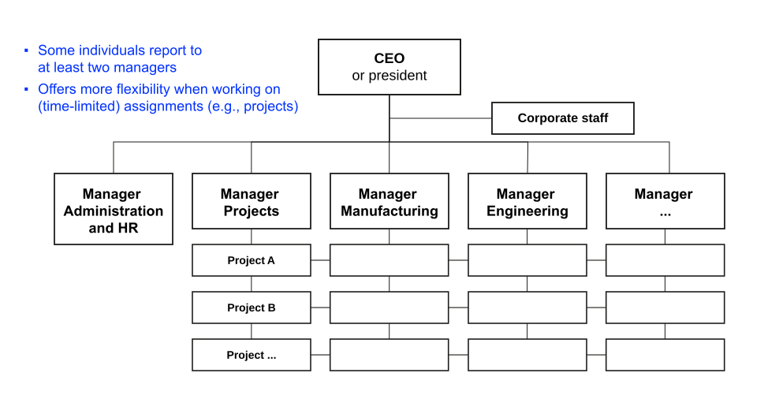{.fragment height="420"}
:::

::: notes
{#fig-matrix}

@fig-matrix shows the dual reporting lines that define the form.

-   **Characteristics:** Dual reporting relationships, shared authority, project-based teams [@dess2014strategic; @david2016strategic]
-   **When appropriate:** Complex projects, dynamic environments, need for specialization and integration
-   **Advantages:** Enhanced coordination, resource efficiency, flexibility, skill development
-   **Disadvantages:** Role ambiguity, complex decisions, high costs, potential conflicts
:::

## Strategic Business Units

:::: html-hidden
::: medium
Strategic business unit (SBU) structure represents [a hybrid approach]{.fragment .highlight-current-blue} that combines [divisional autonomy]{.fragment .highlight-current-blue} with [corporate portfolio management]{.fragment .highlight-current-blue} and [strategic coordination]{.fragment .highlight-current-blue}.
:::
::::

::: notes
Strategic Business Unit (SBU) structure is a variant of divisional structure where divisions are organized as semi-autonomous strategic business units, each responsible for a distinct business area [@hrebiniak2005making].

**Key characteristics**

-   Strategic autonomy: Each SBU operates as a separate business with its own strategy
-   Portfolio management: Corporate level manages portfolio of SBUs like investment portfolio
-   Resource allocation: Corporate allocates resources based on SBU strategic potential
-   Performance accountability: SBUs measured on strategic and financial performance

**Use cases**

-   Large diversified corporations with multiple distinct businesses [@goold1994corporate]
-   Businesses serving different markets with different competitive dynamics
-   Need for both business-level strategy focus and corporate-level synergies
-   Sufficient scale in each business to justify separate strategic management

**Advantages**

-   Clear strategic focus for each business unit
-   Enables portfolio optimization at corporate level
-   Facilitates resource allocation based on strategic priorities
-   Develops general management capabilities
-   Balances autonomy with coordination

**Disadvantages**

-   High administrative overhead and complexity
-   Potential for inter-SBU competition for resources
-   Risk of losing synergies between related businesses
-   Difficulty coordinating across SBUs when needed

**Examples:** General Electric's traditional SBU structure, Samsung's business group structure, 3M's business unit organization.

For comprehensive treatment of SBU management, see @goold1994corporate and @campbell1999synergy.
:::

## Discussion {.discussion-slide .html-hidden}

Philips spun off or sold multiple SBUs including Signify (lighting), ASML (semiconductors), and NXP (chips). These companies are now very successful independently.

:::medium
What did Philips gain and lose through this "de-diversification"?
:::

Compare this to companies like GE or Samsung that maintain SBU structures.



:::notes
Jakobs' philosophy captures the strategic shift: "It's not about where you do innovation, it's about the impact." Philips chose focus over breadth, betting that excellence in healthcare beats mediocrity across multiple industries. The restructuring trades diversification's safety for specialization's performance, accepting healthcare-only risk to gain execution excellence and unified purpose, essential in safety-critical industries where divided attention can be measured in lives lost.

**Gains**

Strategic clarity & execution:

- Clear identity as healthcare technology company enabling "simpler, leaner organization" (Jakobs' stated goal)
- Concentrated management attention: patient safety as unambiguous #1 priority (impossible when distracted by consumer electronics)
- €1.5 billion in cost savings since 2023 through elimination of cross-SBU administrative overhead

Organizational alignment:

- Structure now matches strategy: healthcare-only focus enables unified safety culture
- AI integration enterprise-wide: _"There is no single product in Philips that does not have AI"_; coherent technology strategy impossible in diversified structure
- Cultural transformation: 12-point engagement increase despite layoffs because "we were respectful and clear about why"; singular purpose enables clarity

Market performance:

- Unlocked shareholder value: spin-offs (ASML, NXP, Signify) worth more independently than within Philips
- Healthcare pure-play positioning in growth market vs. conglomerate discount

**Losses**

Risk & scale:

- Total dependence on healthcare market (e.g., no cushion from other industries during healthcare-specific downturns)
- Reduced overall scale and bargaining power

Strategic options:

- Committed to healthcare with limited pivot capability
- Lost diversification's traditional risk management benefits

:::

## Performance Implications

:::: html-hidden
::: medium
Different organizational structures create [distinct performance patterns]{.fragment .highlight-current-blue}: [efficiency vs. innovation trade-offs]{.fragment .highlight-current-blue}, [speed vs. coordination challenges]{.fragment .highlight-current-blue}, and [cost vs. flexibility implications]{.fragment .highlight-current-blue}.
:::
::::

::: notes
Research by @chandler1990scale and @burton2015organizational shows that different structures create distinct performance implications:

**Efficiency vs. innovation trade-offs**

-   Functional structures excel at operational efficiency but may limit innovation
-   Divisional structures promote innovation but can sacrifice economies of scale
-   Matrix structures balance both but at higher administrative costs

**Speed vs. coordination**

-   Simple structures enable rapid decisions but limit coordination capacity
-   Complex structures improve coordination but slow decision-making
-   Hybrid structures attempt balance but create role ambiguity

**Cost vs. flexibility**

-   Centralized structures reduce costs but limit local responsiveness
-   Decentralized structures increase flexibility but raise coordination costs
-   Network structures maximize flexibility but create dependency risks

**Measurement challenges**

-   Different structures require different performance metrics [@galbraith2014designing]
-   Financial measures may not capture innovation or learning benefits
-   Structural efficiency must be balanced with strategic effectiveness
-   Short-term costs of restructuring vs. long-term performance benefits

No structure is inherently superior. As organizational alignment suggests, performance depends on fit between multiple elements, particularly structure, strategy, and environment. Organizations must regularly assess whether their structure enables or constrains strategic objectives.
:::

## Structural Evolution Patterns

::: {.r-stack .html-hidden}
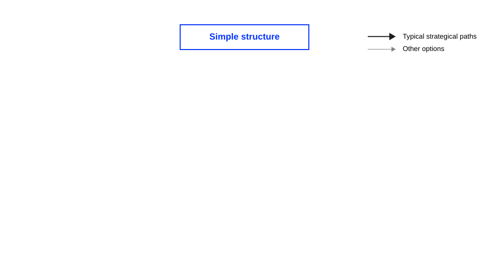{.fragment height="420"}

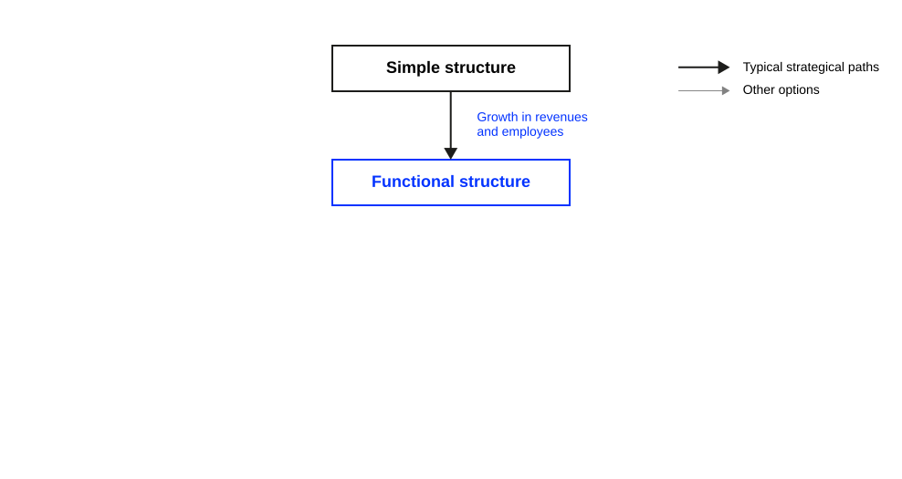{.fragment height="420"}

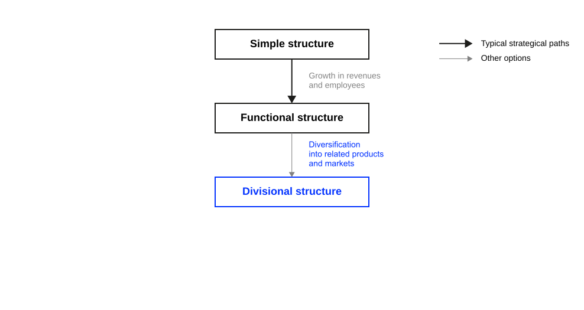{.fragment height="420"}

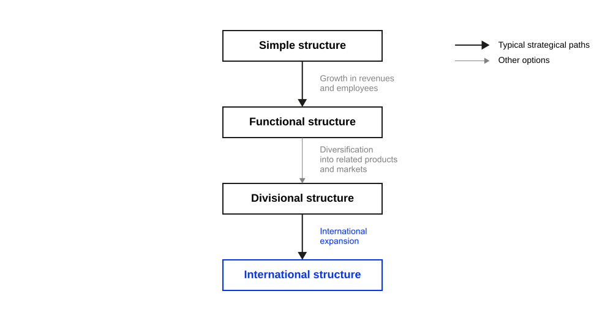{.fragment height="420"}

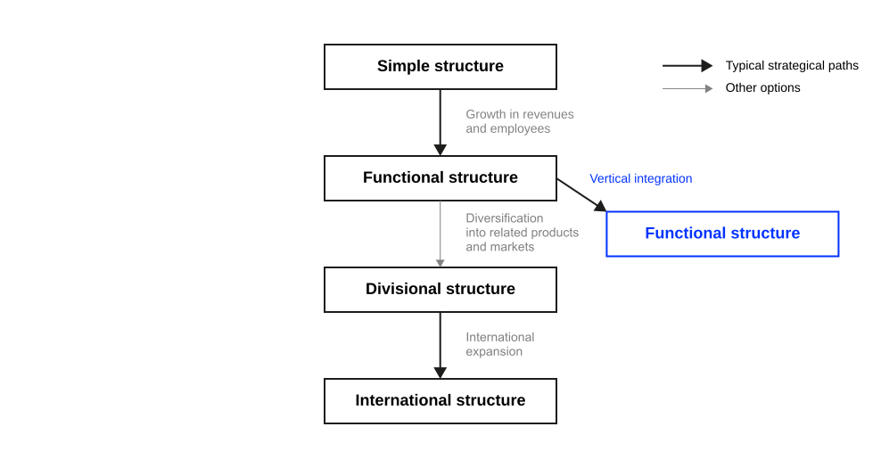{.fragment height="420"}

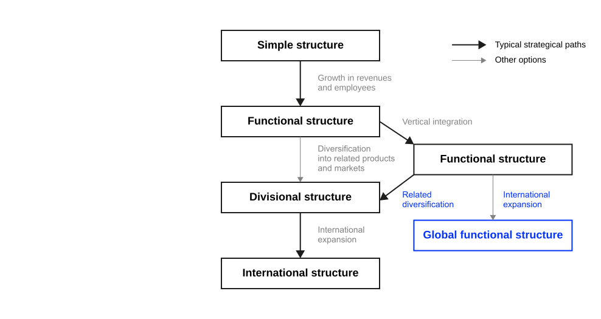{.fragment height="420"}

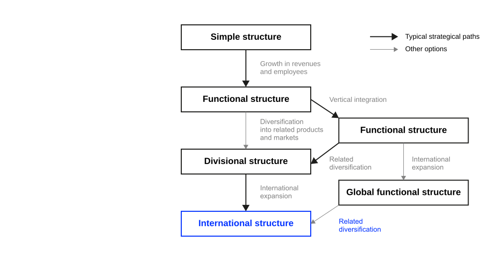{.fragment height="420"}

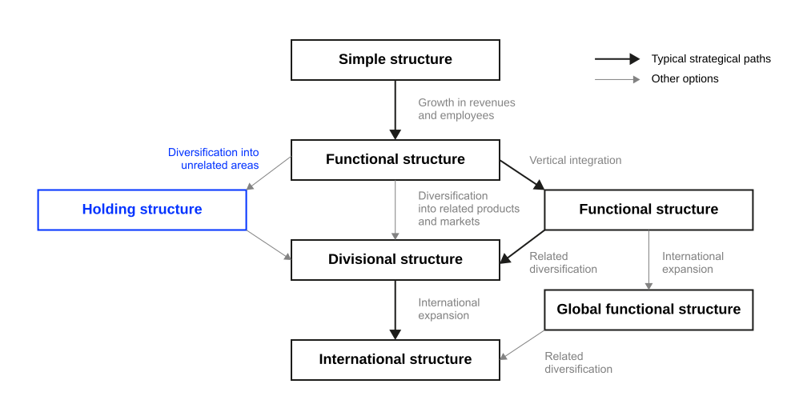{.fragment height="420"}

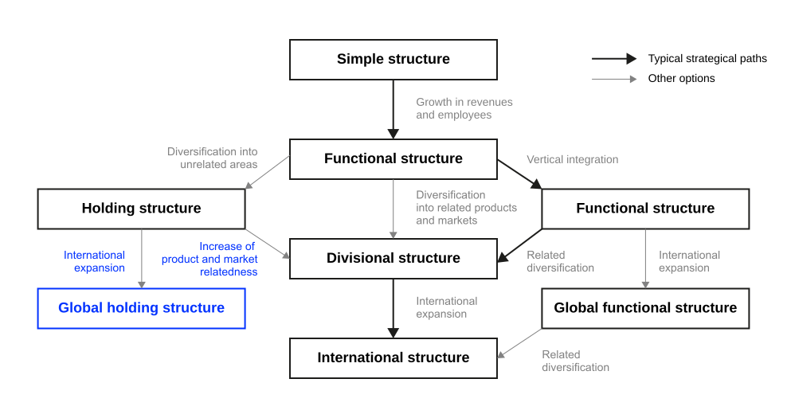{.fragment height="420"}

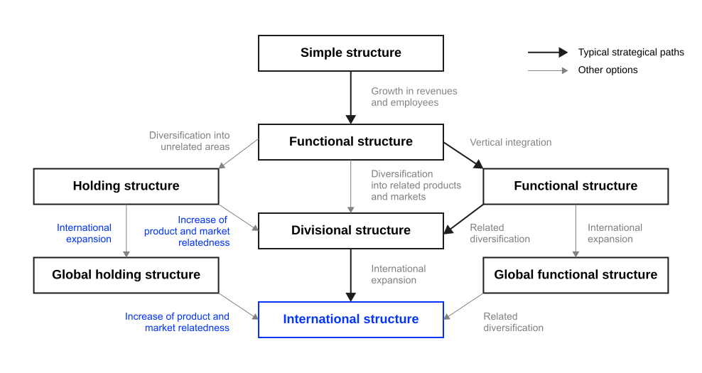{.fragment height="420"}
:::

:::: notes
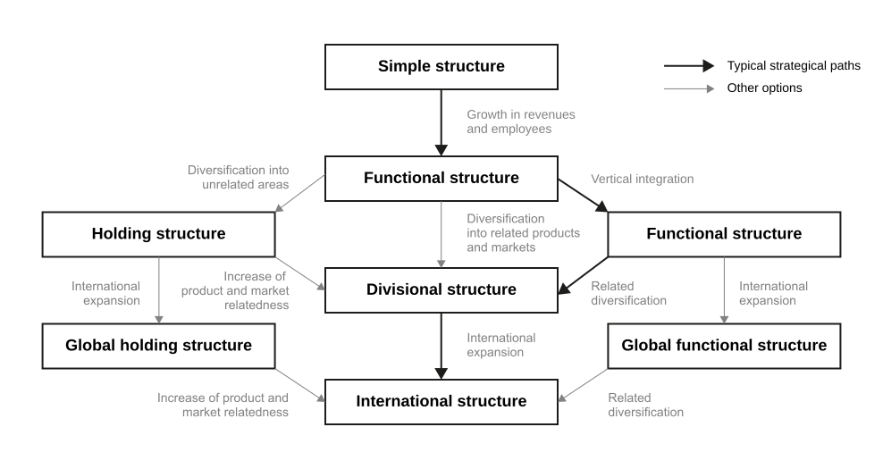{#fig-growth}

@fig-growth traces the paths large corporations take. Organizations typically evolve through predictable stages (simple → functional → divisional → matrix/hybrid) driven by size, strategy, environment, and complexity.

**Stage 1: simple structure**

-   Start-up phase with entrepreneurial leadership
-   Informal processes and direct supervision
-   Focus on survival and early growth

**Stage 2: functional structure**

-   Growing size requires specialization
-   Development of functional departments
-   Formalization of processes and procedures

**Stage 3: divisional structure**

-   Diversification creates need for divisional organization
-   Geographic expansion or product line growth
-   Decentralization of decision-making

**Stage 4: matrix/hybrid structures**

-   Complex environments require flexible structures
-   Multiple organizational dimensions (function, product, geography)
-   Advanced coordination mechanisms

**Driving forces for structural evolution**

1.  **Size:** Increasing size creates need for formalization and coordination
2.  **Strategy:** Strategic changes require structural adaptation
3.  **Environment:** Environmental complexity demands structural responses
4.  **Technology:** Technological changes influence optimal structure
5.  **Age:** Organizational maturity affects structural needs

The fourth driving force is the one that breaks the pattern. Size, strategy, environment, and age push a firm along the sequence toward a form it can settle into. Digital transformation does not: it asks a firm to run an efficient existing business and an exploratory new one at once, which no single stage of the sequence accommodates.
::::

# Structure x Digital Transformation {.headline-only}

## Leadership in Digital Transformation

:::: medium
:::{.fragment fragment-index=1}
Digital transformation (DT) puts both modes inside the technology function:
[the infrastructure the existing business runs on]{.fragment .highlight-current-blue fragment-index=1}
[and the material the new one is made of.]{.fragment .highlight-current-blue fragment-index=2}
:::
::::

:::: medium
:::{.fragment fragment-index=3}
The structural answer divides the mandate:
[CIOs evolving from operational to strategic]{.fragment .highlight-current-blue fragment-index=3}
[and CDOs leading transformation.]{.fragment .highlight-current-blue fragment-index=4}
:::
::::

::: notes
Exploiting a current business while building the next is a general organizational problem, not a digital one. Firms have faced it since the cases @chandler1962strategy studied. What digital transformation changes is where the problem lands.

Technology is at once the infrastructure the existing business depends on and the material the new business is made of, so both modes claim the same function, the same budget, and the same people. That is why a CDO is carved out against an incumbent rather than created in open space, and why the relationship between the two roles is contested in a way that opening a new product division is not [@lorenz2023perfect].

The demand itself is strategic: the firm decides to pursue both. Structure is what that decision is executed with, the same relation @chandler1962strategy described. Execution is hard because reliability and exploration reward opposite things. One is measured on uptime, cost, and compliance, the other on how quickly an unproven idea can be tested and discarded. Held inside one reporting line, the exploratory side predictably loses, because its returns arrive later and are easier to defer. @tushman2004organizational document exactly this at IBM, where emerging businesses had to be shielded structurally from the mature units whose resources they drew on.
:::

## Reflection {.unlisted .unnumbered .html-hidden .discussion-slide}

Form small groups of 3 to 4 students. Discuss your findings from reading @lorenz2023perfect. Prepare to present the key findings.

Your summary must include the following considerations:

-   the roles of CDO and CIO,
-   strategic reasons for introducing a CDO role,
-   the dynamics and challenges related to the relationship between CDOs and CIOs,
-   (structural) ambidexterity in relation to the roles of CIO and CDO,
-   and recommendations for the design and implementation of organisational structures that efficiently support digital transformation.



## Roles

The **Chief Information Officer (CIO)** [traditionally leads the IT department, ensuring technology infrastructure supports organizational goals. They manage data, information systems, and IT operations as well as they address cybersecurity, data privacy, and compliance with IT regulations [@lorenz2023perfect].]{.fragment}

. . .

The **Chief Digital Officer (CDO)** [is responsible for driving digital innovation and transformation across the organization. They often focus on enhancing customer experiences through digital channels and technologies. They collaborate across departments to integrate digital solutions into various aspects of the business [@lorenz2023perfect].]{.fragment}

. . .

::: medium
Both mandates run over the same systems, the same budget, and the same people.
:::

::: notes
The two mandates overlap by construction. A CIO is accountable for systems the business already depends on; a CDO is accountable for changing those systems faster than the CIO's reliability targets allow. Neither can deliver without drawing on the other's resources [@lorenz2023perfect].

This is worth separating from a personality account of the conflict. Tension between the roles is often described as a communication gap or a difference in outlook, and better communication does help at the margin. It does not resolve a disagreement about who controls a shared platform, who absorbs the cost of an outage caused by an experiment, or whose roadmap sets the release calendar. Those are allocation questions, and allocation is settled by structure: reporting lines, budget ownership, and decision rights.

The practical test for students: ask what would change if the two post-holders got on perfectly well. The coordination would improve; the contested decisions would remain.
:::

## Why a Separate Role

::: medium
A CDO is created [when the exploratory mandate needs its own reporting line]{.fragment .highlight-current-blue fragment-index="1"} [and its own budget to survive the incumbent's priorities]{.fragment .highlight-current-blue fragment-index="2"} [@lorenz2023perfect].
:::

::: notes
Firms do not appoint a CDO because digital work needs doing. Digital work was already being done, inside IT. They appoint one when that work keeps losing to operational priorities within the existing function, which it does for structural reasons rather than through anyone's neglect: an outage is visible this quarter, a forgone business model is not.

Giving the mandate a separate reporting line and a separate budget changes what can be deferred. @lorenz2023perfect find that the reporting level is the variable that matters most. A CDO reporting to the CEO can protect exploratory work against the operating plan; a CDO reporting into IT inherits the same pressures the role was created to escape, and the appointment changes a title without changing an allocation.

Two consequences worth naming in class:

- The role is often transitional. Once digital capability is distributed across the business, the separate mandate has less to protect, and several firms have folded the CDO back into an expanded CIO remit.
- A CDO without budget authority is the commonest failure mode, because the role then depends on persuading the function whose priorities it exists to counterbalance.
:::

## Structural Ambidexterity

:::: html-hidden
::: medium
Organizations need to balance [[exploitation]{.fragment .highlight-current-blue fragment-index="1"} (efficiency and optimization)]{.fragment fragment-index="1"} [and [exploration]{.fragment .highlight-current-blue fragment-index="2"} (innovation and new opportunities)]{.fragment fragment-index="2"} [through [structural mechanisms.]{.fragment .highlight-blue fragment-index="3"}]{.fragment fragment-index="3"}
:::
::::

:::: notes
**The ambidexterity challenge:** Organizations must simultaneously manage existing operations efficiently (i.e., *exploitation*) while exploring new opportunities for future growth (i.e., *exploration*). This creates tension between stability and change.

*Structural* ambidexterity resolves it by separation: exploration is placed in a unit with its own targets, metrics, and funding, held together at senior level rather than at the operating level. @tushman2004organizational trace the mechanism at IBM, where emerging businesses were run apart from the mature units and sponsored directly by senior management, because inside those units they lost every resource contest to businesses with nearer and more certain returns.

The alternative is *contextual* ambidexterity, where the same unit does both and individuals divide their own effort. It asks less of the org chart and more of the people, and it is the harder of the two to sustain under operational pressure.

### CIO-CDO Ambidexterity {visibility="hidden"}

**Exploitation focus (CIO-led)**

-   Operational efficiency and cost optimization
-   Stable, reliable IT operations and infrastructure
-   Process improvement and automation initiatives
-   Risk management, security, and regulatory compliance

**Exploration focus (CDO-led)**

-   Digital innovation and new opportunity identification
-   Experimental initiatives and pilot projects
-   Customer experience innovation and new touchpoints
-   New business model development and market entry

### Implementation Strategies {visibility="hidden"}

::: fragment
The roles are complementary: CIOs provide the technical foundation on which CDOs build business transformation [@lorenz2023perfect].
:::

1.  **Separate units:** Exploration is organizationally distinct from the operations it will eventually change
2.  **Senior sponsorship:** The separation is held at executive level, because that is the only level with authority over both sides [@tushman2004organizational]
3.  **Protected budget:** Exploratory funding is ring-fenced rather than competing against operational line items
4.  **Distinct metrics:** The exploratory unit is measured on learning and option value, not on the efficiency targets that govern the core
5.  **Shared platforms:** Common technology is used by both, with explicit rules on who controls change to it

Items 2 and 3 are what separate structural ambidexterity from a renamed project team. Without them the exploratory unit exists on the chart and loses in the budget round.
::::

## Discussion {.unlisted .unnumbered .html-hidden .discussion-slide}

:::medium
Jakobs states *"There is no single product in Philips that does not have AI"* while simultaneously emphasizing patient safety as the #1 priority. 
:::

- How is Philips balancing exploration (AI innovation) with exploitation (safety, reliability, regulatory compliance)? 
- What structural mechanisms enable this ambidexterity? 
- What are the risks of getting this balance wrong in healthcare?



:::notes
**Simultaneous dual focus:** AI integration across all products while establishing "patient safety is #1 priority" as non-negotiable foundation. Jakobs avoids overcorrection, explicitly stating he's "not aiming for 100% no-failure rate, which would prevent many new product launches," recognizing excessive safety focus kills innovation.

Structural mechanisms enabling ambidexterity:

**Separate but coordinated leadership**

- Chief Patient Safety and Quality Officer (exploitation) reports directly to CEO, ensuring compliance
- Innovation leadership (exploration) drives AI integration
- CEO personally bridges both functions

**Integration processes**

- Regular forums reviewing "process and product performance"
- Time for employees to reflect on "how their day-to-day activities trickle down to patient safety"
- Open problem discussion forums preventing safety concerns from being suppressed

**Use-case validation**

- "You need to understand the use case very well...get closer to the practice to really see what the innovations do," grounding AI development in clinical realities

Risks of getting this balance wrong:

- Over-exploitation (safety paralysis): Beneficial AI tools never reach patients; competitors deploy superior diagnostics
- Over-exploration (innovation recklessness): The CPAP crisis demonstrated the catastrophic cost: 500+ deaths when safety was insufficient. In healthcare, errors are irreversible, trust-destroying, and heavily regulated (FDA can shut down entire product lines). 
 
Philips' lesson: **make safety the enabler of innovation.** As Jakobs notes, four streams must align: "Technology, clinical practice, financial regime, and regulatory environment"; innovation without regulatory approval is worthless, and safety without innovation is stagnation.

:::

# Structural Transitions {.headline-only}

## Prologue

:::: html-hidden
::: medium
Most successful firms [experience [periods of convergence]{.fragment .highlight-current-blue fragment-index=1}]{.fragment fragment-index=1} [with [incremental changes]{.fragment .highlight-current-blue fragment-index=2}]{.fragment fragment-index=2} [followed by [periods of upheaval]{.fragment .highlight-current-blue fragment-index=3}]{.fragment fragment-index=3} [with [major system-wide transformations]{.fragment .highlight-current-blue fragment-index=4} [@mintzberg2014strategy].]{.fragment fragment-index=4}
:::
::::

::: notes
> As the fit between strategy, structure, people and processes is never perfect, most successful firms go through **periods of convergence** --- in which they make only incremental changes, followed by **upheaval** -- in which they carry out major, system-wide changes or reorientations, to adapt to environmental shifts. @mintzberg2014strategy
:::

## Periods of Convergence

:::: html-hidden
::: medium
In convergent periods [[stable and interconnected social systems]{.fragment .highlight-current-blue fragment-index=1} emerge,]{.fragment fragment-index=1} [in which [the most successful and resilient actors maintain their position]{.fragment .highlight-current-blue fragment-index=2}]{.fragment fragment-index="2"}.
:::
::::

::: notes
Convergence starts with effective integration of strategy, structure, people and processes, characterized by incremental change.

Convergent periods create stability but can also create inertia that makes future change more difficult, as it may lead to overconfidence and reduced flexibility (less vigilance, greater resistance to change).

**Focus in periods of convergence**

-   Refining policies, methods, and procedures
-   Creating specialized units and linking mechanisms
-   Developing personnel suited to present strategy
-   Fostering commitments to company mission and departmental excellence
-   Promoting confidence in accepted norms, beliefs, and myths
-   Clarifying roles, power, status, dependencies, and allocation mechanisms
:::

## Periods of Upheaval

:::: html-hidden
::: medium
Periods of upheaval with frame-breaking change [occurs in response to [major environmental shifts]{.fragment .highlight-current-blue fragment-index=1}]{.fragment fragment-index=1} [and involves [revolutionary transformation]{.fragment .highlight-blue fragment-index=2} of organizational systems.]{.fragment fragment-index=2}
:::
::::

:::: fragment
The need for discontinuous change usually springs from [@mintzberg2014strategy]:

::: incremental
-   **Industry discontinuities** (emergence of substitutes, new technologies)
-   **Product life-cycle shifts** (moving between emergence, growth, maturity, decline)
-   **Internal company dynamics** (leadership changes, ownership shifts, strategic reorientation)
:::
::::

::: notes
Frame-breaking change represents revolutionary changes *of* the system, as opposed to incremental changes *in* the system [@mintzberg2014strategy].

**Scope of frame-breaking changes**

-   Reformed mission and core values
-   Altered power and status relationships
-   Comprehensive reorganization
-   Revised interaction patterns and communication flows
-   Introduction of new executives and leadership

**Triggers**

1.  **Industry discontinuities:** New technologies disrupting existing business models, emergence of substitute products, regulatory changes
2.  **Product life-cycle shifts:** Moving from growth to maturity phases, market saturation, changing customer needs
3.  **Internal dynamics:** Changes in ownership, leadership transitions, strategic reorientation, performance crises

**Characteristics**

-   Rapid, comprehensive transformation rather than gradual evolution
-   Affects multiple organizational elements simultaneously
-   Often requires external leadership or fresh perspectives
-   Creates discontinuity with past practices and structures
-   Involves higher risk but potentially higher rewards

Diagnosing which of the two a situation calls for is the decision that separates managed transformation from forced transformation [@mintzberg2014strategy].
:::

## Leadership Requirements

::: medium
[Convergence periods require [maintaining alignment and incremental adjustment]{.fragment .highlight-current-blue fragment-index=1}]{.fragment fragment-index=1} [while frame-breaking change demands [comprehensive executive involvement and fresh perspective.]{.fragment .highlight-current-blue fragment-index=2}]{.fragment fragment-index=2}
:::

::: notes
**Leadership during convergence**

-   Focus on maintaining congruence and fit within the organization
-   Re-emphasize strategy, mission, and core values
-   Monitor external environment for opportunities and threats
-   Make incremental adjustments to maintain alignment
-   Build organizational capabilities and cultural strength

**Leadership during upheaval**

-   Direct executive involvement in all aspects of transformation
-   Specification of new strategy, structure, people, and processes
-   Development of comprehensive implementation plans
-   Communication of vision and rationale for change
-   Management of resistance and cultural transformation

Different types of change require fundamentally different leadership approaches. Leaders must diagnose whether situation calls for convergence or frame-breaking approach and adapt their style accordingly.
:::

# Key Takeaways

::: incremental
-   **Organizational alignment** means design variables that are consistent with one another and fitted to the firm's size and environment.
-   **The 7S framework** supplies the diagnostic: seven elements that must reinforce one another, and the one out of line is where realignment starts
-   **Structure follows strategy,** but it follows late, usually only once declining performance has made the mismatch impossible to ignore
-   **Integration strategies add differentiated units,** which raises the coordination load that rules, budgets, committees, and liaison roles exist to carry
-   **Five structure types** trade efficiency against innovation, speed against coordination, and cost against flexibility, and firms move between them predictably as size and strategy change
-   **Structural ambidexterity** separates exploitation from exploration so both can be managed at once, which is the design problem behind the CIO and CDO roles
-   **Convergence alternates with upheaval,** and the leadership task is diagnosing which of the two you are in before the environment decides for you
:::

# Review and Consolidation {.scrollable}

The following questions are designed to review and consolidate what you have learned and are a good starting point for preparing for the exam.

::: smaller
-   Explain the concept of organizational alignment and distinguish internal consistency of design variables from their fit with organizational context.
-   Relate the 7s framework to the concept of organizational alignment.
-   List reasons why firms with a high degree of organizational alignment are better able to adapt to changes in their external environment, are more resilient to threats and better able to capitalize on emerging opportunities.
-   Do research on *Strategic Business Unit* (SBU) structure and explain the difference between a SBU structure and a divisional organizational structure.
-   Discuss advantages and disadvantages of a functional versus a divisional organizational structure.
-   Compare and contrast the roles of Chief Information Officer (CIO) and Chief Digital Officer (CDO) in an organization. How do their responsibilities contribute to strategy formation and strategy implementation?
-   Define and elaborate on the concept of structural ambidexterity in the context of CIO and CDO roles. How can organizations achieve a balance between exploitation and exploration in their structures?
-   How can organizational structures be designed to facilitate effective collaboration between different functional areas?
:::

# Homework

Read @barnett2012does and make notes on following questions:

:::smaller
- What are the primary objectives of Barnett and Salomon's study regarding CSR and financial performance?
- How do the authors measure CSR and financial performance in their study?
- What are the main findings of the study regarding the relationship between CSR and financial performance?
- Were there any unexpected or counterintuitive results in the research findings? How do these findings contribute to the understanding of CSR in strategic management?
- How can the findings of this study inform strategic management practices?
:::

# Q&A {.html-hidden .unlisted .headline-only background-image="../assets/bg.jpg"}

# Literature

::: {#refs}
:::