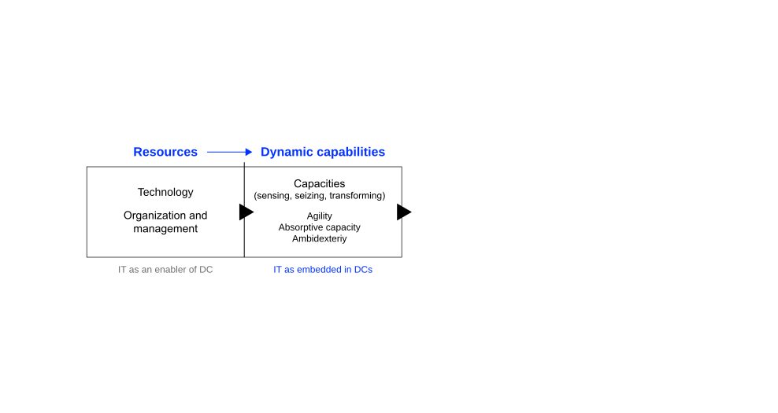
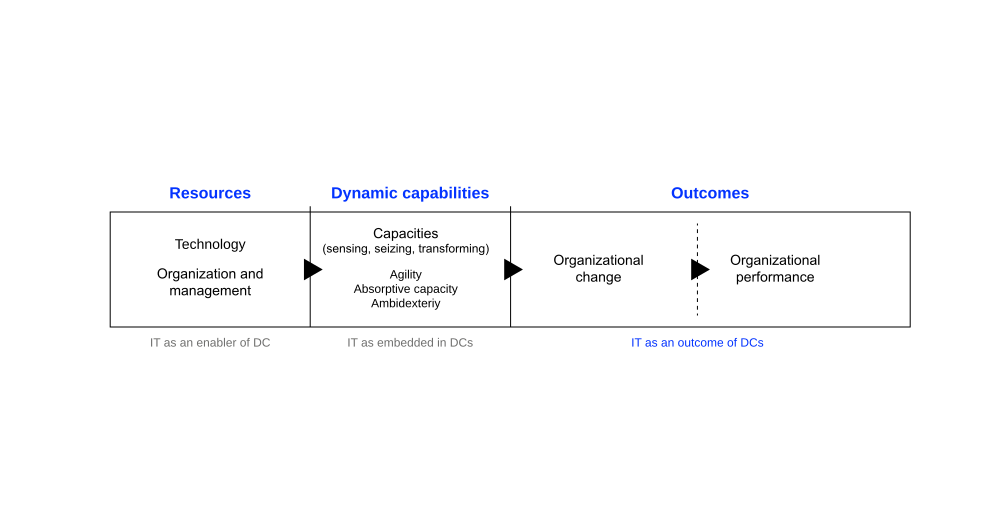
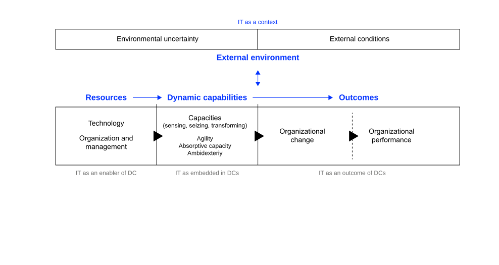
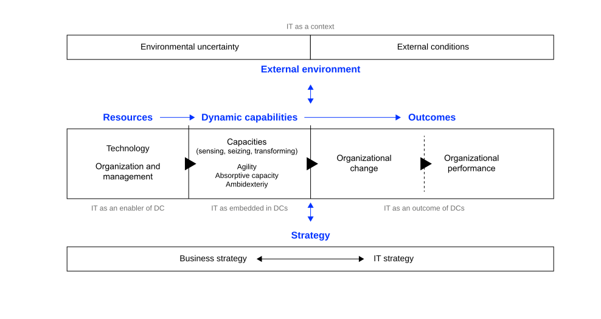
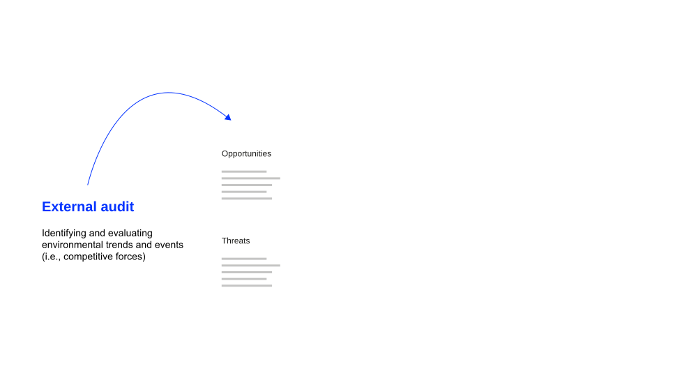
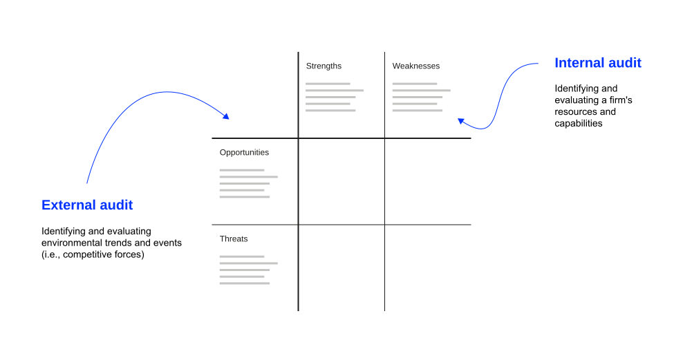
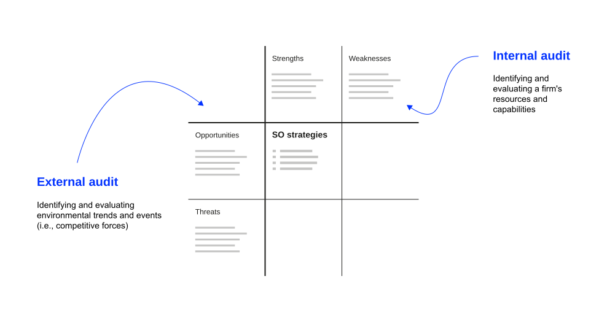
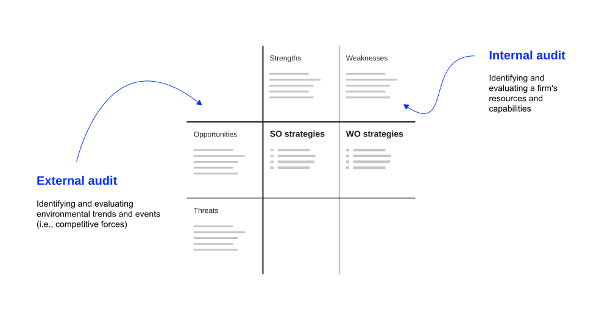
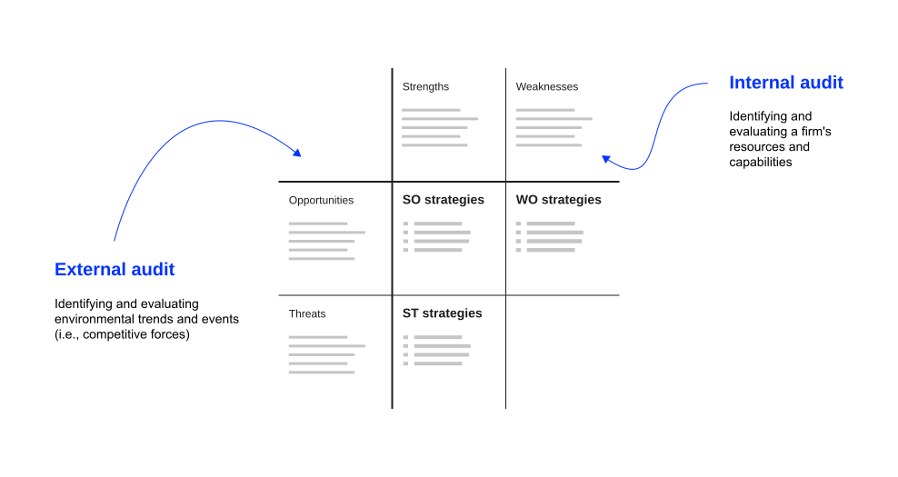
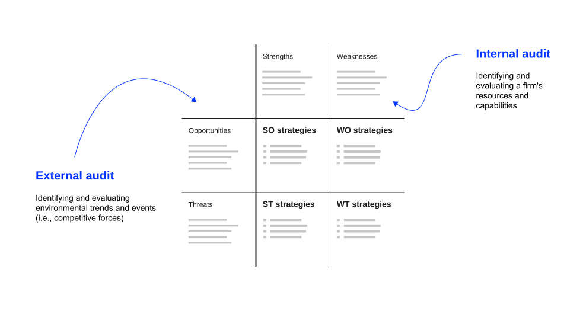

:::{.content-visible when-format="revealjs"}

# Agenda

:::medium
- Reflection & objectives [10 min]{.smaller}
- Internal audit & key resources [35 min]{.smaller}
- RBV & VRIO [35 min]{.smaller}
- [Break]{.highlight} [15 min]{.smaller}
- Culture x VRIO [20 min]{.smaller}
- Mini case: TSMC [25 min]{.smaller}
- Dynamic capabilities & SWOT [15 min]{.smaller}
- SWOT framework [20 min]{.smaller}
- Wrap-up & Q&A [10 min]{.smaller}
:::

:::

# Reflection {.unlisted .unnumbered .html-hidden .discussion-slide}

Before we start: Any questions or comments regarding the competition and positioning concepts discussed last week?

# Learning Objectives

After this section, you should have a solid understanding of

::: incremental
-   the nature and purpose of an internal audit in formulating strategies;
-   major internal factors that impact competitive advantage;
-   the role of organizational culture as a resource that is difficult to imitate;
-   the tenets of the resource-based view and dynamic capabilities;
-   the construction and application of the Strengths-Weaknesses-Opportunities-Threats (SWOT) matrix;
-   how internal resources create sustainable competitive advantage.
:::

# Internal Perspective {.headline-only}

## Internal Audit

:::: html-hidden
::: medium
Assessing a firm's [strengths and weaknesses]{.fragment .highlight-blue} so that strategies can be formulated that [capitalize on internal strengths]{.fragment .highlight-blue} and [overcome weaknesses]{.fragment .strike}.
:::
::::

::: notes
The internal audit focuses on identifying and evaluating a firm's strengths and weaknesses in the functional areas of business, including management, marketing, finance, accounting, production/operations, research and development (R&D), and management of IT/the digital [@david2016strategic].

All organizations have strengths and weaknesses in the functional areas of business. No enterprise is equally strong or weak in all areas. Internal strengths and weaknesses, coupled with external opportunities and threats provide the basics for strategic planning. Objectives and strategies are established with the intention of capitalizing on internal strengths and overcoming weaknesses.
:::

## Key Resources

Key internal areas/resources an internal assessment should focus on:

:::: html-hidden
::: medium
[Tangible resources,]{.fragment .fade-in-then-semi-out} [intangible resources,]{.fragment .fade-in-then-semi-out} [organizational capabilities,]{.fragment .fade-in-then-semi-out} [competitive assets,]{.fragment .fade-in-then-semi-out} [knowledge management,]{.fragment .fade-in-then-semi-out} [strategic flexibility,]{.fragment .fade-in-then-semi-out} [technology]{.fragment .fade-in-then-semi-out} [as well as culture & values.]{.fragment .fade-in-then-semi-out}
:::
::::

::: notes
**Tangible resources**

-   Financial resources: the firm's financial strength, including cash reserves, profitability, and access to capital
-   Physical assets: the firm's physical assets such as manufacturing facilities, real estate, equipment, and inventory

**Intangible resources**

-   Intellectual property: assets including patents, trademarks, copyrights, and proprietary technology
-   Brands and reputation: brand equity and reputation of the firm within its industry and among consumers
-   Human capital: the skills, knowledge, and expertise of the firm's employees, including leadership and talent management

**Organizational capabilities:**

-   Innovation and R&D: the firm's capacity for innovation, research and development capabilities, and the ability to bring new products or services to market
-   Operational efficiency: the efficiency of the firm's operational processes, supply chain management, and cost control measures
-   Marketing and sales: the firm's marketing strategies, customer relationships, and sales capabilities

**Competitive assets:** 

- Strategic partnerships: strategic alliances, partnerships, and collaborations that provide unique competitive advantages 
- Exclusive contracts: exclusive contracts or agreements that offer preferential treatment or access to key resources 
- Market position: the firm's position within its target markets and industry, including market share and market dominance

**Knowledge management:** 

- Knowledge repository: the firm's ability to capture, share, and apply knowledge effectively across the organization 
- Learning organization: culture of continuous learning, adaptation, and knowledge creation

**Strategic flexibility:** 

- Adaptability: the firm's ability to adapt to changing market conditions, competitive threats, and external disruptions 
- Resource mobility: ability to reallocate resources strategically to exploit emerging opportunities or address weaknesses

**Technological capabilities:** 

- Information systems: the quality and effectiveness of the firm's information systems, data analytics capabilities, and technology infrastructure 
- Digital capabilities: the firm's readiness to leverage digital technologies for competitive advantage

**Culture and values:** 

- Corporate culture: the organizational culture and values that influence decision-making, employee behavior, and innovation
- Shared assumptions: the tacit beliefs that guide behavior where no rule or process applies
- Ethical reputation: the firm's ethical practices, corporate social responsibility, and its impact on reputation
:::

## Culture as Resource

::: large
> Culture eats strategy for breakfast. *Widely attributed to Peter Drucker; no documented source exists*
:::

::: fragment
::: html-hidden
Culture is the eighth category of the internal audit. Shared assumptions, norms, and behaviors are **socially complex and costly to imitate,** which makes culture a candidate for sustained competitive advantage.
:::
:::

::: notes
The sentence is widely attributed to Peter Drucker. The Drucker Institute has confirmed that he neither wrote nor said it; the earliest close match appears in a trade magazine in September 2000, and Mark Fields popularized the line at Ford in the early 2000s. Drucker's documented claim is narrower: corporate culture, "no matter how defined, is singularly persistent" [@drucker1991dont]. Persistence matters for strategy in two ways. It limits how fast a firm can change direction, and it makes culture costly for competitors to replicate.

As discussed, [strategy as perspective](../definition/index.qmd#strategy-as-perspective) describes strategy as an ingrained way of perceiving the world, a collective intuition shared by members of the organization, which @mintzberg1987strategy notes can also be called culture or ideology. The [cultural school](../definition/index.qmd#schools-of-strategy) of strategy formation treats strategy as a social process grounded in collective culture and shared belief [@mintzberg2014strategy]. This unit places culture inside the internal audit and evaluates it like any other resource.
:::

### Three levels of culture

@schein2010organizational distinguishes three levels:

:::incremental
-   **Artifacts:** visible structures, processes, and behaviors, including office design, rituals, dress, and slogans. Observable by anyone, including competitors.
-   **Espoused values:** stated strategies, goals, and philosophies, usually published in value statements and career pages.
-   **Basic underlying assumptions:** unconscious, taken-for-granted beliefs that determine actual behavior. Rarely articulated, often not consciously known to members.
:::

:::fragment
**Basic underlying assumptions carry the inimitability.** Competitors can copy artifacts and value statements within months. Underlying assumptions form through shared history and cannot be purchased.
:::

:::notes
National culture is a different level of analysis [@hofstede2010cultures]; firms in the same country develop markedly different organizational cultures.

[Strategic consequences]{.h4}

-   **An organization's culture influences how employees behave, make decisions, and interact with one another.** If a strategic plan contradicts cultural norms or values, employees are likely to prioritize cultural consistency over strategic alignment.
-   **Culture can either enable or constrain the execution of strategic initiatives.** A supportive culture aligns with the strategy, fosters commitment, and drives performance. Conversely, a culture that resists change or lacks alignment can hinder even the most well-conceived strategy.
-   **Leaders play a crucial role in shaping and aligning culture with strategy.** Effective leaders understand the culture's impact and work to foster a culture that supports the strategic vision.
-   **Successful organizations integrate culture and strategy.** They develop strategies that not only consider external market dynamics but also respect and leverage the existing culture.

**Implications** [@david2016strategic]:

- Strategies that require fewer cultural changes may be more attractive because extensive changes can take considerable time and effort
- Political maneuvering consumes valuable time, subverts organizational objectives, diverts human energy, and results in the loss of some valuable employees
- Political biases and personal preferences get unduly embedded in strategy choice decisions
:::

# Resource-Based View {.headline-only}

## Reading Takeaways {.html-hidden .unlisted .discussion-slide}

Form small groups of *3–4 students* and discuss what you have learned about the *Resource-Based View (RBV)* from 
reading @peteraf1993cornerstones and clarify issues of understanding. Focus on following questions:

1. How can the RBV's key tenets be summarized\
   (i.e., main concepts, definitions, and underlying logic).
2. What are key implications for strategic management?



## Key Assumptions

::::fragment
:::large
The RBV contends that [internal resources]{.fragment .highlight-current-blue} are critical for achieving and sustaining [competitive advantage]{.fragment .highlight-current-blue}, even more important than the environment.
:::
::::

::: notes
Understanding the sources of competitive advantages calls for an analysis of not only the company's environment (opportunities and threats), but its own/internal strengths and weaknesses as well [@barney1995looking].

This point is clearly highlighted when we consider the success achieved by companies such as WalMart, Southwest Airlines and Nucor Steel, despite unfavorable environments.

A firm's internal attributes, its resources and capabilities, include all the financial, physical, human and organisational assets used by a firm to develop, manufacture and deliver products/services to its customers.

Resources and capabilities that cannot be readily matched by competitors are referred to as **distinctive competencies**. 
:::

## VRIO Framework

:::: html-hidden
::::fragment
:::large
To create [sustained competitive advantage]{.fragment .highlight-blue}, resources must be [valuable]{.fragment .highlight-current-blue}, [rare]{.fragment .highlight-current-blue}, [inimitable/non-substitutable]{.fragment .highlight-current-blue}, and [organizationally supported]{.fragment .highlight-current-blue} [@barney1995looking].
:::
::::
::::

::: notes

#### The Question of Value {visibility=hidden}

Resources must provide value to the organization and enable it to exploit opportunities or defend against threats. They should contribute to the firm's ability to create or deliver products/services, reduce costs, or increase revenues [@barney1995looking].

Managers need to check if the firm's resources and capabilities enable it to exploit opportunities and/or neutralize threats:

- Managers should be able to evaluate/distinguish resources and capabilities
- Managers should identify resources and capabilities that add value from those that do not
- Managers should identify resources and capabilities that may be less valuable in the future due to changes in environmental factors
- Managers should identify resources and capabilities that are valuable because they can be applied in new ways

#### The Question of Rareness  {visibility=hidden}

Resources should be rare or uncommon in the industry or among competitors. If a resource is widely available or easily replicable, it is less likely to provide a competitive advantage [@barney1995looking].

Therefore, managers need to assess the resources and capabilities that are considered valuable based on how many competing companies already have them:

- If a valuable resource or capability is controlled by several competing firms, it forms a source of competitive parity
- Resources or capabilities that are valuable and rare among competing firms form sources of competitive advantage

#### The Question of Imitability {visibility=hidden}

Resources must be difficult for competitors to imitate or replicate. This can be due to factors like unique capabilities, proprietary knowledge, complex relationships, or a combination of elements that are hard to duplicate. In addition, there should be no readily available substitutes [@barney1995looking].

Thus, managers need to check if firms without a resource or capability face a cost disadvantage in obtaining it:

- If a firm possesses valuable and rare resources or capabilities, it can gain at least a temporary competitive advantage
- If competing firms face a cost disadvantage in trying to imitate these resources/capabilities, then it leads to a sustained competitive advantage
- Imitation can occur through duplication or substitution; socially complex resources are much more difficult to imitate than physically complex resources. Organizational culture is the standard example (see [Culture Through VRIO](index.qmd#culture-through-vrio))

#### The Question of Organization  {visibility=hidden}

The organization and management of these resources play a crucial role in determining whether they can truly provide sustainable competitive advantages. Even if a resource possesses the VRIN attributes, it must be strategically deployed within the organization [@barney1995looking].

Thus strategic management needs to evaluate if a firm is organised to exploit the full competitive potential of its resources and capabilities:

- A firm must be appropriately organised, in order to fully realise the potential for competitive advantage.
- The firm's complementary resources (formal reporting structure, management control systems or compensation policies) are relevant for a firm to realize competitive advantage.
- To create sustained competitive advantage, managers must look inside their firms for valuable, rare and costly-to-imitate resources, and then exploit them through proper organisation.
:::

## Limits to Competition

:::: html-hidden
::: large
@peteraf1993cornerstones identifies [ex-ante and ex-post limits]{.fragment .highlight-blue} to competition that are crucial for [sustaining competitive advantage]{.fragment .highlight-blue}.
:::
::::

::: notes
@peteraf1993cornerstones uses the terms *ex-post* and *ex-ante* to describe different types of limits to competition:

**Ex-post limits to competition** are barriers that protect competitive advantage *after* it's been established. They preserve the sustainability of rents (profits) by making it difficult for competitors to imitate or substitute resources and by preventing competitive forces from eroding the firm's advantage. Examples are patents, complex social relationships, and causal ambiguity that make it hard for competitors to replicate a successful firm's capabilities. Culture is a frequent source of the latter two: competitors observe what a firm does without identifying which underlying assumptions make it work (see [Culture as Resource](index.qmd#culture-as-resource)).

*Example:* A pharmaceutical company develops a new drug. Ex-post limits include patents making it legally difficult for competitors to produce the same drug, proprietary knowledge about formulation and manufacturing, strong brand loyalty among consumers and healthcare providers, and rigorous regulatory approvals that competitors would need to achieve.

**Ex-ante limits to competition** refer to barriers that exist *before* a firm establishes a superior position. These limits ensure that costs don't offset the potential benefits of a strategic position. They limit competition for a position before any firm has established it, prevent the costs of acquiring resources from consuming all future profits.

*Example:* A tech company acquiring a patent for groundbreaking technology. Ex-ante limits include information asymmetry (better information about patent value), first-mover advantage (acting quickly before others), and unique complementary assets that make the patent more valuable to them than to competitors.

Together, these limits ensure that firms can acquire resources at costs below their ultimate value (ex-ante) and maintain their competitive advantage once established (ex-post).
:::

## Culture X VRIO

::::: html-hidden
::: medium
Culture is the standard example of a [socially complex]{.fragment .highlight-current-blue} resource:
:::

::: medium
[Valuable:]{.fragment .fade-in} [guides behavior where no process applies]{.fragment .fade-in-then-semi-out}\
[Rare:]{.fragment .fade-in} [assumptions form through specific shared history]{.fragment .fade-in-then-semi-out}\
[Inimitable:]{.fragment .fade-in} [competitors copy artifacts, not assumptions]{.fragment .fade-in-then-semi-out}\
[Organized:]{.fragment .fade-in} [sustained by hiring, reward, and promotion]{.fragment .fade-in-then-semi-out}
:::
:::::

::: notes
Applying @barney1995looking to culture turns a general claim about its importance into a testable one.

-   **Value:** Culture determines behavior in situations no rule anticipates, which is where most operational decisions are actually made.
-   **Rareness:** Underlying assumptions form through a specific history of shared problem-solving, so two firms in the same industry rarely hold the same ones.
-   **Imitability:** The three levels differ sharply here. Artifacts and espoused values are published and copied within months; basic underlying assumptions cannot be bought, and competitors frequently cannot identify which of them produce the observed performance. This is exactly the causal ambiguity @peteraf1993cornerstones lists among ex-post limits.
-   **Organization:** Culture delivers advantage only when hiring, reward, and promotion systems reproduce it. A stated value nobody is promoted for is an artifact.

Culture also shows why the ex-ante and ex-post distinction matters. No firm bids for a culture on an open market, so there is no acquisition cost to offset the rents, an ex-ante limit by default, while social complexity and causal ambiguity supply the ex-post limits.

The limits are symmetric. The same persistence that blocks imitation blocks redirection, which is why strategies requiring extensive cultural change are expensive [@david2016strategic].
:::

## Discussion {.html-hidden .unlisted .discussion-slide}

Your firm's culture is an internal resource. Competitors can copy artifacts and stated values within months, but the underlying assumptions form over years of shared experience.

:::medium
Which **specific, actionable measures**\
reach the level of underlying assumptions?
:::



:::notes
*Think about:*

- Recruitment and onboarding practices
- Leadership behaviors and role modelling
- Communication and storytelling
- Rituals, symbols, and shared norms
- Reward systems and recognition

:::

## Mini Case: TSMC {.discussion-slide}

:::fragment
TSMC manufactures chips it does not design. Morris Chang launched the pure-play foundry model in 1987: the company builds other firms' designs and never competes with its own customers. That model made fabless companies such as NVIDIA, Qualcomm, and Apple possible.
:::

:::fragment
TSMC holds 72.5% of contract chip manufacturing. Samsung, SMIC, GlobalFoundries, and Intel each hold at most around 6%. Competitors buy the same EUV lithography machines from ASML at EUR 200 to 350 million per unit, and their yields on leading-edge nodes remain lower [^1].
:::

:::fragment
[Your task:]{.h4}

- Identify 3-4 key resources or capabilities of TSMC, analyze each using the VRIO framework
- What protected TSMC before competitors reached leading-edge manufacturing? (*ex-ante limits*)
- What prevents competitors from catching up now? (*ex-post limits*)
- Which of these resources are cultural or organizational rather than physical?
:::

[^1]: Case facts from [Warum diese Chipfirma niemand nachbauen kann](https://www.heise.de/news/Warum-diese-Chipfirma-niemand-nachbauen-kann-11466614.html) by Jan-Keno Janssen, c't/heise online, 25.09.2026 (in German).



:::notes
:::{.callout-note collapse=true}
#### Solution Hints

A news article is case material, not evidence for theory. Modern leading-edge chips carry around 20 billion transistors at 20nm-class structures, and the decisive performance measure is **yield,** the share of functional chips per wafer.

[VRIO Analysis: Key Resources]{.h4}

**Process yield at leading-edge nodes**

- **V:** Yield determines cost per functional chip and volume reliability at the newest nodes
- **R:** Yes; Samsung's 3nm yields were reported in the low double-digit percent range, which moved Qualcomm's orders to TSMC
- **I:** Very high; roughly 40 years of accumulated process knowledge, tens of thousands of trained engineers, and causal ambiguity about which parameters drive yield
- **O:** Yes; fab organization, engineering career paths, and process-discipline routines are built around yield improvement
- *Verdict: the core sustained advantage. The equipment is purchasable, the knowledge to run it accumulates only over time*

**Pure-play foundry model and customer trust**

- **V:** Fabless customers share complete designs and product roadmaps because TSMC sells no competing end products
- **R:** Yes among leading-edge foundries; Samsung builds its own devices and cannot make the same commitment
- **I:** Very high; the commitment has governed every customer relationship since 1987, and an integrated competitor would have to exit its own device business to match it
- **O:** Yes; the business model, sales organization, and IP handling all encode it
- *Verdict: structurally inimitable for integrated competitors. This is organizational culture operating as a resource*

**EUV equipment and the supplier network**

- **V:** Yes; EUV lithography is required for leading-edge nodes
- **R:** Partly; machines cost EUR 200 to 350 million and ASML is the sole supplier, but Samsung and Intel buy them as well
- **I:** Low for the machines themselves. Priority access and co-development with ASML, Zeiss (mirrors), and Trumpf (lasers) are harder to replicate than the purchase
- **O:** Yes; integrated into fab planning and ramp schedules
- *Verdict: necessary, not sufficient. Owning the equipment produces competitive parity. Identical machines with different yields is the clearest teaching case of causal ambiguity in this unit*

**Geographic concentration in Taiwan**

- **V:** Co-located fabs, suppliers, and engineering talent shorten problem-solving cycles; overseas fabs in Arizona, Japan, and Dresden run older nodes
- **R:** Yes; no comparable leading-edge cluster exists
- **I:** High in the short run; cluster effects accumulate over decades
- **O:** Yes, though it concentrates political and seismic risk
- *Verdict: a strength and a weakness at once. Estimates put the cost of a conflict over Taiwan at roughly 10% of global GDP. Useful bridge to the SWOT section, where the same factor can occupy two boxes*

[Ex-ante limits]{.h4}

- **Non-obvious insight:** In 1987 a factory that only built other companies' designs looked like a low-margin service business; integrated device manufacturers saw no reason to copy it
- **Resource position barriers:** No in-house product line to protect, therefore no channel conflict with customers
- **Demand creation:** The foundry model created the fabless industry, and TSMC captured the demand it had enabled
- **Learning curve entry:** Yield knowledge compounds per node, so each generation starts from a better base than competitors reach later

[Ex-post limits]{.h4}

- **Causal ambiguity:** Identical ASML machines produce different yields; no single parameter explains the gap
- **Path dependence and tacit knowledge:** Roughly 40 years of process data and tens of thousands of trained engineers
- **Time compression diseconomies:** SMIC reached 7nm without EUV through multi-exposure, yet remains around seven to eight years behind, with yields and scalability that do not support volume production
- **Social complexity:** Supplier co-development with ASML, Zeiss, and Trumpf, plus customer trust grounded in not competing with customers
- **Switching costs:** Process design kits, IP libraries, and tape-out schedules bind customers to a specific foundry process
- **Competitor exit as evidence:** GlobalFoundries left leading-edge development voluntarily in 2018, citing cost and risk

[Temporary vs. sustained advantages]{.h4}

**Sustained (10+ years)**

- **Yield know-how:** causal ambiguity, tacit knowledge, path dependence
- **Pure-play trust:** social complexity, inimitable for integrated competitors
- **Supplier co-development:** relationship-specific, built over multiple equipment generations

**Temporary or parity**

- **EUV ownership:** parity; available to anyone who pays
- **Node leadership:** 12 to 24 months per generation, requires continuous reinvestment
- **Overseas capacity:** older nodes, risk mitigation rather than advantage

[Key RBV takeaways]{.h4}

1. **Purchasable inputs rarely create advantage:** ASML sells to every foundry; the differentiator is what happens after installation
2. **Causal ambiguity is observable here:** same equipment, different yield, no agreed explanation
3. **Culture as a resource:** a credible commitment not to compete with customers is socially complex and costly for integrated rivals to imitate
4. **Competitor behavior is evidence:** voluntary exit (GlobalFoundries) and lagged entry (SMIC) both indicate strong ex-post limits
5. **The same resource can be a strength and a weakness:** geographic concentration shortens cycle times and concentrates risk

[Deep dive]{.h4}

- If you ran Intel Foundry, which isolating mechanism would you attack first, and why?
- Government subsidy programmes fund fabs. Which of TSMC's resources can subsidies actually buy?
- Which resources would a successful relocation of leading-edge production out of Taiwan destroy?

:::
:::

# Dynamic Capabilities {.headline-only}

## Overview

::: medium
Dynamic capabilities refer to a firm's ability to [integrate, build, and reconfigure internal and external resources]{.fragment .highlight-current-blue} to address [rapidly changing environments]{.fragment .highlight-current-blue} [[@teece1997dynamic].]{.smaller}
:::

::: notes
RBV emphasizes the assessment of internal resources and capabilities to identify those that can provide a sustainable competitive advantage. Dynamic capabilities play a critical role in adapting and reconfiguring these resources over time to maintain their competitiveness.

By developing dynamic capabilities, organizations can better navigate change and respond effectively to new challenges. They are thus **a source of sustainable competitive advantage**, allowing firms to continuously renew and adapt their strategies.
:::

## Core Elements

::: html-hidden
[Sensing,]{.large}\
[(**identifying** and assessing opportunities)]{.fragment .fade-in-then-semi-out}\
[seizing,]{.large}\
[(mobilizing your resources to **capture** value from those opportunities)]{.fragment .fade-in-then-semi-out}\
[and transforming]{.large}\
[(**continuously renewing** the organization)]{.fragment .fade-in-then-semi-out}
:::

::: notes
@teece1997dynamic concept of dynamic capabilities essentially says that what matters for business is corporate agility: the capacity to (1) sense and shape opportunities and threats, (2) seize opportunities, and (3) maintain competitiveness through enhancing, combining, protecting, and, when necessary, reconfiguring the business enterprise's intangible and tangible assets.

**Sensing:** Dynamic capabilities begin with the ability to sense changes in the external environment, such as shifts in customer preferences or emerging market trends. This requires organizations to collect and analyze data from both external and internal sources.

**Seizing:** Once an opportunity is identified, dynamic capabilities involve the rapid and efficient allocation of resources to exploit that opportunity. This requires the organization to be agile and responsive, ensuring that resources are allocated swiftly to capitalize on emerging opportunities.

**Reconfiguring:** In dynamic environments, organizations must be able to adapt and reconfigure their internal resources, such as talent and technology. Dynamic capabilities often necessitate changes in the organization's structure, processes, and systems to support strategic adaptation.

Dynamic capabilities reflect the evolutionary fitness of organizations, which describes how well an organization can adapt to its environment and maintain competitive advantage [@steininger2022dynamic].
:::

## Example: Apple Inc.

:::: html-hidden
::: medium
Apple provides a compelling illustration of [dynamic capabilities in action]{.fragment .highlight-blue} through [sensing, seizing, and transforming]{.fragment .highlight-blue}.
:::
::::

::: notes
Apple Inc. provides a compelling illustration of dynamic capabilities in action:

-   **Sensing:** Apple constantly monitors consumer trends, technological advancements, and shifts in the global market. They sense changes in customer preferences, such as the demand for smartphones, wearables, and digital services.
-   **Seizing:** When Apple sensed the growing demand for smartphones, it seized the opportunity by launching the iPhone in 2007. The rapid development and launch a service ecosystem and new iPhone models showcase their ability to efficiently capture opportunities.
-   **Reconfiguring:** The shift from traditional Mac computers to mobile devices required significant reconfiguration of their manufacturing and supply chain processes. Apple's app ecosystem and digital services are examples of reconfigured capabilities that add value to their products.
:::

:::fragment
Apple's success can be attributed in part to its dynamic capabilities, allowing the company to sense changes in the market, seize opportunities like the smartphone revolution, and reconfigure its resources and capabilities to maintain a competitive edge.
:::

## Excursus: Dynamic Capabilities and IS {visibility=hidden}

::: {.r-stack .html-hidden}

![Nomological net of DC in IS research based on @steininger2022dynamic [p. 454]](images/dc-1.svg){.fragment height="420"}

{.fragment height="420"}

{.fragment height="420"}

{.fragment height="420"}

{.fragment height="420"}

:::

:::notes

IT plays multiple roles in dynamic capabilities:
as enabler, embedded component, outcome, and context [@steininger2022dynamic].

:::column-page-inset
![Nomological net of DC in IS research based on @steininger2022dynamic [p. 454]](images/dc.svg){#fig-dc}
:::

**IT as context:** IT shapes the context within which dynamic capabilities are developed and deployed. The digital environment creates a context that necessitates the development of dynamic capabilities to remain competitive. Environmental uncertainty and industry conditions are critical contextual factors that shape how organizations develop and deploy their capabilities.

**IT as an enabler of dynamic capabilities:** IT provides the tools and infrastructure necessary for developing dynamic capabilities. Advanced data analytics and cloud computing enable organizations to quickly process and analyze large volumes of data, facilitating better decision-making and faster responses to market changes.

**IT embedded in dynamic capabilities:** IT is integrated into the very fabric of dynamic capabilities. IT systems are embedded in processes such as supply chain management and customer relationship management, enhancing the organization's ability to sense and respond to changes.

**IT as an outcome of dynamic capabilities:** Dynamic capabilities can lead to the development and enhancement of IT capabilities. An organization that excels in innovation may develop new IT solutions or improve existing ones as a result of its dynamic capabilities.

[Key theoretical insight]{.h4}

This diagram illustrates that IT's relationship to dynamic capabilities is multifaceted:

- IT isn't simply a "tool" or "resource"; it can play multiple roles simultaneously
- IT enables capabilities (left side), but capabilities also create IT (right side)
- From external factor → tool → component → output shows deepening IT-organization fusion

[Practical implications]{.h4}

- Don't think of IT as just infrastructure (context/enabler view)
- Recognize when IT becomes inseparable from your competitive advantage (embedded view)
- Understand that developing new IT capabilities is itself a strategic outcome (outcome view)

:::

# SWOT Framework {.headline-only}

## Overview

:::: html-hidden
::: medium
The Strengths-Weaknesses-Opportunities-Threats (SWOT) framework integrates [internal and external analysis]{.fragment .highlight-current-blue} to develop [four types of strategies]{.fragment .highlight-current-blue}.
:::
::::

::: notes
The environment reveals external opportunities and threats. The resource-based view emphasizes the significance of internal resources and capabilities in achieving competitive advantage. Dynamic capabilities represent an organization's ability to adapt and reconfigure its resource base over time.

When combined, these concepts offer a comprehensive framework for strategic management. The SWOT framework offers a starting point to develop and think through a strategy, particularly four types of strategies:

-   **SO strategies** (strengths-opportunities, matching): using a firm's internal strengths to take advantage of external opportunities
-   **WO strategies** (weaknesses-opportunities, conversion): improving internal weaknesses by taking advantage of external opportunities
-   **ST strategies** (strengths-threats, neutralization): using a firm's strengths to avoid or reduce the impact of external threats
-   **WT strategies** (weaknesses-threats, defense): defensive tactics directed at reducing internal weakness and avoiding external threats
:::

## SWOT Matrix Structure

::: {.r-stack .html-hidden}

{.fragment height="420"}

{.fragment height="420"}

{.fragment height="420"}

{.fragment height="420"}

{.fragment height="420"}

{.fragment height="420"}
:::

:::notes

:::column-page-inset
{#fig-SWOT}
:::

**SO Strategies (Matching):** use internal strengths to take advantage of external opportunities

- Leverage core competencies to exploit market opportunities
- Build on competitive advantages to capture growth potential

**WO Strategies (Conversion):** improve internal weaknesses by taking advantage of external opportunities

- Address capability gaps to pursue opportunities
- Use market opportunities to justify investments in weak areas

**ST Strategies (Neutralization):** use internal strengths to avoid or reduce impact of external threats

- Leverage competitive advantages to defend against threats
- Apply strengths to minimize vulnerability to external risks

**WT Strategies (Defense):** minimize internal weaknesses and avoid external threats

- Defensive tactics to reduce exposure to threats
- Consider divestiture or strategic restructuring
:::

## Process for SWOT Development

Steps in using the SWOT framework:

::: incremental
1.  Perform an *external audit* to identify opportunities and threats
2.  Perform an *internal audit* to identify strengths and weaknesses
3.  Allocate internal and external factors in the matrix
4.  Review whether allocation to (one) box is correct
5.  Structure the points in each box (i.e. group under headline, structure in sub-levels)
6.  Review potential relevance (and disregard as appropriate)
7.  Test whether statement is true and quantify where possible
8.  Review, prioritize
9.  Develop strategies based on the analysis
:::

::: notes
The SWOT development process ensures systematic analysis:

- External and internal audits provide comprehensive factor identification
- Proper allocation ensures factors are placed in correct categories
- Structuring and prioritizing focuses attention on most important factors
- Testing and quantification adds rigor to the analysis
- Strategy development translates analysis into actionable initiatives

Key questions for strategy development:

- *How to leverage strengths to exploit opportunities?*
- *How to address weaknesses to mitigate threats?*
- *How to use strengths to neutralize threats?*
- *How to convert weaknesses into strengths using opportunities?*
:::

## Exercise to Do at Home {.discussion-slide}

:::medium
Building on the Five Forces analysis of the GenAI industry, now analyze ONE
company's strategic position using SWOT analysis.
:::

1. Identify 3-4 key **strengths** (internal) that give your company competitive advantage
2. Identify 3-4 key **weaknesses** (internal) or limitations your company faces
3. Select 3-4 **opportunities** (external) in the environment that you could exploit (see Five Forces)
4. Select 3-4 **threats** (external) that could harm your company (see Five Forces)
5. Discuss which strategic combination (SO, WO, ST, WT) is most critical for your company
6. Propose a specific strategic action for your chosen combination.

If you have problems, bring them to next weeks' Q&A!

# Key Takeaways

::: incremental
-   **Internal audit** focuses on identifying strengths and weaknesses across functional business areas
-   **Organizational culture** is socially complex and persistent, which makes it both a source of inimitability and a constraint on strategy execution
-   **Resource-based view** emphasizes that internal resources are more critical than environment for competitive advantage
-   **VRIO framework** provides systematic approach to evaluating resources for sustainable competitive advantage
-   **Dynamic capabilities** enable firms to sense, seize, and transform in rapidly changing environments
-   **SWOT analysis** provides comprehensive framework integrating internal and external factors
-   **Limits to competition** both ex-ante and ex-post are necessary for sustaining competitive advantages
:::

# Review and Consolidation {.scrollable}

The following questions are designed to review and consolidate what you have learned and are a good starting point for preparing for the exam.

:::smaller
- Do you agree or disagree with the resource-based view (RBV) theorists that internal resources are more important for a firm than external factors in achieving and sustaining competitive advantage? Explain your and their position.
- What makes a resource valuable to a company? Give specific examples.
- Explain the concept of resource heterogeneity. Why is it considered a crucial factor in determining competitive advantage according to the RBV?
- How does resource immobility relate to the sustainability of competitive advantage?
- Explain why organizational culture can qualify as a VRIO resource. Which of Schein's three levels is hardest for a competitor to imitate, and why?
- Describe a strategy that failed because it conflicted with the prevailing culture. Which underlying assumptions blocked it, and what would changing them have cost?
- Mintzberg describes strategy as perspective, a collective intuition shared by members of an organization. Compare that account of culture with treating culture as an auditable internal resource.
- How do dynamic capabilities enable firms to adapt and innovate over time?
- What is the relationship between a firm's resources, competitive advantage, and value creation for customers?
- How does the RBV contribute to our understanding of why some firms consistently outperform others in the marketplace?
- Give examples for the different ways IT/IS relates to dynamic capabilities.
- Listen to the [decoder episode featuring Josh Miller, the cofounder and CEO of The Browser Company,](https://www.theverge.com/24247369/the-browser-company-ceo-josh-miller-arc-google-chrome-ai-search-web-decoder-interview) and subsequently create a SWOT matrix based on the insights provided in the interview.
- Why do you think the SWOT Matrix is the most widely used of all strategy matrices?
- What other strategy matrices do you know? Name and explain one and compare it to the SWOT matrix.
- Think of limitations of the SWOT matrix and related analysis. Name three limitations and relate them to the concept of dynamic capabilities.
- Perform a SWOT analysis for Spotify [Netflix, OpenAI, NVidia ...].
:::

# Homework

Read @mintzberg1978patterns and make notes on following questions:

- Why and how does Mintzberg challenge the prevailing view of strategic planning as the primary approach to strategy formation?
- How does Mintzberg propose to think of strategy formation instead?
- Which patterns of strategy formation has Mintzberg identified?
- What practical implications can you draw from Mintzberg's insights for strategic management practices?

**Reading tip:** Create a concept map while reading to visualize the relationships between different patterns and concepts.

Do some casual research on Netflix's strategic journey.

# Q&A {.html-hidden .unlisted .headline-only background-image="../assets/bg.jpg"}

# Literature

::: {#refs}
:::